# Proposals: remaining FoundSM staging pages

Phase 1 only. This pull request is a draft. Do not merge it. No page code and no Sanity content was changed to produce it.

Megan Hackman's content rule: update the pages without removing any of the existing content. Content can be added or optimized but not removed.

Captured from https://staging.foundsm.com on November 17, 2026, signed in through Vercel deployment protection. Desktop shots are 1440px wide. Phone shots are 375px wide. Both are full page.

One static mockup shows the child-page direction with the partner badge rail left out. It uses the call-tracking headings already on staging. It is not a built page.

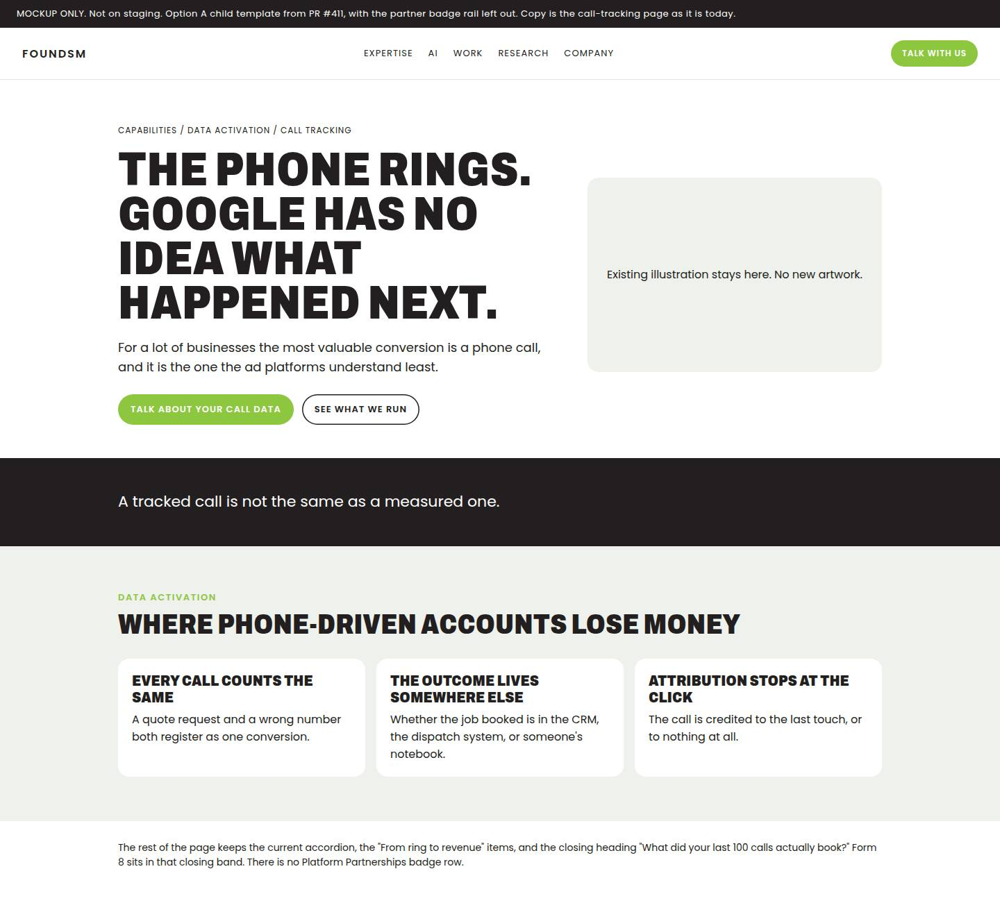

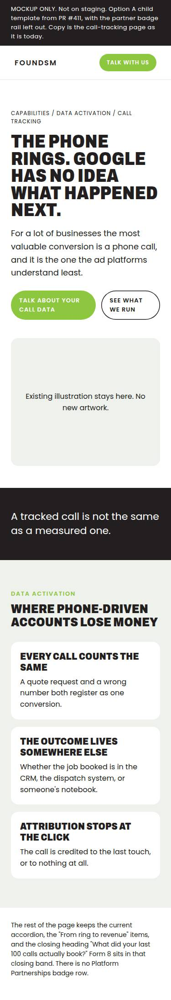

Source: `docs/proposals/mockups/capability-child-option-a.html`.

## Route check

Every in-scope URL below returned HTTP 200 on staging. None of them redirected.

A path that does not exist, `/this-route-should-404-proposal-check/`, returned HTTP 404 and the designed 404 page. That is the 404 proposal, not a broken in-scope route.

These older URLs already redirect and are not pages in this proposal. Leave the redirects alone:

- `/capabilities/data-intelligence/` redirects to `/capabilities/data-analytics/`
- `/capabilities/data-intelligence/server-side-tracking/` and `/capabilities/data-analytics/server-side-tracking/` redirect to `/capabilities/data-activation/server-side-tracking/`
- `/capabilities/data-analytics/privacy-governance/` redirects to `/capabilities/data-activation/privacy-governance/`
- `/whitepapers/` redirects to `/whitepapers/first-party-data/`

Out of scope, and not proposed: `/`, `/capabilities/`, `/ai/`, `/capabilities/paid-media/paid-search/` (open PR #411), the Research mockups (open PR #412), and `/sanity-page-builder-demo/`.

## One-line summary

Say yes, change, or skip on each line. The full proposal follows in the same order.

1. Move About onto the 2026 type system, show all four values at once, replace the em dashes, and add the Talk with us form.
2. Move Team onto the 2026 type system, keep every leader, and add the Talk with us form.
3. Move The Found Loop onto the 2026 type system, keep the eight advantages and five partner blocks as full sections, and add the form.
4. Restyle Life at Found with the 2026 type system, keep every benefit, tradition, and photo, and add the Talk with us form.
5. Keep ActiveCampaign form 4, make the dark-panel labels white, and replace the one em dash.
6. Keep form 8 and the current heading. Restyle the page so the form matches the homepage without copying the homepage intro.
7. Restyle Results with the 2026 type system. Keep the IBJ #4 line exactly. Propose a 2025 and 2026 Microsoft line for approval. Add the form.
8. Restyle the industry hub with the 2026 type system and add the Talk with us form. Keep the three industry cards.
9. Restyle Home services with the 2026 type system. Keep the 46% HVAC line, the logos, and the proof block.
10. Restyle Higher education with the 2026 type system. Keep the tabs, logos, and every card.
11. Restyle Healthcare and pharma with the 2026 type system. Keep the logos and the accordion.
12. Move the paid media practice page onto the 2026 type system, show every tab panel, and keep the badge row.
13. Move the data and analytics practice page onto the 2026 type system and show every panel. The URL stays /capabilities/data-analytics/.
14. Move the data activation practice page onto the 2026 type system and show every panel.
15. Move the performance creative practice page onto the 2026 type system and show every panel.
16. Propose Paid social on the Option A child template from open PR #411, without the partner badge rail.
17. Propose Programmatic on the Option A child template from open PR #411, without the partner badge rail.
18. Propose Competitive intelligence on the Option A child template from open PR #411, without the partner badge rail.
19. Propose Ad account migration on the Option A child template from open PR #411, without the partner badge rail.
20. Propose AI and automation on the Option A child template from open PR #411, without the partner badge rail.
21. Propose Call tracking on the Option A child template from open PR #411, without the partner badge rail.
22. Propose First-party data on the Option A child template from open PR #411, without the partner badge rail. Feature tabs have to stay.
23. Propose Privacy, security and governance on the Option A child template from open PR #411, without the partner badge rail.
24. Propose Server-side tracking on the Option A child template from open PR #411, without the partner badge rail.
25. Propose Attribution on the Option A child template from open PR #411, without the partner badge rail.
26. Propose Audience modeling on the Option A child template from open PR #411, without the partner badge rail.
27. Propose Discovery, audit and analysis on the Option A child template from open PR #411, without the partner badge rail.
28. Propose Customized reporting on the Option A child template from open PR #411, without the partner badge rail.
29. Propose Ad creative on the Option A child template from open PR #411, without the partner badge rail.
30. Propose CRO on the Option A child template from open PR #411, without the partner badge rail.
31. Propose Landing page design on the Option A child template from open PR #411, without the partner badge rail.
32. Apply the 2026 type system only. Leave the magazine redesign to open PR #412. Keep every post link.
33. Restyle Events with the 2026 type system and keep every event card.
34. Keep ActiveCampaign form 6 and every section. Apply the 2026 type system around the paper.
35. Restyle Tools with the 2026 type system. Keep the 46% calculator line and both closing sections.
36. Restyle the build library with the 2026 type system and keep every build card.
37. Keep the quiz embed and frame the page in the 2026 type system.
38. Layout and type only. Do not change any legal sentence.
39. Restyle the thank-you page. Keep the confirmation and the latest-insights module.
40. Restyle the safelist page, keep every email-client step, and replace the em dash.
41. Restyle DataConnect and keep its current ActiveCampaign form.
42. Restyle the author directory. Keep every contributor link and the latest-posts row.
43. One template for every author page. Julie is the sample. Her $215M line becomes the homepage's $210M. Found stays Found.
44. Shared legacy template, this listing: 2026 type, keep every webinar link.
45. Shared legacy template. Keep this page's webinar copy and links.
46. Shared legacy template. Keep the tools and guides listing, and replace its em dash.
47. Shared legacy template. Keep the white paper listing.
48. Shared legacy template. Keep the on-demand webinar copy and video.
49. Shared legacy template. Keep this on-demand webinar.
50. Shared legacy template. Keep this resource page.
51. Shared legacy template. Keep the cookies webinar.
52. Restyle this campaign page with the 2026 type system. Keep every section. Do not publish it to production.
53. Restyle this campaign page with the 2026 type system. Keep every section.
54. Restyle this campaign page with the 2026 type system. Keep every section.
55. Restyle the meetup page with the 2026 type system. Keep the agenda and the form block that is already there.
56. Restyle this draft campaign page with the 2026 type system. It is a local JSON page, not a Sanity document.
57. Restyle the 404 page with the 2026 type system. Keep the heading, the explanation, and every link.
58. One template proposal for every post. Article bodies stay. Em dashes become commas. The award post is the sample.

## Shared design

The 2026 type system is `src/styles/site-2026.css`, already used by `/capabilities/` and `/ai/`. The homepage sets the same Archivo headings in `src/components/home/HomepageV2.astro`.

- Headings: Archivo Black, width 82%, uppercase.
- Body: Poppins, already the site body font.
- Paper `#eef1ec`, ink `#231f20`, green `#8dc63f`.
- Text on a black or dark band is white. Green eyebrows can stay.
- Buttons are caps.
- No em dashes in copy we are allowed to edit. Legal text is not edited.
- Found and FoundSM both stay. Nothing is renamed from one to the other.
- Forms that already exist keep their ActiveCampaign id. Contact-intent pages that only link to `/contact-us/` gain form 8, which is the homepage Talk with us form and the contact page form (`src/lib/homeV2Content.ts`). No new form id and no list change.
- Robots, canonicals, redirects, and the sitemap stay as they are.

## Decisions from Megan, November 17, 2026

- Media spend is $210M. The live homepage says "Paid Media Spend $210M Managed in 2025". Julie's author bio is the only place that says more than $215M. That phrase is a fact correction to $210M. Before and After are on her page.
- IBJ: keep "#4" and "three years running" exactly as they are on Results. Do not remove the rank.
- Results keeps the 2025 Microsoft finalist line because it is accurate. A multi-year line is proposed for approval: 2025 Performance Partner of the Year, plus the two 2026 categories from the September 8, 2026 post (Data Integration Excellence Award and Search Performance Partner of the Year). It is not final until Megan says so.
- Found and FoundSM are both fine. No rename sweep, including the two blog titles and Julie's bio.
- Lunch and learn (`/events/lunch-and-learn/`) is excluded. No proposal. The page stays as it is, `noindex, nofollow`, and it is not linked from the header, footer, Events cards, or the published sitemap.

## Excluded by Megan

`/events/lunch-and-learn/` is out of this review. Megan said to ignore it on November 17, 2026. Do not restyle it. Do not change its copy. Leave `robots` as `noindex, nofollow`.

The published staging sitemap does not list it, because noindex pages are filtered out. The generator in `src/pages/sitemap.xml.ts` still names the route (the static route list, and `addRoute`). Phase 2, if you want that registration gone: remove those two entries only. Do not delete the page.

No header link, footer link, or Events card points at it. `vercel.json` still redirects `/lunch-and-learn` and `/events/lunch-and-learn` (no slash) to `/events/lunch-and-learn/`. Those redirects were not changed.

## Layout rhythm

Megan's note on the first mockups: every section looked the same. The after mockups now change layout from section to section, and each template has its own sequence. Two sections with the same layout are not placed next to each other.

One gray only: `#f2f3f2` (`--s26-section-gray`). That is the muted field the topography and contour already sit on. Paper `#eef1ec`, `#e6e6e3`, and `#eef0ed` are not used as section fills, so two grays never sit together. Sections alternate gray, then light green `#e7f4d4` with the street map, then gray. The hero starts on gray. The form is the only dark band, and its text is white. Bright green (`#8dc63f`) is only a rule, a number, or a small highlight. On About, the founding story sits beside its photo.

Gray sections use the designs already on the site, not new patterns:

- Topography, `/images/pages/our-approach/topography-light.svg`, from `.card-grid-section--muted` (`src/components/modern/CardGrid.astro`), `.proof-mosaic--muted` (`src/components/blocks/ProofMosaicBlock.astro`), `.lp-accordion--pattern` (`src/components/blocks/AccordionBlock.astro`), and `.approach-intro::before` (`src/pages/our-approach.astro`). This is the default on light gray mockup sections.
- Paid media topography, `/images/pages/paid-media/topography-light.svg`, from `.paid-media-tabs__inner` (`src/pages/capabilities/paid-media.astro`) and `.feature-tabs--pattern .feature-tabs__inner` (`src/components/modern/FeatureTabs.astro`). Used on Paid Media and Performance Creative gray sections.
- Contour, `/images/pages/data-activation/contour-2.png`, from `.da-actions` (`src/components/DataActivationPage.astro`). Used on Data Activation gray sections.
- Street map, `/images/pages/our-approach/streets-light.svg`, from `.approach-advantages::before` on the gray advantages field and from `.green-band::before` (`src/styles/global.css`). Proposed on the light green sections too, at low opacity, because that is already how the green band is textured.
- The form's dark band uses `/images/pages/our-approach/contact-bg-fc.svg` from `.dark-band` (`src/styles/global.css`). That is the one dark section, not a gray one.

The homepage paper sections (`home2-section--paper` in `src/styles/homepage-v2.css`) and the Paid Search child panels (`background: var(--h2-paper)` in the PR #411 stylesheet) are flat color, with no extra artwork.

- Company and main pages: editorial or split hero, light green band, zigzag rows, numbered steps, pull quote, light gray band, open FAQ rows, and one dark form 8 band. Our Approach adds the homepage Found Loop (Connect, Model, Activate, Measure) from `src/lib/homeV2Content.ts` and keeps the eight advantages.
- Capabilities practice pages: rule hero, light green band, numbered steps, zigzag rows, light gray band, open FAQ rows, pull quote, form 8 band. Partner images stay. Panels are not hidden.
- Capabilities child template: breadcrumb hero, light gray band, open FAQ rows, numbered steps, pull quote, light green band, related text links, form 8 band. No partner badge rail, no 46% block, no brand logos.
- Results: editorial hero, stat row (`$210M`, `1M+`, `20`, `#4`) on light gray, zigzag, pull quote, light green band, form 8 band. The IBJ #4 line stays. The multi-year Microsoft line is still a proposal.
- Legacy insights: masthead, pull quote, prose, link list. No dark fill.
- Author pages: profile, prose, pull quote, link list. Julie's `$215M` line is the `$210M` fact correction. Found stays Found.
- Blog posts: article header, pull quote, prose. Titles are not renamed.
- Campaign landing pages: offer hero, light green band, numbered steps, zigzag, light gray band, FAQ rows, form 8 band.

## Still open

- The proposed Results Microsoft line above is waiting on approval.
- I did not find "leading agency in applied AI" on these pages, and I did not add it.
- The 46% ROAS line stays where it already is (Results, Home services, Tools). Child pages do not gain one.
- PR #411 is still open. Child pages are written against that template and leave out the partner badge rail. Paid search stays on #411.
- `contactPage`, `newsletterPage`, `privacyPolicyPage`, `eventLandingPage`, and `notFoundPage` are not in the staging dataset. Those pages render from code defaults.

## Shared header and footer

Kept as is on every page in this proposal. Page inventories below are the content inside `<main>`.

Header (`src/components/Header.astro`):

1. FoundSM home (logo link to `/`)
2. Expertise (`/capabilities/`), with Paid Media, Paid Search, Paid Social, Programmatic & Display, Competitive Intelligence, Data Activation, Server-Side Tracking, Call Tracking & Call-to-Revenue, First-Party Data & CRM Integration, Privacy, Security & Governance, Data & Analytics, Discovery, Audit & Analysis, Attribution & Measurement, Audience Modeling, Customized Reporting, Performance Creative, Landing Page Design, CRO & Conversion Optimization, Ad Creative & Motion Graphics, The Found Loop, Ad Account Migration, Custom Builds
3. AI (`/ai/`), with AI at FoundSM, AI Systems, AI in Paid Media, See the builds
4. Work (`/results/`), with Results, By Industry, Home Services, Healthcare & Pharma, Higher Education, Partner Benefits
5. Research (`/insights/`), with Insights, Events, Whitepapers, Tools & Custom Builds, The Found Build Library, Server-Side ROAS Calculator (`https://sst-roas.foundsm.com/`), Signal Quality Assessment
6. Company (`/about-us/`), with About, Team, Newsletter, Explore working at Found
7. Talk with us (`/contact-us/`)

Footer (`src/components/Footer.astro`):

1. FoundSM wordmark, 8475 Nightfall Lane, Suite 200, Fishers, IN 46037, info@foundsm.com, 1.317.721.2229
2. Expertise: The Found Loop, The Found Deployment, Practices
3. AI: AI at FoundSM, AI systems, AI in paid media, Build library
4. Work: Results, Case stories, By industry
5. Research: The Found Brief, Found Signals, Insights, Events
6. Company: About, Team, Life at Found, Career opportunities
7. Privacy Policy, Cookie Settings, copyright line

Results in the header is described as "Twenty years, $210M in media, and the numbers behind the work." That $210M string stays. It matches the live homepage.

## 1. About

**Approve?** Move About onto the 2026 type system, show all four values at once, replace the em dashes, and add the Talk with us form.

- Staging URL: https://staging.foundsm.com/about-us/
- Source: `src/pages/about-us.astro`
- Sanity document: `aboutPage`
- Robots, kept as is: `index, follow, max-image-preview:large, max-snippet:-1, max-video-preview:-1`
- Canonical, kept as is: `https://foundsm.com/about-us/`
- Current heading font: Fraunces, Georgia, serif

### Current state

Full page on staging, November 17, 2026. Scroll-in sections are shown open so the picture matches what a visitor sees after scrolling.

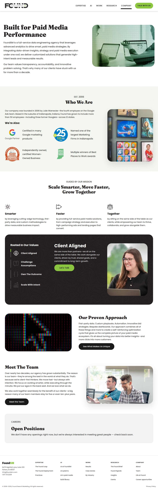

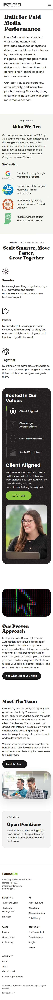

### Proposed changes

**Layout and design.** Headings move from Fraunces to the 2026 type system in `src/styles/site-2026.css`: Archivo Black, 82% width, uppercase, ink `#231f20` on paper `#eef1ec`. Body stays Poppins. Eyebrows are green `#8dc63f`. Buttons are caps. The header and footer keep their own type. Dark-band body text is white. Sections that are only a heading over a large empty area get pulled up so the copy sits with the heading. This is scoped to this page. It does not restyle the homepage, `/capabilities/`, `/ai/`, or the paid search page on PR #411.

Buttons that swap content: Client Aligned; Challenge Assumptions; Own The Outcome; Scale With Intent. Show each panel in the section instead of hiding it.

Add the homepage Talk with us form (ActiveCampaign form 8, `homeV2Forms.contact` in `src/lib/homeV2Content.ts`, the same form already on /contact-us/). Put it in the existing closing section. The intro is this page's closing paragraph, not the homepage intro. The button label is 'Let's Talk', not 'Start the conversation'. Keep the existing contact link as well.

Heading order stays: Built for Paid Media Performance | Who We Are | We're Also: | Scale Smarter, Move Faster, Grow Together | Smarter | Faster | Together | Rooted In Our Values | Client Aligned | Challenge Assumptions | Own The Outcome | Scale With Intent | (more headings are in the inventory)

**Copy to optimize.**

Rewrites below are punctuation, or the two fact edits Megan decided or asked to see. Found is not changed to FoundSM. Both names stay.

- kept, reworded (em dash replaced with a comma)
  - Before: Our company was founded in 2006 by Julie Warnecke—the fourth employee on the Google Ads team. Based in the suburbs of Indianapolis, Indiana, Found has grown to include more than 50 employees—including three former Googlers—across 12 states.
  - After: Our company was founded in 2006 by Julie Warnecke, the fourth employee on the Google Ads team. Based in the suburbs of Indianapolis, Indiana, Found has grown to include more than 50 employees, including three former Googlers, across 12 states.
- kept, reworded (em dash replaced with a comma)
  - Before: We are more than partners—we sit on the same side of the table. We work alongside our clients, driven by trust, shared goals, and a commitment to long-term growth.
  - After: We are more than partners, we sit on the same side of the table. We work alongside our clients, driven by trust, shared goals, and a commitment to long-term growth.
- kept, reworded (em dash replaced with a comma)
  - Before: We encourage our team, agency, and clients to question the status quo. Innovation starts with curiosity—and better outcomes come from testing, learning, and evolving together.
  - After: We encourage our team, agency, and clients to question the status quo. Innovation starts with curiosity, and better outcomes come from testing, learning, and evolving together.
- kept, reworded (em dash replaced with a comma)
  - Before: We focus on what works, measure what matters, and are committed to quality and doing things the right way for our clients—always for the growth of our team and agency.
  - After: We focus on what works, measure what matters, and are committed to quality and doing things the right way for our clients, always for the growth of our team and agency.
- kept, reworded (em dash replaced with a comma)
  - Before: Smart growth is shared growth. Our strategies are built to drive measurable, sustainable impact—for our clients, for our agency, and for the people who make it happen.
  - After: Smart growth is shared growth. Our strategies are built to drive measurable, sustainable impact, for our clients, for our agency, and for the people who make it happen.
- kept, reworded (em dash replaced with a comma)
  - Before: First-party data. Custom playbooks. Automation. Innovative bid strategies. Bespoke dashboards. Our approach combines all of these things and more to create a self-reinforcing optimization cycle that gives us the complete picture of your paid media ecosystem. It's all about turning your data into better insights—and more clicks into more customers.
  - After: First-party data. Custom playbooks. Automation. Innovative bid strategies. Bespoke dashboards. Our approach combines all of these things and more to create a self-reinforcing optimization cycle that gives us the complete picture of your paid media ecosystem. It's all about turning your data into better insights, and more clicks into more customers.
- kept, reworded (em dash replaced with a comma)
  - Before: Over nearly two decades, our agency has grown substantially. The reason is our team—they're among the best in the world at what they do. That's because we're client-first thinkers. We move fast—but always with intention. We focus on working smarter, while executing through the minutia. We put our egos in the back seat. And we love what we do.
  - After: Over nearly two decades, our agency has grown substantially. The reason is our team, they're among the best in the world at what they do. That's because we're client-first thinkers. We move fast, but always with intention. We focus on working smarter, while executing through the minutia. We put our egos in the back seat. And we love what we do.
- kept, reworded (em dash replaced with a comma)
  - Before: We also work together seamlessly for the benefit of our clients—a big reason many of our team members stay for five or even ten-plus years.
  - After: We also work together seamlessly for the benefit of our clients, a big reason many of our team members stay for five or even ten-plus years.
- kept, reworded (em dash replaced with a comma)
  - Before: We don't have any openings right now, but we're always interested in meeting great people — check back soon.
  - After: We don't have any openings right now, but we're always interested in meeting great people, check back soon.

**Content to add.**

The Talk with us form (ActiveCampaign form 8) is added in the closing section. Its words are the closing heading and paragraph already on this page. No new metric, logo, quote, or client name.

### Content inventory

Everything in `<main>` on staging today. The shared header and footer are inventoried once at the top of this file and stay on this page.
1. Section 1: Built for Paid Media Performance
2. Section 2: Who We Are
3. Section 3: Scale Smarter, Move Faster, Grow Together
4. Section 4: Rooted In Our Values
5. Section 5: Our Proven Approach
6. Section 6: Meet The Team
7. Section 7: Open Positions
8. H1: Built for Paid Media Performance
9. H2: Who We Are
10. H3: We're Also:
11. H2: Scale Smarter, Move Faster, Grow Together
12. H3: Smarter
13. H3: Faster
14. H3: Together
15. H2: Rooted In Our Values
16. H3: Client Aligned
17. H3: Challenge Assumptions
18. H3: Own The Outcome
19. H3: Scale With Intent
20. H2: Our Proven Approach
21. H2: Meet The Team
22. H2: Open Positions
23. FoundSM is a full-service data engineering agency that leverages advanced analytics to drive smart, paid media strategies. By integrating data-driven insights, strategy and paid media execution under one roof, we deliver customized solutions that generate high-intent leads and measurable results.
24. Our team values transparency, accountability, and innovative problem solving. That's why many of our clients have stuck with us for more than a decade.
25. EST. 2006
26. Our company was founded in 2006 by Julie Warnecke—the fourth employee on the Google Ads team. Based in the suburbs of Indianapolis, Indiana, Found has grown to include more than 50 employees—including three former Googlers—across 12 states.
27. Certified in many Google marketing products
28. Named one of the largest Marketing Firms in Indianapolis
29. Independently owned, certified Women-Owned Business
30. Multiple winners of Best Places to Work awards
31. GUIDED BY OUR MISSION
32. by leveraging cutting-edge technology, first-party data, and custom methodologies to drive measurable business impact.
33. by providing full-service paid media solutions, from campaign strategy and execution to high-performing ads and landing pages that convert.
34. by sitting on the same side of the table as our clients, while empowering our team to thrive, collaborate, and grow alongside them.
35. We are more than partners—we sit on the same side of the table. We work alongside our clients, driven by trust, shared goals, and a commitment to long-term growth.
36. We encourage our team, agency, and clients to question the status quo. Innovation starts with curiosity—and better outcomes come from testing, learning, and evolving together.
37. We focus on what works, measure what matters, and are committed to quality and doing things the right way for our clients—always for the growth of our team and agency.
38. Smart growth is shared growth. Our strategies are built to drive measurable, sustainable impact—for our clients, for our agency, and for the people who make it happen.
39. First-party data. Custom playbooks. Automation. Innovative bid strategies. Bespoke dashboards. Our approach combines all of these things and more to create a self-reinforcing optimization cycle that gives us the complete picture of your paid media ecosystem. It's all about turning your data into better insights—and more clicks into more customers.
40. Over nearly two decades, our agency has grown substantially. The reason is our team—they're among the best in the world at what they do. That's because we're client-first thinkers. We move fast—but always with intention. We focus on working smarter, while executing through the minutia. We put our egos in the back seat. And we love what we do.
41. We also work together seamlessly for the benefit of our clients—a big reason many of our team members stay for five or even ten-plus years.
42. CAREERS
43. We don't have any openings right now, but we're always interested in meeting great people — check back soon.
44. Let's Talk (/contact-us/)
45. See What Makes Us Unique (/our-approach/)
46. Meet the Team (/team/)
47. Client Aligned
48. Challenge Assumptions
49. Own The Outcome
50. Scale With Intent
51. Image alt 'Built for Paid Media Performance', file 70a7d7d7765b7837f9a0d644588115aa50768eb5-682x660.webp
52. Image alt 'Google Partner badge', file 185529a03474dc5702a2b39b241ebdbd6c15b4da-190x190.png
53. Image alt 'Indianapolis Business Journal Top 25 List 2026 badge', file 41a48ac4bc916dcc2237a962f371a44bff62c369-380x364.png
54. Image alt 'Women-Owned Business Enterprise badge', file 1ab46d52c319a8faac30a868b3fbea1050cf3bb6-500x500.svg
55. Image alt 'Indiana badge', file d9969b59453533c6935a200f5dbee5a8d73b1d4c-95x95.png
56. Image alt 'Found Search Marketing team members collaborating', file fc6c26c28f9f1304acb93506ae832f3a59c0aca1-652x1266.webp
57. Image alt 'Smarter icon', file icon-smarter.svg
58. Image alt 'Faster icon', file icon-faster.svg
59. Image alt 'Together icon', file icon-together.svg
60. Image alt 'Client Aligned icon', file icon-about-tab1.svg
61. Image alt 'Challenge Assumptions icon', file icon-about-tab2.svg
62. Image alt 'Own The Outcome icon', file icon-about-tab3.svg
63. Image alt 'Scale With Intent icon', file icon-about-tab4.svg
64. Image alt 'Client Aligned', file de4e3bf8613cb370f33b7a7b7fd6ea875a69fed6-368x474.webp
65. Image alt 'Challenge Assumptions', file bbdefdbaeca37b92522f020a40a2dd5e35f87e5c-368x474.webp
66. Image alt 'Own The Outcome', file 81958049bf2eb90acdbc6a63ecc1aae0bff425b1-368x474.webp
67. Image alt 'Scale With Intent', file dc72b26b2177db4d7e8214eda31e2cc29be2c57b-368x474.webp
68. Image alt 'Found Search Marketing planning process', file 8e68ec2eccec4559228ffd356c8b9ce7af9793e4-604x604.webp
69. Image alt 'FoundSM team members meeting at the office', file 3886dde4c97104d35e94efb962d3622d1fb1bb86-648x836.jpg

### Content check

1. kept as is: Section 1: Built for Paid Media Performance
2. kept as is: Section 2: Who We Are
3. kept as is: Section 3: Scale Smarter, Move Faster, Grow Together
4. kept as is: Section 4: Rooted In Our Values
5. kept as is: Section 5: Our Proven Approach
6. kept as is: Section 6: Meet The Team
7. kept as is: Section 7: Open Positions
8. kept as is: H1: Built for Paid Media Performance
9. kept as is: H2: Who We Are
10. kept as is: H3: We're Also:
11. kept as is: H2: Scale Smarter, Move Faster, Grow Together
12. kept as is: H3: Smarter
13. kept as is: H3: Faster
14. kept as is: H3: Together
15. kept as is: H2: Rooted In Our Values
16. kept, moved: shown in the Rooted In Our Values grid instead of a hidden tab: H3: Client Aligned
17. kept, moved: shown in the Rooted In Our Values grid instead of a hidden tab: H3: Challenge Assumptions
18. kept, moved: shown in the Rooted In Our Values grid instead of a hidden tab: H3: Own The Outcome
19. kept, moved: shown in the Rooted In Our Values grid instead of a hidden tab: H3: Scale With Intent
20. kept as is: H2: Our Proven Approach
21. kept as is: H2: Meet The Team
22. kept as is: H2: Open Positions
23. kept as is: FoundSM is a full-service data engineering agency that leverages advanced analytics to drive smart, paid media strategies. By integrating data-driven insights, strategy and paid media execution under one roof, we deliver customized solutions that generate high-intent leads and measurable results.
24. kept as is: Our team values transparency, accountability, and innovative problem solving. That's why many of our clients have stuck with us for more than a decade.
25. kept as is: EST. 2006
26. kept, reworded (em dash replaced with a comma)
    - Before: Our company was founded in 2006 by Julie Warnecke—the fourth employee on the Google Ads team. Based in the suburbs of Indianapolis, Indiana, Found has grown to include more than 50 employees—including three former Googlers—across 12 states.
    - After: Our company was founded in 2006 by Julie Warnecke, the fourth employee on the Google Ads team. Based in the suburbs of Indianapolis, Indiana, Found has grown to include more than 50 employees, including three former Googlers, across 12 states.
27. kept as is: Certified in many Google marketing products
28. kept as is: Named one of the largest Marketing Firms in Indianapolis
29. kept as is: Independently owned, certified Women-Owned Business
30. kept as is: Multiple winners of Best Places to Work awards
31. kept as is: GUIDED BY OUR MISSION
32. kept as is: by leveraging cutting-edge technology, first-party data, and custom methodologies to drive measurable business impact.
33. kept as is: by providing full-service paid media solutions, from campaign strategy and execution to high-performing ads and landing pages that convert.
34. kept as is: by sitting on the same side of the table as our clients, while empowering our team to thrive, collaborate, and grow alongside them.
35. kept, moved: shown in the Rooted In Our Values grid instead of a hidden tab: We are more than partners—we sit on the same side of the table. We work alongside our clients, driven by trust, shared goals, and a commitment to long-term growth.
36. kept, moved: shown in the Rooted In Our Values grid instead of a hidden tab: We encourage our team, agency, and clients to question the status quo. Innovation starts with curiosity—and better outcomes come from testing, learning, and evolving together.
37. kept, moved: shown in the Rooted In Our Values grid instead of a hidden tab: We focus on what works, measure what matters, and are committed to quality and doing things the right way for our clients—always for the growth of our team and agency.
38. kept, moved: shown in the Rooted In Our Values grid instead of a hidden tab: Smart growth is shared growth. Our strategies are built to drive measurable, sustainable impact—for our clients, for our agency, and for the people who make it happen.
39. kept, reworded (em dash replaced with a comma)
    - Before: First-party data. Custom playbooks. Automation. Innovative bid strategies. Bespoke dashboards. Our approach combines all of these things and more to create a self-reinforcing optimization cycle that gives us the complete picture of your paid media ecosystem. It's all about turning your data into better insights—and more clicks into more customers.
    - After: First-party data. Custom playbooks. Automation. Innovative bid strategies. Bespoke dashboards. Our approach combines all of these things and more to create a self-reinforcing optimization cycle that gives us the complete picture of your paid media ecosystem. It's all about turning your data into better insights, and more clicks into more customers.
40. kept, reworded (em dash replaced with a comma)
    - Before: Over nearly two decades, our agency has grown substantially. The reason is our team—they're among the best in the world at what they do. That's because we're client-first thinkers. We move fast—but always with intention. We focus on working smarter, while executing through the minutia. We put our egos in the back seat. And we love what we do.
    - After: Over nearly two decades, our agency has grown substantially. The reason is our team, they're among the best in the world at what they do. That's because we're client-first thinkers. We move fast, but always with intention. We focus on working smarter, while executing through the minutia. We put our egos in the back seat. And we love what we do.
41. kept, reworded (em dash replaced with a comma)
    - Before: We also work together seamlessly for the benefit of our clients—a big reason many of our team members stay for five or even ten-plus years.
    - After: We also work together seamlessly for the benefit of our clients, a big reason many of our team members stay for five or even ten-plus years.
42. kept as is: CAREERS
43. kept, reworded (em dash replaced with a comma)
    - Before: We don't have any openings right now, but we're always interested in meeting great people — check back soon.
    - After: We don't have any openings right now, but we're always interested in meeting great people, check back soon.
44. kept as is: Let's Talk (/contact-us/)
45. kept as is: See What Makes Us Unique (/our-approach/)
46. kept as is: Meet the Team (/team/)
47. kept, moved: shown in the Rooted In Our Values grid instead of a hidden tab: Client Aligned
48. kept, moved: shown in the Rooted In Our Values grid instead of a hidden tab: Challenge Assumptions
49. kept, moved: shown in the Rooted In Our Values grid instead of a hidden tab: Own The Outcome
50. kept, moved: shown in the Rooted In Our Values grid instead of a hidden tab: Scale With Intent
51. kept as is: Image alt 'Built for Paid Media Performance', file 70a7d7d7765b7837f9a0d644588115aa50768eb5-682x660.webp
52. kept as is: Image alt 'Google Partner badge', file 185529a03474dc5702a2b39b241ebdbd6c15b4da-190x190.png
53. kept as is: Image alt 'Indianapolis Business Journal Top 25 List 2026 badge', file 41a48ac4bc916dcc2237a962f371a44bff62c369-380x364.png
54. kept as is: Image alt 'Women-Owned Business Enterprise badge', file 1ab46d52c319a8faac30a868b3fbea1050cf3bb6-500x500.svg
55. kept as is: Image alt 'Indiana badge', file d9969b59453533c6935a200f5dbee5a8d73b1d4c-95x95.png
56. kept as is: Image alt 'Found Search Marketing team members collaborating', file fc6c26c28f9f1304acb93506ae832f3a59c0aca1-652x1266.webp
57. kept as is: Image alt 'Smarter icon', file icon-smarter.svg
58. kept as is: Image alt 'Faster icon', file icon-faster.svg
59. kept as is: Image alt 'Together icon', file icon-together.svg
60. kept, moved: shown in the Rooted In Our Values grid instead of a hidden tab: Image alt 'Client Aligned icon', file icon-about-tab1.svg
61. kept, moved: shown in the Rooted In Our Values grid instead of a hidden tab: Image alt 'Challenge Assumptions icon', file icon-about-tab2.svg
62. kept, moved: shown in the Rooted In Our Values grid instead of a hidden tab: Image alt 'Own The Outcome icon', file icon-about-tab3.svg
63. kept, moved: shown in the Rooted In Our Values grid instead of a hidden tab: Image alt 'Scale With Intent icon', file icon-about-tab4.svg
64. kept, moved: shown in the Rooted In Our Values grid instead of a hidden tab: Image alt 'Client Aligned', file de4e3bf8613cb370f33b7a7b7fd6ea875a69fed6-368x474.webp
65. kept, moved: shown in the Rooted In Our Values grid instead of a hidden tab: Image alt 'Challenge Assumptions', file bbdefdbaeca37b92522f020a40a2dd5e35f87e5c-368x474.webp
66. kept, moved: shown in the Rooted In Our Values grid instead of a hidden tab: Image alt 'Own The Outcome', file 81958049bf2eb90acdbc6a63ecc1aae0bff425b1-368x474.webp
67. kept, moved: shown in the Rooted In Our Values grid instead of a hidden tab: Image alt 'Scale With Intent', file dc72b26b2177db4d7e8214eda31e2cc29be2c57b-368x474.webp
68. kept as is: Image alt 'Found Search Marketing planning process', file 8e68ec2eccec4559228ffd356c8b9ce7af9793e4-604x604.webp
69. kept as is: Image alt 'FoundSM team members meeting at the office', file 3886dde4c97104d35e94efb962d3622d1fb1bb86-648x836.jpg

### Open questions

- None for this page. Shared questions are at the top of the file.

### Effort

medium

## 2. Team

**Approve?** Move Team onto the 2026 type system, keep every leader, and add the Talk with us form.

- Staging URL: https://staging.foundsm.com/team/
- Source: `src/pages/team.astro, src/lib/sanity.ts allTeamMembersQuery`
- Sanity document: `teamPage plus teamMember docs`
- Robots, kept as is: `index, follow, max-image-preview:large, max-snippet:-1, max-video-preview:-1`
- Canonical, kept as is: `https://foundsm.com/team/`
- Current heading font: Fraunces, Georgia, serif

### Current state

Full page on staging, November 17, 2026. Scroll-in sections are shown open so the picture matches what a visitor sees after scrolling.

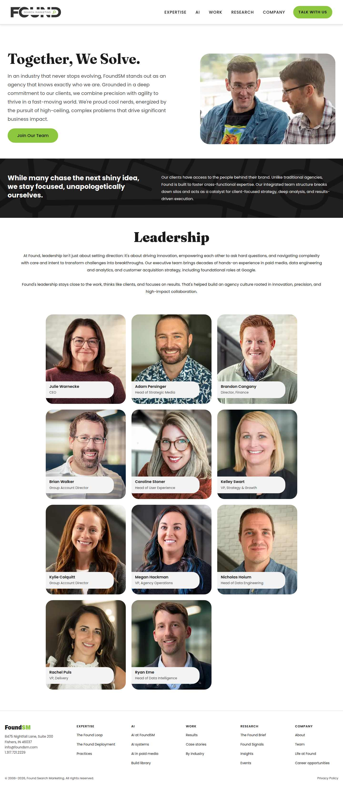

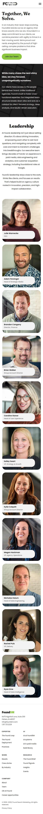

### Proposed changes

**Layout and design.** Headings move from Fraunces to the 2026 type system in `src/styles/site-2026.css`: Archivo Black, 82% width, uppercase, ink `#231f20` on paper `#eef1ec`. Body stays Poppins. Eyebrows are green `#8dc63f`. Buttons are caps. The header and footer keep their own type. Dark-band body text is white. Sections that are only a heading over a large empty area get pulled up so the copy sits with the heading. This is scoped to this page. It does not restyle the homepage, `/capabilities/`, `/ai/`, or the paid search page on PR #411.

Add the homepage Talk with us form (ActiveCampaign form 8, `homeV2Forms.contact` in `src/lib/homeV2Content.ts`, the same form already on /contact-us/). Put it in the existing closing section. The intro is this page's closing paragraph, not the homepage intro. The button label is 'the existing closing button', not 'Start the conversation'. Keep the existing contact link as well.

Heading order stays: Together, We Solve. | Leadership | Julie Warnecke | Adam Persinger | Brandon Cangany | Brian Walker | Caroline Stoner | Kelley Swart | Kylie Colquitt | Megan Hackman | Nicholas Hoium | Rachel Puls | (more headings are in the inventory)

**Copy to optimize.**

None. The wording on the page already matches the facts I could verify. Sections move or restyle only.

**Content to add.**

The Talk with us form (ActiveCampaign form 8) is added in the closing section. Its words are the closing heading and paragraph already on this page. No new metric, logo, quote, or client name.

### Content inventory

Everything in `<main>` on staging today. The shared header and footer are inventoried once at the top of this file and stay on this page.
1. Section 1: Together, We Solve.
2. Section 2: Statement band (copy is in the paragraphs below)
3. Section 3: Leadership
4. H1: Together, We Solve.
5. H2: Leadership
6. H3: Julie Warnecke
7. H3: Adam Persinger
8. H3: Brandon Cangany
9. H3: Brian Walker
10. H3: Caroline Stoner
11. H3: Kelley Swart
12. H3: Kylie Colquitt
13. H3: Megan Hackman
14. H3: Nicholas Hoium
15. H3: Rachel Puls
16. H3: Ryan Eme
17. In an industry that never stops evolving, FoundSM stands out as an agency that knows exactly who we are. Grounded in a deep commitment to our clients, we combine precision with agility to thrive in a fast-moving world. We're proud cool nerds, energized by the pursuit of high-ceiling, complex problems that drive significant business impact.
18. While many chase the next shiny idea, we stay focused, unapologetically ourselves.
19. Our clients have access to the people behind their brand. Unlike traditional agencies, Found is built to foster cross-functional expertise. Our integrated team structure breaks down silos and acts as a catalyst for client-focused strategy, deep analysis, and results-driven execution.
20. At Found, leadership isn't just about setting direction: it's about driving innovation, empowering each other to ask hard questions, and navigating complexity with care and intent to transform challenges into breakthroughs. Our executive team brings decades of hands-on experience in paid media, data engineering and analytics, and customer acquisition strategy, including foundational roles at Google.
21. Found's leadership stays close to the work, thinks like clients, and focuses on results. That's helped build an agency culture rooted in innovation, precision, and high-impact collaboration.
22. CEO
23. Head of Strategic Media
24. Director, Finance
25. Group Account Director
26. Head of User Experience
27. VP, Strategy & Growth
28. Group Account Director
29. VP, Agency Operations
30. Head of Data Engineering
31. VP, Delivery
32. Head of Data Intelligence
33. Join Our Team (/about-us/#careers)
34. Image alt 'FoundSM team members collaborating', file 122f585582b16c71032b01ecadf79dfc96bd23eb-604x658.webp
35. Image alt 'Julie Warnecke, CEO', file 765df875e6b68021831fbdc4d7e0f01a7290697c-450x399.webp
36. Image alt 'Adam Persinger, Head of Strategic Media', file 3fc7b72c007f76df88872814b420a21ba78fcb2e-530x670.webp
37. Image alt 'Brandon Cangany, Director, Finance', file 080ca5bca51c7d52c938d34a57f9bd61968f46c7-450x399.webp
38. Image alt 'Brian Walker, Group Account Director', file f3d76ac77b12ef255e174e3232c388f391d167d1-450x399.webp
39. Image alt 'Caroline Stoner, Head of User Experience', file ecfee349e6efd4e33a963b793a96f4914642d3af-450x399.webp
40. Image alt 'Kelley Swart, VP, Strategy & Growth', file 1f926377bacd5c150484ba785d7ad59e3f519ae5-450x399.webp
41. Image alt 'Kylie Colquitt, Group Account Director', file 2ee13ddcd8fc174c9093ad4136906128a4283807-400x500.webp
42. Image alt 'Megan Hackman, VP, Agency Operations', file 3ea579ed25b2c0358c081f0b2299bc9cad783dad-450x399.webp
43. Image alt 'Nicholas Hoium, Head of Data Engineering', file f4b14d2e2f4bfcc60d01de91f9c2309f515f788a-400x500.webp
44. Image alt 'Rachel Puls, VP, Delivery', file 42442da95731a4f10c46544621e747a14b3cd5a3-600x600.webp
45. Image alt 'Ryan Eme, Head of Data Intelligence', file 3979d65171bd56670f49510cf25833edd5c913d6-1000x667.webp

### Content check

1. kept as is: Section 1: Together, We Solve.
2. kept as is: Section 2: Statement band (copy is in the paragraphs below)
3. kept as is: Section 3: Leadership
4. kept as is: H1: Together, We Solve.
5. kept as is: H2: Leadership
6. kept as is: H3: Julie Warnecke
7. kept as is: H3: Adam Persinger
8. kept as is: H3: Brandon Cangany
9. kept as is: H3: Brian Walker
10. kept as is: H3: Caroline Stoner
11. kept as is: H3: Kelley Swart
12. kept as is: H3: Kylie Colquitt
13. kept as is: H3: Megan Hackman
14. kept as is: H3: Nicholas Hoium
15. kept as is: H3: Rachel Puls
16. kept as is: H3: Ryan Eme
17. kept as is: In an industry that never stops evolving, FoundSM stands out as an agency that knows exactly who we are. Grounded in a deep commitment to our clients, we combine precision with agility to thrive in a fast-moving world. We're proud cool nerds, energized by the pursuit of high-ceiling, complex problems that drive significant business impact.
18. kept as is: While many chase the next shiny idea, we stay focused, unapologetically ourselves.
19. kept as is: Our clients have access to the people behind their brand. Unlike traditional agencies, Found is built to foster cross-functional expertise. Our integrated team structure breaks down silos and acts as a catalyst for client-focused strategy, deep analysis, and results-driven execution.
20. kept as is: At Found, leadership isn't just about setting direction: it's about driving innovation, empowering each other to ask hard questions, and navigating complexity with care and intent to transform challenges into breakthroughs. Our executive team brings decades of hands-on experience in paid media, data engineering and analytics, and customer acquisition strategy, including foundational roles at Google.
21. kept as is: Found's leadership stays close to the work, thinks like clients, and focuses on results. That's helped build an agency culture rooted in innovation, precision, and high-impact collaboration.
22. kept as is: CEO
23. kept as is: Head of Strategic Media
24. kept as is: Director, Finance
25. kept as is: Group Account Director
26. kept as is: Head of User Experience
27. kept as is: VP, Strategy & Growth
28. kept as is: Group Account Director
29. kept as is: VP, Agency Operations
30. kept as is: Head of Data Engineering
31. kept as is: VP, Delivery
32. kept as is: Head of Data Intelligence
33. kept as is: Join Our Team (/about-us/#careers)
34. kept as is: Image alt 'FoundSM team members collaborating', file 122f585582b16c71032b01ecadf79dfc96bd23eb-604x658.webp
35. kept as is: Image alt 'Julie Warnecke, CEO', file 765df875e6b68021831fbdc4d7e0f01a7290697c-450x399.webp
36. kept as is: Image alt 'Adam Persinger, Head of Strategic Media', file 3fc7b72c007f76df88872814b420a21ba78fcb2e-530x670.webp
37. kept as is: Image alt 'Brandon Cangany, Director, Finance', file 080ca5bca51c7d52c938d34a57f9bd61968f46c7-450x399.webp
38. kept as is: Image alt 'Brian Walker, Group Account Director', file f3d76ac77b12ef255e174e3232c388f391d167d1-450x399.webp
39. kept as is: Image alt 'Caroline Stoner, Head of User Experience', file ecfee349e6efd4e33a963b793a96f4914642d3af-450x399.webp
40. kept as is: Image alt 'Kelley Swart, VP, Strategy & Growth', file 1f926377bacd5c150484ba785d7ad59e3f519ae5-450x399.webp
41. kept as is: Image alt 'Kylie Colquitt, Group Account Director', file 2ee13ddcd8fc174c9093ad4136906128a4283807-400x500.webp
42. kept as is: Image alt 'Megan Hackman, VP, Agency Operations', file 3ea579ed25b2c0358c081f0b2299bc9cad783dad-450x399.webp
43. kept as is: Image alt 'Nicholas Hoium, Head of Data Engineering', file f4b14d2e2f4bfcc60d01de91f9c2309f515f788a-400x500.webp
44. kept as is: Image alt 'Rachel Puls, VP, Delivery', file 42442da95731a4f10c46544621e747a14b3cd5a3-600x600.webp
45. kept as is: Image alt 'Ryan Eme, Head of Data Intelligence', file 3979d65171bd56670f49510cf25833edd5c913d6-1000x667.webp

### Open questions

- None for this page. Shared questions are at the top of the file.

### Effort

medium

## 3. Our approach

**Approve?** Move The Found Loop onto the 2026 type system, keep the eight advantages and five partner blocks as full sections, and add the form.

- Staging URL: https://staging.foundsm.com/our-approach/
- Source: `src/pages/our-approach.astro`
- Sanity document: `approachPage`
- Robots, kept as is: `index, follow, max-image-preview:large, max-snippet:-1, max-video-preview:-1`
- Canonical, kept as is: `https://foundsm.com/our-approach/`
- Current heading font: Fraunces, Georgia, serif

### Current state

Full page on staging, November 17, 2026. Scroll-in sections are shown open so the picture matches what a visitor sees after scrolling.

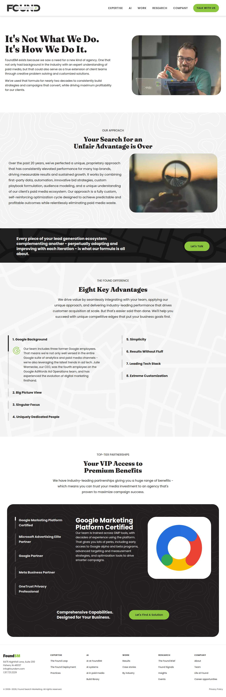

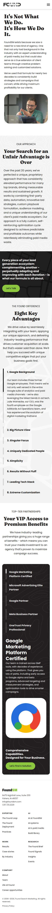

### Proposed changes

**Layout and design.** Headings move from Fraunces to the 2026 type system in `src/styles/site-2026.css`: Archivo Black, 82% width, uppercase, ink `#231f20` on paper `#eef1ec`. Body stays Poppins. Eyebrows are green `#8dc63f`. Buttons are caps. The header and footer keep their own type. Dark-band body text is white. Sections that are only a heading over a large empty area get pulled up so the copy sits with the heading. This is scoped to this page. It does not restyle the homepage, `/capabilities/`, `/ai/`, or the paid search page on PR #411.

Buttons that swap content: 1. Google Background; 2. Big Picture View; 3. Singular Focus; 4. Uniquely Dedicated People; 5. Simplicity; 6. Results Without Fluff; 7. Leading Tech Stack; 8. Extreme Customization. Show each panel in the section instead of hiding it.

Add the homepage Talk with us form (ActiveCampaign form 8, `homeV2Forms.contact` in `src/lib/homeV2Content.ts`, the same form already on /contact-us/). Put it in the existing closing section. The intro is this page's closing paragraph, not the homepage intro. The button label is 'Let's Talk', not 'Start the conversation'. Keep the existing contact link as well.

Heading order stays: It's Not What We Do. It's How We Do It. | Your Search for an Unfair Advantage is Over | Every piece of your lead generation ecosystem complementing another - perpetually adapting and improving with each iteration - is what our formula is all about. | Eight Key Advantages | 1. Google Background | 2. Big Picture View | 3. Singular Focus | 4. Uniquely Dedicated People | 5. Simplicity | 6. Results Without Fluff | 7. Leading Tech Stack | 8. Extreme Customization | (more headings are in the inventory)

**Copy to optimize.**

None. The wording on the page already matches the facts I could verify. Sections move or restyle only.

**Content to add.**

The Talk with us form (ActiveCampaign form 8) is added in the closing section. Its words are the closing heading and paragraph already on this page. No new metric, logo, quote, or client name.

### Content inventory

Everything in `<main>` on staging today. The shared header and footer are inventoried once at the top of this file and stay on this page.
1. Section 1: It's Not What We Do. It's How We Do It.
2. Section 2: Your Search for an Unfair Advantage is Over
3. Section 3: Every piece of your lead generation ecosystem complementing another - perpetually adapting and improving with each iteration - is what our formula is all about.
4. Section 4: Eight Key Advantages
5. Section 5: Your VIP Access to Premium Benefits
6. Section 6: Google Marketing Platform Certified
7. Section 7: Microsoft Advertising Elite Partner
8. Section 8: Google Partner
9. Section 9: Meta Business Partner
10. Section 10: OneTrust Privacy Professional
11. H1: It's Not What We Do. It's How We Do It.
12. H2: Your Search for an Unfair Advantage is Over
13. H2: Every piece of your lead generation ecosystem complementing another - perpetually adapting and improving with each iteration - is what our formula is all about.
14. H2: Eight Key Advantages
15. H3: 1. Google Background
16. H3: 2. Big Picture View
17. H3: 3. Singular Focus
18. H3: 4. Uniquely Dedicated People
19. H3: 5. Simplicity
20. H3: 6. Results Without Fluff
21. H3: 7. Leading Tech Stack
22. H3: 8. Extreme Customization
23. H2: Your VIP Access to Premium Benefits
24. H3: Google Marketing Platform Certified
25. H3: Microsoft Advertising Elite Partner
26. H3: Google Partner
27. H3: Meta Business Partner
28. H3: OneTrust Privacy Professional
29. H3: Comprehensive Capabilities. Designed for Your Business.
30. FoundSM exists because we saw a need for a new kind of agency. One that not only had background in the industry with an expert understanding of paid media, but that could also serve as a true extension of client teams through creative problem solving and customized solutions.
31. We've used that formula for nearly two decades to consistently build strategies and campaigns that convert, while driving maximum profitability for our clients.
32. OUR APPROACH
33. Over the past 20 years, we've perfected a unique, proprietary approach that has consistently elevated performance for many top brands, driving measurable results and sustained growth. It works by combining first-party data, automation, innovative bid strategies, custom playbook formulation, audience modeling, and a unique understanding of our client's paid media ecosystem. Our approach is a fully custom, self-reinforcing optimization cycle designed to achieve predictable and profitable outcomes while relentlessly eliminating paid media waste.
34. THE FOUND DIFFERENCE
35. We drive value by seamlessly integrating with your team, applying our unique approach, and delivering industry-leading performance that drives customer acquisition at scale. But that's easier said than done. We'll help you succeed with unique competitive edges that put your business goals first.
36. Our team includes three former Google employees. That means we're not only well versed in the entire Google suite of analytics and paid media channels - we're also leveraging the latest trends in ad tech. Julie Warnecke, our CEO, was the fourth employee on the Google AdWords Ad Operations team, and has experienced the evolution of digital marketing firsthand.
37. Your performance lead generation ecosystem has lots of interworking parts that need to synergize to create better quality leads. We see your lead generation ecosystem from every angle - from performance paid media to engineering audience models to creative and landing pages, and beyond - making sure you're always moving in alignment with your business objectives.
38. We aren't here to help create new logos, build custom fonts, or reposition your branding. We're here to drive leads through performance paid media, protect your brand, and deliver consistent, measurable wins that maximize profitability.
39. Not many companies can say their people stay for more than six years on average - or that they actually love to solve problems without seeking credit. With no hourly billing or upselling, our outcomes-obsessed team focuses solely on delivering measurable results through a transparent, customized, and innovative process.
40. A single scope of work and point of contact. Transparent pricing. No hourly billing. We take on the complexity - whether it's navigating data privacy policies, engineering dashboards, or reconciling media spend - so our clients can experience simplicity and confidence in every aspect of their campaigns. Bottom line: Our partnership will be simple, agile, and above all, value-and-performance driven.
41. Our team doesn't get caught up in vanity metrics, cherry pick the best stats, or build fancy presentations. But we do give you the clearest possible picture of exactly what's working and what isn't with powerful analytics models and custom dashboards - and we tie everything back to what you're trying to accomplish internally.
42. AI is transforming the way we work. New, more powerful analytics platforms are available almost daily. Methods of data visualization are becoming more intuitive. We're on the leading edge of paid media strategies and we make sure our clients are, too.
43. We don't like templates. Everything we do is built and customized just for you, because there's no other business exactly like yours. Unique problems need unique solutions - and an outside, expert perspective focused on your business goals. We're glad you found us.
44. TOP-TIER PARTNERSHIPS
45. We have industry-leading partnerships giving you a huge range of benefits - which means you can trust your media investment to an agency that's proven to maximize campaign success.
46. Our team is trained across GMP tools, with decades of experience using the platform. That gives you lots of perks, including early access to Google alpha and beta programs, advanced targeting and measurement strategies, and optimization tools to drive smarter campaigns.
47. Elite Partner status is Microsoft's highest recognition, granted only to a select group of top-performing agencies globally. This status translates to many benefits for you, including exclusive access to new programs, and early visibility into product roadmaps, search trends, and audience insights.
48. Being named a Google Partner is recognition for maximizing campaign success for our clients by driving growth and demonstrating Google Ads skills and expertise. You can rest assured that many of our team members are certified in Google Ads and its products.
49. Earning a partnership with Meta means doing more than just demonstrating excellence across Meta platforms. It means giving our clients early access to Meta alpha and beta programs, a direct connection to Meta's evolving roadmap, and assurance that our team is leveraging exclusive tools that drive higher-performing campaigns.
50. At Found, we have a deep understanding of how privacy impacts marketing. As a certified OneTrust partner, we bring expertise in privacy, security, and data governance - empowering your organization to confidently navigate today's complex regulatory landscape.
51. Let's Talk (/contact-us/)
52. Let's Find A Solution (/contact-us/)
53. 1. Google Background
54. 2. Big Picture View
55. 3. Singular Focus
56. 4. Uniquely Dedicated People
57. 5. Simplicity
58. 6. Results Without Fluff
59. 7. Leading Tech Stack
60. 8. Extreme Customization
61. Google Marketing Platform Certified
62. Microsoft Advertising Elite Partner
63. Google Partner
64. Meta Business Partner
65. OneTrust Privacy Professional
66. Image alt 'It's Not What We Do. It's How We Do It.', file f0f199099656c878436ae816c922f8797812af0f-692x722.webp
67. Image alt 'Your Search for an Unfair Advantage is Over', file f5c89d6ff67c8061194e3f0f2107f154d467385a-424x401.webp
68. Image alt '1. Google Background icon', file icon-difference-1.svg
69. Image alt '2. Big Picture View icon', file icon-difference-2.svg
70. Image alt '3. Singular Focus icon', file icon-difference-3.svg
71. Image alt '4. Uniquely Dedicated People icon', file icon-difference-4.svg
72. Image alt '5. Simplicity icon', file icon-difference-5.svg
73. Image alt '6. Results Without Fluff icon', file icon-difference-6.svg
74. Image alt '7. Leading Tech Stack icon', file icon-difference-7.svg
75. Image alt '8. Extreme Customization icon', file icon-difference-8.svg
76. Image alt 'Google Marketing Platform Certified', file d18db23f9d4ca25e2357d18888aeb0996cc9be9f-293x285.svg
77. Image alt 'Microsoft Advertising Elite Partner', file 417073c3e4c1e0d0ce67f89eaf2bc49369a20185-293x285.svg
78. Image alt 'Google Partner', file 9529644588aa9f912dc3e53a82c7f3bf63bcd8f2-293x285.svg
79. Image alt 'Meta Business Partner', file c45c7449c299bda9611125612cbb1bdeeec58291-293x285.svg
80. Image alt 'OneTrust Privacy Professional', file 25f9e1932c2f05778d9f74cbd642bd51425ac87a-906x906.png

### Content check

1. kept as is: Section 1: It's Not What We Do. It's How We Do It.
2. kept as is: Section 2: Your Search for an Unfair Advantage is Over
3. kept as is: Section 3: Every piece of your lead generation ecosystem complementing another - perpetually adapting and improving with each iteration - is what our formula is all about.
4. kept as is: Section 4: Eight Key Advantages
5. kept as is: Section 5: Your VIP Access to Premium Benefits
6. kept as is: Section 6: Google Marketing Platform Certified
7. kept as is: Section 7: Microsoft Advertising Elite Partner
8. kept as is: Section 8: Google Partner
9. kept as is: Section 9: Meta Business Partner
10. kept as is: Section 10: OneTrust Privacy Professional
11. kept as is: H1: It's Not What We Do. It's How We Do It.
12. kept as is: H2: Your Search for an Unfair Advantage is Over
13. kept as is: H2: Every piece of your lead generation ecosystem complementing another - perpetually adapting and improving with each iteration - is what our formula is all about.
14. kept as is: H2: Eight Key Advantages
15. kept as is: H3: 1. Google Background
16. kept as is: H3: 2. Big Picture View
17. kept as is: H3: 3. Singular Focus
18. kept as is: H3: 4. Uniquely Dedicated People
19. kept as is: H3: 5. Simplicity
20. kept as is: H3: 6. Results Without Fluff
21. kept as is: H3: 7. Leading Tech Stack
22. kept as is: H3: 8. Extreme Customization
23. kept as is: H2: Your VIP Access to Premium Benefits
24. kept as is: H3: Google Marketing Platform Certified
25. kept as is: H3: Microsoft Advertising Elite Partner
26. kept as is: H3: Google Partner
27. kept as is: H3: Meta Business Partner
28. kept as is: H3: OneTrust Privacy Professional
29. kept as is: H3: Comprehensive Capabilities. Designed for Your Business.
30. kept as is: FoundSM exists because we saw a need for a new kind of agency. One that not only had background in the industry with an expert understanding of paid media, but that could also serve as a true extension of client teams through creative problem solving and customized solutions.
31. kept as is: We've used that formula for nearly two decades to consistently build strategies and campaigns that convert, while driving maximum profitability for our clients.
32. kept as is: OUR APPROACH
33. kept as is: Over the past 20 years, we've perfected a unique, proprietary approach that has consistently elevated performance for many top brands, driving measurable results and sustained growth. It works by combining first-party data, automation, innovative bid strategies, custom playbook formulation, audience modeling, and a unique understanding of our client's paid media ecosystem. Our approach is a fully custom, self-reinforcing optimization cycle designed to achieve predictable and profitable outcomes while relentlessly eliminating paid media waste.
34. kept as is: THE FOUND DIFFERENCE
35. kept as is: We drive value by seamlessly integrating with your team, applying our unique approach, and delivering industry-leading performance that drives customer acquisition at scale. But that's easier said than done. We'll help you succeed with unique competitive edges that put your business goals first.
36. kept as is: Our team includes three former Google employees. That means we're not only well versed in the entire Google suite of analytics and paid media channels - we're also leveraging the latest trends in ad tech. Julie Warnecke, our CEO, was the fourth employee on the Google AdWords Ad Operations team, and has experienced the evolution of digital marketing firsthand.
37. kept as is: Your performance lead generation ecosystem has lots of interworking parts that need to synergize to create better quality leads. We see your lead generation ecosystem from every angle - from performance paid media to engineering audience models to creative and landing pages, and beyond - making sure you're always moving in alignment with your business objectives.
38. kept as is: We aren't here to help create new logos, build custom fonts, or reposition your branding. We're here to drive leads through performance paid media, protect your brand, and deliver consistent, measurable wins that maximize profitability.
39. kept as is: Not many companies can say their people stay for more than six years on average - or that they actually love to solve problems without seeking credit. With no hourly billing or upselling, our outcomes-obsessed team focuses solely on delivering measurable results through a transparent, customized, and innovative process.
40. kept as is: A single scope of work and point of contact. Transparent pricing. No hourly billing. We take on the complexity - whether it's navigating data privacy policies, engineering dashboards, or reconciling media spend - so our clients can experience simplicity and confidence in every aspect of their campaigns. Bottom line: Our partnership will be simple, agile, and above all, value-and-performance driven.
41. kept as is: Our team doesn't get caught up in vanity metrics, cherry pick the best stats, or build fancy presentations. But we do give you the clearest possible picture of exactly what's working and what isn't with powerful analytics models and custom dashboards - and we tie everything back to what you're trying to accomplish internally.
42. kept as is: AI is transforming the way we work. New, more powerful analytics platforms are available almost daily. Methods of data visualization are becoming more intuitive. We're on the leading edge of paid media strategies and we make sure our clients are, too.
43. kept as is: We don't like templates. Everything we do is built and customized just for you, because there's no other business exactly like yours. Unique problems need unique solutions - and an outside, expert perspective focused on your business goals. We're glad you found us.
44. kept as is: TOP-TIER PARTNERSHIPS
45. kept as is: We have industry-leading partnerships giving you a huge range of benefits - which means you can trust your media investment to an agency that's proven to maximize campaign success.
46. kept as is: Our team is trained across GMP tools, with decades of experience using the platform. That gives you lots of perks, including early access to Google alpha and beta programs, advanced targeting and measurement strategies, and optimization tools to drive smarter campaigns.
47. kept as is: Elite Partner status is Microsoft's highest recognition, granted only to a select group of top-performing agencies globally. This status translates to many benefits for you, including exclusive access to new programs, and early visibility into product roadmaps, search trends, and audience insights.
48. kept as is: Being named a Google Partner is recognition for maximizing campaign success for our clients by driving growth and demonstrating Google Ads skills and expertise. You can rest assured that many of our team members are certified in Google Ads and its products.
49. kept as is: Earning a partnership with Meta means doing more than just demonstrating excellence across Meta platforms. It means giving our clients early access to Meta alpha and beta programs, a direct connection to Meta's evolving roadmap, and assurance that our team is leveraging exclusive tools that drive higher-performing campaigns.
50. kept as is: At Found, we have a deep understanding of how privacy impacts marketing. As a certified OneTrust partner, we bring expertise in privacy, security, and data governance - empowering your organization to confidently navigate today's complex regulatory landscape.
51. kept as is: Let's Talk (/contact-us/)
52. kept as is: Let's Find A Solution (/contact-us/)
53. kept as is: 1. Google Background
54. kept as is: 2. Big Picture View
55. kept as is: 3. Singular Focus
56. kept as is: 4. Uniquely Dedicated People
57. kept as is: 5. Simplicity
58. kept as is: 6. Results Without Fluff
59. kept as is: 7. Leading Tech Stack
60. kept as is: 8. Extreme Customization
61. kept as is: Google Marketing Platform Certified
62. kept as is: Microsoft Advertising Elite Partner
63. kept as is: Google Partner
64. kept as is: Meta Business Partner
65. kept as is: OneTrust Privacy Professional
66. kept as is: Image alt 'It's Not What We Do. It's How We Do It.', file f0f199099656c878436ae816c922f8797812af0f-692x722.webp
67. kept as is: Image alt 'Your Search for an Unfair Advantage is Over', file f5c89d6ff67c8061194e3f0f2107f154d467385a-424x401.webp
68. kept as is: Image alt '1. Google Background icon', file icon-difference-1.svg
69. kept as is: Image alt '2. Big Picture View icon', file icon-difference-2.svg
70. kept as is: Image alt '3. Singular Focus icon', file icon-difference-3.svg
71. kept as is: Image alt '4. Uniquely Dedicated People icon', file icon-difference-4.svg
72. kept as is: Image alt '5. Simplicity icon', file icon-difference-5.svg
73. kept as is: Image alt '6. Results Without Fluff icon', file icon-difference-6.svg
74. kept as is: Image alt '7. Leading Tech Stack icon', file icon-difference-7.svg
75. kept as is: Image alt '8. Extreme Customization icon', file icon-difference-8.svg
76. kept as is: Image alt 'Google Marketing Platform Certified', file d18db23f9d4ca25e2357d18888aeb0996cc9be9f-293x285.svg
77. kept as is: Image alt 'Microsoft Advertising Elite Partner', file 417073c3e4c1e0d0ce67f89eaf2bc49369a20185-293x285.svg
78. kept as is: Image alt 'Google Partner', file 9529644588aa9f912dc3e53a82c7f3bf63bcd8f2-293x285.svg
79. kept as is: Image alt 'Meta Business Partner', file c45c7449c299bda9611125612cbb1bdeeec58291-293x285.svg
80. kept as is: Image alt 'OneTrust Privacy Professional', file 25f9e1932c2f05778d9f74cbd642bd51425ac87a-906x906.png

### Open questions

- None for this page. Shared questions are at the top of the file.

### Effort

large

## 4. Life at Found

**Approve?** Restyle Life at Found with the 2026 type system, keep every benefit, tradition, and photo, and add the Talk with us form.

- Staging URL: https://staging.foundsm.com/life-at-found/
- Source: `src/pages/[...path].astro`
- Sanity document: `landing-page-life-at-found`
- Robots, kept as is: `index, follow, max-image-preview:large, max-snippet:-1, max-video-preview:-1`
- Canonical, kept as is: `https://foundsm.com/life-at-found/`
- Current heading font: Fraunces, Georgia, serif

### Current state

Full page on staging, November 17, 2026. Scroll-in sections are shown open so the picture matches what a visitor sees after scrolling.

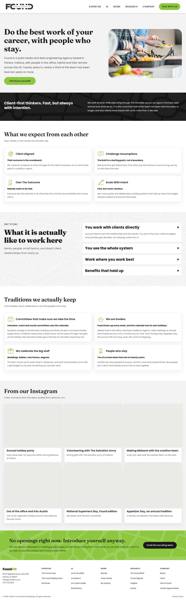

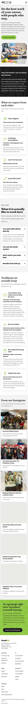

### Proposed changes

**Layout and design.** Headings move from Fraunces to the 2026 type system in `src/styles/site-2026.css`: Archivo Black, 82% width, uppercase, ink `#231f20` on paper `#eef1ec`. Body stays Poppins. Eyebrows are green `#8dc63f`. Buttons are caps. The header and footer keep their own type. Dark-band body text is white. Sections that are only a heading over a large empty area get pulled up so the copy sits with the heading. This is scoped to this page. It does not restyle the homepage, `/capabilities/`, `/ai/`, or the paid search page on PR #411.

Add the homepage Talk with us form (ActiveCampaign form 8, `homeV2Forms.contact` in `src/lib/homeV2Content.ts`, the same form already on /contact-us/). Put it in the existing closing section. The intro is this page's closing paragraph, not the homepage intro. The button label is 'Introduce yourself', not 'Start the conversation'. Keep the existing contact link as well.

Heading order stays: Do the best work of your career, with people who stay. | What we expect from each other | Client Aligned | Challenge Assumptions | Own The Outcome | Scale With Intent | What it is actually like to work here | You work with clients directly + | You see the whole system + | Work where you work best + | Benefits that hold up + | Traditions we actually keep | (more headings are in the inventory)

**Copy to optimize.**

None. The wording on the page already matches the facts I could verify. Sections move or restyle only.

**Content to add.**

The Talk with us form (ActiveCampaign form 8) is added in the closing section. Its words are the closing heading and paragraph already on this page. No new metric, logo, quote, or client name.

### Content inventory

Everything in `<main>` on staging today. The shared header and footer are inventoried once at the top of this file and stay on this page.
1. Section 1: Do the best work of your career, with people who stay.
2. Section 2: Statement band (copy is in the paragraphs below)
3. Section 3: What we expect from each other
4. Section 4: What it is actually like to work here
5. Section 5: Traditions we actually keep
6. Section 6: From our Instagram
7. Section 7: No openings right now. Introduce yourself anyway.
8. H1: Do the best work of your career, with people who stay.
9. H2: What we expect from each other
10. H3: Client Aligned
11. H3: Challenge Assumptions
12. H3: Own The Outcome
13. H3: Scale With Intent
14. H2: What it is actually like to work here
15. H3: You work with clients directly +
16. H3: You see the whole system +
17. H3: Work where you work best +
18. H3: Benefits that hold up +
19. H2: Traditions we actually keep
20. H3: Committees that make sure we take the time
21. H3: We are foodies
22. H3: We celebrate the big stuff
23. H3: People who stay
24. H2: From our Instagram
25. H3: Annual holiday party
26. H3: Volunteering with The Salvation Army
27. H3: Making Midwest with the creative team
28. H3: Out of the office and into Austin
29. H3: National Superhero Day, Found edition
30. H3: Appetizer Day, an annual tradition
31. H2: No openings right now. Introduce yourself anyway.
32. Found is a paid media and data engineering agency based in Fishers, Indiana, with people in the office, hybrid and fully remote across the US. Twenty years in, nearly a third of the team has been here ten years or more.
33. Client-first thinkers. Fast, but always with intention.
34. We work smarter while executing through the minutiae, we put our egos in the back seat, and we love what we do. It is why more than half of the team has been here five years or longer, and why clients have stayed with us for more than a decade.
35. Four values, in the words we actually use.
36. Their outcome is the scoreboard.
37. We measure ourselves on what changes for the client's business, not on what looks good in a platform report.
38. The brief is a starting point, not a boundary.
39. Best practices get tested here. If the data says the obvious move is wrong, we say so and show the work.
40. Nobody waits to be told.
41. Everyone has the authority to fix what they find, and the accountability that comes with it.
42. Fast, but never careless.
43. We move quickly and deliberately, building systems that hold up when the budget doubles instead of shortcuts that break.
44. DAY TO DAY
45. Senior people, small teams, and direct client relationships from early on.
46. Account teams own the relationship and the results. You are in the room where budgets and priorities get decided, not relaying notes from it.
47. Paid media, data engineering, analytics and creative sit together. You learn how the pieces connect because the person who built the other piece is at the next desk, or in the next Slack channel.
48. Some of us are in the Fishers office every day, some split the week between home and the office, and some are fully remote across the US. We hire for the work, not for the desk.
49. Generous PTO, strong healthcare options and a retirement match, plus budgets for certifications, training and conferences. You do not have to negotiate for the things that make you better at the job.
50. Committees, food, celebrations, and the people who stay.
51. Volunteer, event and social committees own the calendar.
52. Quarterly outings or remote team building, and drives all year: a Humane Society supply drive, a children's book drive, a blood drive, and six years of Angel Tree gifts at the holidays. Remote teammates get a half day to volunteer where they live.
53. Food shows up every week, and the calendar has its own holidays.
54. Weekly food in the office, DoorDash credits for agency-wide meetings so remote teammates eat too, and a monthly brunch club. Then the big ones: Appetizer Day, the annual chili and soup cook-offs, and Foundsgiving.
55. Weddings, babies, new homes, degrees.
56. The team shows up for each other's milestones, and work anniversaries come with a gift budget so you pick something you actually want.
57. Ten of us have been here ten to twenty years.
58. Another ten have passed five years, and ten more have passed three. New people join a team that already knows how to work together.
59. A few moments from the team, pulled from @found_sm.
60. Every December, for everyone within driving distance of Fishers.
61. Sorting gifts with The Salvation Army of Indiana.
62. Andy and Jake took the creative team on the road.
63. Live music, legendary barbecue and a few ideas for the way home.
64. We asked, and the team answered.
65. A friendly competition that takes itself seriously.
66. We are always interested in meeting great people. Email the recruiting team with what you do and what you want to do next, or use the contact form if you would rather.
67. Introduce yourself (/contact-us/)
68. Email the recruiting team (mailto:recruiting@foundsm.com)
69. You work with clients directly +
70. You see the whole system +
71. Work where you work best +
72. Benefits that hold up +
73. Image alt 'Team members serving themselves lunch from a buffet in the Found office', file 1fbfbaeb57054503ac0bd099dc7d15976f89b8c6-1250x834.jpg
74. Image alt '(empty alt)', file b95ffe002d178144b3c84944e56a75d33a0a26a7-160x160.svg
75. Image alt '(empty alt)', file b695132658282341c39c4c438d3a469357c00e2e-160x160.svg
76. Image alt '(empty alt)', file c84fea854daf1257e5ef06ecf0656859c02631cd-160x160.svg
77. Image alt '(empty alt)', file b3e5e84605daa2201e2c8e713b6781e2667b50dd-160x160.svg
78. Image alt '(empty alt)', file 36014521ef3ea609ee822e162573b53761abef66-160x160.svg
79. Image alt '(empty alt)', file 3d6192619b3271270212c35a524c75e851ff468a-160x160.svg
80. Image alt '(empty alt)', file 6a213a64284b09bba851c7b81d0e32368aff15e8-160x160.svg
81. Image alt '(empty alt)', file f2e5dd22e88a4f45497d8f41d4862b23532bd3d9-160x160.svg
82. Image alt 'The Found team posing together at the annual holiday party', file 8cb8493cb15013220fee8d48748cfb4c036ed116-1440x1800.jpg
83. Image alt 'Found team members volunteering in a gym full of donated gifts', file 8513c94785842df62442ccf80a6fffe7490624ff-1440x1800.jpg
84. Image alt 'Found creative team members at the Making Midwest event', file f09d11e95611e7d6e8dbf324589ef0f9e7828cd9-2250x3000.jpg
85. Image alt 'Three Found team members at an outdoor venue in Austin', file 8d4fd2af42ce423a28c51a66a59bb85028b9a21d-2316x2895.jpg
86. Image alt 'Illustration of Found team members drawn as superheroes', file 2b02c441236fabd8ab176788c76d7cc23f11817c-1440x1787.jpg
87. Image alt 'Collage of appetizers from Found's annual Appetizer Day', file 085fbfaddb6296e8fa367778f8f29a4c2aa5a713-1440x1440.jpg

### Content check

1. kept as is: Section 1: Do the best work of your career, with people who stay.
2. kept as is: Section 2: Statement band (copy is in the paragraphs below)
3. kept as is: Section 3: What we expect from each other
4. kept as is: Section 4: What it is actually like to work here
5. kept as is: Section 5: Traditions we actually keep
6. kept as is: Section 6: From our Instagram
7. kept as is: Section 7: No openings right now. Introduce yourself anyway.
8. kept as is: H1: Do the best work of your career, with people who stay.
9. kept as is: H2: What we expect from each other
10. kept as is: H3: Client Aligned
11. kept as is: H3: Challenge Assumptions
12. kept as is: H3: Own The Outcome
13. kept as is: H3: Scale With Intent
14. kept as is: H2: What it is actually like to work here
15. kept as is: H3: You work with clients directly +
16. kept as is: H3: You see the whole system +
17. kept as is: H3: Work where you work best +
18. kept as is: H3: Benefits that hold up +
19. kept as is: H2: Traditions we actually keep
20. kept as is: H3: Committees that make sure we take the time
21. kept as is: H3: We are foodies
22. kept as is: H3: We celebrate the big stuff
23. kept as is: H3: People who stay
24. kept as is: H2: From our Instagram
25. kept as is: H3: Annual holiday party
26. kept as is: H3: Volunteering with The Salvation Army
27. kept as is: H3: Making Midwest with the creative team
28. kept as is: H3: Out of the office and into Austin
29. kept as is: H3: National Superhero Day, Found edition
30. kept as is: H3: Appetizer Day, an annual tradition
31. kept as is: H2: No openings right now. Introduce yourself anyway.
32. kept as is: Found is a paid media and data engineering agency based in Fishers, Indiana, with people in the office, hybrid and fully remote across the US. Twenty years in, nearly a third of the team has been here ten years or more.
33. kept as is: Client-first thinkers. Fast, but always with intention.
34. kept as is: We work smarter while executing through the minutiae, we put our egos in the back seat, and we love what we do. It is why more than half of the team has been here five years or longer, and why clients have stayed with us for more than a decade.
35. kept as is: Four values, in the words we actually use.
36. kept as is: Their outcome is the scoreboard.
37. kept as is: We measure ourselves on what changes for the client's business, not on what looks good in a platform report.
38. kept as is: The brief is a starting point, not a boundary.
39. kept as is: Best practices get tested here. If the data says the obvious move is wrong, we say so and show the work.
40. kept as is: Nobody waits to be told.
41. kept as is: Everyone has the authority to fix what they find, and the accountability that comes with it.
42. kept as is: Fast, but never careless.
43. kept as is: We move quickly and deliberately, building systems that hold up when the budget doubles instead of shortcuts that break.
44. kept as is: DAY TO DAY
45. kept as is: Senior people, small teams, and direct client relationships from early on.
46. kept as is: Account teams own the relationship and the results. You are in the room where budgets and priorities get decided, not relaying notes from it.
47. kept as is: Paid media, data engineering, analytics and creative sit together. You learn how the pieces connect because the person who built the other piece is at the next desk, or in the next Slack channel.
48. kept as is: Some of us are in the Fishers office every day, some split the week between home and the office, and some are fully remote across the US. We hire for the work, not for the desk.
49. kept as is: Generous PTO, strong healthcare options and a retirement match, plus budgets for certifications, training and conferences. You do not have to negotiate for the things that make you better at the job.
50. kept as is: Committees, food, celebrations, and the people who stay.
51. kept as is: Volunteer, event and social committees own the calendar.
52. kept as is: Quarterly outings or remote team building, and drives all year: a Humane Society supply drive, a children's book drive, a blood drive, and six years of Angel Tree gifts at the holidays. Remote teammates get a half day to volunteer where they live.
53. kept as is: Food shows up every week, and the calendar has its own holidays.
54. kept as is: Weekly food in the office, DoorDash credits for agency-wide meetings so remote teammates eat too, and a monthly brunch club. Then the big ones: Appetizer Day, the annual chili and soup cook-offs, and Foundsgiving.
55. kept as is: Weddings, babies, new homes, degrees.
56. kept as is: The team shows up for each other's milestones, and work anniversaries come with a gift budget so you pick something you actually want.
57. kept as is: Ten of us have been here ten to twenty years.
58. kept as is: Another ten have passed five years, and ten more have passed three. New people join a team that already knows how to work together.
59. kept as is: A few moments from the team, pulled from @found_sm.
60. kept as is: Every December, for everyone within driving distance of Fishers.
61. kept as is: Sorting gifts with The Salvation Army of Indiana.
62. kept as is: Andy and Jake took the creative team on the road.
63. kept as is: Live music, legendary barbecue and a few ideas for the way home.
64. kept as is: We asked, and the team answered.
65. kept as is: A friendly competition that takes itself seriously.
66. kept as is: We are always interested in meeting great people. Email the recruiting team with what you do and what you want to do next, or use the contact form if you would rather.
67. kept as is: Introduce yourself (/contact-us/)
68. kept as is: Email the recruiting team (mailto:recruiting@foundsm.com)
69. kept as is: You work with clients directly +
70. kept as is: You see the whole system +
71. kept as is: Work where you work best +
72. kept as is: Benefits that hold up +
73. kept as is: Image alt 'Team members serving themselves lunch from a buffet in the Found office', file 1fbfbaeb57054503ac0bd099dc7d15976f89b8c6-1250x834.jpg
74. kept as is: Image alt '(empty alt)', file b95ffe002d178144b3c84944e56a75d33a0a26a7-160x160.svg
75. kept as is: Image alt '(empty alt)', file b695132658282341c39c4c438d3a469357c00e2e-160x160.svg
76. kept as is: Image alt '(empty alt)', file c84fea854daf1257e5ef06ecf0656859c02631cd-160x160.svg
77. kept as is: Image alt '(empty alt)', file b3e5e84605daa2201e2c8e713b6781e2667b50dd-160x160.svg
78. kept as is: Image alt '(empty alt)', file 36014521ef3ea609ee822e162573b53761abef66-160x160.svg
79. kept as is: Image alt '(empty alt)', file 3d6192619b3271270212c35a524c75e851ff468a-160x160.svg
80. kept as is: Image alt '(empty alt)', file 6a213a64284b09bba851c7b81d0e32368aff15e8-160x160.svg
81. kept as is: Image alt '(empty alt)', file f2e5dd22e88a4f45497d8f41d4862b23532bd3d9-160x160.svg
82. kept as is: Image alt 'The Found team posing together at the annual holiday party', file 8cb8493cb15013220fee8d48748cfb4c036ed116-1440x1800.jpg
83. kept as is: Image alt 'Found team members volunteering in a gym full of donated gifts', file 8513c94785842df62442ccf80a6fffe7490624ff-1440x1800.jpg
84. kept as is: Image alt 'Found creative team members at the Making Midwest event', file f09d11e95611e7d6e8dbf324589ef0f9e7828cd9-2250x3000.jpg
85. kept as is: Image alt 'Three Found team members at an outdoor venue in Austin', file 8d4fd2af42ce423a28c51a66a59bb85028b9a21d-2316x2895.jpg
86. kept as is: Image alt 'Illustration of Found team members drawn as superheroes', file 2b02c441236fabd8ab176788c76d7cc23f11817c-1440x1787.jpg
87. kept as is: Image alt 'Collage of appetizers from Found's annual Appetizer Day', file 085fbfaddb6296e8fa367778f8f29a4c2aa5a713-1440x1440.jpg

### Open questions

- None for this page. Shared questions are at the top of the file.

### Effort

medium

## 5. Newsletter

**Approve?** Keep ActiveCampaign form 4, make the dark-panel labels white, and replace the one em dash.

- Staging URL: https://staging.foundsm.com/newsletter/
- Source: `src/pages/newsletter.astro, src/components/wordpress/WordPressMatchPage.astro, src/lib/morePageData.ts`
- Sanity document: `newsletterPage (not in the staging dataset; page uses the code default)`
- Robots, kept as is: `noindex, nofollow`
- Canonical, kept as is: `https://foundsm.com/newsletter/`
- Current heading font: Fraunces, Georgia, serif

### Current state

Full page on staging, November 17, 2026. Scroll-in sections are shown open so the picture matches what a visitor sees after scrolling.

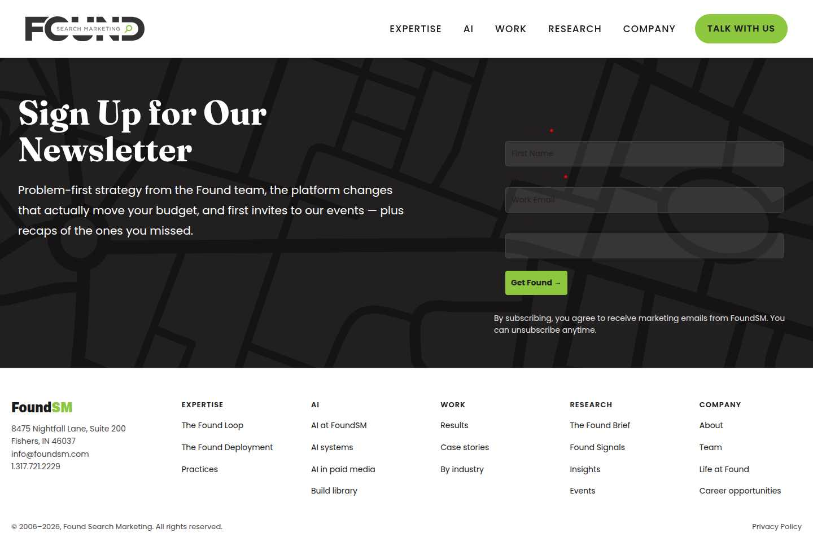

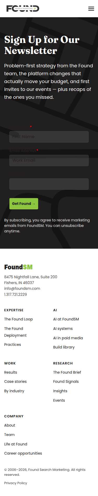

### Proposed changes

**Layout and design.** Headings move from Fraunces to the 2026 type system in `src/styles/site-2026.css`: Archivo Black, 82% width, uppercase, ink `#231f20` on paper `#eef1ec`. Body stays Poppins. Eyebrows are green `#8dc63f`. Buttons are caps. The header and footer keep their own type. Dark-band body text is white. Sections that are only a heading over a large empty area get pulled up so the copy sits with the heading. This is scoped to this page. It does not restyle the homepage, `/capabilities/`, `/ai/`, or the paid search page on PR #411.

This page already posts to ActiveCampaign form 4. Keep that id and the fields. Do not point it at a different list. Restyle the fields to the homepage form (labels, spacing, caps button) and use this page's own heading, not the homepage 'Let's look at your account.'

Text on a dark background that is not white: First Name*; Email Address*; Job Title. Make that text white. Green eyebrows can stay.

Heading order stays: Sign Up for Our Newsletter

**Copy to optimize.**

Rewrites below are punctuation, or the two fact edits Megan decided or asked to see. Found is not changed to FoundSM. Both names stay.

- kept, reworded (em dash replaced with a comma)
  - Before: Problem-first strategy from the Found team, the platform changes that actually move your budget, and first invites to our events — plus recaps of the ones you missed.
  - After: Problem-first strategy from the Found team, the platform changes that actually move your budget, and first invites to our events, plus recaps of the ones you missed.

**Content to add.**

No new form and no new fields. The existing form stays. Page-specific heading and intro stay, so the form does not repeat the homepage.

### Content inventory

Everything in `<main>` on staging today. The shared header and footer are inventoried once at the top of this file and stay on this page.
1. Section 1: Sign Up for Our Newsletter
2. H1: Sign Up for Our Newsletter
3. Problem-first strategy from the Found team, the platform changes that actually move your budget, and first invites to our events — plus recaps of the ones you missed.
4. By subscribing, you agree to receive marketing emails from FoundSM. You can unsubscribe anytime.
5. Get Found →
6. Form action https://foundsm.activehosted.com/proc.php; fields: First Name*, Email Address*, Job Title
7. ActiveCampaign embed: _form_4
8. ActiveCampaign embed: _form_element _field_firstname _full_width 
9. ActiveCampaign embed: _form_element _field_email _full_width 
10. ActiveCampaign embed: _form_element _x19056439 _full_width 
11. ActiveCampaign embed: https://foundsm.activehosted.com/f/embed.php?id=4

### Content check

1. kept as is: Section 1: Sign Up for Our Newsletter
2. kept as is: H1: Sign Up for Our Newsletter
3. kept, reworded (em dash replaced with a comma)
    - Before: Problem-first strategy from the Found team, the platform changes that actually move your budget, and first invites to our events — plus recaps of the ones you missed.
    - After: Problem-first strategy from the Found team, the platform changes that actually move your budget, and first invites to our events, plus recaps of the ones you missed.
4. kept as is: By subscribing, you agree to receive marketing emails from FoundSM. You can unsubscribe anytime.
5. kept as is: Get Found →
6. kept as is: Form action https://foundsm.activehosted.com/proc.php; fields: First Name*, Email Address*, Job Title
7. kept as is: ActiveCampaign embed: _form_4
8. kept as is: ActiveCampaign embed: _form_element _field_firstname _full_width 
9. kept as is: ActiveCampaign embed: _form_element _field_email _full_width 
10. kept as is: ActiveCampaign embed: _form_element _x19056439 _full_width 
11. kept as is: ActiveCampaign embed: https://foundsm.activehosted.com/f/embed.php?id=4

### Open questions

- None for this page. Shared questions are at the top of the file.

### Effort

medium

## 6. Contact

**Approve?** Keep form 8 and the current heading. Restyle the page so the form matches the homepage without copying the homepage intro.

- Staging URL: https://staging.foundsm.com/contact-us/
- Source: `src/pages/contact-us.astro, src/components/modern/FormLanding.astro, src/lib/morePageData.ts`
- Sanity document: `contactPage (not in the staging dataset; page uses the code default, form 8)`
- Robots, kept as is: `index, follow, max-image-preview:large, max-snippet:-1, max-video-preview:-1`
- Canonical, kept as is: `https://foundsm.com/contact-us/`
- Current heading font: Fraunces, Georgia, serif

### Current state

Full page on staging, November 17, 2026. Scroll-in sections are shown open so the picture matches what a visitor sees after scrolling.

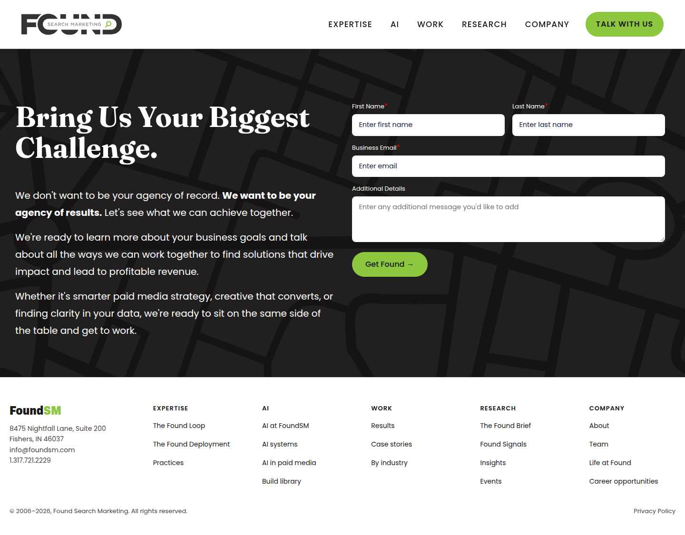

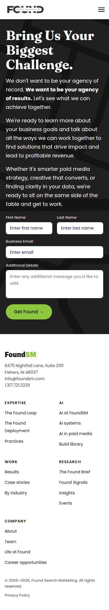

### Proposed changes

**Layout and design.** Headings move from Fraunces to the 2026 type system in `src/styles/site-2026.css`: Archivo Black, 82% width, uppercase, ink `#231f20` on paper `#eef1ec`. Body stays Poppins. Eyebrows are green `#8dc63f`. Buttons are caps. The header and footer keep their own type. Dark-band body text is white. Sections that are only a heading over a large empty area get pulled up so the copy sits with the heading. This is scoped to this page. It does not restyle the homepage, `/capabilities/`, `/ai/`, or the paid search page on PR #411.

This page already posts to ActiveCampaign form 8. Keep that id and the fields. Do not point it at a different list. Restyle the fields to the homepage form (labels, spacing, caps button) and use this page's own heading, not the homepage 'Let's look at your account.'

Heading order stays: Bring Us Your Biggest Challenge.

**Copy to optimize.**

None. The wording on the page already matches the facts I could verify. Sections move or restyle only.

**Content to add.**

No new form and no new fields. The existing form stays. Page-specific heading and intro stay, so the form does not repeat the homepage.

### Content inventory

Everything in `<main>` on staging today. The shared header and footer are inventoried once at the top of this file and stay on this page.
1. Section 1: Bring Us Your Biggest Challenge.
2. H1: Bring Us Your Biggest Challenge.
3. We don't want to be your agency of record. We want to be your agency of results. Let's see what we can achieve together.
4. We're ready to learn more about your business goals and talk about all the ways we can work together to find solutions that drive impact and lead to profitable revenue.
5. Whether it's smarter paid media strategy, creative that converts, or finding clarity in your data, we're ready to sit on the same side of the table and get to work.
6. Get Found →
7. Form action https://foundsm.activehosted.com/proc.php; fields: First Name*, Last Name*, Business Email*, Additional Details
8. ActiveCampaign embed: _form_8 form-landing__frame
9. ActiveCampaign embed: _form_element _x11110001 _full_width 
10. ActiveCampaign embed: _form_element _x11110002 _full_width 
11. ActiveCampaign embed: _form_element _field_email _full_width 
12. ActiveCampaign embed: _form_element _x11110004 _full_width 
13. ActiveCampaign embed: https://foundsm.activehosted.com/f/embed.php?id=8

### Content check

1. kept as is: Section 1: Bring Us Your Biggest Challenge.
2. kept as is: H1: Bring Us Your Biggest Challenge.
3. kept as is: We don't want to be your agency of record. We want to be your agency of results. Let's see what we can achieve together.
4. kept as is: We're ready to learn more about your business goals and talk about all the ways we can work together to find solutions that drive impact and lead to profitable revenue.
5. kept as is: Whether it's smarter paid media strategy, creative that converts, or finding clarity in your data, we're ready to sit on the same side of the table and get to work.
6. kept as is: Get Found →
7. kept as is: Form action https://foundsm.activehosted.com/proc.php; fields: First Name*, Last Name*, Business Email*, Additional Details
8. kept as is: ActiveCampaign embed: _form_8 form-landing__frame
9. kept as is: ActiveCampaign embed: _form_element _x11110001 _full_width 
10. kept as is: ActiveCampaign embed: _form_element _x11110002 _full_width 
11. kept as is: ActiveCampaign embed: _form_element _field_email _full_width 
12. kept as is: ActiveCampaign embed: _form_element _x11110004 _full_width 
13. kept as is: ActiveCampaign embed: https://foundsm.activehosted.com/f/embed.php?id=8

### Open questions

- None for this page. Shared questions are at the top of the file.

### Effort

medium

## 7. Results

**Approve?** Restyle Results with the 2026 type system. Keep the IBJ #4 line exactly. Propose a 2025 and 2026 Microsoft line for approval. Add the form.

- Staging URL: https://staging.foundsm.com/results/
- Source: `src/pages/results/index.astro`
- Sanity document: `landing-page-results`
- Robots, kept as is: `noindex, nofollow`
- Canonical, kept as is: `https://foundsm.com/results/`
- Current heading font: Fraunces, Georgia, serif

### Current state

Full page on staging, November 17, 2026. Scroll-in sections are shown open so the picture matches what a visitor sees after scrolling.

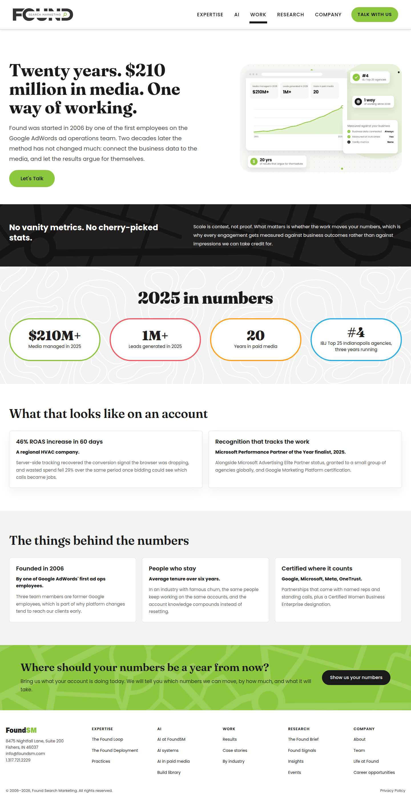

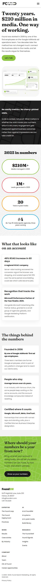

### Proposed changes

**Layout and design.** Headings move from Fraunces to the 2026 type system in `src/styles/site-2026.css`: Archivo Black, 82% width, uppercase, ink `#231f20` on paper `#eef1ec`. Body stays Poppins. Eyebrows are green `#8dc63f`. Buttons are caps. The header and footer keep their own type. Dark-band body text is white. Sections that are only a heading over a large empty area get pulled up so the copy sits with the heading. This is scoped to this page. It does not restyle the homepage, `/capabilities/`, `/ai/`, or the paid search page on PR #411.

IBJ stays exactly as it is: '#4' and 'IBJ Top 25 Indianapolis agencies, three years running.' Megan said not to remove the rank.

The $210M figures on this page stay. They match the live homepage: Paid Media Spend $210M Managed in 2025.

The 2025 Microsoft sentence stays accurate. The After version adds 2026 and is waiting on Megan's approval.

Add the homepage Talk with us form (ActiveCampaign form 8, `homeV2Forms.contact` in `src/lib/homeV2Content.ts`, the same form already on /contact-us/). Put it in the existing closing section. The intro is this page's closing paragraph, not the homepage intro. The button label is 'Let's Talk', not 'Start the conversation'. Keep the existing contact link as well.

Heading order stays: Twenty years. $210 million in media. One way of working. | 2025 in numbers | What that looks like on an account | 46% ROAS increase in 60 days | Recognition that tracks the work | The things behind the numbers | Founded in 2006 | People who stay | Certified where it counts | Where should your numbers be a year from now?

**Copy to optimize.**

Rewrites below are punctuation, or the two fact edits Megan decided or asked to see. Found is not changed to FoundSM. Both names stay.

- kept, reworded (proposed for Megan's approval, not final)
  - Before: Microsoft Performance Partner of the Year finalist, 2025.
  - After: Microsoft Advertising Partner Awards finalist, 2025 and 2026. 2025: Performance Partner of the Year. 2026: Data Integration Excellence Award and Search Performance Partner of the Year.

**Content to add.**

The Talk with us form (ActiveCampaign form 8) is added in the closing section. Its words are the closing heading and paragraph already on this page. No new metric, logo, quote, or client name.

### Content inventory

Everything in `<main>` on staging today. The shared header and footer are inventoried once at the top of this file and stay on this page.
1. Section 1: Twenty years. $210 million in media. One way of working.
2. Section 2: Statement band (copy is in the paragraphs below)
3. Section 3: 2025 in numbers
4. Section 4: What that looks like on an account
5. Section 5: The things behind the numbers
6. Section 6: Where should your numbers be a year from now?
7. H1: Twenty years. $210 million in media. One way of working.
8. H2: 2025 in numbers
9. H2: What that looks like on an account
10. H3: 46% ROAS increase in 60 days
11. H3: Recognition that tracks the work
12. H2: The things behind the numbers
13. H3: Founded in 2006
14. H3: People who stay
15. H3: Certified where it counts
16. H2: Where should your numbers be a year from now?
17. Found was started in 2006 by one of the first employees on the Google AdWords ad operations team. Two decades later the method has not changed much: connect the business data to the media, and let the results argue for themselves.
18. No vanity metrics. No cherry-picked stats.
19. Scale is context, not proof. What matters is whether the work moves your numbers, which is why every engagement gets measured against business outcomes rather than against impressions we can take credit for.
20. $210M+
21. Media managed in 2025
22. 1M+
23. Leads generated in 2025
24. 20
25. Years in paid media
26. #4
27. IBJ Top 25 Indianapolis agencies, three years running
28. A regional HVAC company.
29. Server-side tracking recovered the conversion signal the browser was dropping, and wasted spend fell 29% over the same period once bidding could see which calls became jobs.
30. Microsoft Performance Partner of the Year finalist, 2025.
31. Alongside Microsoft Advertising Elite Partner status, granted to a small group of agencies globally, and Google Marketing Platform certification.
32. By one of Google AdWords' first ad ops employees.
33. Three team members are former Google employees, which is part of why platform changes tend to reach our clients early.
34. Average tenure over six years.
35. In an industry with famous churn, the same people keep working on the same accounts, and the account knowledge compounds instead of resetting.
36. Google, Microsoft, Meta, OneTrust.
37. Partnerships that come with named reps and standing calls, plus a Certified Women Business Enterprise designation.
38. Bring us what your account is doing today. We will tell you which numbers we can move, by how much, and what it will take.
39. Let's Talk (/contact-us/)
40. Show us your numbers (/contact-us/)
41. Image alt 'Illustration of twenty years of media growth from 2006 to 2025, with media managed, leads generated and outcomes measured against the business', file 0eb23e5850c999d3d72131fd57cdd674e6346ab7-1600x1600.webp

### Content check

1. kept as is: Section 1: Twenty years. $210 million in media. One way of working.
2. kept as is: Section 2: Statement band (copy is in the paragraphs below)
3. kept as is: Section 3: 2025 in numbers
4. kept as is: Section 4: What that looks like on an account
5. kept as is: Section 5: The things behind the numbers
6. kept as is: Section 6: Where should your numbers be a year from now?
7. kept as is: H1: Twenty years. $210 million in media. One way of working.
8. kept as is: H2: 2025 in numbers
9. kept as is: H2: What that looks like on an account
10. kept as is: H3: 46% ROAS increase in 60 days
11. kept as is: H3: Recognition that tracks the work
12. kept as is: H2: The things behind the numbers
13. kept as is: H3: Founded in 2006
14. kept as is: H3: People who stay
15. kept as is: H3: Certified where it counts
16. kept as is: H2: Where should your numbers be a year from now?
17. kept as is: Found was started in 2006 by one of the first employees on the Google AdWords ad operations team. Two decades later the method has not changed much: connect the business data to the media, and let the results argue for themselves.
18. kept as is: No vanity metrics. No cherry-picked stats.
19. kept as is: Scale is context, not proof. What matters is whether the work moves your numbers, which is why every engagement gets measured against business outcomes rather than against impressions we can take credit for.
20. kept as is: $210M+
21. kept as is: Media managed in 2025
22. kept as is: 1M+
23. kept as is: Leads generated in 2025
24. kept as is: 20
25. kept as is: Years in paid media
26. kept as is: #4
27. kept as is: IBJ Top 25 Indianapolis agencies, three years running
28. kept as is: A regional HVAC company.
29. kept as is: Server-side tracking recovered the conversion signal the browser was dropping, and wasted spend fell 29% over the same period once bidding could see which calls became jobs.
30. kept, reworded (proposed for Megan's approval, not final)
    - Before: Microsoft Performance Partner of the Year finalist, 2025.
    - After: Microsoft Advertising Partner Awards finalist, 2025 and 2026. 2025: Performance Partner of the Year. 2026: Data Integration Excellence Award and Search Performance Partner of the Year.
31. kept as is: Alongside Microsoft Advertising Elite Partner status, granted to a small group of agencies globally, and Google Marketing Platform certification.
32. kept as is: By one of Google AdWords' first ad ops employees.
33. kept as is: Three team members are former Google employees, which is part of why platform changes tend to reach our clients early.
34. kept as is: Average tenure over six years.
35. kept as is: In an industry with famous churn, the same people keep working on the same accounts, and the account knowledge compounds instead of resetting.
36. kept as is: Google, Microsoft, Meta, OneTrust.
37. kept as is: Partnerships that come with named reps and standing calls, plus a Certified Women Business Enterprise designation.
38. kept as is: Bring us what your account is doing today. We will tell you which numbers we can move, by how much, and what it will take.
39. kept as is: Let's Talk (/contact-us/)
40. kept as is: Show us your numbers (/contact-us/)
41. kept as is: Image alt 'Illustration of twenty years of media growth from 2006 to 2025, with media managed, leads generated and outcomes measured against the business', file 0eb23e5850c999d3d72131fd57cdd674e6346ab7-1600x1600.webp

### Open questions

- The multi-year Microsoft line in the Before/After is waiting on your approval. The 2025 wording stays in that line. The IBJ #4 and three years running stay exactly as they are, per your Nov 17 answer.

### Effort

medium

## 8. Industry

**Approve?** Restyle the industry hub with the 2026 type system and add the Talk with us form. Keep the three industry cards.

- Staging URL: https://staging.foundsm.com/industry/
- Source: `src/pages/industry/index.astro`
- Sanity document: `landing-page-industry-hub`
- Robots, kept as is: `noindex, nofollow`
- Canonical, kept as is: `https://foundsm.com/industry/`
- Current heading font: Fraunces, Georgia, serif

### Current state

Full page on staging, November 17, 2026. Scroll-in sections are shown open so the picture matches what a visitor sees after scrolling.

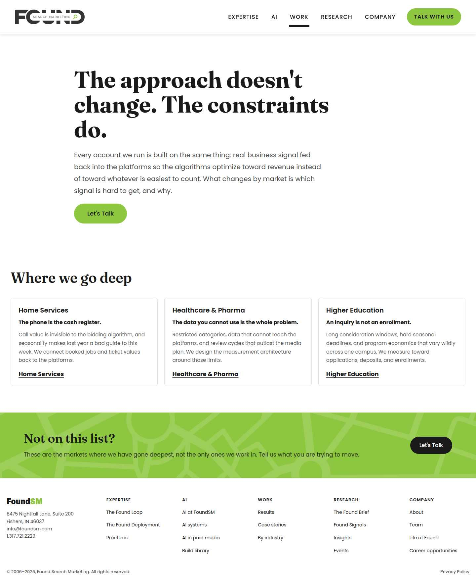

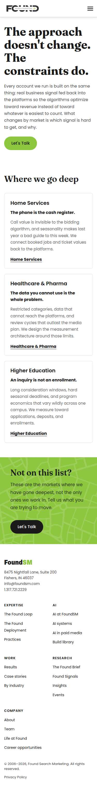

### Proposed changes

**Layout and design.** Headings move from Fraunces to the 2026 type system in `src/styles/site-2026.css`: Archivo Black, 82% width, uppercase, ink `#231f20` on paper `#eef1ec`. Body stays Poppins. Eyebrows are green `#8dc63f`. Buttons are caps. The header and footer keep their own type. Dark-band body text is white. Sections that are only a heading over a large empty area get pulled up so the copy sits with the heading. This is scoped to this page. It does not restyle the homepage, `/capabilities/`, `/ai/`, or the paid search page on PR #411.

Add the homepage Talk with us form (ActiveCampaign form 8, `homeV2Forms.contact` in `src/lib/homeV2Content.ts`, the same form already on /contact-us/). Put it in the existing closing section. The intro is this page's closing paragraph, not the homepage intro. The button label is 'Let's Talk', not 'Start the conversation'. Keep the existing contact link as well.

Heading order stays: The approach doesn't change. The constraints do. | Where we go deep | Home Services | Healthcare & Pharma | Higher Education | Not on this list?

**Copy to optimize.**

None. The wording on the page already matches the facts I could verify. Sections move or restyle only.

**Content to add.**

The Talk with us form (ActiveCampaign form 8) is added in the closing section. Its words are the closing heading and paragraph already on this page. No new metric, logo, quote, or client name.

### Content inventory

Everything in `<main>` on staging today. The shared header and footer are inventoried once at the top of this file and stay on this page.
1. Section 1: The approach doesn't change. The constraints do.
2. Section 2: Where we go deep
3. Section 3: Not on this list?
4. H1: The approach doesn't change. The constraints do.
5. H2: Where we go deep
6. H3: Home Services
7. H3: Healthcare & Pharma
8. H3: Higher Education
9. H2: Not on this list?
10. Every account we run is built on the same thing: real business signal fed back into the platforms so the algorithms optimize toward revenue instead of toward whatever is easiest to count. What changes by market is which signal is hard to get, and why.
11. The phone is the cash register.
12. Call value is invisible to the bidding algorithm, and seasonality makes last year a bad guide to this week. We connect booked jobs and ticket values back to the platforms.
13. The data you cannot use is the whole problem.
14. Restricted categories, data that cannot reach the platforms, and review cycles that outlast the media plan. We design the measurement architecture around those limits.
15. An inquiry is not an enrollment.
16. Long consideration windows, hard seasonal deadlines, and program economics that vary wildly across one campus. We measure toward applications, deposits, and enrollments.
17. These are the markets where we have gone deepest, not the only ones we work in. Tell us what you are trying to move.
18. Let's Talk (/contact-us/)
19. Home Services (/industry/home-services/)
20. Healthcare & Pharma (/industry/healthcare-pharma/)
21. Higher Education (/industry/higher-education/)

### Content check

1. kept as is: Section 1: The approach doesn't change. The constraints do.
2. kept as is: Section 2: Where we go deep
3. kept as is: Section 3: Not on this list?
4. kept as is: H1: The approach doesn't change. The constraints do.
5. kept as is: H2: Where we go deep
6. kept as is: H3: Home Services
7. kept as is: H3: Healthcare & Pharma
8. kept as is: H3: Higher Education
9. kept as is: H2: Not on this list?
10. kept as is: Every account we run is built on the same thing: real business signal fed back into the platforms so the algorithms optimize toward revenue instead of toward whatever is easiest to count. What changes by market is which signal is hard to get, and why.
11. kept as is: The phone is the cash register.
12. kept as is: Call value is invisible to the bidding algorithm, and seasonality makes last year a bad guide to this week. We connect booked jobs and ticket values back to the platforms.
13. kept as is: The data you cannot use is the whole problem.
14. kept as is: Restricted categories, data that cannot reach the platforms, and review cycles that outlast the media plan. We design the measurement architecture around those limits.
15. kept as is: An inquiry is not an enrollment.
16. kept as is: Long consideration windows, hard seasonal deadlines, and program economics that vary wildly across one campus. We measure toward applications, deposits, and enrollments.
17. kept as is: These are the markets where we have gone deepest, not the only ones we work in. Tell us what you are trying to move.
18. kept as is: Let's Talk (/contact-us/)
19. kept as is: Home Services (/industry/home-services/)
20. kept as is: Healthcare & Pharma (/industry/healthcare-pharma/)
21. kept as is: Higher Education (/industry/higher-education/)

### Open questions

- None for this page. Shared questions are at the top of the file.

### Effort

small

## 9. Home services

**Approve?** Restyle Home services with the 2026 type system. Keep the 46% HVAC line, the logos, and the proof block.

- Staging URL: https://staging.foundsm.com/industry/home-services/
- Source: `src/pages/[...path].astro`
- Sanity document: `landing-page-home-services`
- Robots, kept as is: `noindex, nofollow`
- Canonical, kept as is: `https://foundsm.com/industry/home-services/`
- Current heading font: Fraunces, Georgia, serif

### Current state

Full page on staging, November 17, 2026. Scroll-in sections are shown open so the picture matches what a visitor sees after scrolling.

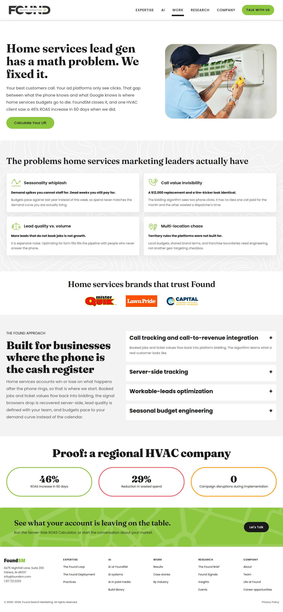

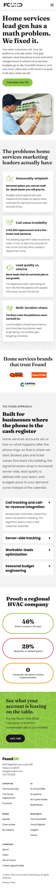

### Proposed changes

**Layout and design.** Headings move from Fraunces to the 2026 type system in `src/styles/site-2026.css`: Archivo Black, 82% width, uppercase, ink `#231f20` on paper `#eef1ec`. Body stays Poppins. Eyebrows are green `#8dc63f`. Buttons are caps. The header and footer keep their own type. Dark-band body text is white. Sections that are only a heading over a large empty area get pulled up so the copy sits with the heading. This is scoped to this page. It does not restyle the homepage, `/capabilities/`, `/ai/`, or the paid search page on PR #411.

Add the homepage Talk with us form (ActiveCampaign form 8, `homeV2Forms.contact` in `src/lib/homeV2Content.ts`, the same form already on /contact-us/). Put it in the existing closing section. The intro is this page's closing paragraph, not the homepage intro. The button label is 'Let's Talk', not 'Start the conversation'. Keep the existing contact link as well.

Heading order stays: Home services lead gen has a math problem. We fixed it. | The problems home services marketing leaders actually have | Seasonality whiplash | Call value invisibility | Lead quality vs. volume | Multi-location chaos | Home services brands that trust Found | Built for businesses where the phone is the cash register | Call tracking and call-to-revenue integration + | Server-side tracking + | Workable-leads optimization + | Seasonal budget engineering + | (more headings are in the inventory)

**Copy to optimize.**

None. The wording on the page already matches the facts I could verify. Sections move or restyle only.

**Content to add.**

The Talk with us form (ActiveCampaign form 8) is added in the closing section. Its words are the closing heading and paragraph already on this page. No new metric, logo, quote, or client name.

### Content inventory

Everything in `<main>` on staging today. The shared header and footer are inventoried once at the top of this file and stay on this page.
1. Section 1: Home services lead gen has a math problem. We fixed it.
2. Section 2: The problems home services marketing leaders actually have
3. Section 3: Home services brands that trust Found
4. Section 4: Built for businesses where the phone is the cash register
5. Section 5: Proof: a regional HVAC company
6. Section 6: See what your account is leaving on the table.
7. H1: Home services lead gen has a math problem. We fixed it.
8. H2: The problems home services marketing leaders actually have
9. H3: Seasonality whiplash
10. H3: Call value invisibility
11. H3: Lead quality vs. volume
12. H3: Multi-location chaos
13. H2: Home services brands that trust Found
14. H2: Built for businesses where the phone is the cash register
15. H3: Call tracking and call-to-revenue integration +
16. H3: Server-side tracking +
17. H3: Workable-leads optimization +
18. H3: Seasonal budget engineering +
19. H2: Proof: a regional HVAC company
20. H2: See what your account is leaving on the table.
21. Your best customers call. Your ad platforms only see clicks. That gap between what the phone knows and what Google knows is where home services budgets go to die. FoundSM closes it, and one HVAC client saw a 46% ROAS increase in 60 days when we did.
22. Demand spikes you cannot staff for. Dead weeks you still pay for.
23. Budgets pace against last year instead of this week, so spend never matches the demand curve you are actually living.
24. A $12,000 replacement and a tire-kicker look identical.
25. The bidding algorithm sees two phone clicks. It has no idea one call paid for the month and the other wasted a dispatcher’s time.
26. More leads that do not book jobs is not growth.
27. It is expensive noise. Optimizing for form fills fills the pipeline with people who never answer the phone.
28. Territory rules the platforms were not built for.
29. Local budgets, shared brand terms, and franchise boundaries need engineering, not another geo-targeting checkbox.
30. THE FOUND APPROACH
31. Home services accounts win or lose on what happens after the phone rings, so that is where we start. Booked jobs and ticket values flow back into bidding, the signal browsers drop is recovered server-side, lead quality is defined with your team, and budgets pace to your demand curve instead of the calendar.
32. Booked jobs and ticket values flow back into platform bidding. The algorithm learns what a real customer looks like.
33. Recovers the 15-35% of signals home services advertisers lose to browser limits. Critical when every lead is high-value.
34. We define lead quality with your team, contact rate, booked rate, job value, and optimize toward it, not toward form fills.
35. Pacing built around your demand curve, with real forecasting instead of last month plus ten percent.
36. 46%
37. ROAS increase in 60 days
38. 29%
39. Reduction in wasted spend
40. Campaign disruptions during implementation
41. Run the Server-Side ROAS Calculator, or start the conversation about your market.
42. Calculate Your Lift (https://sst-roas.foundsm.com/)
43. Let's Talk (/contact-us/)
44. Call tracking and call-to-revenue integration +
45. Server-side tracking +
46. Workable-leads optimization +
47. Seasonal budget engineering +
48. Image alt 'HVAC technician testing a wall-mounted air handler with a multimeter', file ea47917cef0fdbad4fda72e79795318cf3bdf16f-2400x1601.jpg
49. Image alt '(empty alt)', file 002af19c06772121720a6ee6593b8beae40d7a32-160x160.svg
50. Image alt '(empty alt)', file 252d65d9dd5467e8d2a77401d08fd2fc4507dfb0-160x160.svg
51. Image alt '(empty alt)', file 5315b28a054ee9e3d6ffe5ec5703eb05c0e27a4e-160x160.svg
52. Image alt '(empty alt)', file 57e10e1f1013f89f8c9db3eddd01fa2f573549df-160x160.svg
53. Image alt 'Mr. Quik Home Services logo', file 0be0127c01b28d8b52ab4bfb7a2dfd89a63f99c1-463x160.png
54. Image alt 'Lawn Pride logo', file fcf661ec7fbe8a14170cdcbfea6c5cada27d46ba-436x160.png
55. Image alt 'Capital Heating, Cooling, Electric and Plumbing logo', file 31692a762406851b99c436631e670a88a9fb4eb3-610x160.png

### Content check

1. kept as is: Section 1: Home services lead gen has a math problem. We fixed it.
2. kept as is: Section 2: The problems home services marketing leaders actually have
3. kept as is: Section 3: Home services brands that trust Found
4. kept as is: Section 4: Built for businesses where the phone is the cash register
5. kept as is: Section 5: Proof: a regional HVAC company
6. kept as is: Section 6: See what your account is leaving on the table.
7. kept as is: H1: Home services lead gen has a math problem. We fixed it.
8. kept as is: H2: The problems home services marketing leaders actually have
9. kept as is: H3: Seasonality whiplash
10. kept as is: H3: Call value invisibility
11. kept as is: H3: Lead quality vs. volume
12. kept as is: H3: Multi-location chaos
13. kept as is: H2: Home services brands that trust Found
14. kept as is: H2: Built for businesses where the phone is the cash register
15. kept as is: H3: Call tracking and call-to-revenue integration +
16. kept as is: H3: Server-side tracking +
17. kept as is: H3: Workable-leads optimization +
18. kept as is: H3: Seasonal budget engineering +
19. kept as is: H2: Proof: a regional HVAC company
20. kept as is: H2: See what your account is leaving on the table.
21. kept as is: Your best customers call. Your ad platforms only see clicks. That gap between what the phone knows and what Google knows is where home services budgets go to die. FoundSM closes it, and one HVAC client saw a 46% ROAS increase in 60 days when we did.
22. kept as is: Demand spikes you cannot staff for. Dead weeks you still pay for.
23. kept as is: Budgets pace against last year instead of this week, so spend never matches the demand curve you are actually living.
24. kept as is: A $12,000 replacement and a tire-kicker look identical.
25. kept as is: The bidding algorithm sees two phone clicks. It has no idea one call paid for the month and the other wasted a dispatcher’s time.
26. kept as is: More leads that do not book jobs is not growth.
27. kept as is: It is expensive noise. Optimizing for form fills fills the pipeline with people who never answer the phone.
28. kept as is: Territory rules the platforms were not built for.
29. kept as is: Local budgets, shared brand terms, and franchise boundaries need engineering, not another geo-targeting checkbox.
30. kept as is: THE FOUND APPROACH
31. kept as is: Home services accounts win or lose on what happens after the phone rings, so that is where we start. Booked jobs and ticket values flow back into bidding, the signal browsers drop is recovered server-side, lead quality is defined with your team, and budgets pace to your demand curve instead of the calendar.
32. kept as is: Booked jobs and ticket values flow back into platform bidding. The algorithm learns what a real customer looks like.
33. kept as is: Recovers the 15-35% of signals home services advertisers lose to browser limits. Critical when every lead is high-value.
34. kept as is: We define lead quality with your team, contact rate, booked rate, job value, and optimize toward it, not toward form fills.
35. kept as is: Pacing built around your demand curve, with real forecasting instead of last month plus ten percent.
36. kept as is: 46%
37. kept as is: ROAS increase in 60 days
38. kept as is: 29%
39. kept as is: Reduction in wasted spend
40. kept as is: Campaign disruptions during implementation
41. kept as is: Run the Server-Side ROAS Calculator, or start the conversation about your market.
42. kept as is: Calculate Your Lift (https://sst-roas.foundsm.com/)
43. kept as is: Let's Talk (/contact-us/)
44. kept as is: Call tracking and call-to-revenue integration +
45. kept as is: Server-side tracking +
46. kept as is: Workable-leads optimization +
47. kept as is: Seasonal budget engineering +
48. kept as is: Image alt 'HVAC technician testing a wall-mounted air handler with a multimeter', file ea47917cef0fdbad4fda72e79795318cf3bdf16f-2400x1601.jpg
49. kept as is: Image alt '(empty alt)', file 002af19c06772121720a6ee6593b8beae40d7a32-160x160.svg
50. kept as is: Image alt '(empty alt)', file 252d65d9dd5467e8d2a77401d08fd2fc4507dfb0-160x160.svg
51. kept as is: Image alt '(empty alt)', file 5315b28a054ee9e3d6ffe5ec5703eb05c0e27a4e-160x160.svg
52. kept as is: Image alt '(empty alt)', file 57e10e1f1013f89f8c9db3eddd01fa2f573549df-160x160.svg
53. kept as is: Image alt 'Mr. Quik Home Services logo', file 0be0127c01b28d8b52ab4bfb7a2dfd89a63f99c1-463x160.png
54. kept as is: Image alt 'Lawn Pride logo', file fcf661ec7fbe8a14170cdcbfea6c5cada27d46ba-436x160.png
55. kept as is: Image alt 'Capital Heating, Cooling, Electric and Plumbing logo', file 31692a762406851b99c436631e670a88a9fb4eb3-610x160.png

### Open questions

- None for this page. Shared questions are at the top of the file.

### Effort

medium

## 10. Higher education

**Approve?** Restyle Higher education with the 2026 type system. Keep the tabs, logos, and every card.

- Staging URL: https://staging.foundsm.com/industry/higher-education/
- Source: `src/pages/[...path].astro`
- Sanity document: `landing-page-higher-education`
- Robots, kept as is: `noindex, nofollow`
- Canonical, kept as is: `https://foundsm.com/industry/higher-education/`
- Current heading font: Fraunces, Georgia, serif

### Current state

Full page on staging, November 17, 2026. Scroll-in sections are shown open so the picture matches what a visitor sees after scrolling.

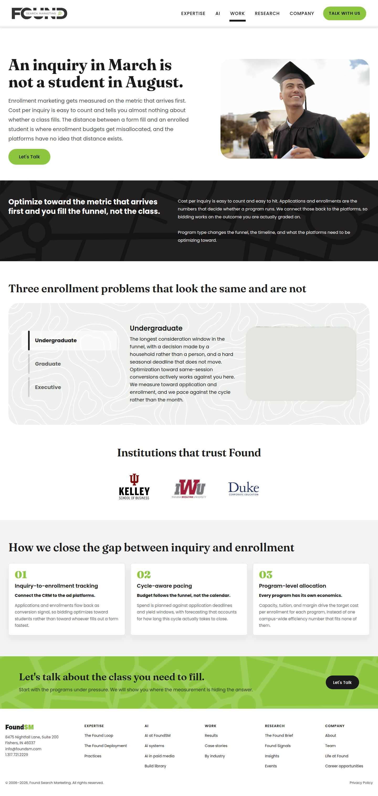

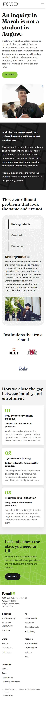

### Proposed changes

**Layout and design.** Headings move from Fraunces to the 2026 type system in `src/styles/site-2026.css`: Archivo Black, 82% width, uppercase, ink `#231f20` on paper `#eef1ec`. Body stays Poppins. Eyebrows are green `#8dc63f`. Buttons are caps. The header and footer keep their own type. Dark-band body text is white. Sections that are only a heading over a large empty area get pulled up so the copy sits with the heading. This is scoped to this page. It does not restyle the homepage, `/capabilities/`, `/ai/`, or the paid search page on PR #411.

Add the homepage Talk with us form (ActiveCampaign form 8, `homeV2Forms.contact` in `src/lib/homeV2Content.ts`, the same form already on /contact-us/). Put it in the existing closing section. The intro is this page's closing paragraph, not the homepage intro. The button label is 'Let's Talk', not 'Start the conversation'. Keep the existing contact link as well.

Heading order stays: An inquiry in March is not a student in August. | Three enrollment problems that look the same and are not | Undergraduate | Graduate | Executive | Institutions that trust Found | How we close the gap between inquiry and enrollment | Inquiry-to-enrollment tracking | Cycle-aware pacing | Program-level allocation | Let's talk about the class you need to fill.

**Copy to optimize.**

None. The wording on the page already matches the facts I could verify. Sections move or restyle only.

**Content to add.**

The Talk with us form (ActiveCampaign form 8) is added in the closing section. Its words are the closing heading and paragraph already on this page. No new metric, logo, quote, or client name.

### Content inventory

Everything in `<main>` on staging today. The shared header and footer are inventoried once at the top of this file and stay on this page.
1. Section 1: An inquiry in March is not a student in August.
2. Section 2: Statement band (copy is in the paragraphs below)
3. Section 3: Three enrollment problems that look the same and are not
4. Section 4: Institutions that trust Found
5. Section 5: How we close the gap between inquiry and enrollment
6. Section 6: Let's talk about the class you need to fill.
7. H1: An inquiry in March is not a student in August.
8. H2: Three enrollment problems that look the same and are not
9. H3: Undergraduate
10. H3: Graduate
11. H3: Executive
12. H2: Institutions that trust Found
13. H2: How we close the gap between inquiry and enrollment
14. H3: Inquiry-to-enrollment tracking
15. H3: Cycle-aware pacing
16. H3: Program-level allocation
17. H2: Let's talk about the class you need to fill.
18. Enrollment marketing gets measured on the metric that arrives first. Cost per inquiry is easy to count and tells you almost nothing about whether a class fills. The distance between a form fill and an enrolled student is where enrollment budgets get misallocated, and the platforms have no idea that distance exists.
19. Optimize toward the metric that arrives first and you fill the funnel, not the class.
20. Cost per inquiry is easy to count and easy to hit. Applications and enrollments are the numbers that decide whether a program runs. We connect those back to the platforms, so bidding works on the outcome you are actually graded on.
21. Program type changes the funnel, the timeline, and what the platforms need to be optimizing toward.
22. The longest consideration window in the funnel, with a decision made by a household rather than a person, and a hard seasonal deadline that does not move. Optimization toward same-session conversions actively works against you here. We measure toward application and enrollment, and we pace against the cycle rather than the month.
23. High intent, high competition, and enormous variance in program economics. A program with 12 seats and a program with 300 cannot share a budget strategy or a target cost per enrollment. We allocate at the program level, using each program's own capacity and revenue, not a blended campus average.
24. Closer to enterprise B2B than to admissions. The buyer is often the employer, the sales cycle involves relationships, and volume is small enough that platform-reported conversions are statistically meaningless. Measurement has to run through the CRM, with qualified-lead signal fed back rather than raw form fills.
25. 01
26. Connect the CRM to the ad platforms.
27. Applications and enrollments flow back as conversion signal, so bidding optimizes toward students rather than toward whoever fills out a form fastest.
28. 02
29. Budget follows the funnel, not the calendar.
30. Spend is planned against application deadlines and yield windows, with forecasting that accounts for how long this cycle actually takes to close.
31. 03
32. Every program has its own economics.
33. Capacity, tuition, and margin drive the target cost per enrollment for each program, instead of one campus-wide efficiency number that fits none of them.
34. Start with the programs under pressure. We will show you where the measurement is hiding the answer.
35. Let's Talk (/contact-us/)
36. Undergraduate
37. Graduate
38. Executive
39. Image alt 'Smiling graduate in cap and gown at an outdoor commencement ceremony', file d62d03b8410f82ff9ff12410eaf4c7b30853ac0f-3921x2539.jpg
40. Image alt 'Graduate raising a diploma in front of a columned university building with classmates behind', file 79d9f6a74fc95003cc2c4f86f9880c2031722bae-6323x4216.jpg
41. Image alt 'Rows of graduation caps seen from behind under sunlit trees', file 0c8b820bbad033000a7fe0fc97550ec8ab81d3fd-3864x2576.jpg
42. Image alt 'Close-up of a graduation cap tassel with a blurred ceremony behind', file d36aece5aff44de10d775d85d66d191a1b4fb1d7-5184x3456.jpg
43. Image alt 'Indiana University Kelley School of Business logo', file e068398557fdce95ae462bfd570379ad45b1f33b-500x500.png
44. Image alt 'Indiana Wesleyan University logo', file 65ecaa13991c4b5506e9f1513c02d7d5a34613fb-500x500.png
45. Image alt 'Duke Corporate Education logo', file 7831ec55ad3cb2f86c884d663c467fe48cb52250-500x500.png

### Content check

1. kept as is: Section 1: An inquiry in March is not a student in August.
2. kept as is: Section 2: Statement band (copy is in the paragraphs below)
3. kept as is: Section 3: Three enrollment problems that look the same and are not
4. kept as is: Section 4: Institutions that trust Found
5. kept as is: Section 5: How we close the gap between inquiry and enrollment
6. kept as is: Section 6: Let's talk about the class you need to fill.
7. kept as is: H1: An inquiry in March is not a student in August.
8. kept as is: H2: Three enrollment problems that look the same and are not
9. kept as is: H3: Undergraduate
10. kept as is: H3: Graduate
11. kept as is: H3: Executive
12. kept as is: H2: Institutions that trust Found
13. kept as is: H2: How we close the gap between inquiry and enrollment
14. kept as is: H3: Inquiry-to-enrollment tracking
15. kept as is: H3: Cycle-aware pacing
16. kept as is: H3: Program-level allocation
17. kept as is: H2: Let's talk about the class you need to fill.
18. kept as is: Enrollment marketing gets measured on the metric that arrives first. Cost per inquiry is easy to count and tells you almost nothing about whether a class fills. The distance between a form fill and an enrolled student is where enrollment budgets get misallocated, and the platforms have no idea that distance exists.
19. kept as is: Optimize toward the metric that arrives first and you fill the funnel, not the class.
20. kept as is: Cost per inquiry is easy to count and easy to hit. Applications and enrollments are the numbers that decide whether a program runs. We connect those back to the platforms, so bidding works on the outcome you are actually graded on.
21. kept as is: Program type changes the funnel, the timeline, and what the platforms need to be optimizing toward.
22. kept as is: The longest consideration window in the funnel, with a decision made by a household rather than a person, and a hard seasonal deadline that does not move. Optimization toward same-session conversions actively works against you here. We measure toward application and enrollment, and we pace against the cycle rather than the month.
23. kept as is: High intent, high competition, and enormous variance in program economics. A program with 12 seats and a program with 300 cannot share a budget strategy or a target cost per enrollment. We allocate at the program level, using each program's own capacity and revenue, not a blended campus average.
24. kept as is: Closer to enterprise B2B than to admissions. The buyer is often the employer, the sales cycle involves relationships, and volume is small enough that platform-reported conversions are statistically meaningless. Measurement has to run through the CRM, with qualified-lead signal fed back rather than raw form fills.
25. kept as is: 01
26. kept as is: Connect the CRM to the ad platforms.
27. kept as is: Applications and enrollments flow back as conversion signal, so bidding optimizes toward students rather than toward whoever fills out a form fastest.
28. kept as is: 02
29. kept as is: Budget follows the funnel, not the calendar.
30. kept as is: Spend is planned against application deadlines and yield windows, with forecasting that accounts for how long this cycle actually takes to close.
31. kept as is: 03
32. kept as is: Every program has its own economics.
33. kept as is: Capacity, tuition, and margin drive the target cost per enrollment for each program, instead of one campus-wide efficiency number that fits none of them.
34. kept as is: Start with the programs under pressure. We will show you where the measurement is hiding the answer.
35. kept as is: Let's Talk (/contact-us/)
36. kept as is: Undergraduate
37. kept as is: Graduate
38. kept as is: Executive
39. kept as is: Image alt 'Smiling graduate in cap and gown at an outdoor commencement ceremony', file d62d03b8410f82ff9ff12410eaf4c7b30853ac0f-3921x2539.jpg
40. kept as is: Image alt 'Graduate raising a diploma in front of a columned university building with classmates behind', file 79d9f6a74fc95003cc2c4f86f9880c2031722bae-6323x4216.jpg
41. kept as is: Image alt 'Rows of graduation caps seen from behind under sunlit trees', file 0c8b820bbad033000a7fe0fc97550ec8ab81d3fd-3864x2576.jpg
42. kept as is: Image alt 'Close-up of a graduation cap tassel with a blurred ceremony behind', file d36aece5aff44de10d775d85d66d191a1b4fb1d7-5184x3456.jpg
43. kept as is: Image alt 'Indiana University Kelley School of Business logo', file e068398557fdce95ae462bfd570379ad45b1f33b-500x500.png
44. kept as is: Image alt 'Indiana Wesleyan University logo', file 65ecaa13991c4b5506e9f1513c02d7d5a34613fb-500x500.png
45. kept as is: Image alt 'Duke Corporate Education logo', file 7831ec55ad3cb2f86c884d663c467fe48cb52250-500x500.png

### Open questions

- None for this page. Shared questions are at the top of the file.

### Effort

medium

## 11. Healthcare and pharma

**Approve?** Restyle Healthcare and pharma with the 2026 type system. Keep the logos and the accordion.

- Staging URL: https://staging.foundsm.com/industry/healthcare-pharma/
- Source: `src/pages/[...path].astro`
- Sanity document: `landing-page-healthcare-pharma`
- Robots, kept as is: `noindex, nofollow`
- Canonical, kept as is: `https://foundsm.com/industry/healthcare-pharma/`
- Current heading font: Fraunces, Georgia, serif

### Current state

Full page on staging, November 17, 2026. Scroll-in sections are shown open so the picture matches what a visitor sees after scrolling.

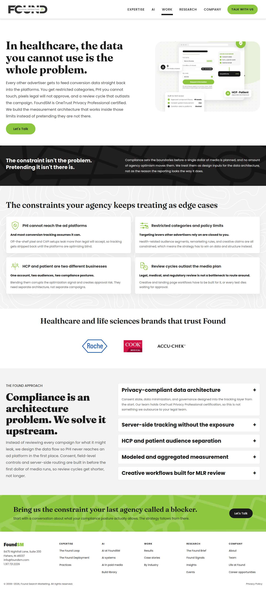

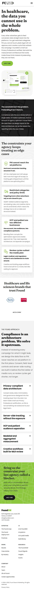

### Proposed changes

**Layout and design.** Headings move from Fraunces to the 2026 type system in `src/styles/site-2026.css`: Archivo Black, 82% width, uppercase, ink `#231f20` on paper `#eef1ec`. Body stays Poppins. Eyebrows are green `#8dc63f`. Buttons are caps. The header and footer keep their own type. Dark-band body text is white. Sections that are only a heading over a large empty area get pulled up so the copy sits with the heading. This is scoped to this page. It does not restyle the homepage, `/capabilities/`, `/ai/`, or the paid search page on PR #411.

Add the homepage Talk with us form (ActiveCampaign form 8, `homeV2Forms.contact` in `src/lib/homeV2Content.ts`, the same form already on /contact-us/). Put it in the existing closing section. The intro is this page's closing paragraph, not the homepage intro. The button label is 'Let's Talk', not 'Start the conversation'. Keep the existing contact link as well.

Heading order stays: In healthcare, the data you cannot use is the whole problem. | The constraints your agency keeps treating as edge cases | PHI cannot reach the ad platforms | Restricted categories and policy limits | HCP and patient are two different businesses | Review cycles outlast the media plan | Healthcare and life sciences brands that trust Found | Compliance is an architecture problem. We solve it upstream. | Privacy-compliant data architecture + | Server-side tracking without the exposure + | HCP and patient audience separation + | Modeled and aggregated measurement + | (more headings are in the inventory)

**Copy to optimize.**

None. The wording on the page already matches the facts I could verify. Sections move or restyle only.

**Content to add.**

The Talk with us form (ActiveCampaign form 8) is added in the closing section. Its words are the closing heading and paragraph already on this page. No new metric, logo, quote, or client name.

### Content inventory

Everything in `<main>` on staging today. The shared header and footer are inventoried once at the top of this file and stay on this page.
1. Section 1: In healthcare, the data you cannot use is the whole problem.
2. Section 2: Statement band (copy is in the paragraphs below)
3. Section 3: The constraints your agency keeps treating as edge cases
4. Section 4: Healthcare and life sciences brands that trust Found
5. Section 5: Compliance is an architecture problem. We solve it upstream.
6. Section 6: Bring us the constraint your last agency called a blocker.
7. H1: In healthcare, the data you cannot use is the whole problem.
8. H2: The constraints your agency keeps treating as edge cases
9. H3: PHI cannot reach the ad platforms
10. H3: Restricted categories and policy limits
11. H3: HCP and patient are two different businesses
12. H3: Review cycles outlast the media plan
13. H2: Healthcare and life sciences brands that trust Found
14. H2: Compliance is an architecture problem. We solve it upstream.
15. H3: Privacy-compliant data architecture +
16. H3: Server-side tracking without the exposure +
17. H3: HCP and patient audience separation +
18. H3: Modeled and aggregated measurement +
19. H3: Creative workflows built for MLR review +
20. H2: Bring us the constraint your last agency called a blocker.
21. Every other advertiser gets to feed conversion data straight back into the platforms. You get restricted categories, PHI you cannot touch, pixels legal will not approve, and a review cycle that outlasts the campaign. FoundSM is OneTrust Privacy Professional certified. We build the measurement architecture that works inside those limits instead of pretending they are not there.
22. The constraint isn't the problem. Pretending it isn't there is.
23. Compliance sets the boundaries before a single dollar of media is planned, and no amount of agency optimism moves them. We treat them as design inputs for the data architecture, not as the reason the reporting looks the way it does.
24. And most conversion tracking assumes it can.
25. Off-the-shelf pixel and CAPI setups leak more than legal will accept, so tracking gets stripped back until the platforms are optimizing blind.
26. Targeting levers other advertisers rely on are closed to you.
27. Health-related audience segments, remarketing rules, and creative claims are all constrained, which means the strategy has to win on data and structure instead.
28. One account, two audiences, two compliance postures.
29. Blending them corrupts the optimization signal and creates approval risk. They need separate architecture, not separate campaigns.
30. Legal, medical, and regulatory review is not a bottleneck to route around.
31. Creative and landing page workflows have to be built for it, or every test dies waiting for approval.
32. THE FOUND APPROACH
33. Instead of reviewing every campaign for what it might leak, we design the data flow so PHI never reaches an ad platform in the first place. Consent, field-level controls and server-side routing are built in before the first dollar of media runs, so review cycles get shorter, not longer.
34. Consent state, data minimization, and governance designed into the tracking layer from the start. Our team holds OneTrust Privacy Professional certification, so this is not something we outsource to your legal team.
35. Server-side implementation lets you control exactly what leaves your environment. You recover conversion signal the browser drops without sending anything the platforms should never receive.
36. Distinct account structure, distinct measurement, distinct creative governance, so the two audiences never contaminate each other's optimization or each other's approval path.
37. Where user-level tracking is off the table, we measure at the cohort and channel level, so budget decisions still rest on evidence rather than platform-reported conversions.
38. Modular creative and landing page systems that let approved components be recombined and tested, instead of restarting review for every variant.
39. Start with a conversation about what your compliance posture actually allows. The strategy follows from there.
40. Let's Talk (/contact-us/)
41. Privacy-compliant data architecture +
42. Server-side tracking without the exposure +
43. HCP and patient audience separation +
44. Modeled and aggregated measurement +
45. Creative workflows built for MLR review +
46. Image alt 'Illustration of a patient request form where PHI stays on the server and only consented, hashed events reach the ad platforms', file 17c9ce38013d4a0a389fb426ccd3639612c99df5-1600x1600.webp
47. Image alt '(empty alt)', file 1d4ee6fe6a88563437bc7f5add8f0c7fec49baf7-160x160.svg
48. Image alt '(empty alt)', file 9553997f1ff074909c870c805bb9fea7b0ac173f-160x160.svg
49. Image alt '(empty alt)', file b780d142d9d662e2fb9456829f1195586b26e0c9-160x160.svg
50. Image alt '(empty alt)', file 94198d0440fc0330ed36922343b131e53e396b25-160x160.svg
51. Image alt 'Roche logo', file 276ff012208bca0f84dbbf45e8b6885c792f246c-500x500.png
52. Image alt 'Cook Medical logo', file 4c403a6a763878f2e0a814e4ad75e3b4816dfe84-500x500.png
53. Image alt 'Accu-Chek logo', file e92790a2b9ea85b730eb40f3f9c68cce73c5453a-500x500.png

### Content check

1. kept as is: Section 1: In healthcare, the data you cannot use is the whole problem.
2. kept as is: Section 2: Statement band (copy is in the paragraphs below)
3. kept as is: Section 3: The constraints your agency keeps treating as edge cases
4. kept as is: Section 4: Healthcare and life sciences brands that trust Found
5. kept as is: Section 5: Compliance is an architecture problem. We solve it upstream.
6. kept as is: Section 6: Bring us the constraint your last agency called a blocker.
7. kept as is: H1: In healthcare, the data you cannot use is the whole problem.
8. kept as is: H2: The constraints your agency keeps treating as edge cases
9. kept as is: H3: PHI cannot reach the ad platforms
10. kept as is: H3: Restricted categories and policy limits
11. kept as is: H3: HCP and patient are two different businesses
12. kept as is: H3: Review cycles outlast the media plan
13. kept as is: H2: Healthcare and life sciences brands that trust Found
14. kept as is: H2: Compliance is an architecture problem. We solve it upstream.
15. kept as is: H3: Privacy-compliant data architecture +
16. kept as is: H3: Server-side tracking without the exposure +
17. kept as is: H3: HCP and patient audience separation +
18. kept as is: H3: Modeled and aggregated measurement +
19. kept as is: H3: Creative workflows built for MLR review +
20. kept as is: H2: Bring us the constraint your last agency called a blocker.
21. kept as is: Every other advertiser gets to feed conversion data straight back into the platforms. You get restricted categories, PHI you cannot touch, pixels legal will not approve, and a review cycle that outlasts the campaign. FoundSM is OneTrust Privacy Professional certified. We build the measurement architecture that works inside those limits instead of pretending they are not there.
22. kept as is: The constraint isn't the problem. Pretending it isn't there is.
23. kept as is: Compliance sets the boundaries before a single dollar of media is planned, and no amount of agency optimism moves them. We treat them as design inputs for the data architecture, not as the reason the reporting looks the way it does.
24. kept as is: And most conversion tracking assumes it can.
25. kept as is: Off-the-shelf pixel and CAPI setups leak more than legal will accept, so tracking gets stripped back until the platforms are optimizing blind.
26. kept as is: Targeting levers other advertisers rely on are closed to you.
27. kept as is: Health-related audience segments, remarketing rules, and creative claims are all constrained, which means the strategy has to win on data and structure instead.
28. kept as is: One account, two audiences, two compliance postures.
29. kept as is: Blending them corrupts the optimization signal and creates approval risk. They need separate architecture, not separate campaigns.
30. kept as is: Legal, medical, and regulatory review is not a bottleneck to route around.
31. kept as is: Creative and landing page workflows have to be built for it, or every test dies waiting for approval.
32. kept as is: THE FOUND APPROACH
33. kept as is: Instead of reviewing every campaign for what it might leak, we design the data flow so PHI never reaches an ad platform in the first place. Consent, field-level controls and server-side routing are built in before the first dollar of media runs, so review cycles get shorter, not longer.
34. kept as is: Consent state, data minimization, and governance designed into the tracking layer from the start. Our team holds OneTrust Privacy Professional certification, so this is not something we outsource to your legal team.
35. kept as is: Server-side implementation lets you control exactly what leaves your environment. You recover conversion signal the browser drops without sending anything the platforms should never receive.
36. kept as is: Distinct account structure, distinct measurement, distinct creative governance, so the two audiences never contaminate each other's optimization or each other's approval path.
37. kept as is: Where user-level tracking is off the table, we measure at the cohort and channel level, so budget decisions still rest on evidence rather than platform-reported conversions.
38. kept as is: Modular creative and landing page systems that let approved components be recombined and tested, instead of restarting review for every variant.
39. kept as is: Start with a conversation about what your compliance posture actually allows. The strategy follows from there.
40. kept as is: Let's Talk (/contact-us/)
41. kept as is: Privacy-compliant data architecture +
42. kept as is: Server-side tracking without the exposure +
43. kept as is: HCP and patient audience separation +
44. kept as is: Modeled and aggregated measurement +
45. kept as is: Creative workflows built for MLR review +
46. kept as is: Image alt 'Illustration of a patient request form where PHI stays on the server and only consented, hashed events reach the ad platforms', file 17c9ce38013d4a0a389fb426ccd3639612c99df5-1600x1600.webp
47. kept as is: Image alt '(empty alt)', file 1d4ee6fe6a88563437bc7f5add8f0c7fec49baf7-160x160.svg
48. kept as is: Image alt '(empty alt)', file 9553997f1ff074909c870c805bb9fea7b0ac173f-160x160.svg
49. kept as is: Image alt '(empty alt)', file b780d142d9d662e2fb9456829f1195586b26e0c9-160x160.svg
50. kept as is: Image alt '(empty alt)', file 94198d0440fc0330ed36922343b131e53e396b25-160x160.svg
51. kept as is: Image alt 'Roche logo', file 276ff012208bca0f84dbbf45e8b6885c792f246c-500x500.png
52. kept as is: Image alt 'Cook Medical logo', file 4c403a6a763878f2e0a814e4ad75e3b4816dfe84-500x500.png
53. kept as is: Image alt 'Accu-Chek logo', file e92790a2b9ea85b730eb40f3f9c68cce73c5453a-500x500.png

### Open questions

- None for this page. Shared questions are at the top of the file.

### Effort

medium

## 12. Paid media

**Approve?** Move the paid media practice page onto the 2026 type system, show every tab panel, and keep the badge row.

- Staging URL: https://staging.foundsm.com/capabilities/paid-media/
- Source: `src/pages/capabilities/paid-media.astro, src/lib/fixedPageData.ts`
- Sanity document: `capabilityPaidMediaPage`
- Robots, kept as is: `index, follow, max-image-preview:large, max-snippet:-1, max-video-preview:-1`
- Canonical, kept as is: `https://foundsm.com/capabilities/paid-media/`
- Current heading font: Fraunces, Georgia, serif

### Current state

Full page on staging, November 17, 2026. Scroll-in sections are shown open so the picture matches what a visitor sees after scrolling.

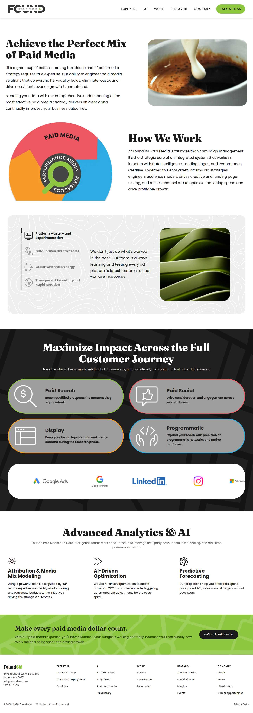

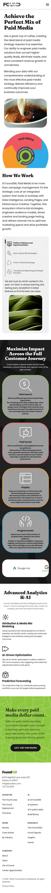

### Proposed changes

**Layout and design.** Headings move from Fraunces to the 2026 type system in `src/styles/site-2026.css`: Archivo Black, 82% width, uppercase, ink `#231f20` on paper `#eef1ec`. Body stays Poppins. Eyebrows are green `#8dc63f`. Buttons are caps. The header and footer keep their own type. Dark-band body text is white. Sections that are only a heading over a large empty area get pulled up so the copy sits with the heading. This is scoped to this page. It does not restyle the homepage, `/capabilities/`, `/ai/`, or the paid search page on PR #411.

This is a fixed practice page, not a landing-page child. It does not use the PR #411 template. The child template is for the pages under it.

Tab buttons currently swap panels, so some of the copy is hidden until a click. Show every panel in the same section. Keep the buttons as links to those panels. Nothing in the inventory is dropped.

Keep the certification and partner images. They are part of this practice page. Do not restyle them into the small floating badge rail you disliked on the paid search draft.

Buttons that swap content: Platform Mastery and Experimentation; Data-Driven Bid Strategies; Cross-Channel Synergy; Transparent Reporting and Rapid Iteration. Show each panel in the section instead of hiding it.

Add the homepage Talk with us form (ActiveCampaign form 8, `homeV2Forms.contact` in `src/lib/homeV2Content.ts`, the same form already on /contact-us/). Put it in the existing closing section. The intro is this page's closing paragraph, not the homepage intro. The button label is 'Let's Talk Paid Media', not 'Start the conversation'. Keep the existing contact link as well.

Heading order stays: Achieve the Perfect Mix of Paid Media | How We Work | Maximize Impact Across the Full Customer Journey | Paid Search | Paid Social | Display | Programmatic | Advanced Analytics & AI | Attribution & Media Mix Modeling | AI-Driven Optimization | Predictive Forecasting | Make every paid media dollar count.

**Copy to optimize.**

None. The wording on the page already matches the facts I could verify. Sections move or restyle only.

**Content to add.**

The Talk with us form (ActiveCampaign form 8) is added in the closing section. Its words are the closing heading and paragraph already on this page. No new metric, logo, quote, or client name.

### Content inventory

Everything in `<main>` on staging today. The shared header and footer are inventoried once at the top of this file and stay on this page.
1. Section 1: Achieve the Perfect Mix of Paid Media
2. Section 2: How We Work
3. Section 3: Paid media capabilities
4. Section 4: Maximize Impact Across the Full Customer Journey
5. Section 5: Advanced Analytics & AI
6. Section 6: Make every paid media dollar count.
7. H1: Achieve the Perfect Mix of Paid Media
8. H2: How We Work
9. H2: Maximize Impact Across the Full Customer Journey
10. H3: Paid Search
11. H3: Paid Social
12. H3: Display
13. H3: Programmatic
14. H2: Advanced Analytics & AI
15. H3: Attribution & Media Mix Modeling
16. H3: AI-Driven Optimization
17. H3: Predictive Forecasting
18. H2: Make every paid media dollar count.
19. Like a great cup of coffee, creating the ideal blend of paid media strategy requires true expertise. Our ability to engineer paid media solutions that convert higher-quality leads, eliminate waste, and drive consistent revenue growth is unmatched.
20. Blending your data with our comprehensive understanding of the most effective paid media strategy delivers efficiency and continually improves your business outcomes.
21. At FoundSM, Paid Media is far more than campaign management. It's the strategic core of an integrated system that works in lockstep with Data Intelligence, Landing Pages, and Performance Creative. Together, this ecosystem informs bid strategies, engineers audience models, drives creative and landing page testing, and refines channel mix to optimize marketing spend and drive profitable growth.
22. We don't just do what's worked in the past. Our team is always learning and testing every ad platform's latest features to find the best use cases.
23. From target-ROAS to Advantage+ bidding, strategies are intentionally crafted based on your specific business goals to balance volume with efficiency.
24. We use data from each channel to inform the next, ensuring your customers see the right message at the right moment. By treating every platform as an interconnected engine, your media mix continuously optimizes to maximize returns.
25. Performance scorecards, dashboards, and real-time monitoring tools keep us aligned on spend, CPL, downstream performance, and more, allowing our team to quickly adapt while your team has visibility into performance.
26. Found creates a diverse media mix that builds awareness, nurtures interest, and captures intent at the right moment.
27. Reach qualified prospects the moment they signal intent.
28. By combining smart data engineering, value-based bidding, and first-party data, we design search strategies that maximize your investment and reach the right prospects at the most impactful point in their research process.
29. Drive consideration and engagement across key platforms.
30. Paid social can offset rising paid search costs, generate awareness, and help create demand. Layered audiences and creative tests help us identify the ads that drive performance.
31. Keep your brand top-of-mind and create demand during the research phase.
32. We look beyond last-click attribution to understand the role display has on search and the broader customer journey, then tie every adjustment back to your data.
33. Expand your reach with precision on programmatic networks and native platforms.
34. Audience-based bid multipliers, frequency capping, and dynamic creative optimization help control ad fatigue and scale efficiently, with every adjustment informed by data.
35. Found's Paid Media and Data Intelligence teams work hand-in-hand to leverage first-party data, media mix modeling, and real-time performance alerts.
36. Using a powerful tech stack guided by our team's expertise, we identify what's working and reallocate budgets to the initiatives driving the strongest outcomes.
37. We use AI-driven optimization to detect outliers in CPC and conversion rate, triggering automated bid adjustments before costs spiral.
38. Our projections help you anticipate spend pacing and ROI, so you can hit targets without guesswork.
39. With our paid media expertise, you'll never wonder if your budget is working optimally, because you'll see exactly how every dollar is being spent and driving growth.
40. Let's Talk Paid Media (/contact-us/)
41. Platform Mastery and Experimentation
42. Data-Driven Bid Strategies
43. Cross-Channel Synergy
44. Transparent Reporting and Rapid Iteration
45. Image alt 'Found Search Marketing paid media ecosystem diagram', file 6c71722bc149d6d0c914b12b96cbaa12a4ad7b61-500x382.webp
46. Image alt 'Platform Mastery and Experimentation icon', file tab-icon-platform.png
47. Image alt 'Data-Driven Bid Strategies icon', file tab-icon-bid.png
48. Image alt 'Cross-Channel Synergy icon', file tab-icon-synergy.png
49. Image alt 'Transparent Reporting and Rapid Iteration icon', file tab-icon-reporting.png
50. Image alt 'Platform mastery and experimentation illustration', file 64cb6c3f2c8a5c4e0b99d8c3a552cdf29da893a5-850x887.webp
51. Image alt 'Data-driven bid strategy illustration', file 2b749657ad1dc14faa8ff61cc22a49710dfbe852-850x887.webp
52. Image alt 'Cross-channel synergy illustration', file 5c5fc322e418d7d08e7a715a65b5dce58aee9e07-850x887.webp
53. Image alt 'Transparent reporting and rapid iteration illustration', file 24de60e86558fda780f4d9e4dc429db961921736-850x887.webp
54. Image alt 'Paid Search icon', file icon-paid-search.png
55. Image alt 'Paid Social icon', file icon-paid-social.png
56. Image alt 'Display icon', file icon-display.png
57. Image alt 'Programmatic icon', file icon-programmatic.png
58. Image alt 'Google Ads partner badge', file d6e8cec009f08486acdfea57fba25ab5760e3c98-294x294.png
59. Image alt 'Google Ads logo', file e80c0755e76bde4762a9fc7b3e0e199ab764510d-828x177.png
60. Image alt 'Google Ads certification badge', file 10ec4c01c1abb2d6bc3eeb0868fde39f78b4193a-330x234.png
61. Image alt 'Google Ads certification wordmark', file 1627597c54982a9acb602003da5f9fdfe5040325-636x192.png
62. Image alt 'Google Ads search badge', file c1d0bb942a61a38801f93dc67534e4d0c455ae39-312x294.png
63. Image alt 'Google Ads display badge', file 1239e0c0b388b4d4965d6b5d1cc56d46bb53b887-1284x141.png
64. Image alt 'Google Ads shopping badge', file 719bf70d3fe4987d6349b11c10fa38d8aad7f3f0-246x231.png
65. Image alt 'Google Ads video badge', file 1724989af056a0483f7fc9343bf2b0d87f2eeefa-243x210.png
66. Image alt 'Google Ads partner badge', file d6e8cec009f08486acdfea57fba25ab5760e3c98-294x294.png
67. Image alt 'Google Ads logo', file e80c0755e76bde4762a9fc7b3e0e199ab764510d-828x177.png
68. Image alt 'Google Ads certification badge', file 10ec4c01c1abb2d6bc3eeb0868fde39f78b4193a-330x234.png
69. Image alt 'Google Ads certification wordmark', file 1627597c54982a9acb602003da5f9fdfe5040325-636x192.png
70. Image alt 'Google Ads search badge', file c1d0bb942a61a38801f93dc67534e4d0c455ae39-312x294.png
71. Image alt 'Google Ads display badge', file 1239e0c0b388b4d4965d6b5d1cc56d46bb53b887-1284x141.png
72. Image alt 'Google Ads shopping badge', file 719bf70d3fe4987d6349b11c10fa38d8aad7f3f0-246x231.png
73. Image alt 'Google Ads video badge', file 1724989af056a0483f7fc9343bf2b0d87f2eeefa-243x210.png
74. Image alt 'Attribution & Media Mix Modeling icon', file icon-attribution.svg
75. Image alt 'AI-Driven Optimization icon', file icon-optimization.svg
76. Image alt 'Predictive Forecasting icon', file icon-forecasting.svg
77. video https://cdn.sanity.io/files/vzneqxsx/staging/9e65605444a2bdce66646599a89eed0497a3a6e4.mp4

### Content check

1. kept as is: Section 1: Achieve the Perfect Mix of Paid Media
2. kept as is: Section 2: How We Work
3. kept as is: Section 3: Paid media capabilities
4. kept as is: Section 4: Maximize Impact Across the Full Customer Journey
5. kept as is: Section 5: Advanced Analytics & AI
6. kept as is: Section 6: Make every paid media dollar count.
7. kept as is: H1: Achieve the Perfect Mix of Paid Media
8. kept as is: H2: How We Work
9. kept as is: H2: Maximize Impact Across the Full Customer Journey
10. kept as is: H3: Paid Search
11. kept as is: H3: Paid Social
12. kept as is: H3: Display
13. kept as is: H3: Programmatic
14. kept as is: H2: Advanced Analytics & AI
15. kept as is: H3: Attribution & Media Mix Modeling
16. kept as is: H3: AI-Driven Optimization
17. kept as is: H3: Predictive Forecasting
18. kept as is: H2: Make every paid media dollar count.
19. kept as is: Like a great cup of coffee, creating the ideal blend of paid media strategy requires true expertise. Our ability to engineer paid media solutions that convert higher-quality leads, eliminate waste, and drive consistent revenue growth is unmatched.
20. kept as is: Blending your data with our comprehensive understanding of the most effective paid media strategy delivers efficiency and continually improves your business outcomes.
21. kept as is: At FoundSM, Paid Media is far more than campaign management. It's the strategic core of an integrated system that works in lockstep with Data Intelligence, Landing Pages, and Performance Creative. Together, this ecosystem informs bid strategies, engineers audience models, drives creative and landing page testing, and refines channel mix to optimize marketing spend and drive profitable growth.
22. kept as is: We don't just do what's worked in the past. Our team is always learning and testing every ad platform's latest features to find the best use cases.
23. kept as is: From target-ROAS to Advantage+ bidding, strategies are intentionally crafted based on your specific business goals to balance volume with efficiency.
24. kept as is: We use data from each channel to inform the next, ensuring your customers see the right message at the right moment. By treating every platform as an interconnected engine, your media mix continuously optimizes to maximize returns.
25. kept as is: Performance scorecards, dashboards, and real-time monitoring tools keep us aligned on spend, CPL, downstream performance, and more, allowing our team to quickly adapt while your team has visibility into performance.
26. kept as is: Found creates a diverse media mix that builds awareness, nurtures interest, and captures intent at the right moment.
27. kept as is: Reach qualified prospects the moment they signal intent.
28. kept as is: By combining smart data engineering, value-based bidding, and first-party data, we design search strategies that maximize your investment and reach the right prospects at the most impactful point in their research process.
29. kept as is: Drive consideration and engagement across key platforms.
30. kept as is: Paid social can offset rising paid search costs, generate awareness, and help create demand. Layered audiences and creative tests help us identify the ads that drive performance.
31. kept as is: Keep your brand top-of-mind and create demand during the research phase.
32. kept as is: We look beyond last-click attribution to understand the role display has on search and the broader customer journey, then tie every adjustment back to your data.
33. kept as is: Expand your reach with precision on programmatic networks and native platforms.
34. kept as is: Audience-based bid multipliers, frequency capping, and dynamic creative optimization help control ad fatigue and scale efficiently, with every adjustment informed by data.
35. kept as is: Found's Paid Media and Data Intelligence teams work hand-in-hand to leverage first-party data, media mix modeling, and real-time performance alerts.
36. kept as is: Using a powerful tech stack guided by our team's expertise, we identify what's working and reallocate budgets to the initiatives driving the strongest outcomes.
37. kept as is: We use AI-driven optimization to detect outliers in CPC and conversion rate, triggering automated bid adjustments before costs spiral.
38. kept as is: Our projections help you anticipate spend pacing and ROI, so you can hit targets without guesswork.
39. kept as is: With our paid media expertise, you'll never wonder if your budget is working optimally, because you'll see exactly how every dollar is being spent and driving growth.
40. kept as is: Let's Talk Paid Media (/contact-us/)
41. kept as is: Platform Mastery and Experimentation
42. kept as is: Data-Driven Bid Strategies
43. kept as is: Cross-Channel Synergy
44. kept as is: Transparent Reporting and Rapid Iteration
45. kept as is: Image alt 'Found Search Marketing paid media ecosystem diagram', file 6c71722bc149d6d0c914b12b96cbaa12a4ad7b61-500x382.webp
46. kept as is: Image alt 'Platform Mastery and Experimentation icon', file tab-icon-platform.png
47. kept as is: Image alt 'Data-Driven Bid Strategies icon', file tab-icon-bid.png
48. kept as is: Image alt 'Cross-Channel Synergy icon', file tab-icon-synergy.png
49. kept as is: Image alt 'Transparent Reporting and Rapid Iteration icon', file tab-icon-reporting.png
50. kept as is: Image alt 'Platform mastery and experimentation illustration', file 64cb6c3f2c8a5c4e0b99d8c3a552cdf29da893a5-850x887.webp
51. kept as is: Image alt 'Data-driven bid strategy illustration', file 2b749657ad1dc14faa8ff61cc22a49710dfbe852-850x887.webp
52. kept as is: Image alt 'Cross-channel synergy illustration', file 5c5fc322e418d7d08e7a715a65b5dce58aee9e07-850x887.webp
53. kept as is: Image alt 'Transparent reporting and rapid iteration illustration', file 24de60e86558fda780f4d9e4dc429db961921736-850x887.webp
54. kept as is: Image alt 'Paid Search icon', file icon-paid-search.png
55. kept as is: Image alt 'Paid Social icon', file icon-paid-social.png
56. kept as is: Image alt 'Display icon', file icon-display.png
57. kept as is: Image alt 'Programmatic icon', file icon-programmatic.png
58. kept as is: Image alt 'Google Ads partner badge', file d6e8cec009f08486acdfea57fba25ab5760e3c98-294x294.png
59. kept as is: Image alt 'Google Ads logo', file e80c0755e76bde4762a9fc7b3e0e199ab764510d-828x177.png
60. kept as is: Image alt 'Google Ads certification badge', file 10ec4c01c1abb2d6bc3eeb0868fde39f78b4193a-330x234.png
61. kept as is: Image alt 'Google Ads certification wordmark', file 1627597c54982a9acb602003da5f9fdfe5040325-636x192.png
62. kept as is: Image alt 'Google Ads search badge', file c1d0bb942a61a38801f93dc67534e4d0c455ae39-312x294.png
63. kept as is: Image alt 'Google Ads display badge', file 1239e0c0b388b4d4965d6b5d1cc56d46bb53b887-1284x141.png
64. kept as is: Image alt 'Google Ads shopping badge', file 719bf70d3fe4987d6349b11c10fa38d8aad7f3f0-246x231.png
65. kept as is: Image alt 'Google Ads video badge', file 1724989af056a0483f7fc9343bf2b0d87f2eeefa-243x210.png
66. kept as is: Image alt 'Google Ads partner badge', file d6e8cec009f08486acdfea57fba25ab5760e3c98-294x294.png
67. kept as is: Image alt 'Google Ads logo', file e80c0755e76bde4762a9fc7b3e0e199ab764510d-828x177.png
68. kept as is: Image alt 'Google Ads certification badge', file 10ec4c01c1abb2d6bc3eeb0868fde39f78b4193a-330x234.png
69. kept as is: Image alt 'Google Ads certification wordmark', file 1627597c54982a9acb602003da5f9fdfe5040325-636x192.png
70. kept as is: Image alt 'Google Ads search badge', file c1d0bb942a61a38801f93dc67534e4d0c455ae39-312x294.png
71. kept as is: Image alt 'Google Ads display badge', file 1239e0c0b388b4d4965d6b5d1cc56d46bb53b887-1284x141.png
72. kept as is: Image alt 'Google Ads shopping badge', file 719bf70d3fe4987d6349b11c10fa38d8aad7f3f0-246x231.png
73. kept as is: Image alt 'Google Ads video badge', file 1724989af056a0483f7fc9343bf2b0d87f2eeefa-243x210.png
74. kept as is: Image alt 'Attribution & Media Mix Modeling icon', file icon-attribution.svg
75. kept as is: Image alt 'AI-Driven Optimization icon', file icon-optimization.svg
76. kept as is: Image alt 'Predictive Forecasting icon', file icon-forecasting.svg
77. kept as is: video https://cdn.sanity.io/files/vzneqxsx/staging/9e65605444a2bdce66646599a89eed0497a3a6e4.mp4

### Open questions

- None for this page. Shared questions are at the top of the file.

### Effort

large

## 13. Data and analytics

**Approve?** Move the data and analytics practice page onto the 2026 type system and show every panel. The URL stays /capabilities/data-analytics/.

- Staging URL: https://staging.foundsm.com/capabilities/data-analytics/
- Source: `src/pages/capabilities/data-analytics.astro, src/components/DataIntelligencePage.astro`
- Sanity document: `capabilityDataIntelligencePage`
- Robots, kept as is: `index, follow, max-image-preview:large, max-snippet:-1, max-video-preview:-1`
- Canonical, kept as is: `https://foundsm.com/capabilities/data-analytics/`
- Current heading font: Fraunces, Georgia, serif

### Current state

Full page on staging, November 17, 2026. Scroll-in sections are shown open so the picture matches what a visitor sees after scrolling.

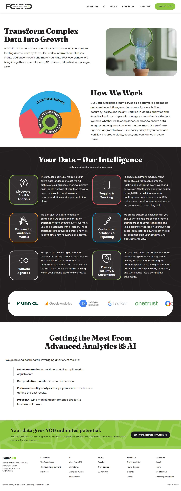

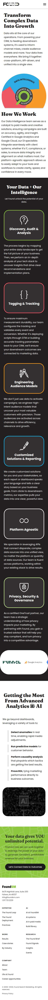

### Proposed changes

**Layout and design.** Headings move from Fraunces to the 2026 type system in `src/styles/site-2026.css`: Archivo Black, 82% width, uppercase, ink `#231f20` on paper `#eef1ec`. Body stays Poppins. Eyebrows are green `#8dc63f`. Buttons are caps. The header and footer keep their own type. Dark-band body text is white. Sections that are only a heading over a large empty area get pulled up so the copy sits with the heading. This is scoped to this page. It does not restyle the homepage, `/capabilities/`, `/ai/`, or the paid search page on PR #411.

This is a fixed practice page, not a landing-page child. It does not use the PR #411 template. The child template is for the pages under it.

Tab buttons currently swap panels, so some of the copy is hidden until a click. Show every panel in the same section. Keep the buttons as links to those panels. Nothing in the inventory is dropped.

Keep the certification and partner images. They are part of this practice page. Do not restyle them into the small floating badge rail you disliked on the paid search draft.

Add the homepage Talk with us form (ActiveCampaign form 8, `homeV2Forms.contact` in `src/lib/homeV2Content.ts`, the same form already on /contact-us/). Put it in the existing closing section. The intro is this page's closing paragraph, not the homepage intro. The button label is 'Let’s Connect Data to Outcomes', not 'Start the conversation'. Keep the existing contact link as well.

Heading order stays: Transform Complex Data Into Growth | How We Work | Your Data + Our Intelligence | Discovery, Audit & Analysis | Tagging & Tracking | Engineering Audience Models | Customized Solutions & Reporting | Platform Agnostic | Privacy, Security & Governance | Getting the Most From Advanced Analytics & AI | Your data gives YOU unlimited potential.

**Copy to optimize.**

None. The wording on the page already matches the facts I could verify. Sections move or restyle only.

**Content to add.**

The Talk with us form (ActiveCampaign form 8) is added in the closing section. Its words are the closing heading and paragraph already on this page. No new metric, logo, quote, or client name.

### Content inventory

Everything in `<main>` on staging today. The shared header and footer are inventoried once at the top of this file and stay on this page.
1. Section 1: Transform Complex Data Into Growth
2. Section 2: How We Work
3. Section 3: Your Data + Our Intelligence
4. Section 4: Getting the Most From Advanced Analytics & AI
5. Section 5: Your data gives YOU unlimited potential.
6. H1: Transform Complex Data Into Growth
7. H2: How We Work
8. H2: Your Data + Our Intelligence
9. H3: Discovery, Audit & Analysis
10. H3: Tagging & Tracking
11. H3: Engineering Audience Models
12. H3: Customized Solutions & Reporting
13. H3: Platform Agnostic
14. H3: Privacy, Security & Governance
15. H2: Getting the Most From Advanced Analytics & AI
16. H2: Your data gives YOU unlimited potential.
17. Data sits at the core of our operations. From powering your CRM, to feeding downstream systems, it’s used to inform channel mixes, create audience models and more. Your data lives everywhere. We bring it together: cross-platform, API-driven, and unified into a single view.
18. Our Data Intelligence team serves as a catalyst to paid media and creative solutions, ensuring campaigns are built on accuracy, agility, and insight. Certified in Google Analytics and Google Cloud, our DI specialists integrate seamlessly with client systems, whether it’s IT, compliance, or sales, to ensure data integrity and alignment on what matters most. Our platform-agnostic approach allows us to easily adapt to your tools and workflows to create clarity, speed, and confidence in every move.
19. Let Found unlock the potential of your data.
20. The process begins by mapping your entire data landscape to get the full picture of your business. Then, we perform an in-depth analysis of your tech stack to uncover insights that drive clear recommendations and implementation plans.
21. To ensure maximum measurement durability, our team configures the tracking and validates every event and conversion. Whether it’s deploying scripts through GTM or building accurate tracking parameters back to your CRM, we’ll ensure your downstream outcomes are connected to marketing data.
22. We don’t just use data to activate campaigns; we engineer high-intent audience models that uncover your most valuable customers with precision. Those audiences are activated across channels to drive efficiency, relevance and growth.
23. We create customized solutions for you and your stakeholders, so each report or dashboard speaks your language and tells a clear story based on your business goals. From clicks to downstream metrics, our expertise pulls your data into one clear, powerful view.
24. We specialize in leveraging APIs that connect disparate, complex data sources into one unified view, no matter the platform or quantity of data sources. Our team is fluent across platforms, working within your existing stack to drive results.
25. As a certified OneTrust partner, our team has a strategic understanding of how privacy impacts your marketing. By partnering with Found, you gain a trusted advisor that will help you stay compliant, and turn privacy into a competitive advantage.
26. We go beyond dashboards, leveraging a variety of tools to:
27. Detect anomalies in real time, enabling rapid media adjustments.
28. Run predictive models for customer behavior.
29. Perform causality analysis that pinpoints which tactics are getting the best results.
30. Prove ROI, tying marketing performance directly to business outcomes.
31. Find out how we can work together to leverage the power of your data to generate consistent, predictable revenue for your business.
32. Let’s Connect Data to Outcomes (/contact-us/)
33. Image alt 'image-12-sm', file f86e5a5746fca0f83604e618a6cd6f835b04c3bb-500x382.webp
34. Image alt 'Discovery, Audit & Analysis icon', file icon-discovery.svg
35. Image alt 'Tagging & Tracking icon', file icon-tagging.svg
36. Image alt 'Engineering Audience Models icon', file icon-audience.svg
37. Image alt 'Customized Solutions & Reporting icon', file icon-reporting.svg
38. Image alt 'Platform Agnostic icon', file icon-platform.svg
39. Image alt 'Privacy, Security & Governance icon', file icon-privacy.svg
40. Image alt 'Dynamics 365', file a6fa6fd7c2e686c88411b6eff976deb171472621-189x52.svg
41. Image alt 'Funnel', file 2144bb143b5dbcbdb67342e7c2947e33f2dbfa5c-169x24.svg
42. Image alt 'Google Analytics', file a9bf1eef28afde3d88742a15e3ecc0fed1ae46dd-247x47.svg
43. Image alt 'Google BigQuery', file 1f4f0a8f15f6656796f8311dc5f72d308030e5c6-178x63.svg
44. Image alt 'Looker', file dcd3eb1d50a0161625add097fd319f1b56cfaeb0-177x79.svg
45. Image alt 'OneTrust', file 7d1a1790bcec13887f75192bfe5405465df263aa-187x41.svg
46. Image alt 'Google Marketing Platform Certified', file db490999d44aeb90ca4d0f272f4754ff2f92a3ba-219x49.svg
47. Image alt 'Salesforce', file 213a9dedd1566397ee53dd963d8d5616dbfc1721-82x54.svg
48. Image alt 'Vertex AI', file 3f56a23f889aab85e678bf0ac38a1b39994f2eb8-123x41.svg
49. Image alt 'Vertex AI', file f51e8abe202792b9df48ed685b1483dccc8984c9-67x56.svg
50. Image alt 'Google Cloud Partner', file 9d0b6a538fc5dc23066abcef795376a298611099-41x47.svg
51. Image alt 'Dynamics 365', file a6fa6fd7c2e686c88411b6eff976deb171472621-189x52.svg
52. Image alt 'Funnel', file 2144bb143b5dbcbdb67342e7c2947e33f2dbfa5c-169x24.svg
53. Image alt 'Google Analytics', file a9bf1eef28afde3d88742a15e3ecc0fed1ae46dd-247x47.svg
54. Image alt 'Google BigQuery', file 1f4f0a8f15f6656796f8311dc5f72d308030e5c6-178x63.svg
55. Image alt 'Looker', file dcd3eb1d50a0161625add097fd319f1b56cfaeb0-177x79.svg
56. Image alt 'OneTrust', file 7d1a1790bcec13887f75192bfe5405465df263aa-187x41.svg
57. Image alt 'Google Marketing Platform Certified', file db490999d44aeb90ca4d0f272f4754ff2f92a3ba-219x49.svg
58. Image alt 'Salesforce', file 213a9dedd1566397ee53dd963d8d5616dbfc1721-82x54.svg
59. Image alt 'Vertex AI', file 3f56a23f889aab85e678bf0ac38a1b39994f2eb8-123x41.svg
60. Image alt 'Vertex AI', file f51e8abe202792b9df48ed685b1483dccc8984c9-67x56.svg
61. Image alt 'Google Cloud Partner', file 9d0b6a538fc5dc23066abcef795376a298611099-41x47.svg
62. Image alt 'Getting the Most From Advanced Analytics & AI', file 0f215cef02e6afec5cf14024d62a4c1e8083bcf4-800x1000.webp
63. video https://cdn.sanity.io/files/vzneqxsx/staging/e5fcd4d2ae5bae7d31107e2e7b75919f99ea0dea.mp4

### Content check

1. kept as is: Section 1: Transform Complex Data Into Growth
2. kept as is: Section 2: How We Work
3. kept as is: Section 3: Your Data + Our Intelligence
4. kept as is: Section 4: Getting the Most From Advanced Analytics & AI
5. kept as is: Section 5: Your data gives YOU unlimited potential.
6. kept as is: H1: Transform Complex Data Into Growth
7. kept as is: H2: How We Work
8. kept as is: H2: Your Data + Our Intelligence
9. kept as is: H3: Discovery, Audit & Analysis
10. kept as is: H3: Tagging & Tracking
11. kept as is: H3: Engineering Audience Models
12. kept as is: H3: Customized Solutions & Reporting
13. kept as is: H3: Platform Agnostic
14. kept as is: H3: Privacy, Security & Governance
15. kept as is: H2: Getting the Most From Advanced Analytics & AI
16. kept as is: H2: Your data gives YOU unlimited potential.
17. kept as is: Data sits at the core of our operations. From powering your CRM, to feeding downstream systems, it’s used to inform channel mixes, create audience models and more. Your data lives everywhere. We bring it together: cross-platform, API-driven, and unified into a single view.
18. kept as is: Our Data Intelligence team serves as a catalyst to paid media and creative solutions, ensuring campaigns are built on accuracy, agility, and insight. Certified in Google Analytics and Google Cloud, our DI specialists integrate seamlessly with client systems, whether it’s IT, compliance, or sales, to ensure data integrity and alignment on what matters most. Our platform-agnostic approach allows us to easily adapt to your tools and workflows to create clarity, speed, and confidence in every move.
19. kept as is: Let Found unlock the potential of your data.
20. kept as is: The process begins by mapping your entire data landscape to get the full picture of your business. Then, we perform an in-depth analysis of your tech stack to uncover insights that drive clear recommendations and implementation plans.
21. kept as is: To ensure maximum measurement durability, our team configures the tracking and validates every event and conversion. Whether it’s deploying scripts through GTM or building accurate tracking parameters back to your CRM, we’ll ensure your downstream outcomes are connected to marketing data.
22. kept as is: We don’t just use data to activate campaigns; we engineer high-intent audience models that uncover your most valuable customers with precision. Those audiences are activated across channels to drive efficiency, relevance and growth.
23. kept as is: We create customized solutions for you and your stakeholders, so each report or dashboard speaks your language and tells a clear story based on your business goals. From clicks to downstream metrics, our expertise pulls your data into one clear, powerful view.
24. kept as is: We specialize in leveraging APIs that connect disparate, complex data sources into one unified view, no matter the platform or quantity of data sources. Our team is fluent across platforms, working within your existing stack to drive results.
25. kept as is: As a certified OneTrust partner, our team has a strategic understanding of how privacy impacts your marketing. By partnering with Found, you gain a trusted advisor that will help you stay compliant, and turn privacy into a competitive advantage.
26. kept as is: We go beyond dashboards, leveraging a variety of tools to:
27. kept as is: Detect anomalies in real time, enabling rapid media adjustments.
28. kept as is: Run predictive models for customer behavior.
29. kept as is: Perform causality analysis that pinpoints which tactics are getting the best results.
30. kept as is: Prove ROI, tying marketing performance directly to business outcomes.
31. kept as is: Find out how we can work together to leverage the power of your data to generate consistent, predictable revenue for your business.
32. kept as is: Let’s Connect Data to Outcomes (/contact-us/)
33. kept as is: Image alt 'image-12-sm', file f86e5a5746fca0f83604e618a6cd6f835b04c3bb-500x382.webp
34. kept as is: Image alt 'Discovery, Audit & Analysis icon', file icon-discovery.svg
35. kept as is: Image alt 'Tagging & Tracking icon', file icon-tagging.svg
36. kept as is: Image alt 'Engineering Audience Models icon', file icon-audience.svg
37. kept as is: Image alt 'Customized Solutions & Reporting icon', file icon-reporting.svg
38. kept as is: Image alt 'Platform Agnostic icon', file icon-platform.svg
39. kept as is: Image alt 'Privacy, Security & Governance icon', file icon-privacy.svg
40. kept as is: Image alt 'Dynamics 365', file a6fa6fd7c2e686c88411b6eff976deb171472621-189x52.svg
41. kept as is: Image alt 'Funnel', file 2144bb143b5dbcbdb67342e7c2947e33f2dbfa5c-169x24.svg
42. kept as is: Image alt 'Google Analytics', file a9bf1eef28afde3d88742a15e3ecc0fed1ae46dd-247x47.svg
43. kept as is: Image alt 'Google BigQuery', file 1f4f0a8f15f6656796f8311dc5f72d308030e5c6-178x63.svg
44. kept as is: Image alt 'Looker', file dcd3eb1d50a0161625add097fd319f1b56cfaeb0-177x79.svg
45. kept as is: Image alt 'OneTrust', file 7d1a1790bcec13887f75192bfe5405465df263aa-187x41.svg
46. kept as is: Image alt 'Google Marketing Platform Certified', file db490999d44aeb90ca4d0f272f4754ff2f92a3ba-219x49.svg
47. kept as is: Image alt 'Salesforce', file 213a9dedd1566397ee53dd963d8d5616dbfc1721-82x54.svg
48. kept as is: Image alt 'Vertex AI', file 3f56a23f889aab85e678bf0ac38a1b39994f2eb8-123x41.svg
49. kept as is: Image alt 'Vertex AI', file f51e8abe202792b9df48ed685b1483dccc8984c9-67x56.svg
50. kept as is: Image alt 'Google Cloud Partner', file 9d0b6a538fc5dc23066abcef795376a298611099-41x47.svg
51. kept as is: Image alt 'Dynamics 365', file a6fa6fd7c2e686c88411b6eff976deb171472621-189x52.svg
52. kept as is: Image alt 'Funnel', file 2144bb143b5dbcbdb67342e7c2947e33f2dbfa5c-169x24.svg
53. kept as is: Image alt 'Google Analytics', file a9bf1eef28afde3d88742a15e3ecc0fed1ae46dd-247x47.svg
54. kept as is: Image alt 'Google BigQuery', file 1f4f0a8f15f6656796f8311dc5f72d308030e5c6-178x63.svg
55. kept as is: Image alt 'Looker', file dcd3eb1d50a0161625add097fd319f1b56cfaeb0-177x79.svg
56. kept as is: Image alt 'OneTrust', file 7d1a1790bcec13887f75192bfe5405465df263aa-187x41.svg
57. kept as is: Image alt 'Google Marketing Platform Certified', file db490999d44aeb90ca4d0f272f4754ff2f92a3ba-219x49.svg
58. kept as is: Image alt 'Salesforce', file 213a9dedd1566397ee53dd963d8d5616dbfc1721-82x54.svg
59. kept as is: Image alt 'Vertex AI', file 3f56a23f889aab85e678bf0ac38a1b39994f2eb8-123x41.svg
60. kept as is: Image alt 'Vertex AI', file f51e8abe202792b9df48ed685b1483dccc8984c9-67x56.svg
61. kept as is: Image alt 'Google Cloud Partner', file 9d0b6a538fc5dc23066abcef795376a298611099-41x47.svg
62. kept as is: Image alt 'Getting the Most From Advanced Analytics & AI', file 0f215cef02e6afec5cf14024d62a4c1e8083bcf4-800x1000.webp
63. kept as is: video https://cdn.sanity.io/files/vzneqxsx/staging/e5fcd4d2ae5bae7d31107e2e7b75919f99ea0dea.mp4

### Open questions

- None for this page. Shared questions are at the top of the file.

### Effort

large

## 14. Data activation

**Approve?** Move the data activation practice page onto the 2026 type system and show every panel.

- Staging URL: https://staging.foundsm.com/capabilities/data-activation/
- Source: `src/pages/capabilities/data-activation.astro, src/components/DataActivationPage.astro`
- Sanity document: `capabilityDataActivationPage`
- Robots, kept as is: `index, follow, max-image-preview:large, max-snippet:-1, max-video-preview:-1`
- Canonical, kept as is: `https://foundsm.com/capabilities/data-activation/`
- Current heading font: Fraunces, Georgia, serif

### Current state

Full page on staging, November 17, 2026. Scroll-in sections are shown open so the picture matches what a visitor sees after scrolling.

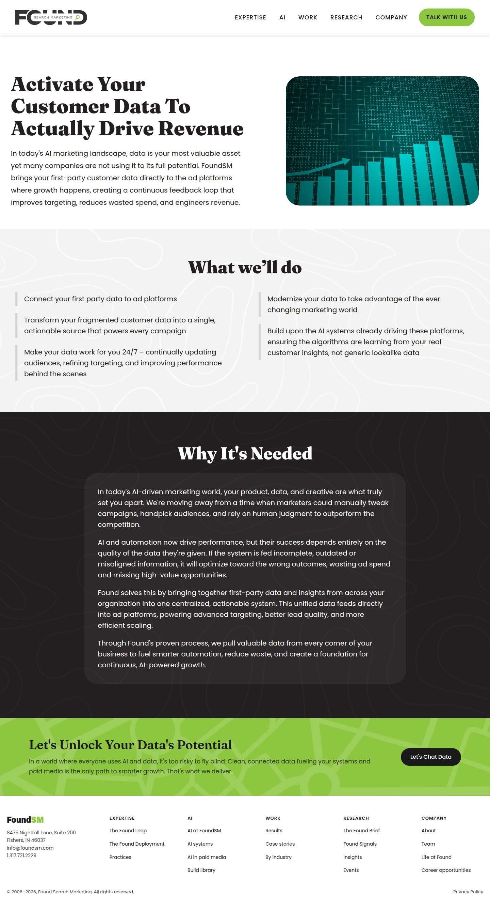

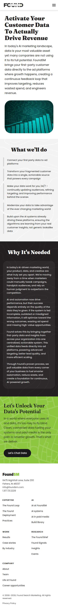

### Proposed changes

**Layout and design.** Headings move from Fraunces to the 2026 type system in `src/styles/site-2026.css`: Archivo Black, 82% width, uppercase, ink `#231f20` on paper `#eef1ec`. Body stays Poppins. Eyebrows are green `#8dc63f`. Buttons are caps. The header and footer keep their own type. Dark-band body text is white. Sections that are only a heading over a large empty area get pulled up so the copy sits with the heading. This is scoped to this page. It does not restyle the homepage, `/capabilities/`, `/ai/`, or the paid search page on PR #411.

This is a fixed practice page, not a landing-page child. It does not use the PR #411 template. The child template is for the pages under it.

Tab buttons currently swap panels, so some of the copy is hidden until a click. Show every panel in the same section. Keep the buttons as links to those panels. Nothing in the inventory is dropped.

Keep the certification and partner images. They are part of this practice page. Do not restyle them into the small floating badge rail you disliked on the paid search draft.

Add the homepage Talk with us form (ActiveCampaign form 8, `homeV2Forms.contact` in `src/lib/homeV2Content.ts`, the same form already on /contact-us/). Put it in the existing closing section. The intro is this page's closing paragraph, not the homepage intro. The button label is 'the existing closing button', not 'Start the conversation'. Keep the existing contact link as well.

Heading order stays: Activate Your Customer Data To Actually Drive Revenue | What we’ll do | Why It's Needed | Let's Unlock Your Data's Potential

**Copy to optimize.**

None. The wording on the page already matches the facts I could verify. Sections move or restyle only.

**Content to add.**

The Talk with us form (ActiveCampaign form 8) is added in the closing section. Its words are the closing heading and paragraph already on this page. No new metric, logo, quote, or client name.

### Content inventory

Everything in `<main>` on staging today. The shared header and footer are inventoried once at the top of this file and stay on this page.
1. Section 1: Activate Your Customer Data To Actually Drive Revenue
2. Section 2: What we’ll do
3. Section 3: Why It's Needed
4. Section 4: Let's Unlock Your Data's Potential
5. H1: Activate Your Customer Data To Actually Drive Revenue
6. H2: What we’ll do
7. H2: Why It's Needed
8. H2: Let's Unlock Your Data's Potential
9. In today's AI marketing landscape, data is your most valuable asset yet many companies are not using it to its full potential. FoundSM brings your first-party customer data directly to the ad platforms where growth happens, creating a continuous feedback loop that improves targeting, reduces wasted spend, and engineers revenue.
10. Connect your first party data to ad platforms
11. Transform your fragmented customer data into a single, actionable source that powers every campaign
12. Make your data work for you 24/7 – continually updating audiences, refining targeting, and improving performance behind the scenes
13. Modernize your data to take advantage of the ever changing marketing world
14. Build upon the AI systems already driving these platforms, ensuring the algorithms are learning from your real customer insights, not generic lookalike data
15. In today's AI-driven marketing world, your product, data, and creative are what truly set you apart. We're moving away from a time when marketers could manually tweak campaigns, handpick audiences, and rely on human judgment to outperform the competition.
16. AI and automation now drive performance, but their success depends entirely on the quality of the data they're given. If the system is fed incomplete, outdated or misaligned information, it will optimize toward the wrong outcomes, wasting ad spend and missing high-value opportunities.
17. Found solves this by bringing together first-party data and insights from across your organization into one centralized, actionable system. This unified data feeds directly into ad platforms, powering advanced targeting, better lead quality, and more efficient scaling.
18. Through Found's proven process, we pull valuable data from every corner of your business to fuel smarter automation, reduce waste, and create a foundation for continuous, AI-powered growth.
19. In a world where everyone uses AI and data, it's too risky to fly blind. Clean, connected data fueling your systems and paid media is the only path to smarter growth. That's what we deliver.
20. Let's Chat Data (https://foundsm.com/dataconnect/)
21. video https://cdn.sanity.io/files/vzneqxsx/staging/82d1f01f9ffa97aa8a8889bf75fb1a8e794b34bf.mp4

### Content check

1. kept as is: Section 1: Activate Your Customer Data To Actually Drive Revenue
2. kept as is: Section 2: What we’ll do
3. kept as is: Section 3: Why It's Needed
4. kept as is: Section 4: Let's Unlock Your Data's Potential
5. kept as is: H1: Activate Your Customer Data To Actually Drive Revenue
6. kept as is: H2: What we’ll do
7. kept as is: H2: Why It's Needed
8. kept as is: H2: Let's Unlock Your Data's Potential
9. kept as is: In today's AI marketing landscape, data is your most valuable asset yet many companies are not using it to its full potential. FoundSM brings your first-party customer data directly to the ad platforms where growth happens, creating a continuous feedback loop that improves targeting, reduces wasted spend, and engineers revenue.
10. kept as is: Connect your first party data to ad platforms
11. kept as is: Transform your fragmented customer data into a single, actionable source that powers every campaign
12. kept as is: Make your data work for you 24/7 – continually updating audiences, refining targeting, and improving performance behind the scenes
13. kept as is: Modernize your data to take advantage of the ever changing marketing world
14. kept as is: Build upon the AI systems already driving these platforms, ensuring the algorithms are learning from your real customer insights, not generic lookalike data
15. kept as is: In today's AI-driven marketing world, your product, data, and creative are what truly set you apart. We're moving away from a time when marketers could manually tweak campaigns, handpick audiences, and rely on human judgment to outperform the competition.
16. kept as is: AI and automation now drive performance, but their success depends entirely on the quality of the data they're given. If the system is fed incomplete, outdated or misaligned information, it will optimize toward the wrong outcomes, wasting ad spend and missing high-value opportunities.
17. kept as is: Found solves this by bringing together first-party data and insights from across your organization into one centralized, actionable system. This unified data feeds directly into ad platforms, powering advanced targeting, better lead quality, and more efficient scaling.
18. kept as is: Through Found's proven process, we pull valuable data from every corner of your business to fuel smarter automation, reduce waste, and create a foundation for continuous, AI-powered growth.
19. kept as is: In a world where everyone uses AI and data, it's too risky to fly blind. Clean, connected data fueling your systems and paid media is the only path to smarter growth. That's what we deliver.
20. kept as is: Let's Chat Data (https://foundsm.com/dataconnect/)
21. kept as is: video https://cdn.sanity.io/files/vzneqxsx/staging/82d1f01f9ffa97aa8a8889bf75fb1a8e794b34bf.mp4

### Open questions

- None for this page. Shared questions are at the top of the file.

### Effort

large

## 15. Performance creative

**Approve?** Move the performance creative practice page onto the 2026 type system and show every panel.

- Staging URL: https://staging.foundsm.com/capabilities/performance-creative/
- Source: `src/pages/capabilities/performance-creative.astro, src/components/modern/PerformanceCreativePage.astro`
- Sanity document: `capabilityPerformanceCreativePage`
- Robots, kept as is: `index, follow, max-image-preview:large, max-snippet:-1, max-video-preview:-1`
- Canonical, kept as is: `https://foundsm.com/capabilities/performance-creative/`
- Current heading font: Fraunces, Georgia, serif

### Current state

Full page on staging, November 17, 2026. Scroll-in sections are shown open so the picture matches what a visitor sees after scrolling.

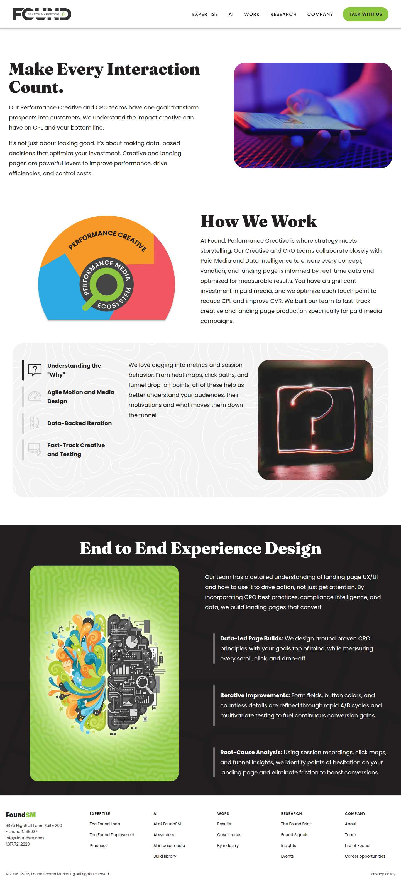

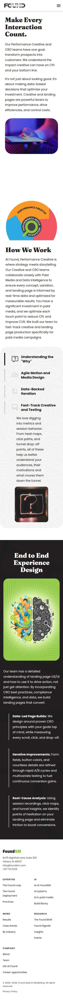

### Proposed changes

**Layout and design.** Headings move from Fraunces to the 2026 type system in `src/styles/site-2026.css`: Archivo Black, 82% width, uppercase, ink `#231f20` on paper `#eef1ec`. Body stays Poppins. Eyebrows are green `#8dc63f`. Buttons are caps. The header and footer keep their own type. Dark-band body text is white. Sections that are only a heading over a large empty area get pulled up so the copy sits with the heading. This is scoped to this page. It does not restyle the homepage, `/capabilities/`, `/ai/`, or the paid search page on PR #411.

This is a fixed practice page, not a landing-page child. It does not use the PR #411 template. The child template is for the pages under it.

Tab buttons currently swap panels, so some of the copy is hidden until a click. Show every panel in the same section. Keep the buttons as links to those panels. Nothing in the inventory is dropped.

Keep the certification and partner images. They are part of this practice page. Do not restyle them into the small floating badge rail you disliked on the paid search draft.

Buttons that swap content: Understanding the "Why"; Agile Motion and Media Design; Data-Backed Iteration; Fast-Track Creative and Testing. Show each panel in the section instead of hiding it.

Add the homepage Talk with us form (ActiveCampaign form 8, `homeV2Forms.contact` in `src/lib/homeV2Content.ts`, the same form already on /contact-us/). Put it in the existing closing section. The intro is this page's closing paragraph, not the homepage intro. The button label is 'the existing closing button', not 'Start the conversation'. Keep the existing contact link as well.

Heading order stays: Make Every Interaction Count. | How We Work | End to End Experience Design

**Copy to optimize.**

None. The wording on the page already matches the facts I could verify. Sections move or restyle only.

**Content to add.**

The Talk with us form (ActiveCampaign form 8) is added in the closing section. Its words are the closing heading and paragraph already on this page. No new metric, logo, quote, or client name.

### Content inventory

Everything in `<main>` on staging today. The shared header and footer are inventoried once at the top of this file and stay on this page.
1. Section 1: Make Every Interaction Count.
2. Section 2: How We Work
3. Section 3: Performance creative methods
4. Section 4: End to End Experience Design
5. H1: Make Every Interaction Count.
6. H2: How We Work
7. H2: End to End Experience Design
8. Our Performance Creative and CRO teams have one goal: transform prospects into customers. We understand the impact creative can have on CPL and your bottom line.
9. It's not just about looking good. It's about making data-based decisions that optimize your investment. Creative and landing pages are powerful levers to improve performance, drive efficiencies, and control costs.
10. At Found, Performance Creative is where strategy meets storytelling. Our Creative and CRO teams collaborate closely with Paid Media and Data Intelligence to ensure every concept, variation, and landing page is informed by real-time data and optimized for measurable results. You have a significant investment in paid media, and we optimize each touch point to reduce CPL and improve CVR. We built our team to fast-track creative and landing page production specifically for paid media campaigns.
11. We love digging into metrics and session behavior. From heat maps, click paths, and funnel drop-off points, all of these help us better understand your audiences, their motivations and what moves them down the funnel.
12. No months-long VFX shoots here. We specialize in fast-tracked creative that has one goal - perform. Our team creates images, videos, and landing pages in days or hours, not weeks. Our project managers plug in with your internal team so you have full visibility and can review and approve all assets.
13. Using innovative tools that include eye-tracking and scroll-map data, we validate creative and page tweaks in real time. Each test is measured, refined, and expanded according to results.
14. Found's Performance Creative Team combines inventive motion design, data-driven landing page builds and conversion rate optimization into one seamless workflow. While we are no stranger to creative sprints, we hold brand safety and compliance to the highest standards.
15. Our team has a detailed understanding of landing page UX/UI and how to use it to drive action, not just get attention. By incorporating CRO best practices, compliance intelligence, and data, we build landing pages that convert.
16. Data-Led Page Builds: We design around proven CRO principles with your goals top of mind, while measuring every scroll, click, and drop-off.
17. Iterative Improvements: Form fields, button colors, and countless details are refined through rapid A/B cycles and multivariate testing to fuel continuous conversion gains.
18. Root-Cause Analysis: Using session recordings, click maps, and funnel insights, we identify points of hesitation on your landing page and eliminate friction to boost conversions.
19. Understanding the "Why"
20. Agile Motion and Media Design
21. Data-Backed Iteration
22. Fast-Track Creative and Testing
23. Image alt 'Performance creative ecosystem diagram', file performance-creative-ecosystem.png
24. Image alt 'Understanding the "Why" icon', file icon-why.svg
25. Image alt 'Agile Motion and Media Design icon', file icon-agile.svg
26. Image alt 'Data-Backed Iteration icon', file icon-iteration.svg
27. Image alt 'Fast-Track Creative and Testing icon', file icon-testing.svg
28. Image alt 'Understanding the "Why"', file 3856fd4da057e7a397ff0736ece08f5c25bdc39b-413x431.webp
29. Image alt 'Agile Motion and Media Design', file 75b913fea26551951dcd9f4eeca98161959c241c-413x431.webp
30. Image alt 'Data-Backed Iteration', file ed228568b3a6ad46081ec528083ebdd79ce1bca6-413x431.webp
31. Image alt 'Fast-Track Creative and Testing', file 38765ec01abe73b97b85ad7a4f5bb2f281f2233e-413x431.webp
32. Image alt 'End to End Experience Design', file e57dc66d1ebbe6ee703b183ec5d5b9df5310c923-535x774.webp
33. video https://cdn.sanity.io/files/vzneqxsx/staging/bf2f3802b9555fe03b8bb57dc92e8124d5ff9975.mp4

### Content check

1. kept as is: Section 1: Make Every Interaction Count.
2. kept as is: Section 2: How We Work
3. kept as is: Section 3: Performance creative methods
4. kept as is: Section 4: End to End Experience Design
5. kept as is: H1: Make Every Interaction Count.
6. kept as is: H2: How We Work
7. kept as is: H2: End to End Experience Design
8. kept as is: Our Performance Creative and CRO teams have one goal: transform prospects into customers. We understand the impact creative can have on CPL and your bottom line.
9. kept as is: It's not just about looking good. It's about making data-based decisions that optimize your investment. Creative and landing pages are powerful levers to improve performance, drive efficiencies, and control costs.
10. kept as is: At Found, Performance Creative is where strategy meets storytelling. Our Creative and CRO teams collaborate closely with Paid Media and Data Intelligence to ensure every concept, variation, and landing page is informed by real-time data and optimized for measurable results. You have a significant investment in paid media, and we optimize each touch point to reduce CPL and improve CVR. We built our team to fast-track creative and landing page production specifically for paid media campaigns.
11. kept as is: We love digging into metrics and session behavior. From heat maps, click paths, and funnel drop-off points, all of these help us better understand your audiences, their motivations and what moves them down the funnel.
12. kept as is: No months-long VFX shoots here. We specialize in fast-tracked creative that has one goal - perform. Our team creates images, videos, and landing pages in days or hours, not weeks. Our project managers plug in with your internal team so you have full visibility and can review and approve all assets.
13. kept as is: Using innovative tools that include eye-tracking and scroll-map data, we validate creative and page tweaks in real time. Each test is measured, refined, and expanded according to results.
14. kept as is: Found's Performance Creative Team combines inventive motion design, data-driven landing page builds and conversion rate optimization into one seamless workflow. While we are no stranger to creative sprints, we hold brand safety and compliance to the highest standards.
15. kept as is: Our team has a detailed understanding of landing page UX/UI and how to use it to drive action, not just get attention. By incorporating CRO best practices, compliance intelligence, and data, we build landing pages that convert.
16. kept as is: Data-Led Page Builds: We design around proven CRO principles with your goals top of mind, while measuring every scroll, click, and drop-off.
17. kept as is: Iterative Improvements: Form fields, button colors, and countless details are refined through rapid A/B cycles and multivariate testing to fuel continuous conversion gains.
18. kept as is: Root-Cause Analysis: Using session recordings, click maps, and funnel insights, we identify points of hesitation on your landing page and eliminate friction to boost conversions.
19. kept as is: Understanding the "Why"
20. kept as is: Agile Motion and Media Design
21. kept as is: Data-Backed Iteration
22. kept as is: Fast-Track Creative and Testing
23. kept as is: Image alt 'Performance creative ecosystem diagram', file performance-creative-ecosystem.png
24. kept as is: Image alt 'Understanding the "Why" icon', file icon-why.svg
25. kept as is: Image alt 'Agile Motion and Media Design icon', file icon-agile.svg
26. kept as is: Image alt 'Data-Backed Iteration icon', file icon-iteration.svg
27. kept as is: Image alt 'Fast-Track Creative and Testing icon', file icon-testing.svg
28. kept as is: Image alt 'Understanding the "Why"', file 3856fd4da057e7a397ff0736ece08f5c25bdc39b-413x431.webp
29. kept as is: Image alt 'Agile Motion and Media Design', file 75b913fea26551951dcd9f4eeca98161959c241c-413x431.webp
30. kept as is: Image alt 'Data-Backed Iteration', file ed228568b3a6ad46081ec528083ebdd79ce1bca6-413x431.webp
31. kept as is: Image alt 'Fast-Track Creative and Testing', file 38765ec01abe73b97b85ad7a4f5bb2f281f2233e-413x431.webp
32. kept as is: Image alt 'End to End Experience Design', file e57dc66d1ebbe6ee703b183ec5d5b9df5310c923-535x774.webp
33. kept as is: video https://cdn.sanity.io/files/vzneqxsx/staging/bf2f3802b9555fe03b8bb57dc92e8124d5ff9975.mp4

### Open questions

- None for this page. Shared questions are at the top of the file.

### Effort

large

## 16. Paid social

**Approve?** Propose Paid social on the Option A child template from open PR #411, without the partner badge rail.

- Staging URL: https://staging.foundsm.com/capabilities/paid-media/paid-social/
- Source: `src/pages/[...path].astro`
- Sanity document: `landing-page-pm-paid-social`
- Robots, kept as is: `noindex, nofollow`
- Canonical, kept as is: `https://foundsm.com/capabilities/paid-media/paid-social/`
- Current heading font: Fraunces, Georgia, serif

### Current state

Full page on staging, November 17, 2026. Scroll-in sections are shown open so the picture matches what a visitor sees after scrolling.

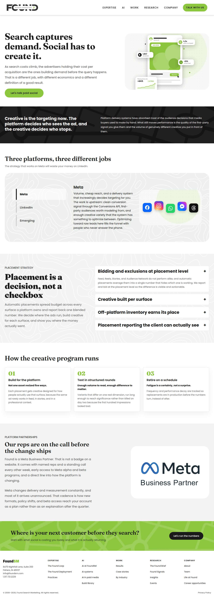

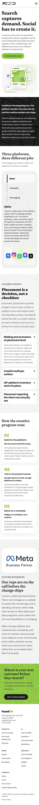

### Proposed changes

**Layout and design.** Headings move from Fraunces to the 2026 type system in `src/styles/site-2026.css`: Archivo Black, 82% width, uppercase, ink `#231f20` on paper `#eef1ec`. Body stays Poppins. Eyebrows are green `#8dc63f`. Buttons are caps. The header and footer keep their own type. Dark-band body text is white. Sections that are only a heading over a large empty area get pulled up so the copy sits with the heading. This is scoped to this page. It does not restyle the homepage, `/capabilities/`, `/ai/`, or the paid search page on PR #411.

This proposal is written against the Option A child template in open PR #411 (`cursor/capabilities-child-template-723b`, not merged and not approved). It is the same template as the paid search page in that PR, which matches the parent practice pages. Paid search itself is out of scope and stays on PR #411.

Do not copy the Platform Partnerships badge rail. You disliked the small badges floating in white space. The template in #411 maps the first `splitFeatureBlock` to that rail and skips `featureTabsBlock`. This page cannot use the template until those two behaviors change: every current block still renders, and a split feature keeps its own copy and media.

Staging section types, in order: modernHeroBlock, statementBandBlock, featureTabsBlock, accordionBlock, cardGridBlock, splitFeatureBlock, modernCtaBlock. All of them stay on this page.

`featureTabsBlock` is not in the template's shown set today. Extending the template to render it is part of this proposal. Dropping the tabs would delete content.

Do not add a 46% results block or a brand-logo bar. This page does not have either in the capture, and the child-page rule says not to add them.

Related cards come from the sibling links already in the Expertise menu (`src/components/Header.astro`). The new labels 'See what we run' and 'Related capabilities' are added chrome from the template. They do not replace this page's headings.

Add the homepage Talk with us form (ActiveCampaign form 8, `homeV2Forms.contact` in `src/lib/homeV2Content.ts`, the same form already on /contact-us/). Put it in the existing closing section. The intro is this page's closing paragraph, not the homepage intro. The button label is 'Let's talk paid social', not 'Start the conversation'. Keep the existing contact link as well.

Heading order stays: Search captures demand. Social has to create it. | Three platforms, three different jobs | Meta | LinkedIn | Emerging | Placement is a decision, not a checkbox | Bidding and exclusions at placement level + | Creative built per surface + | Off-platform inventory earns its place + | Placement reporting the client can actually see + | How the creative program runs | Build for the platform | (more headings are in the inventory)

**Copy to optimize.**

None. The wording on the page already matches the facts I could verify. Sections move or restyle only.

**Content to add.**

The Talk with us form (ActiveCampaign form 8) is added in the closing section. Its words are the closing heading and paragraph already on this page. No new metric, logo, quote, or client name.

### Content inventory

Everything in `<main>` on staging today. The shared header and footer are inventoried once at the top of this file and stay on this page.
1. Section 1: Search captures demand. Social has to create it.
2. Section 2: Statement band (copy is in the paragraphs below)
3. Section 3: Three platforms, three different jobs
4. Section 4: Placement is a decision, not a checkbox
5. Section 5: How the creative program runs
6. Section 6: Our reps are on the call before the change ships
7. Section 7: Where is your next customer before they search?
8. H1: Search captures demand. Social has to create it.
9. H2: Three platforms, three different jobs
10. H3: Meta
11. H3: LinkedIn
12. H3: Emerging
13. H2: Placement is a decision, not a checkbox
14. H3: Bidding and exclusions at placement level +
15. H3: Creative built per surface +
16. H3: Off-platform inventory earns its place +
17. H3: Placement reporting the client can actually see +
18. H2: How the creative program runs
19. H3: Build for the platform
20. H3: Test in structured rounds
21. H3: Retire on a schedule
22. H2: Our reps are on the call before the change ships
23. H2: Where is your next customer before they search?
24. As search costs climb, the advertisers holding their cost per acquisition are the ones building demand before the query happens. That is a different job, with different economics and a different definition of a good result.
25. Creative is the targeting now. The platform decides who sees the ad, and the creative decides who stops.
26. Platform delivery systems have absorbed most of the audience decisions that media buyers used to make by hand. What still moves performance is the quality of the first-party signal you give them and the volume of genuinely different creative you put in front of them.
27. The strategy that works on Meta will waste your money on LinkedIn.
28. Volume, cheap reach, and a delivery system that increasingly decides targeting for you. The work is upstream: clean conversion signal through the Conversions API, first-party audiences worth modeling from, and enough creative variety that the system has something to optimize between. Optimizing toward raw leads here fills the funnel with people who never answer the phone.
29. Expensive impressions and the most precise professional targeting available, which makes waste costly and precision valuable. Worth it when contract values justify the cost per lead. We run it against qualified-lead signal from the CRM rather than platform-reported conversions, because at this volume the platform's numbers are too thin to steer by.
30. Reddit, TikTok, Snapchat, and whatever launches next. These are tests with a defined budget, a defined read window, and a decision at the end. Early-adopter advantage is real and it is temporary, so the discipline is knowing when a channel has earned a permanent line in the budget and when it has not.
31. PLACEMENT STRATEGY
32. Automatic placements spread budget across every surface a platform owns and report back one blended number. We decide where the ads run, build creative for each surface, and show you where the money actually went.
33. Feed, Reels, Stories, and Audience Network do not perform alike, and automatic placements average them into a single number that hides which one is working. We report and bid at the placement level so the difference is visible and actionable.
34. A vertical Reel is not a feed image rotated ninety degrees. Each placement gets assets built for how people actually consume that surface, including how much of the frame the interface covers.
35. Audience Network and equivalent extensions are cheap for a reason. They stay in the mix when they prove out against qualified leads, and come out when they do not, rather than riding along inside a default setting.
36. Where the budget went, not just what it cost. If a third of spend landed somewhere nobody would have chosen deliberately, that should be a visible fact rather than a discovery six months later.
37. 01
38. Not one asset resized five ways.
39. Each placement gets creative designed for how people actually use that surface, because the same ad rarely works in feed, in stories, and in a professional context.
40. 02
41. Enough volume to read, enough difference to matter.
42. Variants that differ on one real dimension, run long enough to reach significance rather than killed on day two because the first hundred impressions looked bad.
43. 03
44. Fatigue is a certainty, not a surprise.
45. Frequency and performance decay are tracked so replacements are in production before the numbers turn, instead of after.
46. PLATFORM PARTNERSHIPS
47. Found is a Meta Business Partner. That is not a badge on a website. It comes with named reps and a standing call every other week, early access to Meta alpha and beta programs, and a direct line into how the platform is changing.
48. Meta changes delivery and measurement constantly, and most of it arrives unannounced. That cadence is how new formats, policy shifts, and beta access reach your account as a plan rather than as an explanation after the quarter.
49. Start with what social is costing you today and what it is actually returning.
50. Let's talk paid social (/contact-us/)
51. Let's run the numbers (/contact-us/)
52. Meta
53. LinkedIn
54. Emerging
55. Bidding and exclusions at placement level +
56. Creative built per surface +
57. Off-platform inventory earns its place +
58. Placement reporting the client can actually see +
59. Image alt 'Sponsored social ad with return on ad spend, conversions and cost per lead callouts', file c436108ce14ea53f31cdd36ff8022d40b9ea71cd-1600x1600.webp
60. Image alt 'Facebook, Instagram, WhatsApp, Messenger and Threads logos', file bf9395c8d9feabb69736e7211318102297dd2fe6-1600x900.webp
61. Image alt 'LinkedIn Ads logo', file d8949bdc1e61ba85a1745fb077bf29a269e01487-1600x900.webp
62. Image alt 'Reddit, TikTok, Snapchat and X logos', file 468f3b06a49ea39f1103bf8a3f56d54043b99405-1600x900.webp
63. Image alt 'Meta Business Partner badge', file c45c7449c299bda9611125612cbb1bdeeec58291-293x285.svg

### Content check

1. kept as is: Section 1: Search captures demand. Social has to create it.
2. kept as is: Section 2: Statement band (copy is in the paragraphs below)
3. kept as is: Section 3: Three platforms, three different jobs
4. kept as is: Section 4: Placement is a decision, not a checkbox
5. kept as is: Section 5: How the creative program runs
6. kept as is: Section 6: Our reps are on the call before the change ships
7. kept as is: Section 7: Where is your next customer before they search?
8. kept as is: H1: Search captures demand. Social has to create it.
9. kept as is: H2: Three platforms, three different jobs
10. kept as is: H3: Meta
11. kept as is: H3: LinkedIn
12. kept as is: H3: Emerging
13. kept as is: H2: Placement is a decision, not a checkbox
14. kept as is: H3: Bidding and exclusions at placement level +
15. kept as is: H3: Creative built per surface +
16. kept as is: H3: Off-platform inventory earns its place +
17. kept as is: H3: Placement reporting the client can actually see +
18. kept as is: H2: How the creative program runs
19. kept as is: H3: Build for the platform
20. kept as is: H3: Test in structured rounds
21. kept as is: H3: Retire on a schedule
22. kept as is: H2: Our reps are on the call before the change ships
23. kept as is: H2: Where is your next customer before they search?
24. kept as is: As search costs climb, the advertisers holding their cost per acquisition are the ones building demand before the query happens. That is a different job, with different economics and a different definition of a good result.
25. kept as is: Creative is the targeting now. The platform decides who sees the ad, and the creative decides who stops.
26. kept as is: Platform delivery systems have absorbed most of the audience decisions that media buyers used to make by hand. What still moves performance is the quality of the first-party signal you give them and the volume of genuinely different creative you put in front of them.
27. kept as is: The strategy that works on Meta will waste your money on LinkedIn.
28. kept as is: Volume, cheap reach, and a delivery system that increasingly decides targeting for you. The work is upstream: clean conversion signal through the Conversions API, first-party audiences worth modeling from, and enough creative variety that the system has something to optimize between. Optimizing toward raw leads here fills the funnel with people who never answer the phone.
29. kept as is: Expensive impressions and the most precise professional targeting available, which makes waste costly and precision valuable. Worth it when contract values justify the cost per lead. We run it against qualified-lead signal from the CRM rather than platform-reported conversions, because at this volume the platform's numbers are too thin to steer by.
30. kept as is: Reddit, TikTok, Snapchat, and whatever launches next. These are tests with a defined budget, a defined read window, and a decision at the end. Early-adopter advantage is real and it is temporary, so the discipline is knowing when a channel has earned a permanent line in the budget and when it has not.
31. kept as is: PLACEMENT STRATEGY
32. kept as is: Automatic placements spread budget across every surface a platform owns and report back one blended number. We decide where the ads run, build creative for each surface, and show you where the money actually went.
33. kept as is: Feed, Reels, Stories, and Audience Network do not perform alike, and automatic placements average them into a single number that hides which one is working. We report and bid at the placement level so the difference is visible and actionable.
34. kept as is: A vertical Reel is not a feed image rotated ninety degrees. Each placement gets assets built for how people actually consume that surface, including how much of the frame the interface covers.
35. kept as is: Audience Network and equivalent extensions are cheap for a reason. They stay in the mix when they prove out against qualified leads, and come out when they do not, rather than riding along inside a default setting.
36. kept as is: Where the budget went, not just what it cost. If a third of spend landed somewhere nobody would have chosen deliberately, that should be a visible fact rather than a discovery six months later.
37. kept as is: 01
38. kept as is: Not one asset resized five ways.
39. kept as is: Each placement gets creative designed for how people actually use that surface, because the same ad rarely works in feed, in stories, and in a professional context.
40. kept as is: 02
41. kept as is: Enough volume to read, enough difference to matter.
42. kept as is: Variants that differ on one real dimension, run long enough to reach significance rather than killed on day two because the first hundred impressions looked bad.
43. kept as is: 03
44. kept as is: Fatigue is a certainty, not a surprise.
45. kept as is: Frequency and performance decay are tracked so replacements are in production before the numbers turn, instead of after.
46. kept as is: PLATFORM PARTNERSHIPS
47. kept as is: Found is a Meta Business Partner. That is not a badge on a website. It comes with named reps and a standing call every other week, early access to Meta alpha and beta programs, and a direct line into how the platform is changing.
48. kept as is: Meta changes delivery and measurement constantly, and most of it arrives unannounced. That cadence is how new formats, policy shifts, and beta access reach your account as a plan rather than as an explanation after the quarter.
49. kept as is: Start with what social is costing you today and what it is actually returning.
50. kept as is: Let's talk paid social (/contact-us/)
51. kept as is: Let's run the numbers (/contact-us/)
52. kept as is: Meta
53. kept as is: LinkedIn
54. kept as is: Emerging
55. kept as is: Bidding and exclusions at placement level +
56. kept as is: Creative built per surface +
57. kept as is: Off-platform inventory earns its place +
58. kept as is: Placement reporting the client can actually see +
59. kept as is: Image alt 'Sponsored social ad with return on ad spend, conversions and cost per lead callouts', file c436108ce14ea53f31cdd36ff8022d40b9ea71cd-1600x1600.webp
60. kept as is: Image alt 'Facebook, Instagram, WhatsApp, Messenger and Threads logos', file bf9395c8d9feabb69736e7211318102297dd2fe6-1600x900.webp
61. kept as is: Image alt 'LinkedIn Ads logo', file d8949bdc1e61ba85a1745fb077bf29a269e01487-1600x900.webp
62. kept as is: Image alt 'Reddit, TikTok, Snapchat and X logos', file 468f3b06a49ea39f1103bf8a3f56d54043b99405-1600x900.webp
63. kept as is: Image alt 'Meta Business Partner badge', file c45c7449c299bda9611125612cbb1bdeeec58291-293x285.svg

### Open questions

- None for this page. Shared questions are at the top of the file.

### Effort

medium

## 17. Programmatic

**Approve?** Propose Programmatic on the Option A child template from open PR #411, without the partner badge rail.

- Staging URL: https://staging.foundsm.com/capabilities/paid-media/programmatic/
- Source: `src/pages/[...path].astro`
- Sanity document: `landing-page-pm-programmatic`
- Robots, kept as is: `noindex, nofollow`
- Canonical, kept as is: `https://foundsm.com/capabilities/paid-media/programmatic/`
- Current heading font: Fraunces, Georgia, serif

### Current state

Full page on staging, November 17, 2026. Scroll-in sections are shown open so the picture matches what a visitor sees after scrolling.

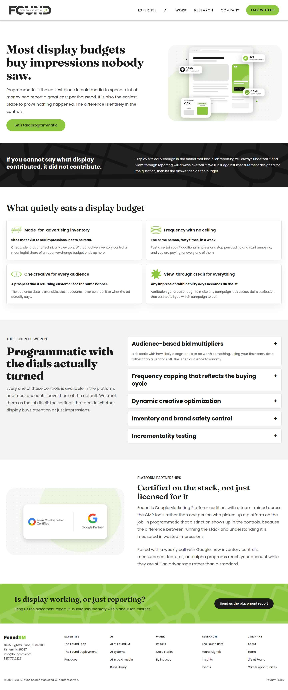

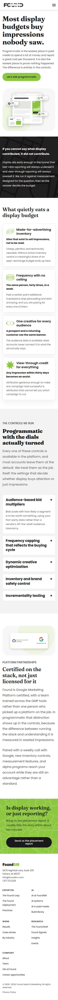

### Proposed changes

**Layout and design.** Headings move from Fraunces to the 2026 type system in `src/styles/site-2026.css`: Archivo Black, 82% width, uppercase, ink `#231f20` on paper `#eef1ec`. Body stays Poppins. Eyebrows are green `#8dc63f`. Buttons are caps. The header and footer keep their own type. Dark-band body text is white. Sections that are only a heading over a large empty area get pulled up so the copy sits with the heading. This is scoped to this page. It does not restyle the homepage, `/capabilities/`, `/ai/`, or the paid search page on PR #411.

This proposal is written against the Option A child template in open PR #411 (`cursor/capabilities-child-template-723b`, not merged and not approved). It is the same template as the paid search page in that PR, which matches the parent practice pages. Paid search itself is out of scope and stays on PR #411.

Do not copy the Platform Partnerships badge rail. You disliked the small badges floating in white space. The template in #411 maps the first `splitFeatureBlock` to that rail and skips `featureTabsBlock`. This page cannot use the template until those two behaviors change: every current block still renders, and a split feature keeps its own copy and media.

Staging section types, in order: modernHeroBlock, statementBandBlock, cardGridBlock, accordionBlock, splitFeatureBlock, modernCtaBlock. All of them stay on this page.

Do not add a 46% results block or a brand-logo bar. This page does not have either in the capture, and the child-page rule says not to add them.

Related cards come from the sibling links already in the Expertise menu (`src/components/Header.astro`). The new labels 'See what we run' and 'Related capabilities' are added chrome from the template. They do not replace this page's headings.

Add the homepage Talk with us form (ActiveCampaign form 8, `homeV2Forms.contact` in `src/lib/homeV2Content.ts`, the same form already on /contact-us/). Put it in the existing closing section. The intro is this page's closing paragraph, not the homepage intro. The button label is 'Let's talk programmatic', not 'Start the conversation'. Keep the existing contact link as well.

Heading order stays: Most display budgets buy impressions nobody saw. | What quietly eats a display budget | Made-for-advertising inventory | Frequency with no ceiling | One creative for every audience | View-through credit for everything | Programmatic with the dials actually turned | Audience-based bid multipliers + | Frequency capping that reflects the buying cycle + | Dynamic creative optimization + | Inventory and brand safety control + | Incrementality testing + | (more headings are in the inventory)

**Copy to optimize.**

None. The wording on the page already matches the facts I could verify. Sections move or restyle only.

**Content to add.**

The Talk with us form (ActiveCampaign form 8) is added in the closing section. Its words are the closing heading and paragraph already on this page. No new metric, logo, quote, or client name.

### Content inventory

Everything in `<main>` on staging today. The shared header and footer are inventoried once at the top of this file and stay on this page.
1. Section 1: Most display budgets buy impressions nobody saw.
2. Section 2: Statement band (copy is in the paragraphs below)
3. Section 3: What quietly eats a display budget
4. Section 4: Programmatic with the dials actually turned
5. Section 5: Certified on the stack, not just licensed for it
6. Section 6: Is display working, or just reporting?
7. H1: Most display budgets buy impressions nobody saw.
8. H2: What quietly eats a display budget
9. H3: Made-for-advertising inventory
10. H3: Frequency with no ceiling
11. H3: One creative for every audience
12. H3: View-through credit for everything
13. H2: Programmatic with the dials actually turned
14. H3: Audience-based bid multipliers +
15. H3: Frequency capping that reflects the buying cycle +
16. H3: Dynamic creative optimization +
17. H3: Inventory and brand safety control +
18. H3: Incrementality testing +
19. H2: Certified on the stack, not just licensed for it
20. H2: Is display working, or just reporting?
21. Programmatic is the easiest place in paid media to spend a lot of money and report a great cost per thousand. It is also the easiest place to prove nothing happened. The difference is entirely in the controls.
22. If you cannot say what display contributed, it did not contribute.
23. Display sits early enough in the funnel that last-click reporting will always undersell it and view-through reporting will always oversell it. We run it against measurement designed for the question, then let the answer decide the budget.
24. Sites that exist to sell impressions, not to be read.
25. Cheap, plentiful, and technically viewable. Without active inventory control a meaningful share of an open-exchange budget ends up here.
26. The same person, forty times, in a week.
27. Past a certain point additional impressions stop persuading and start annoying, and you are paying for every one of them.
28. A prospect and a returning customer see the same banner.
29. The audience data is available. Most accounts never connect it to what the ad actually says.
30. Any impression within thirty days becomes an assist.
31. Attribution generous enough to make any campaign look successful is attribution that cannot tell you which campaign to cut.
32. THE CONTROLS WE RUN
33. Every one of these controls is available in the platform, and most accounts leave them at the default. We treat them as the job itself: the settings that decide whether display buys attention or just impressions.
34. Bids scale with how likely a segment is to be worth something, using your first-party data rather than a vendor's off-the-shelf audience taxonomy.
35. Caps set against how long your purchase decision actually takes, enforced across placements rather than per campaign.
36. Creative assembled against audience, geography, and stage, so the message matches the segment instead of averaging across all of them.
37. Allowlists, exclusions, and ongoing placement review, because the default open-exchange setup is not built in your interest.
38. Geo holdouts and structured tests that answer whether display drove anything, so the budget is defensible in a room with finance in it.
39. PLATFORM PARTNERSHIPS
40. Found is Google Marketing Platform certified, with a team trained across the GMP tools rather than one person who picked up a platform on the job. In programmatic that distinction shows up in the controls, because the difference between running the stack and understanding it is measured in wasted impressions.
41. Paired with a weekly call with Google, new inventory controls, measurement features, and alpha programs reach your account while they are still an advantage rather than a standard.
42. Bring us the placement report. It usually tells the story within about ten minutes.
43. Let's talk programmatic (/contact-us/)
44. Send us the placement report (/contact-us/)
45. Audience-based bid multipliers +
46. Frequency capping that reflects the buying cycle +
47. Dynamic creative optimization +
48. Inventory and brand safety control +
49. Incrementality testing +
50. Image alt 'Publisher page with a display ad, showing viewability, blocked made-for-advertising sites, frequency cap and incremental lift', file 55d030fc8e02eff35b2ab52ddf55fa5ad355cf04-1600x1600.webp
51. Image alt '(empty alt)', file bfdb8886bb55e55f397963833693da12d81c59f1-187x117.svg
52. Image alt '(empty alt)', file 050adc780eb1f6a8599d40079da16db34fdd3c02-144x106.svg
53. Image alt '(empty alt)', file 6358c999c1359587aac3d677f35bd437f6f06386-184x94.svg
54. Image alt '(empty alt)', file 3d57050fb1270c2985d3176fa44512a1e9db008d-162x163.svg
55. Image alt 'Google Marketing Platform Certified and Google Partner badges', file 214a31d7cffcf332e2b6bcefb0d874a618b2d624-1600x900.webp

### Content check

1. kept as is: Section 1: Most display budgets buy impressions nobody saw.
2. kept as is: Section 2: Statement band (copy is in the paragraphs below)
3. kept as is: Section 3: What quietly eats a display budget
4. kept as is: Section 4: Programmatic with the dials actually turned
5. kept as is: Section 5: Certified on the stack, not just licensed for it
6. kept as is: Section 6: Is display working, or just reporting?
7. kept as is: H1: Most display budgets buy impressions nobody saw.
8. kept as is: H2: What quietly eats a display budget
9. kept as is: H3: Made-for-advertising inventory
10. kept as is: H3: Frequency with no ceiling
11. kept as is: H3: One creative for every audience
12. kept as is: H3: View-through credit for everything
13. kept as is: H2: Programmatic with the dials actually turned
14. kept as is: H3: Audience-based bid multipliers +
15. kept as is: H3: Frequency capping that reflects the buying cycle +
16. kept as is: H3: Dynamic creative optimization +
17. kept as is: H3: Inventory and brand safety control +
18. kept as is: H3: Incrementality testing +
19. kept as is: H2: Certified on the stack, not just licensed for it
20. kept as is: H2: Is display working, or just reporting?
21. kept as is: Programmatic is the easiest place in paid media to spend a lot of money and report a great cost per thousand. It is also the easiest place to prove nothing happened. The difference is entirely in the controls.
22. kept as is: If you cannot say what display contributed, it did not contribute.
23. kept as is: Display sits early enough in the funnel that last-click reporting will always undersell it and view-through reporting will always oversell it. We run it against measurement designed for the question, then let the answer decide the budget.
24. kept as is: Sites that exist to sell impressions, not to be read.
25. kept as is: Cheap, plentiful, and technically viewable. Without active inventory control a meaningful share of an open-exchange budget ends up here.
26. kept as is: The same person, forty times, in a week.
27. kept as is: Past a certain point additional impressions stop persuading and start annoying, and you are paying for every one of them.
28. kept as is: A prospect and a returning customer see the same banner.
29. kept as is: The audience data is available. Most accounts never connect it to what the ad actually says.
30. kept as is: Any impression within thirty days becomes an assist.
31. kept as is: Attribution generous enough to make any campaign look successful is attribution that cannot tell you which campaign to cut.
32. kept as is: THE CONTROLS WE RUN
33. kept as is: Every one of these controls is available in the platform, and most accounts leave them at the default. We treat them as the job itself: the settings that decide whether display buys attention or just impressions.
34. kept as is: Bids scale with how likely a segment is to be worth something, using your first-party data rather than a vendor's off-the-shelf audience taxonomy.
35. kept as is: Caps set against how long your purchase decision actually takes, enforced across placements rather than per campaign.
36. kept as is: Creative assembled against audience, geography, and stage, so the message matches the segment instead of averaging across all of them.
37. kept as is: Allowlists, exclusions, and ongoing placement review, because the default open-exchange setup is not built in your interest.
38. kept as is: Geo holdouts and structured tests that answer whether display drove anything, so the budget is defensible in a room with finance in it.
39. kept as is: PLATFORM PARTNERSHIPS
40. kept as is: Found is Google Marketing Platform certified, with a team trained across the GMP tools rather than one person who picked up a platform on the job. In programmatic that distinction shows up in the controls, because the difference between running the stack and understanding it is measured in wasted impressions.
41. kept as is: Paired with a weekly call with Google, new inventory controls, measurement features, and alpha programs reach your account while they are still an advantage rather than a standard.
42. kept as is: Bring us the placement report. It usually tells the story within about ten minutes.
43. kept as is: Let's talk programmatic (/contact-us/)
44. kept as is: Send us the placement report (/contact-us/)
45. kept as is: Audience-based bid multipliers +
46. kept as is: Frequency capping that reflects the buying cycle +
47. kept as is: Dynamic creative optimization +
48. kept as is: Inventory and brand safety control +
49. kept as is: Incrementality testing +
50. kept as is: Image alt 'Publisher page with a display ad, showing viewability, blocked made-for-advertising sites, frequency cap and incremental lift', file 55d030fc8e02eff35b2ab52ddf55fa5ad355cf04-1600x1600.webp
51. kept as is: Image alt '(empty alt)', file bfdb8886bb55e55f397963833693da12d81c59f1-187x117.svg
52. kept as is: Image alt '(empty alt)', file 050adc780eb1f6a8599d40079da16db34fdd3c02-144x106.svg
53. kept as is: Image alt '(empty alt)', file 6358c999c1359587aac3d677f35bd437f6f06386-184x94.svg
54. kept as is: Image alt '(empty alt)', file 3d57050fb1270c2985d3176fa44512a1e9db008d-162x163.svg
55. kept as is: Image alt 'Google Marketing Platform Certified and Google Partner badges', file 214a31d7cffcf332e2b6bcefb0d874a618b2d624-1600x900.webp

### Open questions

- None for this page. Shared questions are at the top of the file.

### Effort

medium

## 18. Competitive intelligence

**Approve?** Propose Competitive intelligence on the Option A child template from open PR #411, without the partner badge rail.

- Staging URL: https://staging.foundsm.com/capabilities/paid-media/competitive-intelligence/
- Source: `src/pages/[...path].astro`
- Sanity document: `landing-page-pm-competitive-intelligence`
- Robots, kept as is: `noindex, nofollow`
- Canonical, kept as is: `https://foundsm.com/capabilities/paid-media/competitive-intelligence/`
- Current heading font: Fraunces, Georgia, serif

### Current state

Full page on staging, November 17, 2026. Scroll-in sections are shown open so the picture matches what a visitor sees after scrolling.

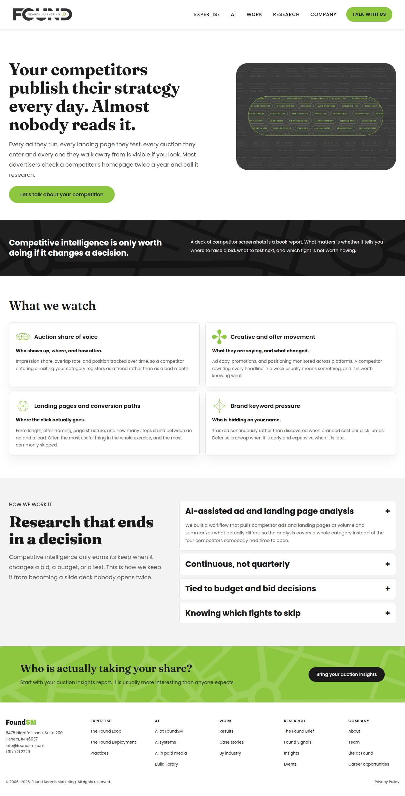

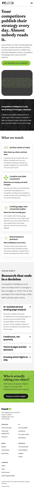

### Proposed changes

**Layout and design.** Headings move from Fraunces to the 2026 type system in `src/styles/site-2026.css`: Archivo Black, 82% width, uppercase, ink `#231f20` on paper `#eef1ec`. Body stays Poppins. Eyebrows are green `#8dc63f`. Buttons are caps. The header and footer keep their own type. Dark-band body text is white. Sections that are only a heading over a large empty area get pulled up so the copy sits with the heading. This is scoped to this page. It does not restyle the homepage, `/capabilities/`, `/ai/`, or the paid search page on PR #411.

This proposal is written against the Option A child template in open PR #411 (`cursor/capabilities-child-template-723b`, not merged and not approved). It is the same template as the paid search page in that PR, which matches the parent practice pages. Paid search itself is out of scope and stays on PR #411.

Do not copy the Platform Partnerships badge rail. You disliked the small badges floating in white space. The template in #411 maps the first `splitFeatureBlock` to that rail and skips `featureTabsBlock`. This page cannot use the template until those two behaviors change: every current block still renders, and a split feature keeps its own copy and media.

Staging section types, in order: modernHeroBlock, statementBandBlock, cardGridBlock, accordionBlock, modernCtaBlock. All of them stay on this page.

Do not add a 46% results block or a brand-logo bar. This page does not have either in the capture, and the child-page rule says not to add them.

Related cards come from the sibling links already in the Expertise menu (`src/components/Header.astro`). The new labels 'See what we run' and 'Related capabilities' are added chrome from the template. They do not replace this page's headings.

Add the homepage Talk with us form (ActiveCampaign form 8, `homeV2Forms.contact` in `src/lib/homeV2Content.ts`, the same form already on /contact-us/). Put it in the existing closing section. The intro is this page's closing paragraph, not the homepage intro. The button label is 'Let's talk about your competition', not 'Start the conversation'. Keep the existing contact link as well.

Heading order stays: Your competitors publish their strategy every day. Almost nobody reads it. | What we watch | Auction share of voice | Creative and offer movement | Landing pages and conversion paths | Brand keyword pressure | Research that ends in a decision | AI-assisted ad and landing page analysis + | Continuous, not quarterly + | Tied to budget and bid decisions + | Knowing which fights to skip + | Who is actually taking your share?

**Copy to optimize.**

None. The wording on the page already matches the facts I could verify. Sections move or restyle only.

**Content to add.**

The Talk with us form (ActiveCampaign form 8) is added in the closing section. Its words are the closing heading and paragraph already on this page. No new metric, logo, quote, or client name.

### Content inventory

Everything in `<main>` on staging today. The shared header and footer are inventoried once at the top of this file and stay on this page.
1. Section 1: Your competitors publish their strategy every day. Almost nobody reads it.
2. Section 2: Statement band (copy is in the paragraphs below)
3. Section 3: What we watch
4. Section 4: Research that ends in a decision
5. Section 5: Who is actually taking your share?
6. H1: Your competitors publish their strategy every day. Almost nobody reads it.
7. H2: What we watch
8. H3: Auction share of voice
9. H3: Creative and offer movement
10. H3: Landing pages and conversion paths
11. H3: Brand keyword pressure
12. H2: Research that ends in a decision
13. H3: AI-assisted ad and landing page analysis +
14. H3: Continuous, not quarterly +
15. H3: Tied to budget and bid decisions +
16. H3: Knowing which fights to skip +
17. H2: Who is actually taking your share?
18. Every ad they run, every landing page they test, every auction they enter and every one they walk away from is visible if you look. Most advertisers check a competitor's homepage twice a year and call it research.
19. Competitive intelligence is only worth doing if it changes a decision.
20. A deck of competitor screenshots is a book report. What matters is whether it tells you where to raise a bid, what to test next, and which fight is not worth having.
21. Who shows up, where, and how often.
22. Impression share, overlap rate, and position tracked over time, so a competitor entering or exiting your category registers as a trend rather than as a bad month.
23. What they are saying, and what changed.
24. Ad copy, promotions, and positioning monitored across platforms. A competitor rewriting every headline in a week usually means something, and it is worth knowing what.
25. Where the click actually goes.
26. Form length, offer framing, page structure, and how many steps stand between an ad and a lead. Often the most useful thing in the whole exercise, and the most commonly skipped.
27. Who is bidding on your name.
28. Tracked continuously rather than discovered when branded cost per click jumps. Defense is cheap when it is early and expensive when it is late.
29. HOW WE WORK IT
30. Competitive intelligence only earns its keep when it changes a bid, a budget, or a test. This is how we keep it from becoming a slide deck nobody opens twice.
31. We built a workflow that pulls competitor ads and landing pages at volume and summarizes what actually differs, so the analysis covers a whole category instead of the four competitors somebody had time to open.
32. Categories move faster than reporting cycles. Monitoring runs in the background and surfaces changes when they happen, rather than assembling a retrospective after the quarter is lost.
33. Findings land as changes to bids, budgets, negatives, and creative tests. If a piece of research cannot be traced to something we did differently, it was entertainment.
34. Some competitors are buying share at a price no rational business should match. Recognizing that early saves more money than winning the auction would have made.
35. Start with your auction insights report. It is usually more interesting than anyone expects.
36. Let's talk about your competition (/contact-us/)
37. Bring your auction insights (/contact-us/)
38. AI-assisted ad and landing page analysis +
39. Continuous, not quarterly +
40. Tied to budget and bid decisions +
41. Knowing which fights to skip +
42. Image alt 'Testing Strategies', file 92036953495bcfd2147d9087c367c026ae4c68f4-2956x1769.png
43. Image alt '(empty alt)', file 170c639162ef3a3801a225eff2d512ff7805f620-198x96.svg
44. Image alt '(empty alt)', file 952e7615ba9d92427a39f3aac2cfc23dcf3dacd3-162x162.svg
45. Image alt '(empty alt)', file a5d10111c41b054f74c4e9807344ee3a25e1ebbf-157x113.svg
46. Image alt '(empty alt)', file 56d982b4581483d2d88c863061c646ca15610f96-206x206.svg

### Content check

1. kept as is: Section 1: Your competitors publish their strategy every day. Almost nobody reads it.
2. kept as is: Section 2: Statement band (copy is in the paragraphs below)
3. kept as is: Section 3: What we watch
4. kept as is: Section 4: Research that ends in a decision
5. kept as is: Section 5: Who is actually taking your share?
6. kept as is: H1: Your competitors publish their strategy every day. Almost nobody reads it.
7. kept as is: H2: What we watch
8. kept as is: H3: Auction share of voice
9. kept as is: H3: Creative and offer movement
10. kept as is: H3: Landing pages and conversion paths
11. kept as is: H3: Brand keyword pressure
12. kept as is: H2: Research that ends in a decision
13. kept as is: H3: AI-assisted ad and landing page analysis +
14. kept as is: H3: Continuous, not quarterly +
15. kept as is: H3: Tied to budget and bid decisions +
16. kept as is: H3: Knowing which fights to skip +
17. kept as is: H2: Who is actually taking your share?
18. kept as is: Every ad they run, every landing page they test, every auction they enter and every one they walk away from is visible if you look. Most advertisers check a competitor's homepage twice a year and call it research.
19. kept as is: Competitive intelligence is only worth doing if it changes a decision.
20. kept as is: A deck of competitor screenshots is a book report. What matters is whether it tells you where to raise a bid, what to test next, and which fight is not worth having.
21. kept as is: Who shows up, where, and how often.
22. kept as is: Impression share, overlap rate, and position tracked over time, so a competitor entering or exiting your category registers as a trend rather than as a bad month.
23. kept as is: What they are saying, and what changed.
24. kept as is: Ad copy, promotions, and positioning monitored across platforms. A competitor rewriting every headline in a week usually means something, and it is worth knowing what.
25. kept as is: Where the click actually goes.
26. kept as is: Form length, offer framing, page structure, and how many steps stand between an ad and a lead. Often the most useful thing in the whole exercise, and the most commonly skipped.
27. kept as is: Who is bidding on your name.
28. kept as is: Tracked continuously rather than discovered when branded cost per click jumps. Defense is cheap when it is early and expensive when it is late.
29. kept as is: HOW WE WORK IT
30. kept as is: Competitive intelligence only earns its keep when it changes a bid, a budget, or a test. This is how we keep it from becoming a slide deck nobody opens twice.
31. kept as is: We built a workflow that pulls competitor ads and landing pages at volume and summarizes what actually differs, so the analysis covers a whole category instead of the four competitors somebody had time to open.
32. kept as is: Categories move faster than reporting cycles. Monitoring runs in the background and surfaces changes when they happen, rather than assembling a retrospective after the quarter is lost.
33. kept as is: Findings land as changes to bids, budgets, negatives, and creative tests. If a piece of research cannot be traced to something we did differently, it was entertainment.
34. kept as is: Some competitors are buying share at a price no rational business should match. Recognizing that early saves more money than winning the auction would have made.
35. kept as is: Start with your auction insights report. It is usually more interesting than anyone expects.
36. kept as is: Let's talk about your competition (/contact-us/)
37. kept as is: Bring your auction insights (/contact-us/)
38. kept as is: AI-assisted ad and landing page analysis +
39. kept as is: Continuous, not quarterly +
40. kept as is: Tied to budget and bid decisions +
41. kept as is: Knowing which fights to skip +
42. kept as is: Image alt 'Testing Strategies', file 92036953495bcfd2147d9087c367c026ae4c68f4-2956x1769.png
43. kept as is: Image alt '(empty alt)', file 170c639162ef3a3801a225eff2d512ff7805f620-198x96.svg
44. kept as is: Image alt '(empty alt)', file 952e7615ba9d92427a39f3aac2cfc23dcf3dacd3-162x162.svg
45. kept as is: Image alt '(empty alt)', file a5d10111c41b054f74c4e9807344ee3a25e1ebbf-157x113.svg
46. kept as is: Image alt '(empty alt)', file 56d982b4581483d2d88c863061c646ca15610f96-206x206.svg

### Open questions

- None for this page. Shared questions are at the top of the file.

### Effort

medium

## 19. Ad account migration

**Approve?** Propose Ad account migration on the Option A child template from open PR #411, without the partner badge rail.

- Staging URL: https://staging.foundsm.com/capabilities/ad-account-migration/
- Source: `src/pages/[...path].astro`
- Sanity document: `landing-page-ad-account-migration`
- Robots, kept as is: `noindex, nofollow`
- Canonical, kept as is: `https://foundsm.com/capabilities/ad-account-migration/`
- Current heading font: Fraunces, Georgia, serif

### Current state

Full page on staging, November 17, 2026. Scroll-in sections are shown open so the picture matches what a visitor sees after scrolling.

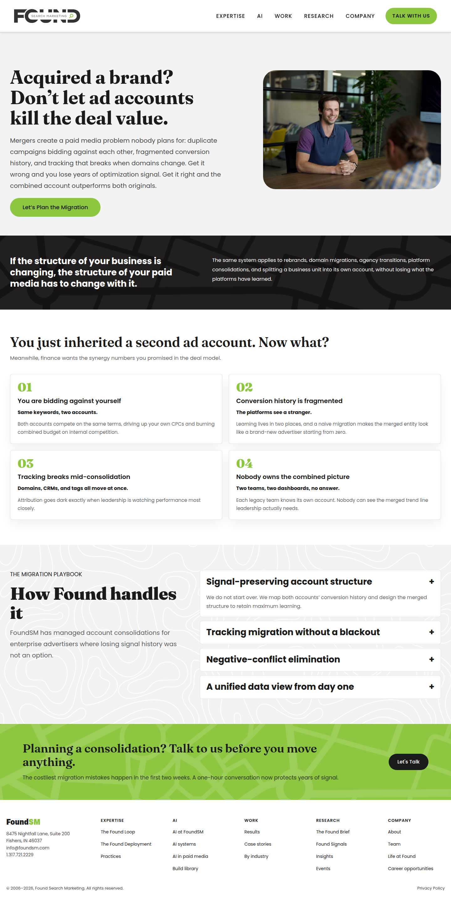

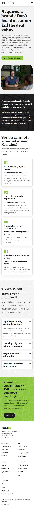

### Proposed changes

**Layout and design.** Headings move from Fraunces to the 2026 type system in `src/styles/site-2026.css`: Archivo Black, 82% width, uppercase, ink `#231f20` on paper `#eef1ec`. Body stays Poppins. Eyebrows are green `#8dc63f`. Buttons are caps. The header and footer keep their own type. Dark-band body text is white. Sections that are only a heading over a large empty area get pulled up so the copy sits with the heading. This is scoped to this page. It does not restyle the homepage, `/capabilities/`, `/ai/`, or the paid search page on PR #411.

This proposal is written against the Option A child template in open PR #411 (`cursor/capabilities-child-template-723b`, not merged and not approved). It is the same template as the paid search page in that PR, which matches the parent practice pages. Paid search itself is out of scope and stays on PR #411.

Do not copy the Platform Partnerships badge rail. You disliked the small badges floating in white space. The template in #411 maps the first `splitFeatureBlock` to that rail and skips `featureTabsBlock`. This page cannot use the template until those two behaviors change: every current block still renders, and a split feature keeps its own copy and media.

Staging section types, in order: modernHeroBlock, statementBandBlock, cardGridBlock, accordionBlock, modernCtaBlock. All of them stay on this page.

Do not add a 46% results block or a brand-logo bar. This page does not have either in the capture, and the child-page rule says not to add them.

This page sits in the header under How We Engage, next to The Found Loop and Custom Builds, not under a practice. Related links should be those existing header links, plus Capabilities. Do not invent a new practice.

Add the homepage Talk with us form (ActiveCampaign form 8, `homeV2Forms.contact` in `src/lib/homeV2Content.ts`, the same form already on /contact-us/). Put it in the existing closing section. The intro is this page's closing paragraph, not the homepage intro. The button label is 'Let’s Plan the Migration', not 'Start the conversation'. Keep the existing contact link as well.

Heading order stays: Acquired a brand? Don’t let ad accounts kill the deal value. | You just inherited a second ad account. Now what? | You are bidding against yourself | Conversion history is fragmented | Tracking breaks mid-consolidation | Nobody owns the combined picture | How Found handles it | Signal-preserving account structure + | Tracking migration without a blackout + | Negative-conflict elimination + | A unified data view from day one + | Planning a consolidation? Talk to us before you move anything.

**Copy to optimize.**

None. The wording on the page already matches the facts I could verify. Sections move or restyle only.

**Content to add.**

The Talk with us form (ActiveCampaign form 8) is added in the closing section. Its words are the closing heading and paragraph already on this page. No new metric, logo, quote, or client name.

### Content inventory

Everything in `<main>` on staging today. The shared header and footer are inventoried once at the top of this file and stay on this page.
1. Section 1: Acquired a brand? Don’t let ad accounts kill the deal value.
2. Section 2: Statement band (copy is in the paragraphs below)
3. Section 3: You just inherited a second ad account. Now what?
4. Section 4: How Found handles it
5. Section 5: Planning a consolidation? Talk to us before you move anything.
6. H1: Acquired a brand? Don’t let ad accounts kill the deal value.
7. H2: You just inherited a second ad account. Now what?
8. H3: You are bidding against yourself
9. H3: Conversion history is fragmented
10. H3: Tracking breaks mid-consolidation
11. H3: Nobody owns the combined picture
12. H2: How Found handles it
13. H3: Signal-preserving account structure +
14. H3: Tracking migration without a blackout +
15. H3: Negative-conflict elimination +
16. H3: A unified data view from day one +
17. H2: Planning a consolidation? Talk to us before you move anything.
18. Mergers create a paid media problem nobody plans for: duplicate campaigns bidding against each other, fragmented conversion history, and tracking that breaks when domains change. Get it wrong and you lose years of optimization signal. Get it right and the combined account outperforms both originals.
19. If the structure of your business is changing, the structure of your paid media has to change with it.
20. The same system applies to rebrands, domain migrations, agency transitions, platform consolidations, and splitting a business unit into its own account, without losing what the platforms have learned.
21. Meanwhile, finance wants the synergy numbers you promised in the deal model.
22. 01
23. Same keywords, two accounts.
24. Both accounts compete on the same terms, driving up your own CPCs and burning combined budget on internal competition.
25. 02
26. The platforms see a stranger.
27. Learning lives in two places, and a naive migration makes the merged entity look like a brand-new advertiser starting from zero.
28. 03
29. Domains, CRMs, and tags all move at once.
30. Attribution goes dark exactly when leadership is watching performance most closely.
31. 04
32. Two teams, two dashboards, no answer.
33. Each legacy team knows its own account. Nobody can see the merged trend line leadership actually needs.
34. THE MIGRATION PLAYBOOK
35. FoundSM has managed account consolidations for enterprise advertisers where losing signal history was not an option.
36. We do not start over. We map both accounts’ conversion history and design the merged structure to retain maximum learning.
37. Server-side infrastructure keeps measurement running while domains, tags, and CRMs move underneath it.
38. Duplicate keywords, conflicting negatives, and cross-account cannibalization identified and resolved before they burn budget.
39. Both accounts’ historical performance in one reporting layer, so leadership sees the combined trend line, not two broken ones.
40. The costliest migration mistakes happen in the first two weeks. A one-hour conversation now protects years of signal.
41. Let’s Plan the Migration (/contact-us/)
42. Let's Talk (/contact-us/)
43. Signal-preserving account structure +
44. Tracking migration without a blackout +
45. Negative-conflict elimination +
46. A unified data view from day one +
47. Image alt 'Two Found team members talking across a table in the Found office.', file ffc3dd859d03c931db25d86fd419648b8b0b51cc-1800x1201.jpg

### Content check

1. kept as is: Section 1: Acquired a brand? Don’t let ad accounts kill the deal value.
2. kept as is: Section 2: Statement band (copy is in the paragraphs below)
3. kept as is: Section 3: You just inherited a second ad account. Now what?
4. kept as is: Section 4: How Found handles it
5. kept as is: Section 5: Planning a consolidation? Talk to us before you move anything.
6. kept as is: H1: Acquired a brand? Don’t let ad accounts kill the deal value.
7. kept as is: H2: You just inherited a second ad account. Now what?
8. kept as is: H3: You are bidding against yourself
9. kept as is: H3: Conversion history is fragmented
10. kept as is: H3: Tracking breaks mid-consolidation
11. kept as is: H3: Nobody owns the combined picture
12. kept as is: H2: How Found handles it
13. kept as is: H3: Signal-preserving account structure +
14. kept as is: H3: Tracking migration without a blackout +
15. kept as is: H3: Negative-conflict elimination +
16. kept as is: H3: A unified data view from day one +
17. kept as is: H2: Planning a consolidation? Talk to us before you move anything.
18. kept as is: Mergers create a paid media problem nobody plans for: duplicate campaigns bidding against each other, fragmented conversion history, and tracking that breaks when domains change. Get it wrong and you lose years of optimization signal. Get it right and the combined account outperforms both originals.
19. kept as is: If the structure of your business is changing, the structure of your paid media has to change with it.
20. kept as is: The same system applies to rebrands, domain migrations, agency transitions, platform consolidations, and splitting a business unit into its own account, without losing what the platforms have learned.
21. kept as is: Meanwhile, finance wants the synergy numbers you promised in the deal model.
22. kept as is: 01
23. kept as is: Same keywords, two accounts.
24. kept as is: Both accounts compete on the same terms, driving up your own CPCs and burning combined budget on internal competition.
25. kept as is: 02
26. kept as is: The platforms see a stranger.
27. kept as is: Learning lives in two places, and a naive migration makes the merged entity look like a brand-new advertiser starting from zero.
28. kept as is: 03
29. kept as is: Domains, CRMs, and tags all move at once.
30. kept as is: Attribution goes dark exactly when leadership is watching performance most closely.
31. kept as is: 04
32. kept as is: Two teams, two dashboards, no answer.
33. kept as is: Each legacy team knows its own account. Nobody can see the merged trend line leadership actually needs.
34. kept as is: THE MIGRATION PLAYBOOK
35. kept as is: FoundSM has managed account consolidations for enterprise advertisers where losing signal history was not an option.
36. kept as is: We do not start over. We map both accounts’ conversion history and design the merged structure to retain maximum learning.
37. kept as is: Server-side infrastructure keeps measurement running while domains, tags, and CRMs move underneath it.
38. kept as is: Duplicate keywords, conflicting negatives, and cross-account cannibalization identified and resolved before they burn budget.
39. kept as is: Both accounts’ historical performance in one reporting layer, so leadership sees the combined trend line, not two broken ones.
40. kept as is: The costliest migration mistakes happen in the first two weeks. A one-hour conversation now protects years of signal.
41. kept as is: Let’s Plan the Migration (/contact-us/)
42. kept as is: Let's Talk (/contact-us/)
43. kept as is: Signal-preserving account structure +
44. kept as is: Tracking migration without a blackout +
45. kept as is: Negative-conflict elimination +
46. kept as is: A unified data view from day one +
47. kept as is: Image alt 'Two Found team members talking across a table in the Found office.', file ffc3dd859d03c931db25d86fd419648b8b0b51cc-1800x1201.jpg

### Open questions

- None for this page. Shared questions are at the top of the file.

### Effort

medium

## 20. AI and automation

**Approve?** Propose AI and automation on the Option A child template from open PR #411, without the partner badge rail.

- Staging URL: https://staging.foundsm.com/capabilities/ai-automation/
- Source: `src/pages/[...path].astro`
- Sanity document: `landing-page-ai-automation`
- Robots, kept as is: `noindex, nofollow`
- Canonical, kept as is: `https://foundsm.com/capabilities/ai-automation/`
- Current heading font: Fraunces, Georgia, serif

### Current state

Full page on staging, November 17, 2026. Scroll-in sections are shown open so the picture matches what a visitor sees after scrolling.

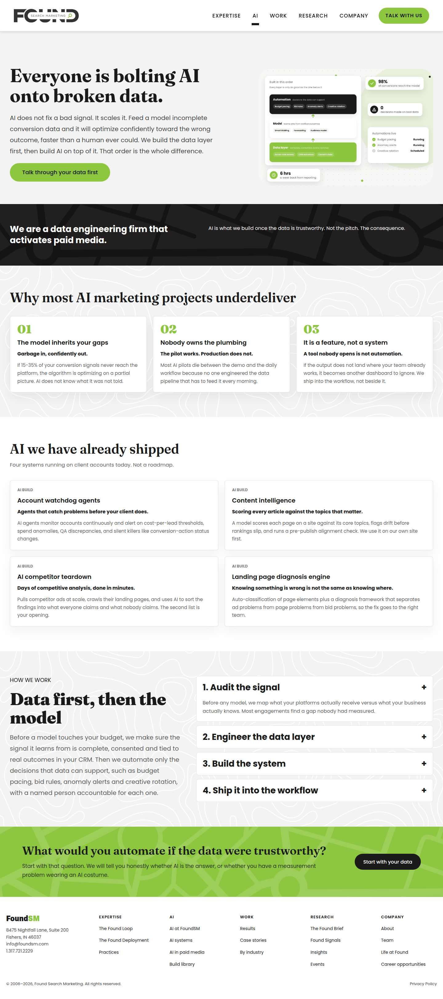

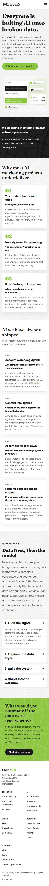

### Proposed changes

**Layout and design.** Headings move from Fraunces to the 2026 type system in `src/styles/site-2026.css`: Archivo Black, 82% width, uppercase, ink `#231f20` on paper `#eef1ec`. Body stays Poppins. Eyebrows are green `#8dc63f`. Buttons are caps. The header and footer keep their own type. Dark-band body text is white. Sections that are only a heading over a large empty area get pulled up so the copy sits with the heading. This is scoped to this page. It does not restyle the homepage, `/capabilities/`, `/ai/`, or the paid search page on PR #411.

This proposal is written against the Option A child template in open PR #411 (`cursor/capabilities-child-template-723b`, not merged and not approved). It is the same template as the paid search page in that PR, which matches the parent practice pages. Paid search itself is out of scope and stays on PR #411.

Do not copy the Platform Partnerships badge rail. You disliked the small badges floating in white space. The template in #411 maps the first `splitFeatureBlock` to that rail and skips `featureTabsBlock`. This page cannot use the template until those two behaviors change: every current block still renders, and a split feature keeps its own copy and media.

Staging section types, in order: modernHeroBlock, statementBandBlock, cardGridBlock, cardGridBlock, accordionBlock, modernCtaBlock. All of them stay on this page.

Do not add a 46% results block or a brand-logo bar. This page does not have either in the capture, and the child-page rule says not to add them.

This page sits in the AI menu, next to AI at FoundSM and the build library. Related links should be those existing links. Do not invent a new practice.

Add the homepage Talk with us form (ActiveCampaign form 8, `homeV2Forms.contact` in `src/lib/homeV2Content.ts`, the same form already on /contact-us/). Put it in the existing closing section. The intro is this page's closing paragraph, not the homepage intro. The button label is 'Talk through your data first', not 'Start the conversation'. Keep the existing contact link as well.

Heading order stays: Everyone is bolting AI onto broken data. | Why most AI marketing projects underdeliver | The model inherits your gaps | Nobody owns the plumbing | It is a feature, not a system | AI we have already shipped | Account watchdog agents | Content intelligence | AI competitor teardown | Landing page diagnosis engine | Data first, then the model | 1. Audit the signal + | (more headings are in the inventory)

**Copy to optimize.**

None. The wording on the page already matches the facts I could verify. Sections move or restyle only.

**Content to add.**

The Talk with us form (ActiveCampaign form 8) is added in the closing section. Its words are the closing heading and paragraph already on this page. No new metric, logo, quote, or client name.

### Content inventory

Everything in `<main>` on staging today. The shared header and footer are inventoried once at the top of this file and stay on this page.
1. Section 1: Everyone is bolting AI onto broken data.
2. Section 2: Statement band (copy is in the paragraphs below)
3. Section 3: Why most AI marketing projects underdeliver
4. Section 4: AI we have already shipped
5. Section 5: Data first, then the model
6. Section 6: What would you automate if the data were trustworthy?
7. H1: Everyone is bolting AI onto broken data.
8. H2: Why most AI marketing projects underdeliver
9. H3: The model inherits your gaps
10. H3: Nobody owns the plumbing
11. H3: It is a feature, not a system
12. H2: AI we have already shipped
13. H3: Account watchdog agents
14. H3: Content intelligence
15. H3: AI competitor teardown
16. H3: Landing page diagnosis engine
17. H2: Data first, then the model
18. H3: 1. Audit the signal +
19. H3: 2. Engineer the data layer +
20. H3: 3. Build the system +
21. H3: 4. Ship it into the workflow +
22. H2: What would you automate if the data were trustworthy?
23. AI does not fix a bad signal. It scales it. Feed a model incomplete conversion data and it will optimize confidently toward the wrong outcome, faster than a human ever could. We build the data layer first, then build AI on top of it. That order is the whole difference.
24. We are a data engineering firm that activates paid media.
25. AI is what we build once the data is trustworthy. Not the pitch. The consequence.
26. 01
27. Garbage in, confidently out.
28. If 15-35% of your conversion signals never reach the platform, the algorithm is optimizing on a partial picture. AI does not know what it was not told.
29. 02
30. The pilot works. Production does not.
31. Most AI pilots die between the demo and the daily workflow because no one engineered the data pipeline that has to feed it every morning.
32. 03
33. A tool nobody opens is not automation.
34. If the output does not land where your team already works, it becomes another dashboard to ignore. We ship into the workflow, not beside it.
35. Four systems running on client accounts today. Not a roadmap.
36. AI BUILD
37. Agents that catch problems before your client does.
38. AI agents monitor accounts continuously and alert on cost-per-lead thresholds, spend anomalies, QA discrepancies, and silent killers like conversion-action status changes.
39. AI BUILD
40. Scoring every article against the topics that matter.
41. A model scores each page on a site against its core topics, flags drift before rankings slip, and runs a pre-publish alignment check. We use it on our own site first.
42. AI BUILD
43. Days of competitive analysis, done in minutes.
44. Pulls competitor ads at scale, crawls their landing pages, and uses AI to sort the findings into what everyone claims and what nobody claims. The second list is your opening.
45. AI BUILD
46. Knowing something is wrong is not the same as knowing where.
47. Auto-classification of page elements plus a diagnosis framework that separates ad problems from page problems from bid problems, so the fix goes to the right team.
48. HOW WE WORK
49. Before a model touches your budget, we make sure the signal it learns from is complete, consented and tied to real outcomes in your CRM. Then we automate only the decisions that data can support, such as budget pacing, bid rules, anomaly alerts and creative rotation, with a named person accountable for each one.
50. Before any model, we map what your platforms actually receive versus what your business actually knows. Most engagements find a gap nobody had measured.
51. Server-side tracking, offline conversion import, CRM integration. The unglamorous work that determines whether anything built on top is worth trusting.
52. Agents, scoring models, or automated workflows, scoped to a problem your team names. Working against your real data in weeks, not quarters.
53. Alerts where your team already looks, documentation, and training. If it needs a new habit to be useful, it will not get used.
54. Start with that question. We will tell you honestly whether AI is the answer, or whether you have a measurement problem wearing an AI costume.
55. Talk through your data first (/contact-us/)
56. Start with your data (/contact-us/)
57. 1. Audit the signal +
58. 2. Engineer the data layer +
59. 3. Build the system +
60. 4. Ship it into the workflow +
61. Image alt 'Illustration of a three-layer stack, data layer, model and automation, with live automations and the share of conversions reaching the model', file bd998d29f3654e29ff89b6f2e2e2aaa7c2ed1729-1600x1600.webp

### Content check

1. kept as is: Section 1: Everyone is bolting AI onto broken data.
2. kept as is: Section 2: Statement band (copy is in the paragraphs below)
3. kept as is: Section 3: Why most AI marketing projects underdeliver
4. kept as is: Section 4: AI we have already shipped
5. kept as is: Section 5: Data first, then the model
6. kept as is: Section 6: What would you automate if the data were trustworthy?
7. kept as is: H1: Everyone is bolting AI onto broken data.
8. kept as is: H2: Why most AI marketing projects underdeliver
9. kept as is: H3: The model inherits your gaps
10. kept as is: H3: Nobody owns the plumbing
11. kept as is: H3: It is a feature, not a system
12. kept as is: H2: AI we have already shipped
13. kept as is: H3: Account watchdog agents
14. kept as is: H3: Content intelligence
15. kept as is: H3: AI competitor teardown
16. kept as is: H3: Landing page diagnosis engine
17. kept as is: H2: Data first, then the model
18. kept as is: H3: 1. Audit the signal +
19. kept as is: H3: 2. Engineer the data layer +
20. kept as is: H3: 3. Build the system +
21. kept as is: H3: 4. Ship it into the workflow +
22. kept as is: H2: What would you automate if the data were trustworthy?
23. kept as is: AI does not fix a bad signal. It scales it. Feed a model incomplete conversion data and it will optimize confidently toward the wrong outcome, faster than a human ever could. We build the data layer first, then build AI on top of it. That order is the whole difference.
24. kept as is: We are a data engineering firm that activates paid media.
25. kept as is: AI is what we build once the data is trustworthy. Not the pitch. The consequence.
26. kept as is: 01
27. kept as is: Garbage in, confidently out.
28. kept as is: If 15-35% of your conversion signals never reach the platform, the algorithm is optimizing on a partial picture. AI does not know what it was not told.
29. kept as is: 02
30. kept as is: The pilot works. Production does not.
31. kept as is: Most AI pilots die between the demo and the daily workflow because no one engineered the data pipeline that has to feed it every morning.
32. kept as is: 03
33. kept as is: A tool nobody opens is not automation.
34. kept as is: If the output does not land where your team already works, it becomes another dashboard to ignore. We ship into the workflow, not beside it.
35. kept as is: Four systems running on client accounts today. Not a roadmap.
36. kept as is: AI BUILD
37. kept as is: Agents that catch problems before your client does.
38. kept as is: AI agents monitor accounts continuously and alert on cost-per-lead thresholds, spend anomalies, QA discrepancies, and silent killers like conversion-action status changes.
39. kept as is: AI BUILD
40. kept as is: Scoring every article against the topics that matter.
41. kept as is: A model scores each page on a site against its core topics, flags drift before rankings slip, and runs a pre-publish alignment check. We use it on our own site first.
42. kept as is: AI BUILD
43. kept as is: Days of competitive analysis, done in minutes.
44. kept as is: Pulls competitor ads at scale, crawls their landing pages, and uses AI to sort the findings into what everyone claims and what nobody claims. The second list is your opening.
45. kept as is: AI BUILD
46. kept as is: Knowing something is wrong is not the same as knowing where.
47. kept as is: Auto-classification of page elements plus a diagnosis framework that separates ad problems from page problems from bid problems, so the fix goes to the right team.
48. kept as is: HOW WE WORK
49. kept as is: Before a model touches your budget, we make sure the signal it learns from is complete, consented and tied to real outcomes in your CRM. Then we automate only the decisions that data can support, such as budget pacing, bid rules, anomaly alerts and creative rotation, with a named person accountable for each one.
50. kept as is: Before any model, we map what your platforms actually receive versus what your business actually knows. Most engagements find a gap nobody had measured.
51. kept as is: Server-side tracking, offline conversion import, CRM integration. The unglamorous work that determines whether anything built on top is worth trusting.
52. kept as is: Agents, scoring models, or automated workflows, scoped to a problem your team names. Working against your real data in weeks, not quarters.
53. kept as is: Alerts where your team already looks, documentation, and training. If it needs a new habit to be useful, it will not get used.
54. kept as is: Start with that question. We will tell you honestly whether AI is the answer, or whether you have a measurement problem wearing an AI costume.
55. kept as is: Talk through your data first (/contact-us/)
56. kept as is: Start with your data (/contact-us/)
57. kept as is: 1. Audit the signal +
58. kept as is: 2. Engineer the data layer +
59. kept as is: 3. Build the system +
60. kept as is: 4. Ship it into the workflow +
61. kept as is: Image alt 'Illustration of a three-layer stack, data layer, model and automation, with live automations and the share of conversions reaching the model', file bd998d29f3654e29ff89b6f2e2e2aaa7c2ed1729-1600x1600.webp

### Open questions

- None for this page. Shared questions are at the top of the file.

### Effort

medium

## 21. Call tracking

**Approve?** Propose Call tracking on the Option A child template from open PR #411, without the partner badge rail.

- Staging URL: https://staging.foundsm.com/capabilities/data-activation/call-tracking/
- Source: `src/pages/[...path].astro`
- Sanity document: `landing-page-da-call-tracking`
- Robots, kept as is: `noindex, nofollow`
- Canonical, kept as is: `https://foundsm.com/capabilities/data-activation/call-tracking/`
- Current heading font: Fraunces, Georgia, serif

### Current state

Full page on staging, November 17, 2026. Scroll-in sections are shown open so the picture matches what a visitor sees after scrolling.

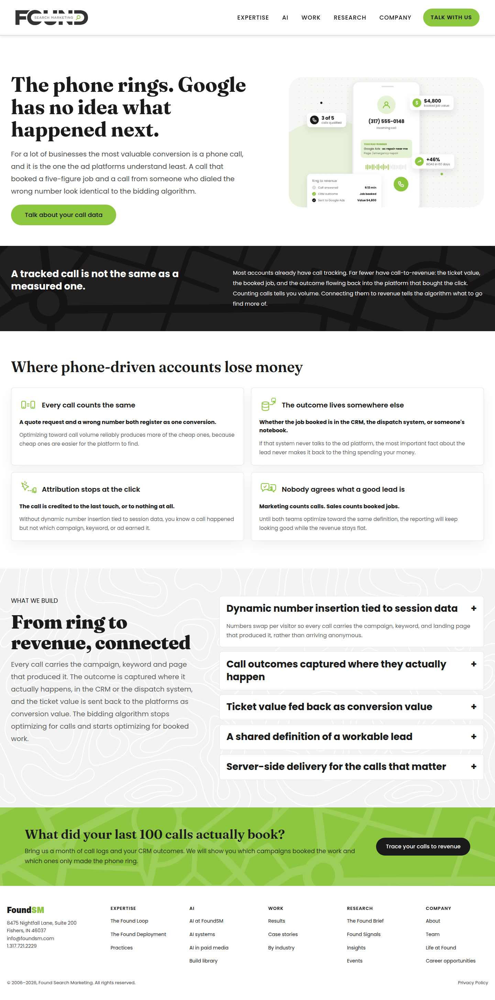

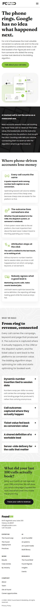

### Proposed changes

**Layout and design.** Headings move from Fraunces to the 2026 type system in `src/styles/site-2026.css`: Archivo Black, 82% width, uppercase, ink `#231f20` on paper `#eef1ec`. Body stays Poppins. Eyebrows are green `#8dc63f`. Buttons are caps. The header and footer keep their own type. Dark-band body text is white. Sections that are only a heading over a large empty area get pulled up so the copy sits with the heading. This is scoped to this page. It does not restyle the homepage, `/capabilities/`, `/ai/`, or the paid search page on PR #411.

This proposal is written against the Option A child template in open PR #411 (`cursor/capabilities-child-template-723b`, not merged and not approved). It is the same template as the paid search page in that PR, which matches the parent practice pages. Paid search itself is out of scope and stays on PR #411.

Do not copy the Platform Partnerships badge rail. You disliked the small badges floating in white space. The template in #411 maps the first `splitFeatureBlock` to that rail and skips `featureTabsBlock`. This page cannot use the template until those two behaviors change: every current block still renders, and a split feature keeps its own copy and media.

Staging section types, in order: modernHeroBlock, statementBandBlock, cardGridBlock, accordionBlock, modernCtaBlock. All of them stay on this page.

Do not add a 46% results block or a brand-logo bar. This page does not have either in the capture, and the child-page rule says not to add them.

Related cards come from the sibling links already in the Expertise menu (`src/components/Header.astro`). The new labels 'See what we run' and 'Related capabilities' are added chrome from the template. They do not replace this page's headings.

Add the homepage Talk with us form (ActiveCampaign form 8, `homeV2Forms.contact` in `src/lib/homeV2Content.ts`, the same form already on /contact-us/). Put it in the existing closing section. The intro is this page's closing paragraph, not the homepage intro. The button label is 'Talk about your call data', not 'Start the conversation'. Keep the existing contact link as well.

Heading order stays: The phone rings. Google has no idea what happened next. | Where phone-driven accounts lose money | Every call counts the same | The outcome lives somewhere else | Attribution stops at the click | Nobody agrees what a good lead is | From ring to revenue, connected | Dynamic number insertion tied to session data + | Call outcomes captured where they actually happen + | Ticket value fed back as conversion value + | A shared definition of a workable lead + | Server-side delivery for the calls that matter + | (more headings are in the inventory)

**Copy to optimize.**

None. The wording on the page already matches the facts I could verify. Sections move or restyle only.

**Content to add.**

The Talk with us form (ActiveCampaign form 8) is added in the closing section. Its words are the closing heading and paragraph already on this page. No new metric, logo, quote, or client name.

### Content inventory

Everything in `<main>` on staging today. The shared header and footer are inventoried once at the top of this file and stay on this page.
1. Section 1: The phone rings. Google has no idea what happened next.
2. Section 2: Statement band (copy is in the paragraphs below)
3. Section 3: Where phone-driven accounts lose money
4. Section 4: From ring to revenue, connected
5. Section 5: What did your last 100 calls actually book?
6. H1: The phone rings. Google has no idea what happened next.
7. H2: Where phone-driven accounts lose money
8. H3: Every call counts the same
9. H3: The outcome lives somewhere else
10. H3: Attribution stops at the click
11. H3: Nobody agrees what a good lead is
12. H2: From ring to revenue, connected
13. H3: Dynamic number insertion tied to session data +
14. H3: Call outcomes captured where they actually happen +
15. H3: Ticket value fed back as conversion value +
16. H3: A shared definition of a workable lead +
17. H3: Server-side delivery for the calls that matter +
18. H2: What did your last 100 calls actually book?
19. For a lot of businesses the most valuable conversion is a phone call, and it is the one the ad platforms understand least. A call that booked a five-figure job and a call from someone who dialed the wrong number look identical to the bidding algorithm.
20. A tracked call is not the same as a measured one.
21. Most accounts already have call tracking. Far fewer have call-to-revenue: the ticket value, the booked job, and the outcome flowing back into the platform that bought the click. Counting calls tells you volume. Connecting them to revenue tells the algorithm what to go find more of.
22. A quote request and a wrong number both register as one conversion.
23. Optimizing toward call volume reliably produces more of the cheap ones, because cheap ones are easier for the platform to find.
24. Whether the job booked is in the CRM, the dispatch system, or someone's notebook.
25. If that system never talks to the ad platform, the most important fact about the lead never makes it back to the thing spending your money.
26. The call is credited to the last touch, or to nothing at all.
27. Without dynamic number insertion tied to session data, you know a call happened but not which campaign, keyword, or ad earned it.
28. Marketing counts calls. Sales counts booked jobs.
29. Until both teams optimize toward the same definition, the reporting will keep looking good while the revenue stays flat.
30. WHAT WE BUILD
31. Every call carries the campaign, keyword and page that produced it. The outcome is captured where it actually happens, in the CRM or the dispatch system, and the ticket value is sent back to the platforms as conversion value. The bidding algorithm stops optimizing for calls and starts optimizing for booked work.
32. Numbers swap per visitor so every call carries the campaign, keyword, and landing page that produced it, rather than arriving anonymous.
33. We integrate with the CRM, dispatch, or scheduling system your team already lives in, because a tracking setup that requires new habits is a tracking setup that decays.
34. Offline conversion imports push booked revenue back into Google and Microsoft, so value-based bidding is working from real dollars rather than a flat placeholder.
35. We define lead quality with your team using contact rate, booked rate, and job value, then optimize toward that instead of toward raw call count.
36. Call conversions routed server-side so they survive the browser limits that strip out 15 to 35 percent of signal before it ever reaches the platform.
37. Bring us a month of call logs and your CRM outcomes. We will show you which campaigns booked the work and which ones only made the phone ring.
38. Talk about your call data (/contact-us/)
39. Trace your calls to revenue (/contact-us/)
40. Dynamic number insertion tied to session data +
41. Call outcomes captured where they actually happen +
42. Ticket value fed back as conversion value +
43. A shared definition of a workable lead +
44. Server-side delivery for the calls that matter +
45. Image alt 'Illustration of an incoming tracked call on a phone, with the booked job value and ROAS lift posted back to Google Ads', file 242b68d8e5f9d058e56a4e35f28c7aaabbadb070-1600x1600.webp
46. Image alt '(empty alt)', file 03c18ca5150e8611b76ff973bceec33fd03e2b80-160x160.svg
47. Image alt '(empty alt)', file 726d5dbf6f8152319323d39ba1f5e9764c19c17c-160x160.svg
48. Image alt '(empty alt)', file e67e81b26c92c4b05c1f5634970e711af0c78667-160x160.svg
49. Image alt '(empty alt)', file 0551b18965f7c8eccf65c2249b719eb7a4be452b-160x160.svg

### Content check

1. kept as is: Section 1: The phone rings. Google has no idea what happened next.
2. kept as is: Section 2: Statement band (copy is in the paragraphs below)
3. kept as is: Section 3: Where phone-driven accounts lose money
4. kept as is: Section 4: From ring to revenue, connected
5. kept as is: Section 5: What did your last 100 calls actually book?
6. kept as is: H1: The phone rings. Google has no idea what happened next.
7. kept as is: H2: Where phone-driven accounts lose money
8. kept as is: H3: Every call counts the same
9. kept as is: H3: The outcome lives somewhere else
10. kept as is: H3: Attribution stops at the click
11. kept as is: H3: Nobody agrees what a good lead is
12. kept as is: H2: From ring to revenue, connected
13. kept as is: H3: Dynamic number insertion tied to session data +
14. kept as is: H3: Call outcomes captured where they actually happen +
15. kept as is: H3: Ticket value fed back as conversion value +
16. kept as is: H3: A shared definition of a workable lead +
17. kept as is: H3: Server-side delivery for the calls that matter +
18. kept as is: H2: What did your last 100 calls actually book?
19. kept as is: For a lot of businesses the most valuable conversion is a phone call, and it is the one the ad platforms understand least. A call that booked a five-figure job and a call from someone who dialed the wrong number look identical to the bidding algorithm.
20. kept as is: A tracked call is not the same as a measured one.
21. kept as is: Most accounts already have call tracking. Far fewer have call-to-revenue: the ticket value, the booked job, and the outcome flowing back into the platform that bought the click. Counting calls tells you volume. Connecting them to revenue tells the algorithm what to go find more of.
22. kept as is: A quote request and a wrong number both register as one conversion.
23. kept as is: Optimizing toward call volume reliably produces more of the cheap ones, because cheap ones are easier for the platform to find.
24. kept as is: Whether the job booked is in the CRM, the dispatch system, or someone's notebook.
25. kept as is: If that system never talks to the ad platform, the most important fact about the lead never makes it back to the thing spending your money.
26. kept as is: The call is credited to the last touch, or to nothing at all.
27. kept as is: Without dynamic number insertion tied to session data, you know a call happened but not which campaign, keyword, or ad earned it.
28. kept as is: Marketing counts calls. Sales counts booked jobs.
29. kept as is: Until both teams optimize toward the same definition, the reporting will keep looking good while the revenue stays flat.
30. kept as is: WHAT WE BUILD
31. kept as is: Every call carries the campaign, keyword and page that produced it. The outcome is captured where it actually happens, in the CRM or the dispatch system, and the ticket value is sent back to the platforms as conversion value. The bidding algorithm stops optimizing for calls and starts optimizing for booked work.
32. kept as is: Numbers swap per visitor so every call carries the campaign, keyword, and landing page that produced it, rather than arriving anonymous.
33. kept as is: We integrate with the CRM, dispatch, or scheduling system your team already lives in, because a tracking setup that requires new habits is a tracking setup that decays.
34. kept as is: Offline conversion imports push booked revenue back into Google and Microsoft, so value-based bidding is working from real dollars rather than a flat placeholder.
35. kept as is: We define lead quality with your team using contact rate, booked rate, and job value, then optimize toward that instead of toward raw call count.
36. kept as is: Call conversions routed server-side so they survive the browser limits that strip out 15 to 35 percent of signal before it ever reaches the platform.
37. kept as is: Bring us a month of call logs and your CRM outcomes. We will show you which campaigns booked the work and which ones only made the phone ring.
38. kept as is: Talk about your call data (/contact-us/)
39. kept as is: Trace your calls to revenue (/contact-us/)
40. kept as is: Dynamic number insertion tied to session data +
41. kept as is: Call outcomes captured where they actually happen +
42. kept as is: Ticket value fed back as conversion value +
43. kept as is: A shared definition of a workable lead +
44. kept as is: Server-side delivery for the calls that matter +
45. kept as is: Image alt 'Illustration of an incoming tracked call on a phone, with the booked job value and ROAS lift posted back to Google Ads', file 242b68d8e5f9d058e56a4e35f28c7aaabbadb070-1600x1600.webp
46. kept as is: Image alt '(empty alt)', file 03c18ca5150e8611b76ff973bceec33fd03e2b80-160x160.svg
47. kept as is: Image alt '(empty alt)', file 726d5dbf6f8152319323d39ba1f5e9764c19c17c-160x160.svg
48. kept as is: Image alt '(empty alt)', file e67e81b26c92c4b05c1f5634970e711af0c78667-160x160.svg
49. kept as is: Image alt '(empty alt)', file 0551b18965f7c8eccf65c2249b719eb7a4be452b-160x160.svg

### Open questions

- None for this page. Shared questions are at the top of the file.

### Effort

medium

## 22. First-party data

**Approve?** Propose First-party data on the Option A child template from open PR #411, without the partner badge rail. Feature tabs have to stay.

- Staging URL: https://staging.foundsm.com/capabilities/data-activation/first-party-data/
- Source: `src/pages/[...path].astro`
- Sanity document: `landing-page-da-first-party-data`
- Robots, kept as is: `noindex, nofollow`
- Canonical, kept as is: `https://foundsm.com/capabilities/data-activation/first-party-data/`
- Current heading font: Fraunces, Georgia, serif

### Current state

Full page on staging, November 17, 2026. Scroll-in sections are shown open so the picture matches what a visitor sees after scrolling.

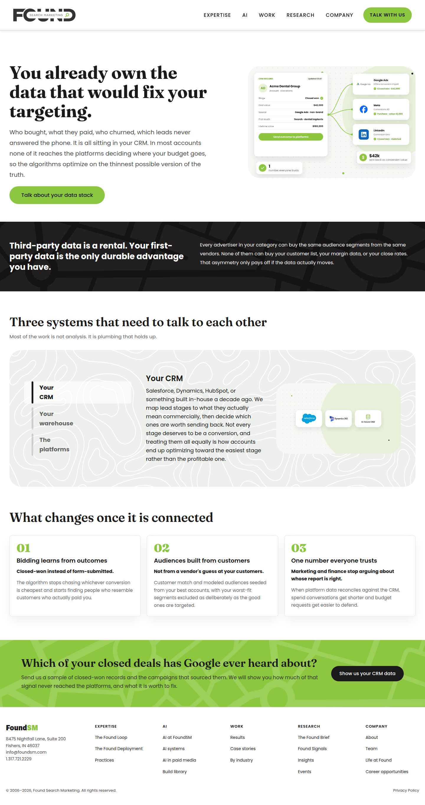

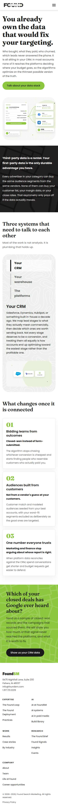

### Proposed changes

**Layout and design.** Headings move from Fraunces to the 2026 type system in `src/styles/site-2026.css`: Archivo Black, 82% width, uppercase, ink `#231f20` on paper `#eef1ec`. Body stays Poppins. Eyebrows are green `#8dc63f`. Buttons are caps. The header and footer keep their own type. Dark-band body text is white. Sections that are only a heading over a large empty area get pulled up so the copy sits with the heading. This is scoped to this page. It does not restyle the homepage, `/capabilities/`, `/ai/`, or the paid search page on PR #411.

This proposal is written against the Option A child template in open PR #411 (`cursor/capabilities-child-template-723b`, not merged and not approved). It is the same template as the paid search page in that PR, which matches the parent practice pages. Paid search itself is out of scope and stays on PR #411.

Do not copy the Platform Partnerships badge rail. You disliked the small badges floating in white space. The template in #411 maps the first `splitFeatureBlock` to that rail and skips `featureTabsBlock`. This page cannot use the template until those two behaviors change: every current block still renders, and a split feature keeps its own copy and media.

Staging section types, in order: modernHeroBlock, statementBandBlock, featureTabsBlock, cardGridBlock, modernCtaBlock. All of them stay on this page.

`featureTabsBlock` is not in the template's shown set today. Extending the template to render it is part of this proposal. Dropping the tabs would delete content.

Do not add a 46% results block or a brand-logo bar. This page does not have either in the capture, and the child-page rule says not to add them.

Related cards come from the sibling links already in the Expertise menu (`src/components/Header.astro`). The new labels 'See what we run' and 'Related capabilities' are added chrome from the template. They do not replace this page's headings.

Add the homepage Talk with us form (ActiveCampaign form 8, `homeV2Forms.contact` in `src/lib/homeV2Content.ts`, the same form already on /contact-us/). Put it in the existing closing section. The intro is this page's closing paragraph, not the homepage intro. The button label is 'Talk about your data stack', not 'Start the conversation'. Keep the existing contact link as well.

Heading order stays: You already own the data that would fix your targeting. | Three systems that need to talk to each other | Your CRM | Your warehouse | The platforms | What changes once it is connected | Bidding learns from outcomes | Audiences built from customers | One number everyone trusts | Which of your closed deals has Google ever heard about?

**Copy to optimize.**

None. The wording on the page already matches the facts I could verify. Sections move or restyle only.

**Content to add.**

The Talk with us form (ActiveCampaign form 8) is added in the closing section. Its words are the closing heading and paragraph already on this page. No new metric, logo, quote, or client name.

### Content inventory

Everything in `<main>` on staging today. The shared header and footer are inventoried once at the top of this file and stay on this page.
1. Section 1: You already own the data that would fix your targeting.
2. Section 2: Statement band (copy is in the paragraphs below)
3. Section 3: Three systems that need to talk to each other
4. Section 4: What changes once it is connected
5. Section 5: Which of your closed deals has Google ever heard about?
6. H1: You already own the data that would fix your targeting.
7. H2: Three systems that need to talk to each other
8. H3: Your CRM
9. H3: Your warehouse
10. H3: The platforms
11. H2: What changes once it is connected
12. H3: Bidding learns from outcomes
13. H3: Audiences built from customers
14. H3: One number everyone trusts
15. H2: Which of your closed deals has Google ever heard about?
16. Who bought, what they paid, who churned, which leads never answered the phone. It is all sitting in your CRM. In most accounts none of it reaches the platforms deciding where your budget goes, so the algorithms optimize on the thinnest possible version of the truth.
17. Third-party data is a rental. Your first-party data is the only durable advantage you have.
18. Every advertiser in your category can buy the same audience segments from the same vendors. None of them can buy your customer list, your margin data, or your close rates. That asymmetry only pays off if the data actually moves.
19. Most of the work is not analysis. It is plumbing that holds up.
20. Salesforce, Dynamics, HubSpot, or something built in-house a decade ago. We map lead stages to what they actually mean commercially, then decide which ones are worth sending back. Not every stage deserves to be a conversion, and treating them all equally is how accounts end up optimizing toward the easiest stage rather than the profitable one.
21. BigQuery, Looker, Funnel, or a set of spreadsheets doing more work than anyone admits. Where multiple sources and multiple CRMs are in play, the warehouse becomes the place truth gets reconciled before anything is sent anywhere. Skipping that step is how two dashboards end up disagreeing in a board meeting.
22. Google, Microsoft, Meta, and LinkedIn all accept first-party signal, and all of them handle it differently. Offline conversion imports, customer match audiences, and value rules each have their own match rates, latency, and privacy constraints. Getting this wrong quietly degrades performance rather than throwing an error.
23. 01
24. Closed-won instead of form-submitted.
25. The algorithm stops chasing whichever conversion is cheapest and starts finding people who resemble customers who actually paid you.
26. 02
27. Not from a vendor's guess at your customers.
28. Customer match and modeled audiences seeded from your best accounts, with your worst-fit segments excluded as deliberately as the good ones are targeted.
29. 03
30. Marketing and finance stop arguing about whose report is right.
31. When platform data reconciles against the CRM, spend conversations get shorter and budget requests get easier to defend.
32. Send us a sample of closed-won records and the campaigns that sourced them. We will show you how much of that signal never reached the platforms, and what it is worth to fix.
33. Talk about your data stack (/contact-us/)
34. Show us your CRM data (/contact-us/)
35. Your CRM
36. Your warehouse
37. The platforms
38. Image alt 'Illustration of a CRM record for a closed-won account being sent back to Google Ads, Meta and LinkedIn as conversion value', file 8ad714e0db135afa7685352eb71ead6897695174-1600x1600.webp
39. Image alt 'Salesforce, Microsoft Dynamics 365 and in-house CRM logos', file e8cd7b23454292b4e561d634831988bcedae71c7-1600x900.webp
40. Image alt 'Google BigQuery, Looker, Funnel and spreadsheet logos', file 1a7b22f69a7027278f29da2444f0ca3454e2fb23-1600x900.webp
41. Image alt 'Google Ads, Facebook, Instagram and LinkedIn logos', file 6c615d014358a9b863ea9733455abf819aa261e6-1600x900.webp

### Content check

1. kept as is: Section 1: You already own the data that would fix your targeting.
2. kept as is: Section 2: Statement band (copy is in the paragraphs below)
3. kept as is: Section 3: Three systems that need to talk to each other
4. kept as is: Section 4: What changes once it is connected
5. kept as is: Section 5: Which of your closed deals has Google ever heard about?
6. kept as is: H1: You already own the data that would fix your targeting.
7. kept as is: H2: Three systems that need to talk to each other
8. kept as is: H3: Your CRM
9. kept as is: H3: Your warehouse
10. kept as is: H3: The platforms
11. kept as is: H2: What changes once it is connected
12. kept as is: H3: Bidding learns from outcomes
13. kept as is: H3: Audiences built from customers
14. kept as is: H3: One number everyone trusts
15. kept as is: H2: Which of your closed deals has Google ever heard about?
16. kept as is: Who bought, what they paid, who churned, which leads never answered the phone. It is all sitting in your CRM. In most accounts none of it reaches the platforms deciding where your budget goes, so the algorithms optimize on the thinnest possible version of the truth.
17. kept as is: Third-party data is a rental. Your first-party data is the only durable advantage you have.
18. kept as is: Every advertiser in your category can buy the same audience segments from the same vendors. None of them can buy your customer list, your margin data, or your close rates. That asymmetry only pays off if the data actually moves.
19. kept as is: Most of the work is not analysis. It is plumbing that holds up.
20. kept as is: Salesforce, Dynamics, HubSpot, or something built in-house a decade ago. We map lead stages to what they actually mean commercially, then decide which ones are worth sending back. Not every stage deserves to be a conversion, and treating them all equally is how accounts end up optimizing toward the easiest stage rather than the profitable one.
21. kept as is: BigQuery, Looker, Funnel, or a set of spreadsheets doing more work than anyone admits. Where multiple sources and multiple CRMs are in play, the warehouse becomes the place truth gets reconciled before anything is sent anywhere. Skipping that step is how two dashboards end up disagreeing in a board meeting.
22. kept as is: Google, Microsoft, Meta, and LinkedIn all accept first-party signal, and all of them handle it differently. Offline conversion imports, customer match audiences, and value rules each have their own match rates, latency, and privacy constraints. Getting this wrong quietly degrades performance rather than throwing an error.
23. kept as is: 01
24. kept as is: Closed-won instead of form-submitted.
25. kept as is: The algorithm stops chasing whichever conversion is cheapest and starts finding people who resemble customers who actually paid you.
26. kept as is: 02
27. kept as is: Not from a vendor's guess at your customers.
28. kept as is: Customer match and modeled audiences seeded from your best accounts, with your worst-fit segments excluded as deliberately as the good ones are targeted.
29. kept as is: 03
30. kept as is: Marketing and finance stop arguing about whose report is right.
31. kept as is: When platform data reconciles against the CRM, spend conversations get shorter and budget requests get easier to defend.
32. kept as is: Send us a sample of closed-won records and the campaigns that sourced them. We will show you how much of that signal never reached the platforms, and what it is worth to fix.
33. kept as is: Talk about your data stack (/contact-us/)
34. kept as is: Show us your CRM data (/contact-us/)
35. kept as is: Your CRM
36. kept as is: Your warehouse
37. kept as is: The platforms
38. kept as is: Image alt 'Illustration of a CRM record for a closed-won account being sent back to Google Ads, Meta and LinkedIn as conversion value', file 8ad714e0db135afa7685352eb71ead6897695174-1600x1600.webp
39. kept as is: Image alt 'Salesforce, Microsoft Dynamics 365 and in-house CRM logos', file e8cd7b23454292b4e561d634831988bcedae71c7-1600x900.webp
40. kept as is: Image alt 'Google BigQuery, Looker, Funnel and spreadsheet logos', file 1a7b22f69a7027278f29da2444f0ca3454e2fb23-1600x900.webp
41. kept as is: Image alt 'Google Ads, Facebook, Instagram and LinkedIn logos', file 6c615d014358a9b863ea9733455abf819aa261e6-1600x900.webp

### Open questions

- None for this page. Shared questions are at the top of the file.

### Effort

medium

## 23. Privacy, security and governance

**Approve?** Propose Privacy, security and governance on the Option A child template from open PR #411, without the partner badge rail.

- Staging URL: https://staging.foundsm.com/capabilities/data-activation/privacy-governance/
- Source: `src/pages/[...path].astro`
- Sanity document: `landing-page-da-privacy-governance`
- Robots, kept as is: `noindex, nofollow`
- Canonical, kept as is: `https://foundsm.com/capabilities/data-activation/privacy-governance/`
- Current heading font: Fraunces, Georgia, serif

### Current state

Full page on staging, November 17, 2026. Scroll-in sections are shown open so the picture matches what a visitor sees after scrolling.

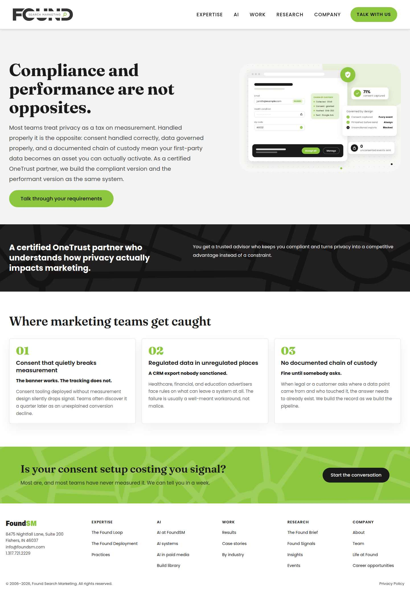

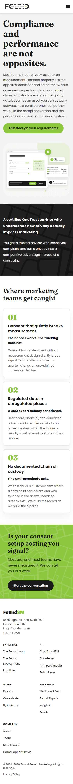

### Proposed changes

**Layout and design.** Headings move from Fraunces to the 2026 type system in `src/styles/site-2026.css`: Archivo Black, 82% width, uppercase, ink `#231f20` on paper `#eef1ec`. Body stays Poppins. Eyebrows are green `#8dc63f`. Buttons are caps. The header and footer keep their own type. Dark-band body text is white. Sections that are only a heading over a large empty area get pulled up so the copy sits with the heading. This is scoped to this page. It does not restyle the homepage, `/capabilities/`, `/ai/`, or the paid search page on PR #411.

This proposal is written against the Option A child template in open PR #411 (`cursor/capabilities-child-template-723b`, not merged and not approved). It is the same template as the paid search page in that PR, which matches the parent practice pages. Paid search itself is out of scope and stays on PR #411.

Do not copy the Platform Partnerships badge rail. You disliked the small badges floating in white space. The template in #411 maps the first `splitFeatureBlock` to that rail and skips `featureTabsBlock`. This page cannot use the template until those two behaviors change: every current block still renders, and a split feature keeps its own copy and media.

Staging section types, in order: modernHeroBlock, statementBandBlock, cardGridBlock, modernCtaBlock. All of them stay on this page.

Do not add a 46% results block or a brand-logo bar. This page does not have either in the capture, and the child-page rule says not to add them.

Related cards come from the sibling links already in the Expertise menu (`src/components/Header.astro`). The new labels 'See what we run' and 'Related capabilities' are added chrome from the template. They do not replace this page's headings.

Add the homepage Talk with us form (ActiveCampaign form 8, `homeV2Forms.contact` in `src/lib/homeV2Content.ts`, the same form already on /contact-us/). Put it in the existing closing section. The intro is this page's closing paragraph, not the homepage intro. The button label is 'Talk through your requirements', not 'Start the conversation'. Keep the existing contact link as well.

Heading order stays: Compliance and performance are not opposites. | Where marketing teams get caught | Consent that quietly breaks measurement | Regulated data in unregulated places | No documented chain of custody | Is your consent setup costing you signal?

**Copy to optimize.**

None. The wording on the page already matches the facts I could verify. Sections move or restyle only.

**Content to add.**

The Talk with us form (ActiveCampaign form 8) is added in the closing section. Its words are the closing heading and paragraph already on this page. No new metric, logo, quote, or client name.

### Content inventory

Everything in `<main>` on staging today. The shared header and footer are inventoried once at the top of this file and stay on this page.
1. Section 1: Compliance and performance are not opposites.
2. Section 2: Statement band (copy is in the paragraphs below)
3. Section 3: Where marketing teams get caught
4. Section 4: Is your consent setup costing you signal?
5. H1: Compliance and performance are not opposites.
6. H2: Where marketing teams get caught
7. H3: Consent that quietly breaks measurement
8. H3: Regulated data in unregulated places
9. H3: No documented chain of custody
10. H2: Is your consent setup costing you signal?
11. Most teams treat privacy as a tax on measurement. Handled properly it is the opposite: consent handled correctly, data governed properly, and a documented chain of custody mean your first-party data becomes an asset you can actually activate. As a certified OneTrust partner, we build the compliant version and the performant version as the same system.
12. A certified OneTrust partner who understands how privacy actually impacts marketing.
13. You get a trusted advisor who keeps you compliant and turns privacy into a competitive advantage instead of a constraint.
14. 01
15. The banner works. The tracking does not.
16. Consent tooling deployed without measurement design silently drops signal. Teams often discover it a quarter later as an unexplained conversion decline.
17. 02
18. A CRM export nobody sanctioned.
19. Healthcare, financial, and education advertisers face rules on what can leave a system at all. The failure is usually a well-meant workaround, not malice.
20. 03
21. Fine until somebody asks.
22. When legal or a customer asks where a data point came from and who touched it, the answer needs to already exist. We build the record as we build the pipeline.
23. Most are, and most teams have never measured it. We can tell you in a week.
24. Talk through your requirements (/contact-us/)
25. Start the conversation (/contact-us/)
26. Image alt 'Illustration of a web form with a hashed email, a blocked health field, a consent banner and a chain-of-custody log', file 7a2af075629c8cbd855091dfbb99b4ae4f07d26c-1600x1600.webp

### Content check

1. kept as is: Section 1: Compliance and performance are not opposites.
2. kept as is: Section 2: Statement band (copy is in the paragraphs below)
3. kept as is: Section 3: Where marketing teams get caught
4. kept as is: Section 4: Is your consent setup costing you signal?
5. kept as is: H1: Compliance and performance are not opposites.
6. kept as is: H2: Where marketing teams get caught
7. kept as is: H3: Consent that quietly breaks measurement
8. kept as is: H3: Regulated data in unregulated places
9. kept as is: H3: No documented chain of custody
10. kept as is: H2: Is your consent setup costing you signal?
11. kept as is: Most teams treat privacy as a tax on measurement. Handled properly it is the opposite: consent handled correctly, data governed properly, and a documented chain of custody mean your first-party data becomes an asset you can actually activate. As a certified OneTrust partner, we build the compliant version and the performant version as the same system.
12. kept as is: A certified OneTrust partner who understands how privacy actually impacts marketing.
13. kept as is: You get a trusted advisor who keeps you compliant and turns privacy into a competitive advantage instead of a constraint.
14. kept as is: 01
15. kept as is: The banner works. The tracking does not.
16. kept as is: Consent tooling deployed without measurement design silently drops signal. Teams often discover it a quarter later as an unexplained conversion decline.
17. kept as is: 02
18. kept as is: A CRM export nobody sanctioned.
19. kept as is: Healthcare, financial, and education advertisers face rules on what can leave a system at all. The failure is usually a well-meant workaround, not malice.
20. kept as is: 03
21. kept as is: Fine until somebody asks.
22. kept as is: When legal or a customer asks where a data point came from and who touched it, the answer needs to already exist. We build the record as we build the pipeline.
23. kept as is: Most are, and most teams have never measured it. We can tell you in a week.
24. kept as is: Talk through your requirements (/contact-us/)
25. kept as is: Start the conversation (/contact-us/)
26. kept as is: Image alt 'Illustration of a web form with a hashed email, a blocked health field, a consent banner and a chain-of-custody log', file 7a2af075629c8cbd855091dfbb99b4ae4f07d26c-1600x1600.webp

### Open questions

- None for this page. Shared questions are at the top of the file.

### Effort

medium

## 24. Server-side tracking

**Approve?** Propose Server-side tracking on the Option A child template from open PR #411, without the partner badge rail.

- Staging URL: https://staging.foundsm.com/capabilities/data-activation/server-side-tracking/
- Source: `src/pages/[...path].astro`
- Sanity document: `landing-page-server-side-tracking`
- Robots, kept as is: `noindex, nofollow`
- Canonical, kept as is: `https://foundsm.com/capabilities/data-activation/server-side-tracking/`
- Current heading font: Fraunces, Georgia, serif

### Current state

Full page on staging, November 17, 2026. Scroll-in sections are shown open so the picture matches what a visitor sees after scrolling.

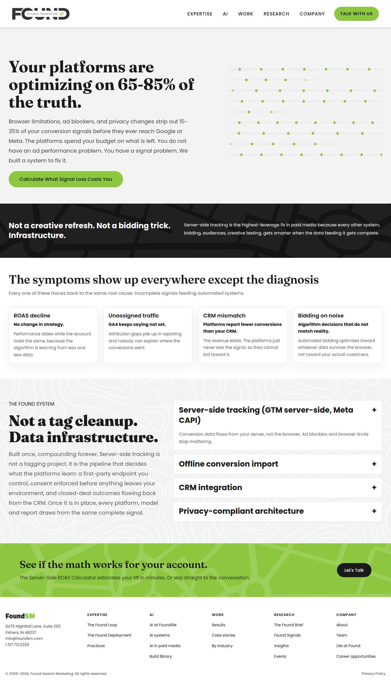

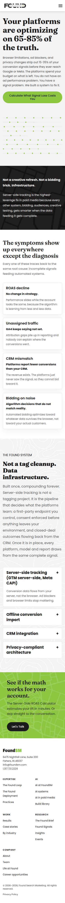

### Proposed changes

**Layout and design.** Headings move from Fraunces to the 2026 type system in `src/styles/site-2026.css`: Archivo Black, 82% width, uppercase, ink `#231f20` on paper `#eef1ec`. Body stays Poppins. Eyebrows are green `#8dc63f`. Buttons are caps. The header and footer keep their own type. Dark-band body text is white. Sections that are only a heading over a large empty area get pulled up so the copy sits with the heading. This is scoped to this page. It does not restyle the homepage, `/capabilities/`, `/ai/`, or the paid search page on PR #411.

This proposal is written against the Option A child template in open PR #411 (`cursor/capabilities-child-template-723b`, not merged and not approved). It is the same template as the paid search page in that PR, which matches the parent practice pages. Paid search itself is out of scope and stays on PR #411.

Do not copy the Platform Partnerships badge rail. You disliked the small badges floating in white space. The template in #411 maps the first `splitFeatureBlock` to that rail and skips `featureTabsBlock`. This page cannot use the template until those two behaviors change: every current block still renders, and a split feature keeps its own copy and media.

Staging section types, in order: modernHeroBlock, statementBandBlock, cardGridBlock, accordionBlock, modernCtaBlock. All of them stay on this page.

Do not add a 46% results block or a brand-logo bar. This page does not have either in the capture, and the child-page rule says not to add them.

Related cards come from the sibling links already in the Expertise menu (`src/components/Header.astro`). The new labels 'See what we run' and 'Related capabilities' are added chrome from the template. They do not replace this page's headings.

Add the homepage Talk with us form (ActiveCampaign form 8, `homeV2Forms.contact` in `src/lib/homeV2Content.ts`, the same form already on /contact-us/). Put it in the existing closing section. The intro is this page's closing paragraph, not the homepage intro. The button label is 'Let's Talk', not 'Start the conversation'. Keep the existing contact link as well.

Heading order stays: Your platforms are optimizing on 65-85% of the truth. | The symptoms show up everywhere except the diagnosis | ROAS decline | Unassigned traffic | CRM mismatch | Bidding on noise | Not a tag cleanup. Data infrastructure. | Server-side tracking (GTM server-side, Meta CAPI) + | Offline conversion import + | CRM integration + | Privacy-compliant architecture + | See if the math works for your account.

**Copy to optimize.**

None. The wording on the page already matches the facts I could verify. Sections move or restyle only.

**Content to add.**

The Talk with us form (ActiveCampaign form 8) is added in the closing section. Its words are the closing heading and paragraph already on this page. No new metric, logo, quote, or client name.

### Content inventory

Everything in `<main>` on staging today. The shared header and footer are inventoried once at the top of this file and stay on this page.
1. Section 1: Your platforms are optimizing on 65-85% of the truth.
2. Section 2: Statement band (copy is in the paragraphs below)
3. Section 3: The symptoms show up everywhere except the diagnosis
4. Section 4: Not a tag cleanup. Data infrastructure.
5. Section 5: See if the math works for your account.
6. H1: Your platforms are optimizing on 65-85% of the truth.
7. H2: The symptoms show up everywhere except the diagnosis
8. H3: ROAS decline
9. H3: Unassigned traffic
10. H3: CRM mismatch
11. H3: Bidding on noise
12. H2: Not a tag cleanup. Data infrastructure.
13. H3: Server-side tracking (GTM server-side, Meta CAPI) +
14. H3: Offline conversion import +
15. H3: CRM integration +
16. H3: Privacy-compliant architecture +
17. H2: See if the math works for your account.
18. Browser limitations, ad blockers, and privacy changes strip out 15-35% of your conversion signals before they ever reach Google or Meta. The platforms spend your budget on what is left. You do not have an ad performance problem. You have a signal problem. We built a system to fix it.
19. Not a creative refresh. Not a bidding trick. Infrastructure.
20. Server-side tracking is the highest-leverage fix in paid media because every other system, bidding, audiences, creative testing, gets smarter when the data feeding it gets complete.
21. Every one of these traces back to the same root cause: incomplete signals feeding automated systems.
22. No change in strategy.
23. Performance slides while the account looks the same, because the algorithm is learning from less and less data.
24. GA4 keeps saying not set.
25. Attribution gaps pile up in reporting and nobody can explain where the conversions went.
26. Platforms report fewer conversions than your CRM.
27. The revenue exists. The platforms just never saw the signal, so they cannot bid toward it.
28. Algorithm decisions that do not match reality.
29. Automated bidding optimizes toward whatever data survives the browser, not toward your actual customers.
30. THE FOUND SYSTEM
31. Built once, compounding forever. Server-side tracking is not a tagging project. It is the pipeline that decides what the platforms learn: a first-party endpoint you control, consent enforced before anything leaves your environment, and closed-deal outcomes flowing back from the CRM. Once it is in place, every platform, model and report draws from the same complete signal.
32. Conversion data flows from your server, not the browser. Ad blockers and browser limits stop mattering.
33. Closed-deal data flows back into the platforms, so bidding optimizes toward revenue, not form fills.
34. Your customer data and your ad platforms finally speak the same language, across multiple data sources and CRMs.
35. OneTrust Privacy Professional certified. Better data and compliance are not a trade-off.
36. The Server-Side ROAS Calculator estimates your lift in minutes. Or skip straight to the conversation.
37. Calculate What Signal Loss Costs You (https://sst-roas.foundsm.com)
38. Let's Talk (/contact-us/)
39. Server-side tracking (GTM server-side, Meta CAPI) +
40. Offline conversion import +
41. CRM integration +
42. Privacy-compliant architecture +
43. Image alt 'Nine streams of conversion signals travel toward the ad platforms. Three fade out before they arrive, leaving their paths dark.', file signal-loss.webp

### Content check

1. kept as is: Section 1: Your platforms are optimizing on 65-85% of the truth.
2. kept as is: Section 2: Statement band (copy is in the paragraphs below)
3. kept as is: Section 3: The symptoms show up everywhere except the diagnosis
4. kept as is: Section 4: Not a tag cleanup. Data infrastructure.
5. kept as is: Section 5: See if the math works for your account.
6. kept as is: H1: Your platforms are optimizing on 65-85% of the truth.
7. kept as is: H2: The symptoms show up everywhere except the diagnosis
8. kept as is: H3: ROAS decline
9. kept as is: H3: Unassigned traffic
10. kept as is: H3: CRM mismatch
11. kept as is: H3: Bidding on noise
12. kept as is: H2: Not a tag cleanup. Data infrastructure.
13. kept as is: H3: Server-side tracking (GTM server-side, Meta CAPI) +
14. kept as is: H3: Offline conversion import +
15. kept as is: H3: CRM integration +
16. kept as is: H3: Privacy-compliant architecture +
17. kept as is: H2: See if the math works for your account.
18. kept as is: Browser limitations, ad blockers, and privacy changes strip out 15-35% of your conversion signals before they ever reach Google or Meta. The platforms spend your budget on what is left. You do not have an ad performance problem. You have a signal problem. We built a system to fix it.
19. kept as is: Not a creative refresh. Not a bidding trick. Infrastructure.
20. kept as is: Server-side tracking is the highest-leverage fix in paid media because every other system, bidding, audiences, creative testing, gets smarter when the data feeding it gets complete.
21. kept as is: Every one of these traces back to the same root cause: incomplete signals feeding automated systems.
22. kept as is: No change in strategy.
23. kept as is: Performance slides while the account looks the same, because the algorithm is learning from less and less data.
24. kept as is: GA4 keeps saying not set.
25. kept as is: Attribution gaps pile up in reporting and nobody can explain where the conversions went.
26. kept as is: Platforms report fewer conversions than your CRM.
27. kept as is: The revenue exists. The platforms just never saw the signal, so they cannot bid toward it.
28. kept as is: Algorithm decisions that do not match reality.
29. kept as is: Automated bidding optimizes toward whatever data survives the browser, not toward your actual customers.
30. kept as is: THE FOUND SYSTEM
31. kept as is: Built once, compounding forever. Server-side tracking is not a tagging project. It is the pipeline that decides what the platforms learn: a first-party endpoint you control, consent enforced before anything leaves your environment, and closed-deal outcomes flowing back from the CRM. Once it is in place, every platform, model and report draws from the same complete signal.
32. kept as is: Conversion data flows from your server, not the browser. Ad blockers and browser limits stop mattering.
33. kept as is: Closed-deal data flows back into the platforms, so bidding optimizes toward revenue, not form fills.
34. kept as is: Your customer data and your ad platforms finally speak the same language, across multiple data sources and CRMs.
35. kept as is: OneTrust Privacy Professional certified. Better data and compliance are not a trade-off.
36. kept as is: The Server-Side ROAS Calculator estimates your lift in minutes. Or skip straight to the conversation.
37. kept as is: Calculate What Signal Loss Costs You (https://sst-roas.foundsm.com)
38. kept as is: Let's Talk (/contact-us/)
39. kept as is: Server-side tracking (GTM server-side, Meta CAPI) +
40. kept as is: Offline conversion import +
41. kept as is: CRM integration +
42. kept as is: Privacy-compliant architecture +
43. kept as is: Image alt 'Nine streams of conversion signals travel toward the ad platforms. Three fade out before they arrive, leaving their paths dark.', file signal-loss.webp

### Open questions

- None for this page. Shared questions are at the top of the file.

### Effort

medium

## 25. Attribution

**Approve?** Propose Attribution on the Option A child template from open PR #411, without the partner badge rail.

- Staging URL: https://staging.foundsm.com/capabilities/data-analytics/attribution/
- Source: `src/pages/[...path].astro`
- Sanity document: `landing-page-da-attribution`
- Robots, kept as is: `noindex, nofollow`
- Canonical, kept as is: `https://foundsm.com/capabilities/data-analytics/attribution/`
- Current heading font: Fraunces, Georgia, serif

### Current state

Full page on staging, November 17, 2026. Scroll-in sections are shown open so the picture matches what a visitor sees after scrolling.

### Proposed changes

**Layout and design.** Headings move from Fraunces to the 2026 type system in `src/styles/site-2026.css`: Archivo Black, 82% width, uppercase, ink `#231f20` on paper `#eef1ec`. Body stays Poppins. Eyebrows are green `#8dc63f`. Buttons are caps. The header and footer keep their own type. Dark-band body text is white. Sections that are only a heading over a large empty area get pulled up so the copy sits with the heading. This is scoped to this page. It does not restyle the homepage, `/capabilities/`, `/ai/`, or the paid search page on PR #411.

This proposal is written against the Option A child template in open PR #411 (`cursor/capabilities-child-template-723b`, not merged and not approved). It is the same template as the paid search page in that PR, which matches the parent practice pages. Paid search itself is out of scope and stays on PR #411.

Do not copy the Platform Partnerships badge rail. You disliked the small badges floating in white space. The template in #411 maps the first `splitFeatureBlock` to that rail and skips `featureTabsBlock`. This page cannot use the template until those two behaviors change: every current block still renders, and a split feature keeps its own copy and media.

Staging section types, in order: modernHeroBlock, statementBandBlock, cardGridBlock, accordionBlock, modernCtaBlock. All of them stay on this page.

Do not add a 46% results block or a brand-logo bar. This page does not have either in the capture, and the child-page rule says not to add them.

Related cards come from the sibling links already in the Expertise menu (`src/components/Header.astro`). The new labels 'See what we run' and 'Related capabilities' are added chrome from the template. They do not replace this page's headings.

Add the homepage Talk with us form (ActiveCampaign form 8, `homeV2Forms.contact` in `src/lib/homeV2Content.ts`, the same form already on /contact-us/). Put it in the existing closing section. The intro is this page's closing paragraph, not the homepage intro. The button label is 'Let's Talk', not 'Start the conversation'. Keep the existing contact link as well.

Heading order stays: Every platform grades its own homework. | Why your measurement does not survive a budget conversation | Last-click logic | Double-counted conversions | Siloed channel data | No incrementality read | Measurement frameworks grounded in your business, not the platform's | Custom attribution frameworks + | Media mix modeling + | Incrementality measurement + | Predictive forecasting and scenario modeling + | Revenue-aligned reporting + | (more headings are in the inventory)

**Copy to optimize.**

None. The wording on the page already matches the facts I could verify. Sections move or restyle only.

**Content to add.**

The Talk with us form (ActiveCampaign form 8) is added in the closing section. Its words are the closing heading and paragraph already on this page. No new metric, logo, quote, or client name.

### Content inventory

Everything in `<main>` on staging today. The shared header and footer are inventoried once at the top of this file and stay on this page.
1. Section 1: Every platform grades its own homework.
2. Section 2: Statement band (copy is in the paragraphs below)
3. Section 3: Why your measurement does not survive a budget conversation
4. Section 4: Measurement frameworks grounded in your business, not the platform's
5. Section 5: Find out what your numbers are actually telling you.
6. H1: Every platform grades its own homework.
7. H2: Why your measurement does not survive a budget conversation
8. H3: Last-click logic
9. H3: Double-counted conversions
10. H3: Siloed channel data
11. H3: No incrementality read
12. H2: Measurement frameworks grounded in your business, not the platform's
13. H3: Custom attribution frameworks +
14. H3: Media mix modeling +
15. H3: Incrementality measurement +
16. H3: Predictive forecasting and scenario modeling +
17. H3: Revenue-aligned reporting +
18. H2: Find out what your numbers are actually telling you.
19. Add up the conversions your platforms report and you will find more revenue than your finance team has ever seen. Google claims the click. Meta claims the view. Your CRM tells a third story. None of them are lying, and none of them are right.
20. We don't rely on last-click logic or siloed data.
21. We build holistic, measurement-driven frameworks that quantify cross-channel impact and inform smarter budget allocation. Attribution is not a reporting exercise. It is how you decide where the next dollar goes.
22. The final touch takes all the credit.
23. Upper-funnel work looks like waste, so it gets cut, and then lower-funnel efficiency quietly collapses two quarters later.
24. Every platform reports the same lead.
25. Summed platform numbers overstate performance, which makes budget shifts between channels a guess dressed up as a decision.
26. Search, social, and display are measured apart.
27. Cross-channel impact never shows up in the reporting, so the channels that assist never get funded.
28. Nobody knows what would have happened anyway.
29. Branded search and retargeting absorb budget that would have converted without them, and the reporting rewards it.
30. WHAT WE BUILD
31. Every platform grades its own homework. We start from the outcomes your leadership already trusts, such as pipeline, booked revenue and margin, and build the model backward from there. Platform-reported conversions become one input, not the scoreboard.
32. We start from your business goals and margin structure, then build the model. No templates, no generic dashboards, no last-click by default.
33. A top-down read on how channels contribute together, useful when privacy limits and long consideration windows make user-level tracking unreliable.
34. Structured holdouts and geo tests that isolate real growth drivers, so you know which spend is creating demand and which is buying credit for it.
35. Historical performance plus market signals, used to pressure-test investment strategies before the dollars are committed.
36. One set of numbers that marketing, finance, and the board can all work from, tied to pipeline and revenue rather than platform-reported conversions.
37. Bring us your current reporting. We will show you where the model is crediting the wrong thing.
38. Let's Talk (/contact-us/)
39. Custom attribution frameworks +
40. Media mix modeling +
41. Incrementality measurement +
42. Predictive forecasting and scenario modeling +
43. Revenue-aligned reporting +
44. Image alt 'Illustration comparing last-click credit with data-driven attribution across a five-touch customer journey, next to a holdout test result', file cca6b04507e169ce6261f9fa0faa4b4955cb44be-1600x1600.webp
45. Image alt '(empty alt)', file 118e8e33803c7c2ecb42b84a9bd6e06137ac805c-160x160.svg
46. Image alt '(empty alt)', file 459267864cf2629d61dc21c42415b5b933ebfc88-160x160.svg
47. Image alt '(empty alt)', file 6ccbc1fe779a73db7eea99b21c62e180b2dd7f8f-160x160.svg
48. Image alt '(empty alt)', file b640837b2d96b8baacfa65d75580b6906c3a2904-160x160.svg

### Content check

1. kept as is: Section 1: Every platform grades its own homework.
2. kept as is: Section 2: Statement band (copy is in the paragraphs below)
3. kept as is: Section 3: Why your measurement does not survive a budget conversation
4. kept as is: Section 4: Measurement frameworks grounded in your business, not the platform's
5. kept as is: Section 5: Find out what your numbers are actually telling you.
6. kept as is: H1: Every platform grades its own homework.
7. kept as is: H2: Why your measurement does not survive a budget conversation
8. kept as is: H3: Last-click logic
9. kept as is: H3: Double-counted conversions
10. kept as is: H3: Siloed channel data
11. kept as is: H3: No incrementality read
12. kept as is: H2: Measurement frameworks grounded in your business, not the platform's
13. kept as is: H3: Custom attribution frameworks +
14. kept as is: H3: Media mix modeling +
15. kept as is: H3: Incrementality measurement +
16. kept as is: H3: Predictive forecasting and scenario modeling +
17. kept as is: H3: Revenue-aligned reporting +
18. kept as is: H2: Find out what your numbers are actually telling you.
19. kept as is: Add up the conversions your platforms report and you will find more revenue than your finance team has ever seen. Google claims the click. Meta claims the view. Your CRM tells a third story. None of them are lying, and none of them are right.
20. kept as is: We don't rely on last-click logic or siloed data.
21. kept as is: We build holistic, measurement-driven frameworks that quantify cross-channel impact and inform smarter budget allocation. Attribution is not a reporting exercise. It is how you decide where the next dollar goes.
22. kept as is: The final touch takes all the credit.
23. kept as is: Upper-funnel work looks like waste, so it gets cut, and then lower-funnel efficiency quietly collapses two quarters later.
24. kept as is: Every platform reports the same lead.
25. kept as is: Summed platform numbers overstate performance, which makes budget shifts between channels a guess dressed up as a decision.
26. kept as is: Search, social, and display are measured apart.
27. kept as is: Cross-channel impact never shows up in the reporting, so the channels that assist never get funded.
28. kept as is: Nobody knows what would have happened anyway.
29. kept as is: Branded search and retargeting absorb budget that would have converted without them, and the reporting rewards it.
30. kept as is: WHAT WE BUILD
31. kept as is: Every platform grades its own homework. We start from the outcomes your leadership already trusts, such as pipeline, booked revenue and margin, and build the model backward from there. Platform-reported conversions become one input, not the scoreboard.
32. kept as is: We start from your business goals and margin structure, then build the model. No templates, no generic dashboards, no last-click by default.
33. kept as is: A top-down read on how channels contribute together, useful when privacy limits and long consideration windows make user-level tracking unreliable.
34. kept as is: Structured holdouts and geo tests that isolate real growth drivers, so you know which spend is creating demand and which is buying credit for it.
35. kept as is: Historical performance plus market signals, used to pressure-test investment strategies before the dollars are committed.
36. kept as is: One set of numbers that marketing, finance, and the board can all work from, tied to pipeline and revenue rather than platform-reported conversions.
37. kept as is: Bring us your current reporting. We will show you where the model is crediting the wrong thing.
38. kept as is: Let's Talk (/contact-us/)
39. kept as is: Custom attribution frameworks +
40. kept as is: Media mix modeling +
41. kept as is: Incrementality measurement +
42. kept as is: Predictive forecasting and scenario modeling +
43. kept as is: Revenue-aligned reporting +
44. kept as is: Image alt 'Illustration comparing last-click credit with data-driven attribution across a five-touch customer journey, next to a holdout test result', file cca6b04507e169ce6261f9fa0faa4b4955cb44be-1600x1600.webp
45. kept as is: Image alt '(empty alt)', file 118e8e33803c7c2ecb42b84a9bd6e06137ac805c-160x160.svg
46. kept as is: Image alt '(empty alt)', file 459267864cf2629d61dc21c42415b5b933ebfc88-160x160.svg
47. kept as is: Image alt '(empty alt)', file 6ccbc1fe779a73db7eea99b21c62e180b2dd7f8f-160x160.svg
48. kept as is: Image alt '(empty alt)', file b640837b2d96b8baacfa65d75580b6906c3a2904-160x160.svg

### Open questions

- None for this page. Shared questions are at the top of the file.

### Effort

medium

## 26. Audience modeling

**Approve?** Propose Audience modeling on the Option A child template from open PR #411, without the partner badge rail.

- Staging URL: https://staging.foundsm.com/capabilities/data-analytics/audience-modeling/
- Source: `src/pages/[...path].astro`
- Sanity document: `landing-page-da-audience-modeling`
- Robots, kept as is: `noindex, nofollow`
- Canonical, kept as is: `https://foundsm.com/capabilities/data-analytics/audience-modeling/`
- Current heading font: Fraunces, Georgia, serif

### Current state

Full page on staging, November 17, 2026. Scroll-in sections are shown open so the picture matches what a visitor sees after scrolling.

### Proposed changes

**Layout and design.** Headings move from Fraunces to the 2026 type system in `src/styles/site-2026.css`: Archivo Black, 82% width, uppercase, ink `#231f20` on paper `#eef1ec`. Body stays Poppins. Eyebrows are green `#8dc63f`. Buttons are caps. The header and footer keep their own type. Dark-band body text is white. Sections that are only a heading over a large empty area get pulled up so the copy sits with the heading. This is scoped to this page. It does not restyle the homepage, `/capabilities/`, `/ai/`, or the paid search page on PR #411.

This proposal is written against the Option A child template in open PR #411 (`cursor/capabilities-child-template-723b`, not merged and not approved). It is the same template as the paid search page in that PR, which matches the parent practice pages. Paid search itself is out of scope and stays on PR #411.

Do not copy the Platform Partnerships badge rail. You disliked the small badges floating in white space. The template in #411 maps the first `splitFeatureBlock` to that rail and skips `featureTabsBlock`. This page cannot use the template until those two behaviors change: every current block still renders, and a split feature keeps its own copy and media.

Staging section types, in order: modernHeroBlock, statementBandBlock, cardGridBlock, modernCtaBlock. All of them stay on this page.

Do not add a 46% results block or a brand-logo bar. This page does not have either in the capture, and the child-page rule says not to add them.

Related cards come from the sibling links already in the Expertise menu (`src/components/Header.astro`). The new labels 'See what we run' and 'Related capabilities' are added chrome from the template. They do not replace this page's headings.

Add the homepage Talk with us form (ActiveCampaign form 8, `homeV2Forms.contact` in `src/lib/homeV2Content.ts`, the same form already on /contact-us/). Put it in the existing closing section. The intro is this page's closing paragraph, not the homepage intro. The button label is 'Talk about your audiences', not 'Start the conversation'. Keep the existing contact link as well.

Heading order stays: Lookalikes are a guess. Your customers are a fact. | What changes when the model is yours | The algorithm optimizes toward value | Exclusions get as much work as targeting | Segments stay current | Who are your best customers, really?

**Copy to optimize.**

None. The wording on the page already matches the facts I could verify. Sections move or restyle only.

**Content to add.**

The Talk with us form (ActiveCampaign form 8) is added in the closing section. Its words are the closing heading and paragraph already on this page. No new metric, logo, quote, or client name.

### Content inventory

Everything in `<main>` on staging today. The shared header and footer are inventoried once at the top of this file and stay on this page.
1. Section 1: Lookalikes are a guess. Your customers are a fact.
2. Section 2: Statement band (copy is in the paragraphs below)
3. Section 3: What changes when the model is yours
4. Section 4: Who are your best customers, really?
5. H1: Lookalikes are a guess. Your customers are a fact.
6. H2: What changes when the model is yours
7. H3: The algorithm optimizes toward value
8. H3: Exclusions get as much work as targeting
9. H3: Segments stay current
10. H2: Who are your best customers, really?
11. Platform lookalike audiences start from a seed the platform barely understands. We build audience models from what your business actually knows: who bought, who churned, who was worth ten times the average. Then we activate those models across channels so the algorithms learn from real customers.
12. We do not just use data to activate campaigns. We engineer the audiences the campaigns run on.
13. High-intent models, built from your first-party data, activated across every channel that will accept them.
14. 01
15. Not toward volume.
16. Feed the platform revenue and lifetime value instead of raw form fills, and it starts finding people who look like your best customers rather than your easiest ones.
17. 02
18. Who you stop paying for matters.
19. Current customers, known-bad leads, and closed-lost segments quietly consume budget in most accounts. Suppression is often the fastest efficiency win available.
20. 03
21. A model built once is a model already decaying.
22. Audiences refresh from live data on a schedule, so segmentation reflects who your customers are now, not who they were the quarter you built it.
23. If the answer lives in a CRM the ad platforms have never seen, that is the opportunity.
24. Talk about your audiences (/contact-us/)
25. Start the conversation (/contact-us/)
26. Image alt 'Illustration of a customer scatter plot with the highest lifetime value cluster targeted and low-value accounts excluded', file 77eadce8dc7692eb7cd007c2bdcf2a4f6f2ae7d1-1600x1600.webp

### Content check

1. kept as is: Section 1: Lookalikes are a guess. Your customers are a fact.
2. kept as is: Section 2: Statement band (copy is in the paragraphs below)
3. kept as is: Section 3: What changes when the model is yours
4. kept as is: Section 4: Who are your best customers, really?
5. kept as is: H1: Lookalikes are a guess. Your customers are a fact.
6. kept as is: H2: What changes when the model is yours
7. kept as is: H3: The algorithm optimizes toward value
8. kept as is: H3: Exclusions get as much work as targeting
9. kept as is: H3: Segments stay current
10. kept as is: H2: Who are your best customers, really?
11. kept as is: Platform lookalike audiences start from a seed the platform barely understands. We build audience models from what your business actually knows: who bought, who churned, who was worth ten times the average. Then we activate those models across channels so the algorithms learn from real customers.
12. kept as is: We do not just use data to activate campaigns. We engineer the audiences the campaigns run on.
13. kept as is: High-intent models, built from your first-party data, activated across every channel that will accept them.
14. kept as is: 01
15. kept as is: Not toward volume.
16. kept as is: Feed the platform revenue and lifetime value instead of raw form fills, and it starts finding people who look like your best customers rather than your easiest ones.
17. kept as is: 02
18. kept as is: Who you stop paying for matters.
19. kept as is: Current customers, known-bad leads, and closed-lost segments quietly consume budget in most accounts. Suppression is often the fastest efficiency win available.
20. kept as is: 03
21. kept as is: A model built once is a model already decaying.
22. kept as is: Audiences refresh from live data on a schedule, so segmentation reflects who your customers are now, not who they were the quarter you built it.
23. kept as is: If the answer lives in a CRM the ad platforms have never seen, that is the opportunity.
24. kept as is: Talk about your audiences (/contact-us/)
25. kept as is: Start the conversation (/contact-us/)
26. kept as is: Image alt 'Illustration of a customer scatter plot with the highest lifetime value cluster targeted and low-value accounts excluded', file 77eadce8dc7692eb7cd007c2bdcf2a4f6f2ae7d1-1600x1600.webp

### Open questions

- None for this page. Shared questions are at the top of the file.

### Effort

medium

## 27. Discovery, audit and analysis

**Approve?** Propose Discovery, audit and analysis on the Option A child template from open PR #411, without the partner badge rail.

- Staging URL: https://staging.foundsm.com/capabilities/data-analytics/discovery-audit/
- Source: `src/pages/[...path].astro`
- Sanity document: `landing-page-da-discovery-audit`
- Robots, kept as is: `noindex, nofollow`
- Canonical, kept as is: `https://foundsm.com/capabilities/data-analytics/discovery-audit/`
- Current heading font: Fraunces, Georgia, serif

### Current state

Full page on staging, November 17, 2026. Scroll-in sections are shown open so the picture matches what a visitor sees after scrolling.

### Proposed changes

**Layout and design.** Headings move from Fraunces to the 2026 type system in `src/styles/site-2026.css`: Archivo Black, 82% width, uppercase, ink `#231f20` on paper `#eef1ec`. Body stays Poppins. Eyebrows are green `#8dc63f`. Buttons are caps. The header and footer keep their own type. Dark-band body text is white. Sections that are only a heading over a large empty area get pulled up so the copy sits with the heading. This is scoped to this page. It does not restyle the homepage, `/capabilities/`, `/ai/`, or the paid search page on PR #411.

This proposal is written against the Option A child template in open PR #411 (`cursor/capabilities-child-template-723b`, not merged and not approved). It is the same template as the paid search page in that PR, which matches the parent practice pages. Paid search itself is out of scope and stays on PR #411.

Do not copy the Platform Partnerships badge rail. You disliked the small badges floating in white space. The template in #411 maps the first `splitFeatureBlock` to that rail and skips `featureTabsBlock`. This page cannot use the template until those two behaviors change: every current block still renders, and a split feature keeps its own copy and media.

Staging section types, in order: modernHeroBlock, statementBandBlock, cardGridBlock, accordionBlock, modernCtaBlock. All of them stay on this page.

Do not add a 46% results block or a brand-logo bar. This page does not have either in the capture, and the child-page rule says not to add them.

Related cards come from the sibling links already in the Expertise menu (`src/components/Header.astro`). The new labels 'See what we run' and 'Related capabilities' are added chrome from the template. They do not replace this page's headings.

Add the homepage Talk with us form (ActiveCampaign form 8, `homeV2Forms.contact` in `src/lib/homeV2Content.ts`, the same form already on /contact-us/). Put it in the existing closing section. The intro is this page's closing paragraph, not the homepage intro. The button label is 'Start with an audit', not 'Start the conversation'. Keep the existing contact link as well.

Heading order stays: You cannot fix what nobody has mapped. | What we find, almost every time | Conversions counted more than once | Signals that never arrive | Reports that disagree | Nobody owns the pipeline | Map, test, rank | 1. Map the landscape + | 2. Validate against reality + | 3. Rank by revenue impact + | What is your data actually telling you?

**Copy to optimize.**

None. The wording on the page already matches the facts I could verify. Sections move or restyle only.

**Content to add.**

The Talk with us form (ActiveCampaign form 8) is added in the closing section. Its words are the closing heading and paragraph already on this page. No new metric, logo, quote, or client name.

### Content inventory

Everything in `<main>` on staging today. The shared header and footer are inventoried once at the top of this file and stay on this page.
1. Section 1: You cannot fix what nobody has mapped.
2. Section 2: Statement band (copy is in the paragraphs below)
3. Section 3: What we find, almost every time
4. Section 4: Map, test, rank
5. Section 5: What is your data actually telling you?
6. H1: You cannot fix what nobody has mapped.
7. H2: What we find, almost every time
8. H3: Conversions counted more than once
9. H3: Signals that never arrive
10. H3: Reports that disagree
11. H3: Nobody owns the pipeline
12. H2: Map, test, rank
13. H3: 1. Map the landscape +
14. H3: 2. Validate against reality +
15. H3: 3. Rank by revenue impact +
16. H2: What is your data actually telling you?
17. Most accounts have never had their data landscape drawn end to end. Tags fire twice. Conversions double-count. A CRM field nobody owns quietly breaks a report every quarter. We map the whole picture first, then tell you which gaps actually cost money and which are noise.
18. An audit that ends in a document is a cost. An audit that ends in a fix list is an investment.
19. Every finding we hand over has an owner, an effort estimate, and a reason it matters.
20. Different accounts, same short list.
21. Your reported volume is inflated and nobody knows by how much.
22. Duplicate tags, overlapping conversion actions, and thank-you pages that fire on refresh. The number your team reports to leadership is not the number the business made.
23. The platform is optimizing on a partial picture.
24. Browser limits, ad blockers, and consent choices strip a meaningful share of conversions before they reach the platform. The algorithm never knows what it did not see.
25. Three dashboards, three answers, no tiebreaker.
26. Platform, analytics, and CRM each count differently. Without a documented source of truth, every meeting relitigates whose number is right.
27. It worked when it was built. Nobody has checked since.
28. Tracking degrades quietly. A site release, a CRM field rename, a platform update, and a measurement chain breaks with no alert.
29. HOW THE AUDIT RUNS
30. We inventory every tag, pixel, form and CRM field that touches revenue, fire test conversions through each one, and rank what we find by how much it is costing you. You get a fix list in priority order, not a forty-page appendix.
31. Every source, tag, conversion action, integration, and downstream system. Written down in one place, usually for the first time.
32. We fire real events and follow them through the chain to see what actually arrives. Documentation and behavior are rarely the same thing.
33. You get a fix-first list ordered by what moves money, not a 40-page report that ends up in a folder.
34. Most teams find out their reported numbers were never the real ones. Better to know now.
35. Start with an audit (/contact-us/)
36. Book an audit conversation (/contact-us/)
37. 1. Map the landscape +
38. 2. Validate against reality +
39. 3. Rank by revenue impact +
40. Image alt 'Illustration of a mapped data landscape showing duplicate tags, a broken CRM connection and a fix list ranked by revenue impact', file 2a24960bfe8170ec404eed72c5912e48b7c3c8a1-1600x1600.webp
41. Image alt '(empty alt)', file a4ed1a4b3c088e57815e85af417e4bfb7d0a0b9f-160x160.svg
42. Image alt '(empty alt)', file 590526c530a284bc76c60f4137b31a34a84e49a1-160x160.svg
43. Image alt '(empty alt)', file 421ccff1737ce3ab9c15b9388d37830d00ab3b5c-160x160.svg
44. Image alt '(empty alt)', file 84829f32460b95f9b5362cd1f38c8f989da81cba-160x160.svg

### Content check

1. kept as is: Section 1: You cannot fix what nobody has mapped.
2. kept as is: Section 2: Statement band (copy is in the paragraphs below)
3. kept as is: Section 3: What we find, almost every time
4. kept as is: Section 4: Map, test, rank
5. kept as is: Section 5: What is your data actually telling you?
6. kept as is: H1: You cannot fix what nobody has mapped.
7. kept as is: H2: What we find, almost every time
8. kept as is: H3: Conversions counted more than once
9. kept as is: H3: Signals that never arrive
10. kept as is: H3: Reports that disagree
11. kept as is: H3: Nobody owns the pipeline
12. kept as is: H2: Map, test, rank
13. kept as is: H3: 1. Map the landscape +
14. kept as is: H3: 2. Validate against reality +
15. kept as is: H3: 3. Rank by revenue impact +
16. kept as is: H2: What is your data actually telling you?
17. kept as is: Most accounts have never had their data landscape drawn end to end. Tags fire twice. Conversions double-count. A CRM field nobody owns quietly breaks a report every quarter. We map the whole picture first, then tell you which gaps actually cost money and which are noise.
18. kept as is: An audit that ends in a document is a cost. An audit that ends in a fix list is an investment.
19. kept as is: Every finding we hand over has an owner, an effort estimate, and a reason it matters.
20. kept as is: Different accounts, same short list.
21. kept as is: Your reported volume is inflated and nobody knows by how much.
22. kept as is: Duplicate tags, overlapping conversion actions, and thank-you pages that fire on refresh. The number your team reports to leadership is not the number the business made.
23. kept as is: The platform is optimizing on a partial picture.
24. kept as is: Browser limits, ad blockers, and consent choices strip a meaningful share of conversions before they reach the platform. The algorithm never knows what it did not see.
25. kept as is: Three dashboards, three answers, no tiebreaker.
26. kept as is: Platform, analytics, and CRM each count differently. Without a documented source of truth, every meeting relitigates whose number is right.
27. kept as is: It worked when it was built. Nobody has checked since.
28. kept as is: Tracking degrades quietly. A site release, a CRM field rename, a platform update, and a measurement chain breaks with no alert.
29. kept as is: HOW THE AUDIT RUNS
30. kept as is: We inventory every tag, pixel, form and CRM field that touches revenue, fire test conversions through each one, and rank what we find by how much it is costing you. You get a fix list in priority order, not a forty-page appendix.
31. kept as is: Every source, tag, conversion action, integration, and downstream system. Written down in one place, usually for the first time.
32. kept as is: We fire real events and follow them through the chain to see what actually arrives. Documentation and behavior are rarely the same thing.
33. kept as is: You get a fix-first list ordered by what moves money, not a 40-page report that ends up in a folder.
34. kept as is: Most teams find out their reported numbers were never the real ones. Better to know now.
35. kept as is: Start with an audit (/contact-us/)
36. kept as is: Book an audit conversation (/contact-us/)
37. kept as is: 1. Map the landscape +
38. kept as is: 2. Validate against reality +
39. kept as is: 3. Rank by revenue impact +
40. kept as is: Image alt 'Illustration of a mapped data landscape showing duplicate tags, a broken CRM connection and a fix list ranked by revenue impact', file 2a24960bfe8170ec404eed72c5912e48b7c3c8a1-1600x1600.webp
41. kept as is: Image alt '(empty alt)', file a4ed1a4b3c088e57815e85af417e4bfb7d0a0b9f-160x160.svg
42. kept as is: Image alt '(empty alt)', file 590526c530a284bc76c60f4137b31a34a84e49a1-160x160.svg
43. kept as is: Image alt '(empty alt)', file 421ccff1737ce3ab9c15b9388d37830d00ab3b5c-160x160.svg
44. kept as is: Image alt '(empty alt)', file 84829f32460b95f9b5362cd1f38c8f989da81cba-160x160.svg

### Open questions

- None for this page. Shared questions are at the top of the file.

### Effort

medium

## 28. Customized reporting

**Approve?** Propose Customized reporting on the Option A child template from open PR #411, without the partner badge rail.

- Staging URL: https://staging.foundsm.com/capabilities/data-analytics/reporting/
- Source: `src/pages/[...path].astro`
- Sanity document: `landing-page-da-reporting`
- Robots, kept as is: `noindex, nofollow`
- Canonical, kept as is: `https://foundsm.com/capabilities/data-analytics/reporting/`
- Current heading font: Fraunces, Georgia, serif

### Current state

Full page on staging, November 17, 2026. Scroll-in sections are shown open so the picture matches what a visitor sees after scrolling.

### Proposed changes

**Layout and design.** Headings move from Fraunces to the 2026 type system in `src/styles/site-2026.css`: Archivo Black, 82% width, uppercase, ink `#231f20` on paper `#eef1ec`. Body stays Poppins. Eyebrows are green `#8dc63f`. Buttons are caps. The header and footer keep their own type. Dark-band body text is white. Sections that are only a heading over a large empty area get pulled up so the copy sits with the heading. This is scoped to this page. It does not restyle the homepage, `/capabilities/`, `/ai/`, or the paid search page on PR #411.

This proposal is written against the Option A child template in open PR #411 (`cursor/capabilities-child-template-723b`, not merged and not approved). It is the same template as the paid search page in that PR, which matches the parent practice pages. Paid search itself is out of scope and stays on PR #411.

Do not copy the Platform Partnerships badge rail. You disliked the small badges floating in white space. The template in #411 maps the first `splitFeatureBlock` to that rail and skips `featureTabsBlock`. This page cannot use the template until those two behaviors change: every current block still renders, and a split feature keeps its own copy and media.

Staging section types, in order: modernHeroBlock, statementBandBlock, cardGridBlock, modernCtaBlock. All of them stay on this page.

Do not add a 46% results block or a brand-logo bar. This page does not have either in the capture, and the child-page rule says not to add them.

Related cards come from the sibling links already in the Expertise menu (`src/components/Header.astro`). The new labels 'See what we run' and 'Related capabilities' are added chrome from the template. They do not replace this page's headings.

Add the homepage Talk with us form (ActiveCampaign form 8, `homeV2Forms.contact` in `src/lib/homeV2Content.ts`, the same form already on /contact-us/). Put it in the existing closing section. The intro is this page's closing paragraph, not the homepage intro. The button label is 'Show us your current reports', not 'Start the conversation'. Keep the existing contact link as well.

Heading order stays: No templates. No generic dashboards. | What we build into every report | One source of truth | Downstream outcomes, not just clicks | Built for the reader | Refresh anyone can run | What decision is your reporting failing to support?

**Copy to optimize.**

None. The wording on the page already matches the facts I could verify. Sections move or restyle only.

**Content to add.**

The Talk with us form (ActiveCampaign form 8) is added in the closing section. Its words are the closing heading and paragraph already on this page. No new metric, logo, quote, or client name.

### Content inventory

Everything in `<main>` on staging today. The shared header and footer are inventoried once at the top of this file and stay on this page.
1. Section 1: No templates. No generic dashboards.
2. Section 2: Statement band (copy is in the paragraphs below)
3. Section 3: What we build into every report
4. Section 4: What decision is your reporting failing to support?
5. H1: No templates. No generic dashboards.
6. H2: What we build into every report
7. H3: One source of truth
8. H3: Downstream outcomes, not just clicks
9. H3: Built for the reader
10. H3: Refresh anyone can run
11. H2: What decision is your reporting failing to support?
12. A report that nobody opens is a report that failed. We build reporting around the decisions your team actually makes and the language your stakeholders actually use, pulling platform data, analytics, and downstream business outcomes into one view that settles arguments instead of starting them.
13. From clicks to downstream metrics, in one clear view.
14. Custom-built for your goals, your data, and your workflows. Not a template with your logo on it.
15. Agreed before anything gets built.
16. We settle which system is authoritative for each metric up front, so the quarterly meeting stops relitigating whose number is right.
17. Leads are a proxy. Revenue is the point.
18. Reporting follows the chain past the form fill into booked, closed, and retained, so spend decisions are made on business results.
19. A CFO and a channel manager need different things.
20. Executive views summarize and explain. Practitioner views expose the detail needed to act this week. Same data, different jobs.
21. Not gated behind one analyst.
22. We build pipelines that update on a schedule or on demand, so nobody waits three days for a number they needed on Monday.
23. Start there. The dashboard follows the decision, not the other way around.
24. Show us your current reports (/contact-us/)
25. Start the conversation (/contact-us/)
26. Image alt 'Illustration of a reporting dashboard with pipeline, booked jobs and cost per lead tied to a single source of truth', file 3f8f78b62d9b0b90e7bef5317b80e9b65c5ce0f2-1600x1600.webp
27. Image alt '(empty alt)', file e481b8698fbb0265ae5d6d8fa70b03a7ef39b5de-160x160.svg
28. Image alt '(empty alt)', file 4149e51c2625a666f0cdac7864277c179027c6d0-160x160.svg
29. Image alt '(empty alt)', file c460851f120029e9cf1a3c354fedc6c5dadafb37-160x160.svg
30. Image alt '(empty alt)', file ac5c2228f54eea3c678cc9a0cbcb90e16a1bd26b-160x160.svg

### Content check

1. kept as is: Section 1: No templates. No generic dashboards.
2. kept as is: Section 2: Statement band (copy is in the paragraphs below)
3. kept as is: Section 3: What we build into every report
4. kept as is: Section 4: What decision is your reporting failing to support?
5. kept as is: H1: No templates. No generic dashboards.
6. kept as is: H2: What we build into every report
7. kept as is: H3: One source of truth
8. kept as is: H3: Downstream outcomes, not just clicks
9. kept as is: H3: Built for the reader
10. kept as is: H3: Refresh anyone can run
11. kept as is: H2: What decision is your reporting failing to support?
12. kept as is: A report that nobody opens is a report that failed. We build reporting around the decisions your team actually makes and the language your stakeholders actually use, pulling platform data, analytics, and downstream business outcomes into one view that settles arguments instead of starting them.
13. kept as is: From clicks to downstream metrics, in one clear view.
14. kept as is: Custom-built for your goals, your data, and your workflows. Not a template with your logo on it.
15. kept as is: Agreed before anything gets built.
16. kept as is: We settle which system is authoritative for each metric up front, so the quarterly meeting stops relitigating whose number is right.
17. kept as is: Leads are a proxy. Revenue is the point.
18. kept as is: Reporting follows the chain past the form fill into booked, closed, and retained, so spend decisions are made on business results.
19. kept as is: A CFO and a channel manager need different things.
20. kept as is: Executive views summarize and explain. Practitioner views expose the detail needed to act this week. Same data, different jobs.
21. kept as is: Not gated behind one analyst.
22. kept as is: We build pipelines that update on a schedule or on demand, so nobody waits three days for a number they needed on Monday.
23. kept as is: Start there. The dashboard follows the decision, not the other way around.
24. kept as is: Show us your current reports (/contact-us/)
25. kept as is: Start the conversation (/contact-us/)
26. kept as is: Image alt 'Illustration of a reporting dashboard with pipeline, booked jobs and cost per lead tied to a single source of truth', file 3f8f78b62d9b0b90e7bef5317b80e9b65c5ce0f2-1600x1600.webp
27. kept as is: Image alt '(empty alt)', file e481b8698fbb0265ae5d6d8fa70b03a7ef39b5de-160x160.svg
28. kept as is: Image alt '(empty alt)', file 4149e51c2625a666f0cdac7864277c179027c6d0-160x160.svg
29. kept as is: Image alt '(empty alt)', file c460851f120029e9cf1a3c354fedc6c5dadafb37-160x160.svg
30. kept as is: Image alt '(empty alt)', file ac5c2228f54eea3c678cc9a0cbcb90e16a1bd26b-160x160.svg

### Open questions

- None for this page. Shared questions are at the top of the file.

### Effort

medium

## 29. Ad creative

**Approve?** Propose Ad creative on the Option A child template from open PR #411, without the partner badge rail.

- Staging URL: https://staging.foundsm.com/capabilities/performance-creative/ad-creative/
- Source: `src/pages/[...path].astro`
- Sanity document: `landing-page-pc-ad-creative`
- Robots, kept as is: `noindex, nofollow`
- Canonical, kept as is: `https://foundsm.com/capabilities/performance-creative/ad-creative/`
- Current heading font: Fraunces, Georgia, serif

### Current state

Full page on staging, November 17, 2026. Scroll-in sections are shown open so the picture matches what a visitor sees after scrolling.

### Proposed changes

**Layout and design.** Headings move from Fraunces to the 2026 type system in `src/styles/site-2026.css`: Archivo Black, 82% width, uppercase, ink `#231f20` on paper `#eef1ec`. Body stays Poppins. Eyebrows are green `#8dc63f`. Buttons are caps. The header and footer keep their own type. Dark-band body text is white. Sections that are only a heading over a large empty area get pulled up so the copy sits with the heading. This is scoped to this page. It does not restyle the homepage, `/capabilities/`, `/ai/`, or the paid search page on PR #411.

This proposal is written against the Option A child template in open PR #411 (`cursor/capabilities-child-template-723b`, not merged and not approved). It is the same template as the paid search page in that PR, which matches the parent practice pages. Paid search itself is out of scope and stays on PR #411.

Do not copy the Platform Partnerships badge rail. You disliked the small badges floating in white space. The template in #411 maps the first `splitFeatureBlock` to that rail and skips `featureTabsBlock`. This page cannot use the template until those two behaviors change: every current block still renders, and a split feature keeps its own copy and media.

Staging section types, in order: modernHeroBlock, statementBandBlock, cardGridBlock, accordionBlock, modernCtaBlock. All of them stay on this page.

Do not add a 46% results block or a brand-logo bar. This page does not have either in the capture, and the child-page rule says not to add them.

Related cards come from the sibling links already in the Expertise menu (`src/components/Header.astro`). The new labels 'See what we run' and 'Related capabilities' are added chrome from the template. They do not replace this page's headings.

Add the homepage Talk with us form (ActiveCampaign form 8, `homeV2Forms.contact` in `src/lib/homeV2Content.ts`, the same form already on /contact-us/). Put it in the existing closing section. The intro is this page's closing paragraph, not the homepage intro. The button label is 'Talk about your creative', not 'Start the conversation'. Keep the existing contact link as well.

Heading order stays: Creative is a performance variable, not a deliverable. | What we produce | Static and display | Motion graphics | Video for social | Produced at the speed testing requires | Concepts tied to audience and stage + | Variety with a purpose + | Fast-track production + | Refresh before fatigue, not after + | How many ads are actually running right now?

**Copy to optimize.**

None. The wording on the page already matches the facts I could verify. Sections move or restyle only.

**Content to add.**

The Talk with us form (ActiveCampaign form 8) is added in the closing section. Its words are the closing heading and paragraph already on this page. No new metric, logo, quote, or client name.

### Content inventory

Everything in `<main>` on staging today. The shared header and footer are inventoried once at the top of this file and stay on this page.
1. Section 1: Creative is a performance variable, not a deliverable.
2. Section 2: Statement band (copy is in the paragraphs below)
3. Section 3: What we produce
4. Section 4: Produced at the speed testing requires
5. Section 5: How many ads are actually running right now?
6. H1: Creative is a performance variable, not a deliverable.
7. H2: What we produce
8. H3: Static and display
9. H3: Motion graphics
10. H3: Video for social
11. H2: Produced at the speed testing requires
12. H3: Concepts tied to audience and stage +
13. H3: Variety with a purpose +
14. H3: Fast-track production +
15. H3: Refresh before fatigue, not after +
16. H2: How many ads are actually running right now?
17. As the platforms absorb more of the targeting decisions, what you put in front of people is one of the few levers left that still separates advertisers. That makes creative a media problem, and it should be produced and measured like one.
18. Creative that wins an award and loses on cost per lead has not done its job.
19. We build ads to be judged by the media report. That means enough variety for the platform to optimize between, produced fast enough to keep pace with what testing reveals, and retired without sentiment when the numbers turn.
20. Full size sets, not one design stretched to fit.
21. Every required placement built deliberately, because the sizes that get skipped are usually the ones with cheap available inventory.
22. Movement that earns the first two seconds.
23. Built for sound-off viewing with the message legible before anyone decides to keep scrolling.
24. Vertical, captioned, and cut for the feed.
25. Produced for the surface it runs on rather than repurposed from a brand film shot for a different job entirely.
26. HOW IT WORKS WITH MEDIA
27. Creative is a testing input, not a launch event. We produce in modular systems, with headline, visual and call-to-action variants that recombine across formats, so new versions ship every week and winners scale before fatigue sets in.
28. Messaging built for who is seeing it and how far along they are, rather than one campaign idea applied uniformly across a funnel that is not uniform.
29. Variants that differ on a real dimension, so a result tells you something transferable instead of proving that one photo outperformed another photo.
30. A team built specifically to supply paid campaigns, so the media plan is never waiting on assets and a winning insight can be acted on while it is still current.
31. Frequency and performance decay are tracked so replacements are in production ahead of the decline rather than commissioned in response to it.
32. If the answer is three, and two of them are a year old, the account is not being given much to work with.
33. Talk about your creative (/contact-us/)
34. Start the conversation (/contact-us/)
35. Concepts tied to audience and stage +
36. Variety with a purpose +
37. Fast-track production +
38. Refresh before fatigue, not after +
39. Image alt 'Illustration of static, video and banner ad variants with a fatigue curve showing a fresh variant entering rotation', file 8bbaba1fd9febd267092d94a548a914624b86611-1600x1600.webp
40. Image alt '(empty alt)', file 64d6f4158cebb7af678d218477f1b9f5dd9db103-160x160.svg
41. Image alt '(empty alt)', file 6fc4fd0f06b69782c5c46b34eb8d09540da97ff3-160x160.svg
42. Image alt '(empty alt)', file bcfc27e8aa3be304ea4cc84143d5e350f30bb77a-160x160.svg

### Content check

1. kept as is: Section 1: Creative is a performance variable, not a deliverable.
2. kept as is: Section 2: Statement band (copy is in the paragraphs below)
3. kept as is: Section 3: What we produce
4. kept as is: Section 4: Produced at the speed testing requires
5. kept as is: Section 5: How many ads are actually running right now?
6. kept as is: H1: Creative is a performance variable, not a deliverable.
7. kept as is: H2: What we produce
8. kept as is: H3: Static and display
9. kept as is: H3: Motion graphics
10. kept as is: H3: Video for social
11. kept as is: H2: Produced at the speed testing requires
12. kept as is: H3: Concepts tied to audience and stage +
13. kept as is: H3: Variety with a purpose +
14. kept as is: H3: Fast-track production +
15. kept as is: H3: Refresh before fatigue, not after +
16. kept as is: H2: How many ads are actually running right now?
17. kept as is: As the platforms absorb more of the targeting decisions, what you put in front of people is one of the few levers left that still separates advertisers. That makes creative a media problem, and it should be produced and measured like one.
18. kept as is: Creative that wins an award and loses on cost per lead has not done its job.
19. kept as is: We build ads to be judged by the media report. That means enough variety for the platform to optimize between, produced fast enough to keep pace with what testing reveals, and retired without sentiment when the numbers turn.
20. kept as is: Full size sets, not one design stretched to fit.
21. kept as is: Every required placement built deliberately, because the sizes that get skipped are usually the ones with cheap available inventory.
22. kept as is: Movement that earns the first two seconds.
23. kept as is: Built for sound-off viewing with the message legible before anyone decides to keep scrolling.
24. kept as is: Vertical, captioned, and cut for the feed.
25. kept as is: Produced for the surface it runs on rather than repurposed from a brand film shot for a different job entirely.
26. kept as is: HOW IT WORKS WITH MEDIA
27. kept as is: Creative is a testing input, not a launch event. We produce in modular systems, with headline, visual and call-to-action variants that recombine across formats, so new versions ship every week and winners scale before fatigue sets in.
28. kept as is: Messaging built for who is seeing it and how far along they are, rather than one campaign idea applied uniformly across a funnel that is not uniform.
29. kept as is: Variants that differ on a real dimension, so a result tells you something transferable instead of proving that one photo outperformed another photo.
30. kept as is: A team built specifically to supply paid campaigns, so the media plan is never waiting on assets and a winning insight can be acted on while it is still current.
31. kept as is: Frequency and performance decay are tracked so replacements are in production ahead of the decline rather than commissioned in response to it.
32. kept as is: If the answer is three, and two of them are a year old, the account is not being given much to work with.
33. kept as is: Talk about your creative (/contact-us/)
34. kept as is: Start the conversation (/contact-us/)
35. kept as is: Concepts tied to audience and stage +
36. kept as is: Variety with a purpose +
37. kept as is: Fast-track production +
38. kept as is: Refresh before fatigue, not after +
39. kept as is: Image alt 'Illustration of static, video and banner ad variants with a fatigue curve showing a fresh variant entering rotation', file 8bbaba1fd9febd267092d94a548a914624b86611-1600x1600.webp
40. kept as is: Image alt '(empty alt)', file 64d6f4158cebb7af678d218477f1b9f5dd9db103-160x160.svg
41. kept as is: Image alt '(empty alt)', file 6fc4fd0f06b69782c5c46b34eb8d09540da97ff3-160x160.svg
42. kept as is: Image alt '(empty alt)', file bcfc27e8aa3be304ea4cc84143d5e350f30bb77a-160x160.svg

### Open questions

- None for this page. Shared questions are at the top of the file.

### Effort

medium

## 30. CRO

**Approve?** Propose CRO on the Option A child template from open PR #411, without the partner badge rail.

- Staging URL: https://staging.foundsm.com/capabilities/performance-creative/cro/
- Source: `src/pages/[...path].astro`
- Sanity document: `landing-page-pc-cro`
- Robots, kept as is: `noindex, nofollow`
- Canonical, kept as is: `https://foundsm.com/capabilities/performance-creative/cro/`
- Current heading font: Fraunces, Georgia, serif

### Current state

Full page on staging, November 17, 2026. Scroll-in sections are shown open so the picture matches what a visitor sees after scrolling.

### Proposed changes

**Layout and design.** Headings move from Fraunces to the 2026 type system in `src/styles/site-2026.css`: Archivo Black, 82% width, uppercase, ink `#231f20` on paper `#eef1ec`. Body stays Poppins. Eyebrows are green `#8dc63f`. Buttons are caps. The header and footer keep their own type. Dark-band body text is white. Sections that are only a heading over a large empty area get pulled up so the copy sits with the heading. This is scoped to this page. It does not restyle the homepage, `/capabilities/`, `/ai/`, or the paid search page on PR #411.

This proposal is written against the Option A child template in open PR #411 (`cursor/capabilities-child-template-723b`, not merged and not approved). It is the same template as the paid search page in that PR, which matches the parent practice pages. Paid search itself is out of scope and stays on PR #411.

Do not copy the Platform Partnerships badge rail. You disliked the small badges floating in white space. The template in #411 maps the first `splitFeatureBlock` to that rail and skips `featureTabsBlock`. This page cannot use the template until those two behaviors change: every current block still renders, and a split feature keeps its own copy and media.

Staging section types, in order: modernHeroBlock, statementBandBlock, cardGridBlock, cardGridBlock, modernCtaBlock. All of them stay on this page.

Do not add a 46% results block or a brand-logo bar. This page does not have either in the capture, and the child-page rule says not to add them.

Related cards come from the sibling links already in the Expertise menu (`src/components/Header.astro`). The new labels 'See what we run' and 'Related capabilities' are added chrome from the template. They do not replace this page's headings.

Add the homepage Talk with us form (ActiveCampaign form 8, `homeV2Forms.contact` in `src/lib/homeV2Content.ts`, the same form already on /contact-us/). Put it in the existing closing section. The intro is this page's closing paragraph, not the homepage intro. The button label is 'Talk about your conversion rate', not 'Start the conversation'. Keep the existing contact link as well.

Heading order stays: Cheaper clicks have a ceiling. Better conversion doesn't. | What we actually test | Form length and structure | Consent and disclaimer copy | Offer and value framing | Page structure and content density | How the testing program runs | One variable, enough traffic | Read against lead quality | Losses documented, not buried | What was the last thing you tested?

**Copy to optimize.**

None. The wording on the page already matches the facts I could verify. Sections move or restyle only.

**Content to add.**

The Talk with us form (ActiveCampaign form 8) is added in the closing section. Its words are the closing heading and paragraph already on this page. No new metric, logo, quote, or client name.

### Content inventory

Everything in `<main>` on staging today. The shared header and footer are inventoried once at the top of this file and stay on this page.
1. Section 1: Cheaper clicks have a ceiling. Better conversion doesn't.
2. Section 2: Statement band (copy is in the paragraphs below)
3. Section 3: What we actually test
4. Section 4: How the testing program runs
5. Section 5: What was the last thing you tested?
6. H1: Cheaper clicks have a ceiling. Better conversion doesn't.
7. H2: What we actually test
8. H3: Form length and structure
9. H3: Consent and disclaimer copy
10. H3: Offer and value framing
11. H3: Page structure and content density
12. H2: How the testing program runs
13. H3: One variable, enough traffic
14. H3: Read against lead quality
15. H3: Losses documented, not buried
16. H2: What was the last thing you tested?
17. Auction prices are set by competitors. Conversion rate is set by you. Once an account is well managed, the page usually holds more remaining upside than the bidding does, and it is the part most teams have never systematically tested.
18. A test that lifts conversions and lowers lead quality is a loss you booked as a win.
19. Removing friction almost always raises conversion rate. Whether it raises revenue depends entirely on who converted. We read every test against downstream quality, not just the number on the page.
20. Fewer fields, multi-step flows, progressive profiling.
21. The highest-leverage element on most lead gen pages, and the one most often set by internal preference rather than evidence.
22. Checkbox wording, placement, and what it costs you.
23. Compliance requirements are not optional, but their presentation is. The difference between two compliant versions can be substantial in both directions.
24. What the visitor gets for their information.
25. Often a larger lever than layout. A weak offer presented beautifully still converts worse than a strong offer presented plainly.
26. How much belongs above the fold, and on which device.
27. Mobile and desktop frequently want different answers, and assuming they want the same one leaves conversion rate on the table for whichever is bigger.
28. 01
29. Tests sized to reach significance.
30. If a test cannot reach a readable result in a reasonable window, we redesign it rather than run it and interpret noise.
31. 02
32. Contact rate and close rate, not just form fills.
33. Results are traced through the CRM wherever the data allows, because the conversion is a means and the customer is the point.
34. 03
35. The tests that failed are the cheapest knowledge you own.
36. A losing test that is written down stops the same idea being retried in eighteen months by someone who was not in the room.
37. If the honest answer is the button color, there is real money sitting in the form below it.
38. Talk about your conversion rate (/contact-us/)
39. Start the conversation (/contact-us/)
40. Image alt 'Illustration of an A/B test comparing one long form with a three-step form, with the winning conversion rate and test log', file 9cea2bf4e96fad3f923bf0c8251c2452537d5874-1600x1600.webp
41. Image alt '(empty alt)', file d4025ad37559fcbc8dcb8e18a1283a4e511332e9-160x160.svg
42. Image alt '(empty alt)', file acc5e804a2899451370cb9ba452738e8735f8526-160x160.svg
43. Image alt '(empty alt)', file b4a68c4a8c12df6ff642c2956491296cbdaef813-160x160.svg
44. Image alt '(empty alt)', file 739ca5524f938c5e900c3f10d2bd0648d232d26c-160x160.svg

### Content check

1. kept as is: Section 1: Cheaper clicks have a ceiling. Better conversion doesn't.
2. kept as is: Section 2: Statement band (copy is in the paragraphs below)
3. kept as is: Section 3: What we actually test
4. kept as is: Section 4: How the testing program runs
5. kept as is: Section 5: What was the last thing you tested?
6. kept as is: H1: Cheaper clicks have a ceiling. Better conversion doesn't.
7. kept as is: H2: What we actually test
8. kept as is: H3: Form length and structure
9. kept as is: H3: Consent and disclaimer copy
10. kept as is: H3: Offer and value framing
11. kept as is: H3: Page structure and content density
12. kept as is: H2: How the testing program runs
13. kept as is: H3: One variable, enough traffic
14. kept as is: H3: Read against lead quality
15. kept as is: H3: Losses documented, not buried
16. kept as is: H2: What was the last thing you tested?
17. kept as is: Auction prices are set by competitors. Conversion rate is set by you. Once an account is well managed, the page usually holds more remaining upside than the bidding does, and it is the part most teams have never systematically tested.
18. kept as is: A test that lifts conversions and lowers lead quality is a loss you booked as a win.
19. kept as is: Removing friction almost always raises conversion rate. Whether it raises revenue depends entirely on who converted. We read every test against downstream quality, not just the number on the page.
20. kept as is: Fewer fields, multi-step flows, progressive profiling.
21. kept as is: The highest-leverage element on most lead gen pages, and the one most often set by internal preference rather than evidence.
22. kept as is: Checkbox wording, placement, and what it costs you.
23. kept as is: Compliance requirements are not optional, but their presentation is. The difference between two compliant versions can be substantial in both directions.
24. kept as is: What the visitor gets for their information.
25. kept as is: Often a larger lever than layout. A weak offer presented beautifully still converts worse than a strong offer presented plainly.
26. kept as is: How much belongs above the fold, and on which device.
27. kept as is: Mobile and desktop frequently want different answers, and assuming they want the same one leaves conversion rate on the table for whichever is bigger.
28. kept as is: 01
29. kept as is: Tests sized to reach significance.
30. kept as is: If a test cannot reach a readable result in a reasonable window, we redesign it rather than run it and interpret noise.
31. kept as is: 02
32. kept as is: Contact rate and close rate, not just form fills.
33. kept as is: Results are traced through the CRM wherever the data allows, because the conversion is a means and the customer is the point.
34. kept as is: 03
35. kept as is: The tests that failed are the cheapest knowledge you own.
36. kept as is: A losing test that is written down stops the same idea being retried in eighteen months by someone who was not in the room.
37. kept as is: If the honest answer is the button color, there is real money sitting in the form below it.
38. kept as is: Talk about your conversion rate (/contact-us/)
39. kept as is: Start the conversation (/contact-us/)
40. kept as is: Image alt 'Illustration of an A/B test comparing one long form with a three-step form, with the winning conversion rate and test log', file 9cea2bf4e96fad3f923bf0c8251c2452537d5874-1600x1600.webp
41. kept as is: Image alt '(empty alt)', file d4025ad37559fcbc8dcb8e18a1283a4e511332e9-160x160.svg
42. kept as is: Image alt '(empty alt)', file acc5e804a2899451370cb9ba452738e8735f8526-160x160.svg
43. kept as is: Image alt '(empty alt)', file b4a68c4a8c12df6ff642c2956491296cbdaef813-160x160.svg
44. kept as is: Image alt '(empty alt)', file 739ca5524f938c5e900c3f10d2bd0648d232d26c-160x160.svg

### Open questions

- None for this page. Shared questions are at the top of the file.

### Effort

medium

## 31. Landing page design

**Approve?** Propose Landing page design on the Option A child template from open PR #411, without the partner badge rail.

- Staging URL: https://staging.foundsm.com/capabilities/performance-creative/landing-pages/
- Source: `src/pages/[...path].astro`
- Sanity document: `landing-page-pc-landing-pages`
- Robots, kept as is: `noindex, nofollow`
- Canonical, kept as is: `https://foundsm.com/capabilities/performance-creative/landing-pages/`
- Current heading font: Fraunces, Georgia, serif

### Current state

Full page on staging, November 17, 2026. Scroll-in sections are shown open so the picture matches what a visitor sees after scrolling.

### Proposed changes

**Layout and design.** Headings move from Fraunces to the 2026 type system in `src/styles/site-2026.css`: Archivo Black, 82% width, uppercase, ink `#231f20` on paper `#eef1ec`. Body stays Poppins. Eyebrows are green `#8dc63f`. Buttons are caps. The header and footer keep their own type. Dark-band body text is white. Sections that are only a heading over a large empty area get pulled up so the copy sits with the heading. This is scoped to this page. It does not restyle the homepage, `/capabilities/`, `/ai/`, or the paid search page on PR #411.

This proposal is written against the Option A child template in open PR #411 (`cursor/capabilities-child-template-723b`, not merged and not approved). It is the same template as the paid search page in that PR, which matches the parent practice pages. Paid search itself is out of scope and stays on PR #411.

Do not copy the Platform Partnerships badge rail. You disliked the small badges floating in white space. The template in #411 maps the first `splitFeatureBlock` to that rail and skips `featureTabsBlock`. This page cannot use the template until those two behaviors change: every current block still renders, and a split feature keeps its own copy and media.

Staging section types, in order: modernHeroBlock, statementBandBlock, cardGridBlock, accordionBlock, modernCtaBlock. All of them stay on this page.

Do not add a 46% results block or a brand-logo bar. This page does not have either in the capture, and the child-page rule says not to add them.

Related cards come from the sibling links already in the Expertise menu (`src/components/Header.astro`). The new labels 'See what we run' and 'Related capabilities' are added chrome from the template. They do not replace this page's headings.

Add the homepage Talk with us form (ActiveCampaign form 8, `homeV2Forms.contact` in `src/lib/homeV2Content.ts`, the same form already on /contact-us/). Put it in the existing closing section. The intro is this page's closing paragraph, not the homepage intro. The button label is 'Talk about your landing pages', not 'Start the conversation'. Keep the existing contact link as well.

Heading order stays: Your homepage is not a landing page. | Why the traffic converts worse than it should | One page for every campaign | Forms built for the CRM, not the visitor | Slow pages on the devices that matter | Nothing can be changed quickly | Designed for one audience, one channel, one job | A page per audience and channel + | Form design treated as a conversion lever + | Built to load fast on a phone + | Tracking designed in, not bolted on + | Fast-track production for paid campaigns + | (more headings are in the inventory)

**Copy to optimize.**

None. The wording on the page already matches the facts I could verify. Sections move or restyle only.

**Content to add.**

The Talk with us form (ActiveCampaign form 8) is added in the closing section. Its words are the closing heading and paragraph already on this page. No new metric, logo, quote, or client name.

### Content inventory

Everything in `<main>` on staging today. The shared header and footer are inventoried once at the top of this file and stay on this page.
1. Section 1: Your homepage is not a landing page.
2. Section 2: Statement band (copy is in the paragraphs below)
3. Section 3: Why the traffic converts worse than it should
4. Section 4: Designed for one audience, one channel, one job
5. Section 5: Where is your paid traffic actually landing?
6. H1: Your homepage is not a landing page.
7. H2: Why the traffic converts worse than it should
8. H3: One page for every campaign
9. H3: Forms built for the CRM, not the visitor
10. H3: Slow pages on the devices that matter
11. H3: Nothing can be changed quickly
12. H2: Designed for one audience, one channel, one job
13. H3: A page per audience and channel +
14. H3: Form design treated as a conversion lever +
15. H3: Built to load fast on a phone +
16. H3: Tracking designed in, not bolted on +
17. H3: Fast-track production for paid campaigns +
18. H2: Where is your paid traffic actually landing?
19. It was built for everyone: customers, candidates, journalists, investors. Paid traffic arrives with one specific question, and a page trying to serve five audiences answers none of them well. That gap is usually the cheapest performance gain available in an account.
20. We don't build websites. We build the page the ad promised.
21. No brand identity work, no rebuilding your site. Pages designed and developed for specific campaigns, specific audiences, and specific channels, built to be measured and replaced when the data says so.
22. Ten ad groups, five audiences, one destination.
23. The message match breaks the moment someone clicks, and the page has to work harder than a well-targeted ad ever should require.
24. Eleven fields because sales asked for eleven fields.
25. Every additional field costs completions. Some of that cost buys better qualification and some of it is pure loss, and most teams have never measured which is which.
26. Fine on the designer's laptop, painful on a phone.
27. Most paid traffic is mobile. Load time is a conversion rate input, not a technical footnote, and heavy page builders quietly tax every click you buy.
28. A copy tweak takes three weeks and a ticket.
29. If iterating on the page is harder than changing the bids, the page stops improving and the media team compensates by spending more.
30. HOW WE BUILD THEM
31. Each page is built for the person who clicked and the promise the ad made. One message, one action, nothing to scroll past. When the offer or the audience changes, the page changes with it, without a ticket to the web team.
32. Message match from ad to headline, with the offer framed for the intent that produced the click. Search traffic and social traffic want different things and rarely belong on the same page.
33. Field count, multi-step flows, consent checkboxes, and disclaimer copy all tested rather than assumed, because the form is usually where the most conversion rate is hiding.
34. Lightweight builds on the platform that fits your stack, so the page is quick on the connection your customers actually have.
35. Events, consent state, and conversion signal specified while the page is being built, so the data is clean from launch instead of reconstructed later.
36. Built specifically to keep pace with media, so a new offer does not wait a quarter for a page and testing never stalls behind a development queue.
37. Send us the destination URLs from your top campaigns. The answer is usually visible in a few minutes.
38. Talk about your landing pages (/contact-us/)
39. Start the conversation (/contact-us/)
40. A page per audience and channel +
41. Form design treated as a conversion lever +
42. Built to load fast on a phone +
43. Tracking designed in, not bolted on +
44. Fast-track production for paid campaigns +
45. Image alt 'Illustration of a search ad leading to a matching mobile landing page with a short form and a same-day quote button', file 5e8a91554a10f27f5d76bab7cdf8c76f1b83d8d4-1600x1600.webp
46. Image alt '(empty alt)', file 9f4d03c16940f5be39d628a3532ca68078f11dad-160x160.svg
47. Image alt '(empty alt)', file 77d7a2ae5300ac0a5728982a4b1b2d0ae7853fc9-160x160.svg
48. Image alt '(empty alt)', file 123c217e5d52c4c74a5d45671e60f5d4ee8c8949-160x160.svg
49. Image alt '(empty alt)', file 5b5fe00009ef01f3dc45e008bee11067148a5fe2-160x160.svg

### Content check

1. kept as is: Section 1: Your homepage is not a landing page.
2. kept as is: Section 2: Statement band (copy is in the paragraphs below)
3. kept as is: Section 3: Why the traffic converts worse than it should
4. kept as is: Section 4: Designed for one audience, one channel, one job
5. kept as is: Section 5: Where is your paid traffic actually landing?
6. kept as is: H1: Your homepage is not a landing page.
7. kept as is: H2: Why the traffic converts worse than it should
8. kept as is: H3: One page for every campaign
9. kept as is: H3: Forms built for the CRM, not the visitor
10. kept as is: H3: Slow pages on the devices that matter
11. kept as is: H3: Nothing can be changed quickly
12. kept as is: H2: Designed for one audience, one channel, one job
13. kept as is: H3: A page per audience and channel +
14. kept as is: H3: Form design treated as a conversion lever +
15. kept as is: H3: Built to load fast on a phone +
16. kept as is: H3: Tracking designed in, not bolted on +
17. kept as is: H3: Fast-track production for paid campaigns +
18. kept as is: H2: Where is your paid traffic actually landing?
19. kept as is: It was built for everyone: customers, candidates, journalists, investors. Paid traffic arrives with one specific question, and a page trying to serve five audiences answers none of them well. That gap is usually the cheapest performance gain available in an account.
20. kept as is: We don't build websites. We build the page the ad promised.
21. kept as is: No brand identity work, no rebuilding your site. Pages designed and developed for specific campaigns, specific audiences, and specific channels, built to be measured and replaced when the data says so.
22. kept as is: Ten ad groups, five audiences, one destination.
23. kept as is: The message match breaks the moment someone clicks, and the page has to work harder than a well-targeted ad ever should require.
24. kept as is: Eleven fields because sales asked for eleven fields.
25. kept as is: Every additional field costs completions. Some of that cost buys better qualification and some of it is pure loss, and most teams have never measured which is which.
26. kept as is: Fine on the designer's laptop, painful on a phone.
27. kept as is: Most paid traffic is mobile. Load time is a conversion rate input, not a technical footnote, and heavy page builders quietly tax every click you buy.
28. kept as is: A copy tweak takes three weeks and a ticket.
29. kept as is: If iterating on the page is harder than changing the bids, the page stops improving and the media team compensates by spending more.
30. kept as is: HOW WE BUILD THEM
31. kept as is: Each page is built for the person who clicked and the promise the ad made. One message, one action, nothing to scroll past. When the offer or the audience changes, the page changes with it, without a ticket to the web team.
32. kept as is: Message match from ad to headline, with the offer framed for the intent that produced the click. Search traffic and social traffic want different things and rarely belong on the same page.
33. kept as is: Field count, multi-step flows, consent checkboxes, and disclaimer copy all tested rather than assumed, because the form is usually where the most conversion rate is hiding.
34. kept as is: Lightweight builds on the platform that fits your stack, so the page is quick on the connection your customers actually have.
35. kept as is: Events, consent state, and conversion signal specified while the page is being built, so the data is clean from launch instead of reconstructed later.
36. kept as is: Built specifically to keep pace with media, so a new offer does not wait a quarter for a page and testing never stalls behind a development queue.
37. kept as is: Send us the destination URLs from your top campaigns. The answer is usually visible in a few minutes.
38. kept as is: Talk about your landing pages (/contact-us/)
39. kept as is: Start the conversation (/contact-us/)
40. kept as is: A page per audience and channel +
41. kept as is: Form design treated as a conversion lever +
42. kept as is: Built to load fast on a phone +
43. kept as is: Tracking designed in, not bolted on +
44. kept as is: Fast-track production for paid campaigns +
45. kept as is: Image alt 'Illustration of a search ad leading to a matching mobile landing page with a short form and a same-day quote button', file 5e8a91554a10f27f5d76bab7cdf8c76f1b83d8d4-1600x1600.webp
46. kept as is: Image alt '(empty alt)', file 9f4d03c16940f5be39d628a3532ca68078f11dad-160x160.svg
47. kept as is: Image alt '(empty alt)', file 77d7a2ae5300ac0a5728982a4b1b2d0ae7853fc9-160x160.svg
48. kept as is: Image alt '(empty alt)', file 123c217e5d52c4c74a5d45671e60f5d4ee8c8949-160x160.svg
49. kept as is: Image alt '(empty alt)', file 5b5fe00009ef01f3dc45e008bee11067148a5fe2-160x160.svg

### Open questions

- None for this page. Shared questions are at the top of the file.

### Effort

medium

## 32. Insights

**Approve?** Apply the 2026 type system only. Leave the magazine redesign to open PR #412. Keep every post link.

- Staging URL: https://staging.foundsm.com/insights/
- Source: `src/pages/insights.astro`
- Sanity document: `insightsPage`
- Robots, kept as is: `index, follow`
- Canonical, kept as is: `https://foundsm.com/insights/`
- Current heading font: Fraunces, Georgia, serif

### Current state

Full page on staging, November 17, 2026. Scroll-in sections are shown open so the picture matches what a visitor sees after scrolling.

### Proposed changes

**Layout and design.** Headings move from Fraunces to the 2026 type system in `src/styles/site-2026.css`: Archivo Black, 82% width, uppercase, ink `#231f20` on paper `#eef1ec`. Body stays Poppins. Eyebrows are green `#8dc63f`. Buttons are caps. The header and footer keep their own type. Dark-band body text is white. Sections that are only a heading over a large empty area get pulled up so the copy sits with the heading. This is scoped to this page. It does not restyle the homepage, `/capabilities/`, `/ai/`, or the paid search page on PR #411.

Open PR #412 is the magazine-style Research direction, and it is not chosen. This proposal does not rebuild Insights into that layout. It only applies the 2026 type, spacing, and link styles to the page that is on staging now. The post grid, filters, and every post link stay.

Heading order stays: Where Bold Ideas Are Found. | FEATURED INSIGHTS | Closing the Loop: How Conversion APIs and Value-Based Bidding Transform Performance Marketing | Bot Traffic and Bad Lookalikes: How Dirty Signals Can Wreck Your Funnel and Your Targeting | Articles | Microsoft Named Its 2026 Partner Awards Finalists. Here's the Work Behind Ours. | Midwest HVAC Demand Triples Before the Heat Hits: How Marketers Get Ahead of It | 20 Years of Found: A Conversation With Julie Warnecke | 20 Years of Higher Ed Marketing: What's Changed, What's Coming, and How to Test What's Next | Bot Traffic and Bad Lookalikes: How Dirty Signals Can Wreck Your Funnel and Your Targeting | Google Ads API Update: A Critical Change for Customer Match | When Marketing Metrics and Financial Results Don’t Align: Understanding Signal Loss | (more headings are in the inventory)

**Copy to optimize.**

None. The wording on the page already matches the facts I could verify. Sections move or restyle only.

**Content to add.**

No new facts. Anything added is a label from the existing template or header ('See what we run', 'Related capabilities', sibling links that already exist in the menu).

### Content inventory

Everything in `<main>` on staging today. The shared header and footer are inventoried once at the top of this file and stay on this page.
1. Section 1: Where Bold Ideas Are Found.
2. Section 2: FEATURED INSIGHTS
3. Section 3: Articles
4. Section 4: Microsoft Named Its 2026 Partner Awards Finalists. Here's the Work Behind Ours.
5. H1: Where Bold Ideas Are Found.
6. H2: FEATURED INSIGHTS
7. H3: Closing the Loop: How Conversion APIs and Value-Based Bidding Transform Performance Marketing
8. H3: Bot Traffic and Bad Lookalikes: How Dirty Signals Can Wreck Your Funnel and Your Targeting
9. H2: Articles
10. H3: Microsoft Named Its 2026 Partner Awards Finalists. Here's the Work Behind Ours.
11. H3: Midwest HVAC Demand Triples Before the Heat Hits: How Marketers Get Ahead of It
12. H3: 20 Years of Found: A Conversation With Julie Warnecke
13. H3: 20 Years of Higher Ed Marketing: What's Changed, What's Coming, and How to Test What's Next
14. H3: Bot Traffic and Bad Lookalikes: How Dirty Signals Can Wreck Your Funnel and Your Targeting
15. H3: Google Ads API Update: A Critical Change for Customer Match
16. H3: When Marketing Metrics and Financial Results Don’t Align: Understanding Signal Loss
17. H3: Google’s Vision for 2026: Building a Revenue Engine Powered by Data
18. H3: ICDPA Isn’t Just Compliance. It’s the Foundation of Smarter Data Strategy.
19. H3: Closing the Loop: How Conversion APIs and Value-Based Bidding Transform Performance Marketing
20. H3: Wrapping Up 19 Years With Purpose: Found’s Year-End Tradition of Giving Back
21. H3: A 3 Minute Implementation Guide to Segmenting AI Traffic in GA4
22. H3: How Advantage+ Is Reshaping Student Recruitment, Insights from a Meta Education Summit
23. H3: Our Top Takeaways From Search Marketing Expo Advanced 2025
24. H3: SEO Basics: 7 Simple Tips to Improve Search Rankings
25. H3: Google Analytics 4 and Paid Media: What’s Changing?
26. H3: Get More from Paid Social Media Lead Generation Strategies
27. H3: Content Best Practices to Improve Search Engine Ranking
28. H3: TikTok Marketing: Is It Right For Your Business?
29. H3: FoundSM Named A Great Employer to Work For in 2022
30. H3: A Marketer’s Guide to Paid Media Ad Types
31. H3: Intro to Responsive Search Ads (RSAs)
32. H3: Three Ways to Get Ahead of Google’s Expanded Text Ad (ETA) Sunset
33. H3: How to use Headlines to Increase your Landing Page Conversions by up to 138.6%
34. H3: How to Get Started with Facebook’s Campaign Budget Optimization (CBO)
35. H3: Embrace the Future of Analytics: Google Analytics 4 (GA4)
36. H3: Core Web Vitals – An Introduction to Google’s New Page Experience Signal
37. H3: A Guide to Using Paid Search for Top of Funnel Marketing
38. H3: 3 Paid Social Strategies to Stop Doing
39. H3: How to Remarket on Social Media for Lead Generation
40. H3: LinkedIn Conversation Ads – What You Need to Know
41. H3: How the 2020 Presidential Election has Impacted Digital Advertising
42. H3: 8 Reasons You Should Conduct Yearly Google Analytics Audits
43. H3: The ABC’s of How to Rank Higher on Google Maps
44. H3: Local SEO for Dummies: A Quick Guide
45. H3: How to Increase Your Organic Search Rankings In 7 Easy Steps
46. H3: Top 5 Conversion Rate Optimization Best Practices
47. H3: How to Evolve Your Marketing Strategy During COVID-19
48. H3: Advanced Google Tag Manager Tips - Tracking HTML Video Elements
49. H3: Advanced Google Tag Manager Tip - Javascript Utility Variables
50. H3: What The CCPA Means for Your Business
51. H3: Increase Leads / Conversions on Facebook Using Emojis
52. H3: Inside INdiana Business Tech Town Hall: Women in Tech
53. H3: FoundSM recognized with Select Status in new expanded Bing Partner Program
54. H3: Game-Changing Facebook Advertising Tips [Infographic]
55. H3: Big Changes in Motion for Paid Search Text Ads
56. H3: Here's Why Paid Facebook Should Be the Center of Your "Traditional" Advertising Buy
57. H3: Social Media Success Pt. 3: Make Engagement Easy
58. H3: Inside INdiana Feature: Paving the Way for Women in Business
59. H3: FoundSM Voted One of the 2016 Best Places to Work in Indiana
60. H3: Social Media Success Pt. 2: Avoid Negative Attention
61. H3: Social Media Success Pt. 1: Treat Customers Like You’d Like to Be Treated
62. H3: Welcome to the New FoundSM
63. Great performance begins by staying sharp. Tap into fresh insights, news, and forward-thinking strategies from our team and beyond. Practical perspective on paid media, first-party data, and measurement you can put to work right away.
64. BLOG
65. January 23, 2026
66. Pixel tracking alone can’t feed today’s bidding algorithms. Here’s how Conversion APIs and value-based bidding send better signals and drive stronger ROI.
67. BLOG
68. March 20, 2026
69. Leads are up. Pipeline quality is down. Dirty signals can poison optimization and steer budget to the wrong audiences. Here’s what executives should watch.
70. Find inspiration and insights from the experts at Found.
71. September 8, 2026
72. Microsoft named Found Search Marketing a finalist in two categories of its 2026 Microsoft Advertising Partner Awards: the Data Integration Excellence Award and Search Performance Partner of the Year. In neither case was the work campaign management.
73. July 7, 2026
74. Most HVAC contractors treat summer as the season they react to. But the Midwest demand spike is predictable months in advance, and so is the paid media competition that comes with it. Here is how to budget by the demand curve, not the calendar.
75. June 9, 2026
76. Celebrating 20 years, founder Julie Warnecke, an early Google AdWords team member, shares how she built an agency on performance, tenure, and what's next.
77. June 3, 2026
78. A look back on what has changed in higher ed marketing, and how marketers are preparing for what’s to come.
79. March 20, 2026
80. Leads are up. Pipeline quality is down. Dirty signals can poison optimization and steer budget to the wrong audiences. Here’s what executives should watch.
81. March 11, 2026
82. Google Ads API Update could disrupt your Customer Match workflows starting April 2026. Here s how to prepare.
83. March 6, 2026
84. Marketing says ROAS is 3.5:1. Finance disagrees. The gap isn t a reporting error, it s signal loss. Here s where to find it.
85. February 18, 2026
86. Explore Google’s 2026 vision for building a scalable revenue engine powered by data, AI, and smarter monetization strategies.
87. February 2, 2026
88. Indiana’s ICDPA reshapes how businesses collect, consent to, and optimize first-party data for growth.
89. January 23, 2026
90. Pixel tracking alone can’t feed today’s bidding algorithms. Here’s how Conversion APIs and value-based bidding send better signals and drive stronger ROI.
91. January 6, 2026
92. Found has always believed that great work starts with great people, and great people make an even greater impact when they come together for good. This year, our team leaned into compassion, local involvement, and service.
93. January 2, 2026
94. Segmenting AI search traffic in GA4 allows you to see traffic trends from answer engines over time and analyze correlations between other traffic sources (for example, organic search). This change in Google Analytics is very straightforward and should not take more than 3 minutes to implement.
95. November 10, 2025
96. Meta invited Julie Warnecke to join a panel at its Education Summit on how automation is reshaping student recruitment. Her read from the stage: Advantage+ Audience has evolved from a simple reach-expanding tool into an AI-driven solution helping institutions move beyond manual segmentation to discover new, high-value audiences.
97. June 10, 2025
98. In June 2025, four of our Found Search Marketing team members traveled to Boston, MA, for the first in-person SMX conference since 2019. We’ve compiled many of our thoughts and takeaways for those that missed it.
99. June 13, 2023
100. Search engine optimization (SEO) is the process and techniques associated with adjusting the content and structure of a website so that it displays prominently on search engine results pages.
101. May 18, 2023
102. Google Analytics 4 continues to change the way web data is measured, but while the future of data collection has started, the end is in sight for...
103. May 11, 2023
104. With websites, blogs, direct mail, emails, videos, podcasts, ebooks, infographics, and so many other ways to connect with audiences, it’s easy to lose sight of the lead...
105. April 20, 2023
106. A comprehensive content library is vital to the success of virtually every company. But just having content isn’t quite enough for success. After all, if you’re going...
107. February 23, 2023
108. Marketing gravitates toward the hot platforms of the moment, and nothing has captured the attention of the social media world over the past few years like TikTok.
109. February 21, 2023
110. Found Search Marketing ranked third among small businesses on a list of Great Employers to Work For in Indiana for 2022.
111. January 7, 2022
112. Let’s talk about the most common types of ads and platforms and get a bird’s eye view of each. In this post, we’ll look at Google, Microsoft, Facebook, and LinkedIn.
113. December 20, 2021
114. By now, you’ve probably heard the news that Google is making responsive search ads (RSAs) the default ad type for all campaigns beginning June 30, 2022.
115. October 6, 2021
116. Google announced last month that advertisers will no longer be able to create or edit expanded text ads (ETAs) in a paid search campaign starting on June 30, 2022
117. June 21, 2021
118. When writing an effective landing page headline, ensure that you are speaking directly to the purpose of the call-to-action (CTA).
119. June 9, 2021
120. Every digital marketer running Facebook Campaigns loves the idea of better performance and higher ad ROI. To help improve ROI, Facebook released the Campaign Budget Optimization (CBO) algorithm.
121. May 10, 2021
122. We’ll guide you through the easiest ways to become a pro with GA4. We’ll also touch on the biggest changes GA4 brings to the web analytics ecosystem
123. April 13, 2021
124. What are the Core Web Vitals and what does that mean for your website? We’ll walk you through everything you need to know.
125. April 1, 2021
126. Who could benefit from running awareness search campaigns for their brand? In short, most everyone. It’s a good fit for any company looking to attract new potential customers and clients.
127. March 12, 2021
128. For as many best practices there are for social media advertising, there’s also a lot of things you shouldn’t be doing. Here are three social strategies that you should stop doing now!
129. February 24, 2021
130. Remarketing is a well-utilized marketing strategy that allows marketers to reach potential customers that haven’t yet converted or to reach existing customers who could convert again.
131. January 4, 2021
132. In 2020, LinkedIn introduced Conversation Ads – a new ad format that allows marketers to engage audiences in LinkedIn’s messaging platform.
133. October 23, 2020
134. 2020 has been a crazy year. Many events this year have impacted every industry, including digital marketing.
135. June 17, 2020
136. Ongoing monitoring and Google Analytics audits are important. FoundSM offers comprehensive auditing services. Engage with us for an annual GA audit for your organization.
137. June 11, 2020
138. Getting your local business to rank high on Google Maps is not as easy as it used to be. Learn how to rank higher on Google Maps for a better bottom line.
139. June 11, 2020
140. In this local SEO for Dummies guide, we’ll walk you through what you need to know about local SEO and how to improve the fortunes of your enterprise online.
141. May 28, 2020
142. Follow these steps to increase your organic search ranking. Get to the top of SERPs, attract more visitors, convert them, and reign supreme for relevant keywords.
143. May 12, 2020
144. Turn existing web traffic into paying customers. Get the inside scoop with these conversion rate optimization best practices for 2020.
145. April 13, 2020
146. Adaptability is key when it comes to your marketing strategy during these COVID-19 times. How exactly can you be proactive and prepared?
147. April 3, 2020
148. Learn how to build a listener in Google Tag Manager for tracking HTML Video interactions using the built-in video triggers that currently only support YouTube videos.
149. March 30, 2020
150. Google Tag Manager’s user-defined variables are a powerful tool to help simplify your tracking needs. Here we'll share how to implement JavaScript Utility Variables.
151. March 19, 2020
152. Everything you need to know about CCPA, how it affects your business, and what you may need to update.
153. January 30, 2020
154. Like any new advertising strategy, the best way to know if emoji ads work for your brand is to run a split test. An A/B split test compares the performance of two ads with a single difference between them.
155. July 18, 2017
156. Our founder and managing partner Julie Warnecke took part in another special feature on the first Inside Indiana Business Tech Town Hall broadcast of 2017.
157. November 15, 2016
158. As part of the expansion of the Bing Partner Program, Microsoft named FoundSM as one of a group of key partners to act as trusted advisors. Learn more!
159. July 29, 2016
160. With over a billion people on Facebook every day, it's time to get serious about Facebook ads. Get your ads noticed and generate more leads with these tips.
161. July 6, 2016
162. Want to know more about the switch from Standard Text Ads to Expanded Text Ads? Read on and find out what it means for you and your accounts.
163. June 10, 2016
164. Facebook users now exceed the number of television viewers in the US. Our creative director shares why you should move your media dollars to Facebook stat.
165. June 3, 2016
166. Follow our social media success guide to creating posts that command attention. We'll help you build brand profiles worth following. Learn more.
167. May 31, 2016
168. Back in March, Inside INdiana Business interviewed our founder Julie Warnecke during their exclusive women entrepreneur show. Watch the clip!
169. February 29, 2016
170. Found Search + Marketing has been chosen by the Indiana Chamber of Commerce as a 2016 Best Place to Work in Indiana. See what makes this place the best!
171. January 25, 2016
172. Don't ruin your social street cred. Read along as we share our must-know tips for protecting your brand and channels from unwanted time in the spotlight.
173. January 7, 2016
174. In Part 1 of our series, our experts provide best practices for engaging with your followers for brand success on Facebook, Twitter, Instagram, and more.
175. December 18, 2015
176. Welcome to the New FoundSM
177. PAID MEDIA
178. PAID MEDIA
179. LIFE AT FOUND
180. FIRST-PARTY DATA & AI
181. FIRST-PARTY DATA & AI
182. INDUSTRY NEWS & TRENDS
183. First-Party Data & AI
184. Industry News & Trends
185. First-Party Data & AI
186. First-Party Data & AI
187. Life at Found
188. First-Party Data & AI
189. Industry News & Trends
190. Industry News & Trends
191. Industry News & Trends
192. First-Party Data & AI
193. Paid Media
194. Industry News & Trends
195. Industry News & Trends
196. Life at Found
197. Paid Media
198. Paid Media
199. Paid Media
200. First-Party Data & AI
201. Paid Media
202. First-Party Data & AI
203. Industry News & Trends
204. Paid Media
205. Paid Media
206. Paid Media
207. Paid Media
208. Industry News & Trends
209. First-Party Data & AI
210. Industry News & Trends
211. Industry News & Trends
212. Industry News & Trends
213. First-Party Data & AI
214. Industry News & Trends
215. First-Party Data & AI
216. First-Party Data & AI
217. Industry News & Trends
218. Paid Media
219. Life at Found
220. Industry News & Trends
221. Paid Media
222. Paid Media
223. Paid Media
224. Paid Media
225. Life at Found
226. Life at Found
227. Paid Media
228. Paid Media
229. Life at Found
230. BLOG FIRST-PARTY DATA & AI Closing the Loop: How Conversion APIs and Value-Based Bidding Transform Performance Marketing January 23, 2026 Pixel tracking alone can’t feed today’s bi (/insights/closing-the-loop-how-conversion-apis-and-value-based-bidding-transform-performance-marketing/)
231. BLOG FIRST-PARTY DATA & AI Bot Traffic and Bad Lookalikes: How Dirty Signals Can Wreck Your Funnel and Your Targeting March 20, 2026 Leads are up. Pipeline quality is down. Dirty s (/insights/dirty-signals-bot-traffic-junk-leads/)
232. (no text) (/insights/microsoft-partner-awards-2026-finalist/)
233. Microsoft Named Its 2026 Partner Awards Finalists. Here's the Work Behind Ours. (/insights/microsoft-partner-awards-2026-finalist/)
234. See the Work Behind It → (/insights/microsoft-partner-awards-2026-finalist/)
235. (no text) (/insights/midwest-hvac-paid-media-seasonal-demand/)
236. Midwest HVAC Demand Triples Before the Heat Hits: How Marketers Get Ahead of It (/insights/midwest-hvac-paid-media-seasonal-demand/)
237. Get Ahead of HVAC Season → (/insights/midwest-hvac-paid-media-seasonal-demand/)
238. (no text) (/insights/20-year-anniversary/)
239. 20 Years of Found: A Conversation With Julie Warnecke (/insights/20-year-anniversary/)
240. Hear Julie's Story → (/insights/20-year-anniversary/)
241. (no text) (/insights/20-years-of-higher-ed-marketing/)
242. 20 Years of Higher Ed Marketing: What's Changed, What's Coming, and How to Test What's Next (/insights/20-years-of-higher-ed-marketing/)
243. See What's Next in Higher Ed → (/insights/20-years-of-higher-ed-marketing/)
244. (no text) (/insights/dirty-signals-bot-traffic-junk-leads/)
245. Bot Traffic and Bad Lookalikes: How Dirty Signals Can Wreck Your Funnel and Your Targeting (/insights/dirty-signals-bot-traffic-junk-leads/)
246. Clean Up Your Signals → (/insights/dirty-signals-bot-traffic-junk-leads/)
247. (no text) (/insights/customer-match-uploads-disabled-in-google-ads-api/)
248. Google Ads API Update: A Critical Change for Customer Match (/insights/customer-match-uploads-disabled-in-google-ads-api/)
249. See the Customer Match Change → (/insights/customer-match-uploads-disabled-in-google-ads-api/)
250. (no text) (/insights/signal-loss-costs-real-revenue/)
251. When Marketing Metrics and Financial Results Don’t Align: Understanding Signal Loss (/insights/signal-loss-costs-real-revenue/)
252. Understand Signal Loss → (/insights/signal-loss-costs-real-revenue/)
253. (no text) (/insights/googles-vision-for-2026-building-a-revenue-engine-powered-by-data/)
254. Google’s Vision for 2026: Building a Revenue Engine Powered by Data (/insights/googles-vision-for-2026-building-a-revenue-engine-powered-by-data/)
255. Explore Google's 2026 Vision → (/insights/googles-vision-for-2026-building-a-revenue-engine-powered-by-data/)
256. (no text) (/insights/indiana-consumer-data-protection-act/)
257. ICDPA Isn’t Just Compliance. It’s the Foundation of Smarter Data Strategy. (/insights/indiana-consumer-data-protection-act/)
258. Get Ahead of ICDPA → (/insights/indiana-consumer-data-protection-act/)
259. (no text) (/insights/closing-the-loop-how-conversion-apis-and-value-based-bidding-transform-performance-marketing/)
260. Closing the Loop: How Conversion APIs and Value-Based Bidding Transform Performance Marketing (/insights/closing-the-loop-how-conversion-apis-and-value-based-bidding-transform-performance-marketing/)
261. Close the Loop → (/insights/closing-the-loop-how-conversion-apis-and-value-based-bidding-transform-performance-marketing/)
262. (no text) (/insights/wrapping-up-19-years-with-purpose-founds-year-end-tradition-of-giving-back/)
263. Wrapping Up 19 Years With Purpose: Found’s Year-End Tradition of Giving Back (/insights/wrapping-up-19-years-with-purpose-founds-year-end-tradition-of-giving-back/)
264. See How We Give Back → (/insights/wrapping-up-19-years-with-purpose-founds-year-end-tradition-of-giving-back/)
265. (no text) (/insights/a-3-minute-implementation-guide-to-segmenting-ai-traffic-in-ga4/)
266. A 3 Minute Implementation Guide to Segmenting AI Traffic in GA4 (/insights/a-3-minute-implementation-guide-to-segmenting-ai-traffic-in-ga4/)
267. Segment AI Traffic in GA4 → (/insights/a-3-minute-implementation-guide-to-segmenting-ai-traffic-in-ga4/)
268. (no text) (/insights/how-advantage-is-reshaping-student-recruitment-insights-from-a-meta-education-summit/)
269. How Advantage+ Is Reshaping Student Recruitment, Insights from a Meta Education Summit (/insights/how-advantage-is-reshaping-student-recruitment-insights-from-a-meta-education-summit/)
270. See the Advantage+ Insights → (/insights/how-advantage-is-reshaping-student-recruitment-insights-from-a-meta-education-summit/)
271. (no text) (/insights/our-top-takeaways-from-search-marketing-expo-advanced-2025/)
272. Our Top Takeaways From Search Marketing Expo Advanced 2025 (/insights/our-top-takeaways-from-search-marketing-expo-advanced-2025/)
273. Get the SMX Takeaways → (/insights/our-top-takeaways-from-search-marketing-expo-advanced-2025/)
274. (no text) (/insights/seo-basics-7-simple-tips-to-improve-search-rankings/)
275. SEO Basics: 7 Simple Tips to Improve Search Rankings (/insights/seo-basics-7-simple-tips-to-improve-search-rankings/)
276. Get the 7 SEO Tips → (/insights/seo-basics-7-simple-tips-to-improve-search-rankings/)
277. (no text) (/insights/ga4-and-paid-media-whats-changing/)
278. Google Analytics 4 and Paid Media: What’s Changing? (/insights/ga4-and-paid-media-whats-changing/)
279. See What's Changing in GA4 → (/insights/ga4-and-paid-media-whats-changing/)
280. (no text) (/insights/leveling-up-social-media-lead-generation-strategies/)
281. Get More from Paid Social Media Lead Generation Strategies (/insights/leveling-up-social-media-lead-generation-strategies/)
282. Level Up Paid Social Leads → (/insights/leveling-up-social-media-lead-generation-strategies/)
283. (no text) (/insights/content-best-practices-to-improve-search-engine-ranking/)
284. Content Best Practices to Improve Search Engine Ranking (/insights/content-best-practices-to-improve-search-engine-ranking/)
285. Improve Your Content → (/insights/content-best-practices-to-improve-search-engine-ranking/)
286. (no text) (/insights/tiktok-marketing-is-it-right-for-your-business/)
287. TikTok Marketing: Is It Right For Your Business? (/insights/tiktok-marketing-is-it-right-for-your-business/)
288. Is TikTok Right for You? → (/insights/tiktok-marketing-is-it-right-for-your-business/)
289. (no text) (/insights/foundsm-named-a-great-employer-to-work-for-in-2022/)
290. FoundSM Named A Great Employer to Work For in 2022 (/insights/foundsm-named-a-great-employer-to-work-for-in-2022/)
291. See the 2022 Award → (/insights/foundsm-named-a-great-employer-to-work-for-in-2022/)
292. (no text) (/insights/a-marketers-guide-to-paid-media-ad-types/)
293. A Marketer’s Guide to Paid Media Ad Types (/insights/a-marketers-guide-to-paid-media-ad-types/)
294. Explore Paid Media Ad Types → (/insights/a-marketers-guide-to-paid-media-ad-types/)
295. (no text) (/insights/intro-to-responsive-search-ads-rsas/)
296. Intro to Responsive Search Ads (RSAs) (/insights/intro-to-responsive-search-ads-rsas/)
297. Get Started With RSAs → (/insights/intro-to-responsive-search-ads-rsas/)
298. (no text) (/insights/three-ways-to-get-ahead-of-googles-expanded-text-ad-eta-sunset/)
299. Three Ways to Get Ahead of Google’s Expanded Text Ad (ETA) Sunset (/insights/three-ways-to-get-ahead-of-googles-expanded-text-ad-eta-sunset/)
300. Prepare for the ETA Sunset → (/insights/three-ways-to-get-ahead-of-googles-expanded-text-ad-eta-sunset/)
301. (no text) (/insights/headline-copy-increase-lp-cvr/)
302. How to use Headlines to Increase your Landing Page Conversions by up to 138.6% (/insights/headline-copy-increase-lp-cvr/)
303. Write Better Headlines → (/insights/headline-copy-increase-lp-cvr/)
304. (no text) (/insights/how-to-get-started-with-facebooks-campaign-budget-optimization-cbo/)
305. How to Get Started with Facebook’s Campaign Budget Optimization (CBO) (/insights/how-to-get-started-with-facebooks-campaign-budget-optimization-cbo/)
306. Get Started With CBO → (/insights/how-to-get-started-with-facebooks-campaign-budget-optimization-cbo/)
307. (no text) (/insights/embrace-the-future-of-analytics-ga4/)
308. Embrace the Future of Analytics: Google Analytics 4 (GA4) (/insights/embrace-the-future-of-analytics-ga4/)
309. Embrace GA4 → (/insights/embrace-the-future-of-analytics-ga4/)
310. (no text) (/insights/core-web-vitals-an-introduction-to-googles-new-page-experience-signal/)
311. Core Web Vitals – An Introduction to Google’s New Page Experience Signal (/insights/core-web-vitals-an-introduction-to-googles-new-page-experience-signal/)
312. Learn Core Web Vitals → (/insights/core-web-vitals-an-introduction-to-googles-new-page-experience-signal/)
313. (no text) (/insights/a-guide-to-using-paid-search-for-top-of-funnel-marketing/)
314. A Guide to Using Paid Search for Top of Funnel Marketing (/insights/a-guide-to-using-paid-search-for-top-of-funnel-marketing/)
315. Read the Paid Search Guide → (/insights/a-guide-to-using-paid-search-for-top-of-funnel-marketing/)
316. (no text) (/insights/3-paid-social-strategies-to-stop-doing/)
317. 3 Paid Social Strategies to Stop Doing (/insights/3-paid-social-strategies-to-stop-doing/)
318. See What to Stop Doing → (/insights/3-paid-social-strategies-to-stop-doing/)
319. (no text) (/insights/how-to-remarket-on-social-media-for-lead-generation/)
320. How to Remarket on Social Media for Lead Generation (/insights/how-to-remarket-on-social-media-for-lead-generation/)
321. Learn Social Remarketing → (/insights/how-to-remarket-on-social-media-for-lead-generation/)
322. (no text) (/insights/linkedin-conversation-ads/)
323. LinkedIn Conversation Ads – What You Need to Know (/insights/linkedin-conversation-ads/)
324. Explore Conversation Ads → (/insights/linkedin-conversation-ads/)
325. (no text) (/insights/how-the-2020-presidential-election-has-impacted-digital-advertising/)
326. How the 2020 Presidential Election has Impacted Digital Advertising (/insights/how-the-2020-presidential-election-has-impacted-digital-advertising/)
327. See the Election Impact → (/insights/how-the-2020-presidential-election-has-impacted-digital-advertising/)
328. (no text) (/insights/annual-google-analytics-audits/)
329. 8 Reasons You Should Conduct Yearly Google Analytics Audits (/insights/annual-google-analytics-audits/)
330. Get the 8 Audit Reasons → (/insights/annual-google-analytics-audits/)
331. (no text) (/insights/rank-higher-on-google-maps/)
332. The ABC’s of How to Rank Higher on Google Maps (/insights/rank-higher-on-google-maps/)
333. Rank Higher on Google Maps → (/insights/rank-higher-on-google-maps/)
334. (no text) (/insights/guide-for-local-seo/)
335. Local SEO for Dummies: A Quick Guide (/insights/guide-for-local-seo/)
336. Read the Local SEO Guide → (/insights/guide-for-local-seo/)
337. (no text) (/insights/increase-search-rankings/)
338. How to Increase Your Organic Search Rankings In 7 Easy Steps (/insights/increase-search-rankings/)
339. Get the 7 Ranking Steps → (/insights/increase-search-rankings/)
340. (no text) (/insights/cro-best-practices/)
341. Top 5 Conversion Rate Optimization Best Practices (/insights/cro-best-practices/)
342. Get the 5 CRO Practices → (/insights/cro-best-practices/)
343. (no text) (/insights/marketing-covid19/)
344. How to Evolve Your Marketing Strategy During COVID-19 (/insights/marketing-covid19/)
345. Evolve Your Strategy → (/insights/marketing-covid19/)
346. (no text) (/insights/gtm-video-elements/)
347. Advanced Google Tag Manager Tips - Tracking HTML Video Elements (/insights/gtm-video-elements/)
348. Track Video in GTM → (/insights/gtm-video-elements/)
349. (no text) (/insights/gtm-javascript-utility-variables/)
350. Advanced Google Tag Manager Tip - Javascript Utility Variables (/insights/gtm-javascript-utility-variables/)
351. Get the GTM Variable Tip → (/insights/gtm-javascript-utility-variables/)
352. (no text) (/insights/ccpa/)
353. What The CCPA Means for Your Business (/insights/ccpa/)
354. Understand the CCPA → (/insights/ccpa/)
355. (no text) (/insights/emojis-facebook/)
356. Increase Leads / Conversions on Facebook Using Emojis (/insights/emojis-facebook/)
357. Try Emojis in Your Ads → (/insights/emojis-facebook/)
358. (no text) (/insights/inside-indiana-business-tech-town-hall/)
359. Inside INdiana Business Tech Town Hall: Women in Tech (/insights/inside-indiana-business-tech-town-hall/)
360. See the Town Hall Recap → (/insights/inside-indiana-business-tech-town-hall/)
361. (no text) (/insights/bing-select-partner/)
362. FoundSM recognized with Select Status in new expanded Bing Partner Program (/insights/bing-select-partner/)
363. See Our Bing Select Status → (/insights/bing-select-partner/)
364. (no text) (/insights/facebook-ad-creative/)
365. Game-Changing Facebook Advertising Tips [Infographic] (/insights/facebook-ad-creative/)
366. View the Infographic → (/insights/facebook-ad-creative/)
367. (no text) (/insights/expanded-text-ads/)
368. Big Changes in Motion for Paid Search Text Ads (/insights/expanded-text-ads/)
369. See the Text Ad Changes → (/insights/expanded-text-ads/)
370. (no text) (/insights/facebook-vs-traditional-advertising/)
371. Here's Why Paid Facebook Should Be the Center of Your "Traditional" Advertising Buy (/insights/facebook-vs-traditional-advertising/)
372. Rethink Your Ad Buy → (/insights/facebook-vs-traditional-advertising/)
373. (no text) (/insights/social-media-success-pt-3/)
374. Social Media Success Pt. 3: Make Engagement Easy (/insights/social-media-success-pt-3/)
375. Make Engagement Easy → (/insights/social-media-success-pt-3/)
376. (no text) (/insights/entrepreneurship-show/)
377. Inside INdiana Feature: Paving the Way for Women in Business (/insights/entrepreneurship-show/)
378. See the Feature → (/insights/entrepreneurship-show/)
379. (no text) (/insights/best-places-to-work-2016/)
380. FoundSM Voted One of the 2016 Best Places to Work in Indiana (/insights/best-places-to-work-2016/)
381. See the 2016 Honor → (/insights/best-places-to-work-2016/)
382. (no text) (/insights/social-media-success-pt-2/)
383. Social Media Success Pt. 2: Avoid Negative Attention (/insights/social-media-success-pt-2/)
384. Avoid Negative Attention → (/insights/social-media-success-pt-2/)
385. (no text) (/insights/social-media-success-pt-1/)
386. Social Media Success Pt. 1: Treat Customers Like You’d Like to Be Treated (/insights/social-media-success-pt-1/)
387. Treat Customers Right → (/insights/social-media-success-pt-1/)
388. (no text) (/insights/found-sm-website/)
389. Welcome to the New FoundSM (/insights/found-sm-website/)
390. Tour the New Site → (/insights/found-sm-website/)
391. Page 2 (/insights/?e-page-a93972f=2)
392. Page 3 (/insights/?e-page-a93972f=3)
393. Page 4 (/insights/?e-page-a93972f=4)
394. Page 5 (/insights/?e-page-a93972f=5)
395. Page 6 (/insights/?e-page-a93972f=6)
396. Page 7 (/insights/?e-page-a93972f=7)
397. Page 8 (/insights/?e-page-a93972f=8)
398. Page 9 (/insights/?e-page-a93972f=9)
399. Next (/insights/?e-page-a93972f=2)
400. ALL
401. FIRST-PARTY DATA & AI
402. INDUSTRY NEWS & TRENDS
403. LIFE AT FOUND
404. PAID MEDIA
405. Image alt 'Edison bulb pendants hanging in the Found Search Marketing office', file 5a68dd94f9ec87a1259d58f733a3de4bb81ea3c4-2400x1601.jpg
406. Image alt 'Closing the Loop: How Conversion APIs and Value-Based Bidding Transform Performance Marketing', file e510195611d497f63d7c92987c2cfb992a8a96a6-850x500.webp
407. Image alt 'Bot Traffic and Bad Lookalikes: How Dirty Signals Can Wreck Your Funnel and Your Targeting', file e4fc6f2857e413e0a6814e6fc0574aa3714d2fe6-850x500.webp
408. Image alt 'Microsoft Advertising Partner Awards Finalist 2026 badge for North America, naming Found Search Marketing a finalist for the Data Integration Excellence Award and Search Performance Partner of the Year', file 439b6709d65a3f49855ec184f4936c8a8c584f55-1390x479.png
409. Image alt 'Budget paid media investment by the demand curve, not the calendar — HVAC paid media illustration with an AC unit under a hot summer sun', file 3f5aba2f59f2a459c359af267ba612518a0dd93b-2400x1600.png
410. Image alt '20 Years of Found: A Conversation With Julie Warnecke', file 0c466db1ade60a2c3dcfb4f5a9e9eff7ffd94096-1200x706.jpg
411. Image alt 'Bot Traffic and Bad Lookalikes: How Dirty Signals Can Wreck Your Funnel and Your Targeting', file e4fc6f2857e413e0a6814e6fc0574aa3714d2fe6-850x500.webp
412. Image alt 'Google Ads API Update: A Critical Change for Customer Match', file 88537a46fd1bb82f51d423f6c86417de6cbdca7c-850x500.webp
413. Image alt 'When Marketing Metrics and Financial Results Don’t Align: Understanding Signal Loss', file 50b343c3f470c0cd5a9fe95efa9d9d27a21f5d21-850x500.webp
414. Image alt 'Google’s Vision for 2026: Building a Revenue Engine Powered by Data', file ef329151c663f12c17e5455c634627ce3c71cb35-850x500.webp
415. Image alt 'ICDPA Isn’t Just Compliance. It’s the Foundation of Smarter Data Strategy.', file 7be03beb44465e71b0874acecd69d8064d06b69a-850x500.webp
416. Image alt 'Closing the Loop: How Conversion APIs and Value-Based Bidding Transform Performance Marketing', file e510195611d497f63d7c92987c2cfb992a8a96a6-850x500.webp
417. Image alt 'Wrapping Up 19 Years With Purpose: Found’s Year-End Tradition of Giving Back', file 8036e0e6224537f6cacbc9b86d29e75030443c87-850x500.jpg
418. Image alt 'A 3 Minute Implementation Guide to Segmenting AI Traffic in GA4', file 05af0c61d95514fe32760857cdd926b69ac9d6a6-850x500.png
419. Image alt 'How Advantage+ Is Reshaping Student Recruitment, Insights from a Meta Education Summit', file 91a2d0befb86dce5c3b3b05e6827c38c4a5468ac-850x500.webp
420. Image alt 'Our Top Takeaways From Search Marketing Expo Advanced 2025', file 83d62e664750119d92e9b6b080b328bf7fd7da18-1200x801.avif
421. Image alt 'SEO Basics: 7 Simple Tips to Improve Search Rankings', file c16fad9eec8d75700bf0169db07864e1e08f6757-1920x1080.png
422. Image alt 'Google Analytics 4 and Paid Media: What’s Changing?', file 5e058abd1ecfd5d507179a19fcb96bfe9e46842a-1920x1080.png
423. Image alt 'Get More from Paid Social Media Lead Generation Strategies', file 3aa03ee5808f86a81fcddf4d06e119a3bebf4320-1920x1080.png
424. Image alt 'Content Best Practices to Improve Search Engine Ranking', file 44437fa90cd5e10e82ec44ba8df1bbfb38d6c480-1920x1080.png
425. Image alt 'TikTok Marketing: Is It Right For Your Business?', file ae6189a9b64e9fb6513d4ef71d6a47a95545f9b3-1920x1080.png
426. Image alt 'FoundSM Named A Great Employer to Work For in 2022', file f06032eac986fdaec89d74683e7d2da221e4f680-1200x630.jpg
427. Image alt 'A Marketer’s Guide to Paid Media Ad Types', file 9fdd3d36570888c32c8f11b08444f67b19eeae2b-1200x630.jpg
428. Image alt 'Intro to Responsive Search Ads (RSAs)', file 0afde0d3ae0014cd057c96907426528c9223bede-1200x630.jpg
429. Image alt 'Three Ways to Get Ahead of Google’s Expanded Text Ad (ETA) Sunset', file 37593c10c100f98711f8ddc79aa662a6b90212d7-1920x1080.png
430. Image alt 'How to use Headlines to Increase your Landing Page Conversions by up to 138.6%', file bbd044d8f66fa12f3e455373c1b4e8f344db715a-1920x1080.png
431. Image alt 'How to Get Started with Facebook’s Campaign Budget Optimization (CBO)', file f0e2154308078b947a8a07d172c0848a1cc71f77-1920x1080.png
432. Image alt 'Embrace the Future of Analytics: Google Analytics 4 (GA4)', file fdad5527ff1f47b5837e8fe0221bd6ad947e0998-1200x630.jpg
433. Image alt 'Core Web Vitals – An Introduction to Google’s New Page Experience Signal', file 10a97665991f2ce1ffd25854fe4bab0b489fe331-1920x1080.png
434. Image alt 'A Guide to Using Paid Search for Top of Funnel Marketing', file 4a1eaa5d7131f7a4e497cd20dbbf7afc9be8a0ff-1920x1080.png
435. Image alt '3 Paid Social Strategies to Stop Doing', file 0d60034b40b1ebcb7db46cafa61b5ef4eedd7507-1920x1080.png
436. Image alt 'How to Remarket on Social Media for Lead Generation', file 31094dc5afa45e84307324b4bd57b908b5c64193-1920x1080.png
437. Image alt 'LinkedIn Conversation Ads – What You Need to Know', file 59a20503a4fb1b589a3d084cd28a208a9760a4e5-1200x630.jpg
438. Image alt 'How the 2020 Presidential Election has Impacted Digital Advertising', file 779e7f366bb4815d1c41910bb0d58d3ee0f01634-1920x1080.png
439. Image alt '8 Reasons You Should Conduct Yearly Google Analytics Audits', file 6327bc736115da22f9e18fc615899fceb30bb492-789x443.jpg
440. Image alt 'The ABC’s of How to Rank Higher on Google Maps', file 65dc6a53fb174ed45adb440cde75b04dae774912-4022x2475.jpg
441. Image alt 'Local SEO for Dummies: A Quick Guide', file a64fbd1456466bfdd70a1d3c14fe17bff6b0292e-1920x1080.png
442. Image alt 'How to Increase Your Organic Search Rankings In 7 Easy Steps', file 40317ddc4cb262c38f2dc83b6a3ce503d13f06c7-3862x2578.jpg
443. Image alt 'Top 5 Conversion Rate Optimization Best Practices', file 4b50ae71155ca08fc4a4fb529df91a3df7202f9d-3000x2300.jpg
444. Image alt 'How to Evolve Your Marketing Strategy During COVID-19', file 882f7eb96b730244f05c71b428363d873f65de2c-2428x1234.jpg
445. Image alt 'Advanced Google Tag Manager Tips - Tracking HTML Video Elements', file 63f20741255f585169c240d651a22ba302a49965-2120x1414.jpg
446. Image alt 'Advanced Google Tag Manager Tip - Javascript Utility Variables', file b8278ce24e0bee8de097ee3cc8e5a38cdb0b2164-6392x4232.jpg
447. Image alt 'What The CCPA Means for Your Business', file b7a63008d4dfe6ac8a2959c44712ee6b90543fcf-3852x2132.jpg
448. Image alt 'Increase Leads / Conversions on Facebook Using Emojis', file 795037c4267fcb8560d556e811b17bbad0c2e27c-1920x1080.png
449. Image alt 'Inside INdiana Business Tech Town Hall: Women in Tech', file 3abe00ddf71dd5b5395c64aa4eadbfcd771d66a7-1200x480.jpg
450. Image alt 'FoundSM recognized with Select Status in new expanded Bing Partner Program', file 4ef78defa1c9555c27652b47a6684f8f20aeaf7a-740x480.png
451. Image alt 'Game-Changing Facebook Advertising Tips [Infographic]', file 0a359ce2468ea1cdb66e96d24f0ec2c118c9ed84-880x438.png
452. Image alt 'Big Changes in Motion for Paid Search Text Ads', file 442b276608445de2bb5131900e2710f66364d58a-1200x480.png
453. Image alt 'Here's Why Paid Facebook Should Be the Center of Your "Traditional" Advertising Buy', file 
454. Image alt 'Social Media Success Pt. 3: Make Engagement Easy', file e3b6de8f6247ab99e542a4f5b8aee7e1c5694d63-1200x480.jpg
455. Image alt 'Inside INdiana Feature: Paving the Way for Women in Business', file 79fc37c86a5cf022f2ed599c5a8d2d75c2d8ea12-1000x750.png
456. Image alt 'FoundSM Voted One of the 2016 Best Places to Work in Indiana', file a6ab0cdca96c2655a5e5f24c7096a79e4e7bc115-880x337.png
457. Image alt 'Social Media Success Pt. 2: Avoid Negative Attention', file 074161933d0b94aebe73c5760cb1d43c9817a961-1024x682.jpg
458. Image alt 'Social Media Success Pt. 1: Treat Customers Like You’d Like to Be Treated', file 59440bcf1cb54ec550d17a6fd8ed01c4c7a0b1b5-1024x682.jpg
459. Image alt 'Welcome to the New FoundSM', file 2d7bf40956ea4105c4f09c454f50d8fd54ff3ffe-1024x448.png
460. video https://cdn.sanity.io/files/vzneqxsx/staging/f6414fd0e9b18cbdd48965e51684c3f7d52e34df.mp4

### Content check

1. kept as is: Section 1: Where Bold Ideas Are Found.
2. kept as is: Section 2: FEATURED INSIGHTS
3. kept as is: Section 3: Articles
4. kept as is: Section 4: Microsoft Named Its 2026 Partner Awards Finalists. Here's the Work Behind Ours.
5. kept as is: H1: Where Bold Ideas Are Found.
6. kept as is: H2: FEATURED INSIGHTS
7. kept as is: H3: Closing the Loop: How Conversion APIs and Value-Based Bidding Transform Performance Marketing
8. kept as is: H3: Bot Traffic and Bad Lookalikes: How Dirty Signals Can Wreck Your Funnel and Your Targeting
9. kept as is: H2: Articles
10. kept as is: H3: Microsoft Named Its 2026 Partner Awards Finalists. Here's the Work Behind Ours.
11. kept as is: H3: Midwest HVAC Demand Triples Before the Heat Hits: How Marketers Get Ahead of It
12. kept as is: H3: 20 Years of Found: A Conversation With Julie Warnecke
13. kept as is: H3: 20 Years of Higher Ed Marketing: What's Changed, What's Coming, and How to Test What's Next
14. kept as is: H3: Bot Traffic and Bad Lookalikes: How Dirty Signals Can Wreck Your Funnel and Your Targeting
15. kept as is: H3: Google Ads API Update: A Critical Change for Customer Match
16. kept as is: H3: When Marketing Metrics and Financial Results Don’t Align: Understanding Signal Loss
17. kept as is: H3: Google’s Vision for 2026: Building a Revenue Engine Powered by Data
18. kept as is: H3: ICDPA Isn’t Just Compliance. It’s the Foundation of Smarter Data Strategy.
19. kept as is: H3: Closing the Loop: How Conversion APIs and Value-Based Bidding Transform Performance Marketing
20. kept as is: H3: Wrapping Up 19 Years With Purpose: Found’s Year-End Tradition of Giving Back
21. kept as is: H3: A 3 Minute Implementation Guide to Segmenting AI Traffic in GA4
22. kept as is: H3: How Advantage+ Is Reshaping Student Recruitment, Insights from a Meta Education Summit
23. kept as is: H3: Our Top Takeaways From Search Marketing Expo Advanced 2025
24. kept as is: H3: SEO Basics: 7 Simple Tips to Improve Search Rankings
25. kept as is: H3: Google Analytics 4 and Paid Media: What’s Changing?
26. kept as is: H3: Get More from Paid Social Media Lead Generation Strategies
27. kept as is: H3: Content Best Practices to Improve Search Engine Ranking
28. kept as is: H3: TikTok Marketing: Is It Right For Your Business?
29. kept as is: H3: FoundSM Named A Great Employer to Work For in 2022
30. kept as is: H3: A Marketer’s Guide to Paid Media Ad Types
31. kept as is: H3: Intro to Responsive Search Ads (RSAs)
32. kept as is: H3: Three Ways to Get Ahead of Google’s Expanded Text Ad (ETA) Sunset
33. kept as is: H3: How to use Headlines to Increase your Landing Page Conversions by up to 138.6%
34. kept as is: H3: How to Get Started with Facebook’s Campaign Budget Optimization (CBO)
35. kept as is: H3: Embrace the Future of Analytics: Google Analytics 4 (GA4)
36. kept as is: H3: Core Web Vitals – An Introduction to Google’s New Page Experience Signal
37. kept as is: H3: A Guide to Using Paid Search for Top of Funnel Marketing
38. kept as is: H3: 3 Paid Social Strategies to Stop Doing
39. kept as is: H3: How to Remarket on Social Media for Lead Generation
40. kept as is: H3: LinkedIn Conversation Ads – What You Need to Know
41. kept as is: H3: How the 2020 Presidential Election has Impacted Digital Advertising
42. kept as is: H3: 8 Reasons You Should Conduct Yearly Google Analytics Audits
43. kept as is: H3: The ABC’s of How to Rank Higher on Google Maps
44. kept as is: H3: Local SEO for Dummies: A Quick Guide
45. kept as is: H3: How to Increase Your Organic Search Rankings In 7 Easy Steps
46. kept as is: H3: Top 5 Conversion Rate Optimization Best Practices
47. kept as is: H3: How to Evolve Your Marketing Strategy During COVID-19
48. kept as is: H3: Advanced Google Tag Manager Tips - Tracking HTML Video Elements
49. kept as is: H3: Advanced Google Tag Manager Tip - Javascript Utility Variables
50. kept as is: H3: What The CCPA Means for Your Business
51. kept as is: H3: Increase Leads / Conversions on Facebook Using Emojis
52. kept as is: H3: Inside INdiana Business Tech Town Hall: Women in Tech
53. kept as is: H3: FoundSM recognized with Select Status in new expanded Bing Partner Program
54. kept as is: H3: Game-Changing Facebook Advertising Tips [Infographic]
55. kept as is: H3: Big Changes in Motion for Paid Search Text Ads
56. kept as is: H3: Here's Why Paid Facebook Should Be the Center of Your "Traditional" Advertising Buy
57. kept as is: H3: Social Media Success Pt. 3: Make Engagement Easy
58. kept as is: H3: Inside INdiana Feature: Paving the Way for Women in Business
59. kept as is: H3: FoundSM Voted One of the 2016 Best Places to Work in Indiana
60. kept as is: H3: Social Media Success Pt. 2: Avoid Negative Attention
61. kept as is: H3: Social Media Success Pt. 1: Treat Customers Like You’d Like to Be Treated
62. kept as is: H3: Welcome to the New FoundSM
63. kept as is: Great performance begins by staying sharp. Tap into fresh insights, news, and forward-thinking strategies from our team and beyond. Practical perspective on paid media, first-party data, and measurement you can put to work right away.
64. kept as is: BLOG
65. kept as is: January 23, 2026
66. kept as is: Pixel tracking alone can’t feed today’s bidding algorithms. Here’s how Conversion APIs and value-based bidding send better signals and drive stronger ROI.
67. kept as is: BLOG
68. kept as is: March 20, 2026
69. kept as is: Leads are up. Pipeline quality is down. Dirty signals can poison optimization and steer budget to the wrong audiences. Here’s what executives should watch.
70. kept as is: Find inspiration and insights from the experts at Found.
71. kept as is: September 8, 2026
72. kept as is: Microsoft named Found Search Marketing a finalist in two categories of its 2026 Microsoft Advertising Partner Awards: the Data Integration Excellence Award and Search Performance Partner of the Year. In neither case was the work campaign management.
73. kept as is: July 7, 2026
74. kept as is: Most HVAC contractors treat summer as the season they react to. But the Midwest demand spike is predictable months in advance, and so is the paid media competition that comes with it. Here is how to budget by the demand curve, not the calendar.
75. kept as is: June 9, 2026
76. kept as is: Celebrating 20 years, founder Julie Warnecke, an early Google AdWords team member, shares how she built an agency on performance, tenure, and what's next.
77. kept as is: June 3, 2026
78. kept as is: A look back on what has changed in higher ed marketing, and how marketers are preparing for what’s to come.
79. kept as is: March 20, 2026
80. kept as is: Leads are up. Pipeline quality is down. Dirty signals can poison optimization and steer budget to the wrong audiences. Here’s what executives should watch.
81. kept as is: March 11, 2026
82. kept as is: Google Ads API Update could disrupt your Customer Match workflows starting April 2026. Here s how to prepare.
83. kept as is: March 6, 2026
84. kept as is: Marketing says ROAS is 3.5:1. Finance disagrees. The gap isn t a reporting error, it s signal loss. Here s where to find it.
85. kept as is: February 18, 2026
86. kept as is: Explore Google’s 2026 vision for building a scalable revenue engine powered by data, AI, and smarter monetization strategies.
87. kept as is: February 2, 2026
88. kept as is: Indiana’s ICDPA reshapes how businesses collect, consent to, and optimize first-party data for growth.
89. kept as is: January 23, 2026
90. kept as is: Pixel tracking alone can’t feed today’s bidding algorithms. Here’s how Conversion APIs and value-based bidding send better signals and drive stronger ROI.
91. kept as is: January 6, 2026
92. kept as is: Found has always believed that great work starts with great people, and great people make an even greater impact when they come together for good. This year, our team leaned into compassion, local involvement, and service.
93. kept as is: January 2, 2026
94. kept as is: Segmenting AI search traffic in GA4 allows you to see traffic trends from answer engines over time and analyze correlations between other traffic sources (for example, organic search). This change in Google Analytics is very straightforward and should not take more than 3 minutes to implement.
95. kept as is: November 10, 2025
96. kept as is: Meta invited Julie Warnecke to join a panel at its Education Summit on how automation is reshaping student recruitment. Her read from the stage: Advantage+ Audience has evolved from a simple reach-expanding tool into an AI-driven solution helping institutions move beyond manual segmentation to discover new, high-value audiences.
97. kept as is: June 10, 2025
98. kept as is: In June 2025, four of our Found Search Marketing team members traveled to Boston, MA, for the first in-person SMX conference since 2019. We’ve compiled many of our thoughts and takeaways for those that missed it.
99. kept as is: June 13, 2023
100. kept as is: Search engine optimization (SEO) is the process and techniques associated with adjusting the content and structure of a website so that it displays prominently on search engine results pages.
101. kept as is: May 18, 2023
102. kept as is: Google Analytics 4 continues to change the way web data is measured, but while the future of data collection has started, the end is in sight for...
103. kept as is: May 11, 2023
104. kept as is: With websites, blogs, direct mail, emails, videos, podcasts, ebooks, infographics, and so many other ways to connect with audiences, it’s easy to lose sight of the lead...
105. kept as is: April 20, 2023
106. kept as is: A comprehensive content library is vital to the success of virtually every company. But just having content isn’t quite enough for success. After all, if you’re going...
107. kept as is: February 23, 2023
108. kept as is: Marketing gravitates toward the hot platforms of the moment, and nothing has captured the attention of the social media world over the past few years like TikTok.
109. kept as is: February 21, 2023
110. kept as is: Found Search Marketing ranked third among small businesses on a list of Great Employers to Work For in Indiana for 2022.
111. kept as is: January 7, 2022
112. kept as is: Let’s talk about the most common types of ads and platforms and get a bird’s eye view of each. In this post, we’ll look at Google, Microsoft, Facebook, and LinkedIn.
113. kept as is: December 20, 2021
114. kept as is: By now, you’ve probably heard the news that Google is making responsive search ads (RSAs) the default ad type for all campaigns beginning June 30, 2022.
115. kept as is: October 6, 2021
116. kept as is: Google announced last month that advertisers will no longer be able to create or edit expanded text ads (ETAs) in a paid search campaign starting on June 30, 2022
117. kept as is: June 21, 2021
118. kept as is: When writing an effective landing page headline, ensure that you are speaking directly to the purpose of the call-to-action (CTA).
119. kept as is: June 9, 2021
120. kept as is: Every digital marketer running Facebook Campaigns loves the idea of better performance and higher ad ROI. To help improve ROI, Facebook released the Campaign Budget Optimization (CBO) algorithm.
121. kept as is: May 10, 2021
122. kept as is: We’ll guide you through the easiest ways to become a pro with GA4. We’ll also touch on the biggest changes GA4 brings to the web analytics ecosystem
123. kept as is: April 13, 2021
124. kept as is: What are the Core Web Vitals and what does that mean for your website? We’ll walk you through everything you need to know.
125. kept as is: April 1, 2021
126. kept as is: Who could benefit from running awareness search campaigns for their brand? In short, most everyone. It’s a good fit for any company looking to attract new potential customers and clients.
127. kept as is: March 12, 2021
128. kept as is: For as many best practices there are for social media advertising, there’s also a lot of things you shouldn’t be doing. Here are three social strategies that you should stop doing now!
129. kept as is: February 24, 2021
130. kept as is: Remarketing is a well-utilized marketing strategy that allows marketers to reach potential customers that haven’t yet converted or to reach existing customers who could convert again.
131. kept as is: January 4, 2021
132. kept as is: In 2020, LinkedIn introduced Conversation Ads – a new ad format that allows marketers to engage audiences in LinkedIn’s messaging platform.
133. kept as is: October 23, 2020
134. kept as is: 2020 has been a crazy year. Many events this year have impacted every industry, including digital marketing.
135. kept as is: June 17, 2020
136. kept as is: Ongoing monitoring and Google Analytics audits are important. FoundSM offers comprehensive auditing services. Engage with us for an annual GA audit for your organization.
137. kept as is: June 11, 2020
138. kept as is: Getting your local business to rank high on Google Maps is not as easy as it used to be. Learn how to rank higher on Google Maps for a better bottom line.
139. kept as is: June 11, 2020
140. kept as is: In this local SEO for Dummies guide, we’ll walk you through what you need to know about local SEO and how to improve the fortunes of your enterprise online.
141. kept as is: May 28, 2020
142. kept as is: Follow these steps to increase your organic search ranking. Get to the top of SERPs, attract more visitors, convert them, and reign supreme for relevant keywords.
143. kept as is: May 12, 2020
144. kept as is: Turn existing web traffic into paying customers. Get the inside scoop with these conversion rate optimization best practices for 2020.
145. kept as is: April 13, 2020
146. kept as is: Adaptability is key when it comes to your marketing strategy during these COVID-19 times. How exactly can you be proactive and prepared?
147. kept as is: April 3, 2020
148. kept as is: Learn how to build a listener in Google Tag Manager for tracking HTML Video interactions using the built-in video triggers that currently only support YouTube videos.
149. kept as is: March 30, 2020
150. kept as is: Google Tag Manager’s user-defined variables are a powerful tool to help simplify your tracking needs. Here we'll share how to implement JavaScript Utility Variables.
151. kept as is: March 19, 2020
152. kept as is: Everything you need to know about CCPA, how it affects your business, and what you may need to update.
153. kept as is: January 30, 2020
154. kept as is: Like any new advertising strategy, the best way to know if emoji ads work for your brand is to run a split test. An A/B split test compares the performance of two ads with a single difference between them.
155. kept as is: July 18, 2017
156. kept as is: Our founder and managing partner Julie Warnecke took part in another special feature on the first Inside Indiana Business Tech Town Hall broadcast of 2017.
157. kept as is: November 15, 2016
158. kept as is: As part of the expansion of the Bing Partner Program, Microsoft named FoundSM as one of a group of key partners to act as trusted advisors. Learn more!
159. kept as is: July 29, 2016
160. kept as is: With over a billion people on Facebook every day, it's time to get serious about Facebook ads. Get your ads noticed and generate more leads with these tips.
161. kept as is: July 6, 2016
162. kept as is: Want to know more about the switch from Standard Text Ads to Expanded Text Ads? Read on and find out what it means for you and your accounts.
163. kept as is: June 10, 2016
164. kept as is: Facebook users now exceed the number of television viewers in the US. Our creative director shares why you should move your media dollars to Facebook stat.
165. kept as is: June 3, 2016
166. kept as is: Follow our social media success guide to creating posts that command attention. We'll help you build brand profiles worth following. Learn more.
167. kept as is: May 31, 2016
168. kept as is: Back in March, Inside INdiana Business interviewed our founder Julie Warnecke during their exclusive women entrepreneur show. Watch the clip!
169. kept as is: February 29, 2016
170. kept as is: Found Search + Marketing has been chosen by the Indiana Chamber of Commerce as a 2016 Best Place to Work in Indiana. See what makes this place the best!
171. kept as is: January 25, 2016
172. kept as is: Don't ruin your social street cred. Read along as we share our must-know tips for protecting your brand and channels from unwanted time in the spotlight.
173. kept as is: January 7, 2016
174. kept as is: In Part 1 of our series, our experts provide best practices for engaging with your followers for brand success on Facebook, Twitter, Instagram, and more.
175. kept as is: December 18, 2015
176. kept as is: Welcome to the New FoundSM
177. kept as is: PAID MEDIA
178. kept as is: PAID MEDIA
179. kept as is: LIFE AT FOUND
180. kept as is: FIRST-PARTY DATA & AI
181. kept as is: FIRST-PARTY DATA & AI
182. kept as is: INDUSTRY NEWS & TRENDS
183. kept as is: First-Party Data & AI
184. kept as is: Industry News & Trends
185. kept as is: First-Party Data & AI
186. kept as is: First-Party Data & AI
187. kept as is: Life at Found
188. kept as is: First-Party Data & AI
189. kept as is: Industry News & Trends
190. kept as is: Industry News & Trends
191. kept as is: Industry News & Trends
192. kept as is: First-Party Data & AI
193. kept as is: Paid Media
194. kept as is: Industry News & Trends
195. kept as is: Industry News & Trends
196. kept as is: Life at Found
197. kept as is: Paid Media
198. kept as is: Paid Media
199. kept as is: Paid Media
200. kept as is: First-Party Data & AI
201. kept as is: Paid Media
202. kept as is: First-Party Data & AI
203. kept as is: Industry News & Trends
204. kept as is: Paid Media
205. kept as is: Paid Media
206. kept as is: Paid Media
207. kept as is: Paid Media
208. kept as is: Industry News & Trends
209. kept as is: First-Party Data & AI
210. kept as is: Industry News & Trends
211. kept as is: Industry News & Trends
212. kept as is: Industry News & Trends
213. kept as is: First-Party Data & AI
214. kept as is: Industry News & Trends
215. kept as is: First-Party Data & AI
216. kept as is: First-Party Data & AI
217. kept as is: Industry News & Trends
218. kept as is: Paid Media
219. kept as is: Life at Found
220. kept as is: Industry News & Trends
221. kept as is: Paid Media
222. kept as is: Paid Media
223. kept as is: Paid Media
224. kept as is: Paid Media
225. kept as is: Life at Found
226. kept as is: Life at Found
227. kept as is: Paid Media
228. kept as is: Paid Media
229. kept as is: Life at Found
230. kept as is: BLOG FIRST-PARTY DATA & AI Closing the Loop: How Conversion APIs and Value-Based Bidding Transform Performance Marketing January 23, 2026 Pixel tracking alone can’t feed today’s bi (/insights/closing-the-loop-how-conversion-apis-and-value-based-bidding-transform-performance-marketing/)
231. kept as is: BLOG FIRST-PARTY DATA & AI Bot Traffic and Bad Lookalikes: How Dirty Signals Can Wreck Your Funnel and Your Targeting March 20, 2026 Leads are up. Pipeline quality is down. Dirty s (/insights/dirty-signals-bot-traffic-junk-leads/)
232. kept as is: (no text) (/insights/microsoft-partner-awards-2026-finalist/)
233. kept as is: Microsoft Named Its 2026 Partner Awards Finalists. Here's the Work Behind Ours. (/insights/microsoft-partner-awards-2026-finalist/)
234. kept as is: See the Work Behind It → (/insights/microsoft-partner-awards-2026-finalist/)
235. kept as is: (no text) (/insights/midwest-hvac-paid-media-seasonal-demand/)
236. kept as is: Midwest HVAC Demand Triples Before the Heat Hits: How Marketers Get Ahead of It (/insights/midwest-hvac-paid-media-seasonal-demand/)
237. kept as is: Get Ahead of HVAC Season → (/insights/midwest-hvac-paid-media-seasonal-demand/)
238. kept as is: (no text) (/insights/20-year-anniversary/)
239. kept as is: 20 Years of Found: A Conversation With Julie Warnecke (/insights/20-year-anniversary/)
240. kept as is: Hear Julie's Story → (/insights/20-year-anniversary/)
241. kept as is: (no text) (/insights/20-years-of-higher-ed-marketing/)
242. kept as is: 20 Years of Higher Ed Marketing: What's Changed, What's Coming, and How to Test What's Next (/insights/20-years-of-higher-ed-marketing/)
243. kept as is: See What's Next in Higher Ed → (/insights/20-years-of-higher-ed-marketing/)
244. kept as is: (no text) (/insights/dirty-signals-bot-traffic-junk-leads/)
245. kept as is: Bot Traffic and Bad Lookalikes: How Dirty Signals Can Wreck Your Funnel and Your Targeting (/insights/dirty-signals-bot-traffic-junk-leads/)
246. kept as is: Clean Up Your Signals → (/insights/dirty-signals-bot-traffic-junk-leads/)
247. kept as is: (no text) (/insights/customer-match-uploads-disabled-in-google-ads-api/)
248. kept as is: Google Ads API Update: A Critical Change for Customer Match (/insights/customer-match-uploads-disabled-in-google-ads-api/)
249. kept as is: See the Customer Match Change → (/insights/customer-match-uploads-disabled-in-google-ads-api/)
250. kept as is: (no text) (/insights/signal-loss-costs-real-revenue/)
251. kept as is: When Marketing Metrics and Financial Results Don’t Align: Understanding Signal Loss (/insights/signal-loss-costs-real-revenue/)
252. kept as is: Understand Signal Loss → (/insights/signal-loss-costs-real-revenue/)
253. kept as is: (no text) (/insights/googles-vision-for-2026-building-a-revenue-engine-powered-by-data/)
254. kept as is: Google’s Vision for 2026: Building a Revenue Engine Powered by Data (/insights/googles-vision-for-2026-building-a-revenue-engine-powered-by-data/)
255. kept as is: Explore Google's 2026 Vision → (/insights/googles-vision-for-2026-building-a-revenue-engine-powered-by-data/)
256. kept as is: (no text) (/insights/indiana-consumer-data-protection-act/)
257. kept as is: ICDPA Isn’t Just Compliance. It’s the Foundation of Smarter Data Strategy. (/insights/indiana-consumer-data-protection-act/)
258. kept as is: Get Ahead of ICDPA → (/insights/indiana-consumer-data-protection-act/)
259. kept as is: (no text) (/insights/closing-the-loop-how-conversion-apis-and-value-based-bidding-transform-performance-marketing/)
260. kept as is: Closing the Loop: How Conversion APIs and Value-Based Bidding Transform Performance Marketing (/insights/closing-the-loop-how-conversion-apis-and-value-based-bidding-transform-performance-marketing/)
261. kept as is: Close the Loop → (/insights/closing-the-loop-how-conversion-apis-and-value-based-bidding-transform-performance-marketing/)
262. kept as is: (no text) (/insights/wrapping-up-19-years-with-purpose-founds-year-end-tradition-of-giving-back/)
263. kept as is: Wrapping Up 19 Years With Purpose: Found’s Year-End Tradition of Giving Back (/insights/wrapping-up-19-years-with-purpose-founds-year-end-tradition-of-giving-back/)
264. kept as is: See How We Give Back → (/insights/wrapping-up-19-years-with-purpose-founds-year-end-tradition-of-giving-back/)
265. kept as is: (no text) (/insights/a-3-minute-implementation-guide-to-segmenting-ai-traffic-in-ga4/)
266. kept as is: A 3 Minute Implementation Guide to Segmenting AI Traffic in GA4 (/insights/a-3-minute-implementation-guide-to-segmenting-ai-traffic-in-ga4/)
267. kept as is: Segment AI Traffic in GA4 → (/insights/a-3-minute-implementation-guide-to-segmenting-ai-traffic-in-ga4/)
268. kept as is: (no text) (/insights/how-advantage-is-reshaping-student-recruitment-insights-from-a-meta-education-summit/)
269. kept as is: How Advantage+ Is Reshaping Student Recruitment, Insights from a Meta Education Summit (/insights/how-advantage-is-reshaping-student-recruitment-insights-from-a-meta-education-summit/)
270. kept as is: See the Advantage+ Insights → (/insights/how-advantage-is-reshaping-student-recruitment-insights-from-a-meta-education-summit/)
271. kept as is: (no text) (/insights/our-top-takeaways-from-search-marketing-expo-advanced-2025/)
272. kept as is: Our Top Takeaways From Search Marketing Expo Advanced 2025 (/insights/our-top-takeaways-from-search-marketing-expo-advanced-2025/)
273. kept as is: Get the SMX Takeaways → (/insights/our-top-takeaways-from-search-marketing-expo-advanced-2025/)
274. kept as is: (no text) (/insights/seo-basics-7-simple-tips-to-improve-search-rankings/)
275. kept as is: SEO Basics: 7 Simple Tips to Improve Search Rankings (/insights/seo-basics-7-simple-tips-to-improve-search-rankings/)
276. kept as is: Get the 7 SEO Tips → (/insights/seo-basics-7-simple-tips-to-improve-search-rankings/)
277. kept as is: (no text) (/insights/ga4-and-paid-media-whats-changing/)
278. kept as is: Google Analytics 4 and Paid Media: What’s Changing? (/insights/ga4-and-paid-media-whats-changing/)
279. kept as is: See What's Changing in GA4 → (/insights/ga4-and-paid-media-whats-changing/)
280. kept as is: (no text) (/insights/leveling-up-social-media-lead-generation-strategies/)
281. kept as is: Get More from Paid Social Media Lead Generation Strategies (/insights/leveling-up-social-media-lead-generation-strategies/)
282. kept as is: Level Up Paid Social Leads → (/insights/leveling-up-social-media-lead-generation-strategies/)
283. kept as is: (no text) (/insights/content-best-practices-to-improve-search-engine-ranking/)
284. kept as is: Content Best Practices to Improve Search Engine Ranking (/insights/content-best-practices-to-improve-search-engine-ranking/)
285. kept as is: Improve Your Content → (/insights/content-best-practices-to-improve-search-engine-ranking/)
286. kept as is: (no text) (/insights/tiktok-marketing-is-it-right-for-your-business/)
287. kept as is: TikTok Marketing: Is It Right For Your Business? (/insights/tiktok-marketing-is-it-right-for-your-business/)
288. kept as is: Is TikTok Right for You? → (/insights/tiktok-marketing-is-it-right-for-your-business/)
289. kept as is: (no text) (/insights/foundsm-named-a-great-employer-to-work-for-in-2022/)
290. kept as is: FoundSM Named A Great Employer to Work For in 2022 (/insights/foundsm-named-a-great-employer-to-work-for-in-2022/)
291. kept as is: See the 2022 Award → (/insights/foundsm-named-a-great-employer-to-work-for-in-2022/)
292. kept as is: (no text) (/insights/a-marketers-guide-to-paid-media-ad-types/)
293. kept as is: A Marketer’s Guide to Paid Media Ad Types (/insights/a-marketers-guide-to-paid-media-ad-types/)
294. kept as is: Explore Paid Media Ad Types → (/insights/a-marketers-guide-to-paid-media-ad-types/)
295. kept as is: (no text) (/insights/intro-to-responsive-search-ads-rsas/)
296. kept as is: Intro to Responsive Search Ads (RSAs) (/insights/intro-to-responsive-search-ads-rsas/)
297. kept as is: Get Started With RSAs → (/insights/intro-to-responsive-search-ads-rsas/)
298. kept as is: (no text) (/insights/three-ways-to-get-ahead-of-googles-expanded-text-ad-eta-sunset/)
299. kept as is: Three Ways to Get Ahead of Google’s Expanded Text Ad (ETA) Sunset (/insights/three-ways-to-get-ahead-of-googles-expanded-text-ad-eta-sunset/)
300. kept as is: Prepare for the ETA Sunset → (/insights/three-ways-to-get-ahead-of-googles-expanded-text-ad-eta-sunset/)
301. kept as is: (no text) (/insights/headline-copy-increase-lp-cvr/)
302. kept as is: How to use Headlines to Increase your Landing Page Conversions by up to 138.6% (/insights/headline-copy-increase-lp-cvr/)
303. kept as is: Write Better Headlines → (/insights/headline-copy-increase-lp-cvr/)
304. kept as is: (no text) (/insights/how-to-get-started-with-facebooks-campaign-budget-optimization-cbo/)
305. kept as is: How to Get Started with Facebook’s Campaign Budget Optimization (CBO) (/insights/how-to-get-started-with-facebooks-campaign-budget-optimization-cbo/)
306. kept as is: Get Started With CBO → (/insights/how-to-get-started-with-facebooks-campaign-budget-optimization-cbo/)
307. kept as is: (no text) (/insights/embrace-the-future-of-analytics-ga4/)
308. kept as is: Embrace the Future of Analytics: Google Analytics 4 (GA4) (/insights/embrace-the-future-of-analytics-ga4/)
309. kept as is: Embrace GA4 → (/insights/embrace-the-future-of-analytics-ga4/)
310. kept as is: (no text) (/insights/core-web-vitals-an-introduction-to-googles-new-page-experience-signal/)
311. kept as is: Core Web Vitals – An Introduction to Google’s New Page Experience Signal (/insights/core-web-vitals-an-introduction-to-googles-new-page-experience-signal/)
312. kept as is: Learn Core Web Vitals → (/insights/core-web-vitals-an-introduction-to-googles-new-page-experience-signal/)
313. kept as is: (no text) (/insights/a-guide-to-using-paid-search-for-top-of-funnel-marketing/)
314. kept as is: A Guide to Using Paid Search for Top of Funnel Marketing (/insights/a-guide-to-using-paid-search-for-top-of-funnel-marketing/)
315. kept as is: Read the Paid Search Guide → (/insights/a-guide-to-using-paid-search-for-top-of-funnel-marketing/)
316. kept as is: (no text) (/insights/3-paid-social-strategies-to-stop-doing/)
317. kept as is: 3 Paid Social Strategies to Stop Doing (/insights/3-paid-social-strategies-to-stop-doing/)
318. kept as is: See What to Stop Doing → (/insights/3-paid-social-strategies-to-stop-doing/)
319. kept as is: (no text) (/insights/how-to-remarket-on-social-media-for-lead-generation/)
320. kept as is: How to Remarket on Social Media for Lead Generation (/insights/how-to-remarket-on-social-media-for-lead-generation/)
321. kept as is: Learn Social Remarketing → (/insights/how-to-remarket-on-social-media-for-lead-generation/)
322. kept as is: (no text) (/insights/linkedin-conversation-ads/)
323. kept as is: LinkedIn Conversation Ads – What You Need to Know (/insights/linkedin-conversation-ads/)
324. kept as is: Explore Conversation Ads → (/insights/linkedin-conversation-ads/)
325. kept as is: (no text) (/insights/how-the-2020-presidential-election-has-impacted-digital-advertising/)
326. kept as is: How the 2020 Presidential Election has Impacted Digital Advertising (/insights/how-the-2020-presidential-election-has-impacted-digital-advertising/)
327. kept as is: See the Election Impact → (/insights/how-the-2020-presidential-election-has-impacted-digital-advertising/)
328. kept as is: (no text) (/insights/annual-google-analytics-audits/)
329. kept as is: 8 Reasons You Should Conduct Yearly Google Analytics Audits (/insights/annual-google-analytics-audits/)
330. kept as is: Get the 8 Audit Reasons → (/insights/annual-google-analytics-audits/)
331. kept as is: (no text) (/insights/rank-higher-on-google-maps/)
332. kept as is: The ABC’s of How to Rank Higher on Google Maps (/insights/rank-higher-on-google-maps/)
333. kept as is: Rank Higher on Google Maps → (/insights/rank-higher-on-google-maps/)
334. kept as is: (no text) (/insights/guide-for-local-seo/)
335. kept as is: Local SEO for Dummies: A Quick Guide (/insights/guide-for-local-seo/)
336. kept as is: Read the Local SEO Guide → (/insights/guide-for-local-seo/)
337. kept as is: (no text) (/insights/increase-search-rankings/)
338. kept as is: How to Increase Your Organic Search Rankings In 7 Easy Steps (/insights/increase-search-rankings/)
339. kept as is: Get the 7 Ranking Steps → (/insights/increase-search-rankings/)
340. kept as is: (no text) (/insights/cro-best-practices/)
341. kept as is: Top 5 Conversion Rate Optimization Best Practices (/insights/cro-best-practices/)
342. kept as is: Get the 5 CRO Practices → (/insights/cro-best-practices/)
343. kept as is: (no text) (/insights/marketing-covid19/)
344. kept as is: How to Evolve Your Marketing Strategy During COVID-19 (/insights/marketing-covid19/)
345. kept as is: Evolve Your Strategy → (/insights/marketing-covid19/)
346. kept as is: (no text) (/insights/gtm-video-elements/)
347. kept as is: Advanced Google Tag Manager Tips - Tracking HTML Video Elements (/insights/gtm-video-elements/)
348. kept as is: Track Video in GTM → (/insights/gtm-video-elements/)
349. kept as is: (no text) (/insights/gtm-javascript-utility-variables/)
350. kept as is: Advanced Google Tag Manager Tip - Javascript Utility Variables (/insights/gtm-javascript-utility-variables/)
351. kept as is: Get the GTM Variable Tip → (/insights/gtm-javascript-utility-variables/)
352. kept as is: (no text) (/insights/ccpa/)
353. kept as is: What The CCPA Means for Your Business (/insights/ccpa/)
354. kept as is: Understand the CCPA → (/insights/ccpa/)
355. kept as is: (no text) (/insights/emojis-facebook/)
356. kept as is: Increase Leads / Conversions on Facebook Using Emojis (/insights/emojis-facebook/)
357. kept as is: Try Emojis in Your Ads → (/insights/emojis-facebook/)
358. kept as is: (no text) (/insights/inside-indiana-business-tech-town-hall/)
359. kept as is: Inside INdiana Business Tech Town Hall: Women in Tech (/insights/inside-indiana-business-tech-town-hall/)
360. kept as is: See the Town Hall Recap → (/insights/inside-indiana-business-tech-town-hall/)
361. kept as is: (no text) (/insights/bing-select-partner/)
362. kept as is: FoundSM recognized with Select Status in new expanded Bing Partner Program (/insights/bing-select-partner/)
363. kept as is: See Our Bing Select Status → (/insights/bing-select-partner/)
364. kept as is: (no text) (/insights/facebook-ad-creative/)
365. kept as is: Game-Changing Facebook Advertising Tips [Infographic] (/insights/facebook-ad-creative/)
366. kept as is: View the Infographic → (/insights/facebook-ad-creative/)
367. kept as is: (no text) (/insights/expanded-text-ads/)
368. kept as is: Big Changes in Motion for Paid Search Text Ads (/insights/expanded-text-ads/)
369. kept as is: See the Text Ad Changes → (/insights/expanded-text-ads/)
370. kept as is: (no text) (/insights/facebook-vs-traditional-advertising/)
371. kept as is: Here's Why Paid Facebook Should Be the Center of Your "Traditional" Advertising Buy (/insights/facebook-vs-traditional-advertising/)
372. kept as is: Rethink Your Ad Buy → (/insights/facebook-vs-traditional-advertising/)
373. kept as is: (no text) (/insights/social-media-success-pt-3/)
374. kept as is: Social Media Success Pt. 3: Make Engagement Easy (/insights/social-media-success-pt-3/)
375. kept as is: Make Engagement Easy → (/insights/social-media-success-pt-3/)
376. kept as is: (no text) (/insights/entrepreneurship-show/)
377. kept as is: Inside INdiana Feature: Paving the Way for Women in Business (/insights/entrepreneurship-show/)
378. kept as is: See the Feature → (/insights/entrepreneurship-show/)
379. kept as is: (no text) (/insights/best-places-to-work-2016/)
380. kept as is: FoundSM Voted One of the 2016 Best Places to Work in Indiana (/insights/best-places-to-work-2016/)
381. kept as is: See the 2016 Honor → (/insights/best-places-to-work-2016/)
382. kept as is: (no text) (/insights/social-media-success-pt-2/)
383. kept as is: Social Media Success Pt. 2: Avoid Negative Attention (/insights/social-media-success-pt-2/)
384. kept as is: Avoid Negative Attention → (/insights/social-media-success-pt-2/)
385. kept as is: (no text) (/insights/social-media-success-pt-1/)
386. kept as is: Social Media Success Pt. 1: Treat Customers Like You’d Like to Be Treated (/insights/social-media-success-pt-1/)
387. kept as is: Treat Customers Right → (/insights/social-media-success-pt-1/)
388. kept as is: (no text) (/insights/found-sm-website/)
389. kept as is: Welcome to the New FoundSM (/insights/found-sm-website/)
390. kept as is: Tour the New Site → (/insights/found-sm-website/)
391. kept as is: Page 2 (/insights/?e-page-a93972f=2)
392. kept as is: Page 3 (/insights/?e-page-a93972f=3)
393. kept as is: Page 4 (/insights/?e-page-a93972f=4)
394. kept as is: Page 5 (/insights/?e-page-a93972f=5)
395. kept as is: Page 6 (/insights/?e-page-a93972f=6)
396. kept as is: Page 7 (/insights/?e-page-a93972f=7)
397. kept as is: Page 8 (/insights/?e-page-a93972f=8)
398. kept as is: Page 9 (/insights/?e-page-a93972f=9)
399. kept as is: Next (/insights/?e-page-a93972f=2)
400. kept as is: ALL
401. kept as is: FIRST-PARTY DATA & AI
402. kept as is: INDUSTRY NEWS & TRENDS
403. kept as is: LIFE AT FOUND
404. kept as is: PAID MEDIA
405. kept as is: Image alt 'Edison bulb pendants hanging in the Found Search Marketing office', file 5a68dd94f9ec87a1259d58f733a3de4bb81ea3c4-2400x1601.jpg
406. kept as is: Image alt 'Closing the Loop: How Conversion APIs and Value-Based Bidding Transform Performance Marketing', file e510195611d497f63d7c92987c2cfb992a8a96a6-850x500.webp
407. kept as is: Image alt 'Bot Traffic and Bad Lookalikes: How Dirty Signals Can Wreck Your Funnel and Your Targeting', file e4fc6f2857e413e0a6814e6fc0574aa3714d2fe6-850x500.webp
408. kept as is: Image alt 'Microsoft Advertising Partner Awards Finalist 2026 badge for North America, naming Found Search Marketing a finalist for the Data Integration Excellence Award and Search Performance Partner of the Year', file 439b6709d65a3f49855ec184f4936c8a8c584f55-1390x479.png
409. kept as is: Image alt 'Budget paid media investment by the demand curve, not the calendar — HVAC paid media illustration with an AC unit under a hot summer sun', file 3f5aba2f59f2a459c359af267ba612518a0dd93b-2400x1600.png
410. kept as is: Image alt '20 Years of Found: A Conversation With Julie Warnecke', file 0c466db1ade60a2c3dcfb4f5a9e9eff7ffd94096-1200x706.jpg
411. kept as is: Image alt 'Bot Traffic and Bad Lookalikes: How Dirty Signals Can Wreck Your Funnel and Your Targeting', file e4fc6f2857e413e0a6814e6fc0574aa3714d2fe6-850x500.webp
412. kept as is: Image alt 'Google Ads API Update: A Critical Change for Customer Match', file 88537a46fd1bb82f51d423f6c86417de6cbdca7c-850x500.webp
413. kept as is: Image alt 'When Marketing Metrics and Financial Results Don’t Align: Understanding Signal Loss', file 50b343c3f470c0cd5a9fe95efa9d9d27a21f5d21-850x500.webp
414. kept as is: Image alt 'Google’s Vision for 2026: Building a Revenue Engine Powered by Data', file ef329151c663f12c17e5455c634627ce3c71cb35-850x500.webp
415. kept as is: Image alt 'ICDPA Isn’t Just Compliance. It’s the Foundation of Smarter Data Strategy.', file 7be03beb44465e71b0874acecd69d8064d06b69a-850x500.webp
416. kept as is: Image alt 'Closing the Loop: How Conversion APIs and Value-Based Bidding Transform Performance Marketing', file e510195611d497f63d7c92987c2cfb992a8a96a6-850x500.webp
417. kept as is: Image alt 'Wrapping Up 19 Years With Purpose: Found’s Year-End Tradition of Giving Back', file 8036e0e6224537f6cacbc9b86d29e75030443c87-850x500.jpg
418. kept as is: Image alt 'A 3 Minute Implementation Guide to Segmenting AI Traffic in GA4', file 05af0c61d95514fe32760857cdd926b69ac9d6a6-850x500.png
419. kept as is: Image alt 'How Advantage+ Is Reshaping Student Recruitment, Insights from a Meta Education Summit', file 91a2d0befb86dce5c3b3b05e6827c38c4a5468ac-850x500.webp
420. kept as is: Image alt 'Our Top Takeaways From Search Marketing Expo Advanced 2025', file 83d62e664750119d92e9b6b080b328bf7fd7da18-1200x801.avif
421. kept as is: Image alt 'SEO Basics: 7 Simple Tips to Improve Search Rankings', file c16fad9eec8d75700bf0169db07864e1e08f6757-1920x1080.png
422. kept as is: Image alt 'Google Analytics 4 and Paid Media: What’s Changing?', file 5e058abd1ecfd5d507179a19fcb96bfe9e46842a-1920x1080.png
423. kept as is: Image alt 'Get More from Paid Social Media Lead Generation Strategies', file 3aa03ee5808f86a81fcddf4d06e119a3bebf4320-1920x1080.png
424. kept as is: Image alt 'Content Best Practices to Improve Search Engine Ranking', file 44437fa90cd5e10e82ec44ba8df1bbfb38d6c480-1920x1080.png
425. kept as is: Image alt 'TikTok Marketing: Is It Right For Your Business?', file ae6189a9b64e9fb6513d4ef71d6a47a95545f9b3-1920x1080.png
426. kept as is: Image alt 'FoundSM Named A Great Employer to Work For in 2022', file f06032eac986fdaec89d74683e7d2da221e4f680-1200x630.jpg
427. kept as is: Image alt 'A Marketer’s Guide to Paid Media Ad Types', file 9fdd3d36570888c32c8f11b08444f67b19eeae2b-1200x630.jpg
428. kept as is: Image alt 'Intro to Responsive Search Ads (RSAs)', file 0afde0d3ae0014cd057c96907426528c9223bede-1200x630.jpg
429. kept as is: Image alt 'Three Ways to Get Ahead of Google’s Expanded Text Ad (ETA) Sunset', file 37593c10c100f98711f8ddc79aa662a6b90212d7-1920x1080.png
430. kept as is: Image alt 'How to use Headlines to Increase your Landing Page Conversions by up to 138.6%', file bbd044d8f66fa12f3e455373c1b4e8f344db715a-1920x1080.png
431. kept as is: Image alt 'How to Get Started with Facebook’s Campaign Budget Optimization (CBO)', file f0e2154308078b947a8a07d172c0848a1cc71f77-1920x1080.png
432. kept as is: Image alt 'Embrace the Future of Analytics: Google Analytics 4 (GA4)', file fdad5527ff1f47b5837e8fe0221bd6ad947e0998-1200x630.jpg
433. kept as is: Image alt 'Core Web Vitals – An Introduction to Google’s New Page Experience Signal', file 10a97665991f2ce1ffd25854fe4bab0b489fe331-1920x1080.png
434. kept as is: Image alt 'A Guide to Using Paid Search for Top of Funnel Marketing', file 4a1eaa5d7131f7a4e497cd20dbbf7afc9be8a0ff-1920x1080.png
435. kept as is: Image alt '3 Paid Social Strategies to Stop Doing', file 0d60034b40b1ebcb7db46cafa61b5ef4eedd7507-1920x1080.png
436. kept as is: Image alt 'How to Remarket on Social Media for Lead Generation', file 31094dc5afa45e84307324b4bd57b908b5c64193-1920x1080.png
437. kept as is: Image alt 'LinkedIn Conversation Ads – What You Need to Know', file 59a20503a4fb1b589a3d084cd28a208a9760a4e5-1200x630.jpg
438. kept as is: Image alt 'How the 2020 Presidential Election has Impacted Digital Advertising', file 779e7f366bb4815d1c41910bb0d58d3ee0f01634-1920x1080.png
439. kept as is: Image alt '8 Reasons You Should Conduct Yearly Google Analytics Audits', file 6327bc736115da22f9e18fc615899fceb30bb492-789x443.jpg
440. kept as is: Image alt 'The ABC’s of How to Rank Higher on Google Maps', file 65dc6a53fb174ed45adb440cde75b04dae774912-4022x2475.jpg
441. kept as is: Image alt 'Local SEO for Dummies: A Quick Guide', file a64fbd1456466bfdd70a1d3c14fe17bff6b0292e-1920x1080.png
442. kept as is: Image alt 'How to Increase Your Organic Search Rankings In 7 Easy Steps', file 40317ddc4cb262c38f2dc83b6a3ce503d13f06c7-3862x2578.jpg
443. kept as is: Image alt 'Top 5 Conversion Rate Optimization Best Practices', file 4b50ae71155ca08fc4a4fb529df91a3df7202f9d-3000x2300.jpg
444. kept as is: Image alt 'How to Evolve Your Marketing Strategy During COVID-19', file 882f7eb96b730244f05c71b428363d873f65de2c-2428x1234.jpg
445. kept as is: Image alt 'Advanced Google Tag Manager Tips - Tracking HTML Video Elements', file 63f20741255f585169c240d651a22ba302a49965-2120x1414.jpg
446. kept as is: Image alt 'Advanced Google Tag Manager Tip - Javascript Utility Variables', file b8278ce24e0bee8de097ee3cc8e5a38cdb0b2164-6392x4232.jpg
447. kept as is: Image alt 'What The CCPA Means for Your Business', file b7a63008d4dfe6ac8a2959c44712ee6b90543fcf-3852x2132.jpg
448. kept as is: Image alt 'Increase Leads / Conversions on Facebook Using Emojis', file 795037c4267fcb8560d556e811b17bbad0c2e27c-1920x1080.png
449. kept as is: Image alt 'Inside INdiana Business Tech Town Hall: Women in Tech', file 3abe00ddf71dd5b5395c64aa4eadbfcd771d66a7-1200x480.jpg
450. kept as is: Image alt 'FoundSM recognized with Select Status in new expanded Bing Partner Program', file 4ef78defa1c9555c27652b47a6684f8f20aeaf7a-740x480.png
451. kept as is: Image alt 'Game-Changing Facebook Advertising Tips [Infographic]', file 0a359ce2468ea1cdb66e96d24f0ec2c118c9ed84-880x438.png
452. kept as is: Image alt 'Big Changes in Motion for Paid Search Text Ads', file 442b276608445de2bb5131900e2710f66364d58a-1200x480.png
453. kept as is: Image alt 'Here's Why Paid Facebook Should Be the Center of Your "Traditional" Advertising Buy', file 
454. kept as is: Image alt 'Social Media Success Pt. 3: Make Engagement Easy', file e3b6de8f6247ab99e542a4f5b8aee7e1c5694d63-1200x480.jpg
455. kept as is: Image alt 'Inside INdiana Feature: Paving the Way for Women in Business', file 79fc37c86a5cf022f2ed599c5a8d2d75c2d8ea12-1000x750.png
456. kept as is: Image alt 'FoundSM Voted One of the 2016 Best Places to Work in Indiana', file a6ab0cdca96c2655a5e5f24c7096a79e4e7bc115-880x337.png
457. kept as is: Image alt 'Social Media Success Pt. 2: Avoid Negative Attention', file 074161933d0b94aebe73c5760cb1d43c9817a961-1024x682.jpg
458. kept as is: Image alt 'Social Media Success Pt. 1: Treat Customers Like You’d Like to Be Treated', file 59440bcf1cb54ec550d17a6fd8ed01c4c7a0b1b5-1024x682.jpg
459. kept as is: Image alt 'Welcome to the New FoundSM', file 2d7bf40956ea4105c4f09c454f50d8fd54ff3ffe-1024x448.png
460. kept as is: video https://cdn.sanity.io/files/vzneqxsx/staging/f6414fd0e9b18cbdd48965e51684c3f7d52e34df.mp4

### Open questions

- None for this page. Shared questions are at the top of the file.

### Effort

large

## 33. Events

**Approve?** Restyle Events with the 2026 type system and keep every event card.

- Staging URL: https://staging.foundsm.com/events/
- Source: `src/pages/events/index.astro`
- Sanity document: `landing-page-events`
- Robots, kept as is: `noindex, nofollow`
- Canonical, kept as is: `https://foundsm.com/events/`
- Current heading font: Fraunces, Georgia, serif

### Current state

Full page on staging, November 17, 2026. Scroll-in sections are shown open so the picture matches what a visitor sees after scrolling.

### Proposed changes

**Layout and design.** Headings move from Fraunces to the 2026 type system in `src/styles/site-2026.css`: Archivo Black, 82% width, uppercase, ink `#231f20` on paper `#eef1ec`. Body stays Poppins. Eyebrows are green `#8dc63f`. Buttons are caps. The header and footer keep their own type. Dark-band body text is white. Sections that are only a heading over a large empty area get pulled up so the copy sits with the heading. This is scoped to this page. It does not restyle the homepage, `/capabilities/`, `/ai/`, or the paid search page on PR #411.

Add the homepage Talk with us form (ActiveCampaign form 8, `homeV2Forms.contact` in `src/lib/homeV2Content.ts`, the same form already on /contact-us/). Put it in the existing closing section. The intro is this page's closing paragraph, not the homepage intro. The button label is 'Invite Us to Speak', not 'Start the conversation'. Keep the existing contact link as well.

Heading order stays: We don’t just talk about the work. We teach it. | Coming up | 2026 AMA Indy MARCON | 2026 Invest In Women Founders Summit | Getting AI Initiatives Over the Finish Line | Where we’ve been | Boston University Digital Marketing Summit | Startup Study Hall: Before You Spend Another Dollar on Marketing | AI x Marketing Roundtable: Marketing Under the Microscope | AMA Indy: GA4 Keynote at Found | InfoTrust Co-Webinar | Meta Education Summit | (more headings are in the inventory)

**Copy to optimize.**

None. The wording on the page already matches the facts I could verify. Sections move or restyle only.

**Content to add.**

The Talk with us form (ActiveCampaign form 8) is added in the closing section. Its words are the closing heading and paragraph already on this page. No new metric, logo, quote, or client name.

### Content inventory

Everything in `<main>` on staging today. The shared header and footer are inventoried once at the top of this file and stay on this page.
1. Section 1: We don’t just talk about the work. We teach it.
2. Section 2: Statement band (copy is in the paragraphs below)
3. Section 3: Coming up
4. Section 4: Where we’ve been
5. Section 5: Where we learn first
6. Section 6: Want Found in your room?
7. H1: We don’t just talk about the work. We teach it.
8. H2: Coming up
9. H3: 2026 AMA Indy MARCON
10. H3: 2026 Invest In Women Founders Summit
11. H3: Getting AI Initiatives Over the Finish Line
12. H2: Where we’ve been
13. H3: Boston University Digital Marketing Summit
14. H3: Startup Study Hall: Before You Spend Another Dollar on Marketing
15. H3: AI x Marketing Roundtable: Marketing Under the Microscope
16. H3: AMA Indy: GA4 Keynote at Found
17. H3: InfoTrust Co-Webinar
18. H3: Meta Education Summit
19. H3: Invest In Women Founders Summit
20. H3: SMX Next
21. H3: Search Engine Land Awards
22. H3: The Startup Ladies 10th Anniversary
23. H3: The Startup Ladies Podcast
24. H2: Where we learn first
25. H3: Google Rethink 2026
26. H3: Meta Creative Shop: Creator Ads
27. H3: Making Midwest
28. H3: Google Veo Master Class
29. H3: Google Rethink ROI
30. H3: Google Marketing Live
31. H2: Want Found in your room?
32. FoundSM hosts roundtables, teaches workshops, and takes the stage at industry events, because the fastest way to prove expertise is to hand it over in a room full of smart people. Here is where we have been and where we are headed.
33. Twenty years of paid media expertise, handed over in person.
34. Every event below produced something the attendees kept: a framework, a test plan, a working answer to a hard question. That is the standard for anything we put our name on.
35. Where you can catch the Found team next.
36. OCT · 1 · 8:00 AM ET
37. Exhibitor · Indianapolis
38. Found is exhibiting at AMA Indy’s marketing conference, a full day of practical sessions for marketers built around the theme “Mastering the Craft: Excellence Is a Practice.” Come find the team and say hello.
39. NOV · 5 · 12:00 PM ET
40. Sponsor · Indianapolis
41. Found is sponsoring The Startup Ladies’ summit, where nine women founders from across the country take the stage for live interviews with executives, founders, and investors as part of the Top 9 Investor Readiness Accelerator.
42. NOV · 6 · 11:30 AM ET
43. AI Meetup, Hosted by Found
44. Built for teams moving AI forward inside bigger, more structured organizations. We’ll dig into the false starts and half starts that stall so many AI projects, how to choose the right model for the problem, and real cases submitted in advance, including how to position them, frame them, and get buy-in.
45. Hosted, taught, or keynoted by the Found team.
46. KEYNOTE · SEPTEMBER 2026
47. Brian Walker, Group Account Director, delivered the summit keynote on the state of marketing: how AI, changing audience expectations, search behavior, privacy, personalization, and digital maturity are reshaping the work across industries and higher education.
48. HOSTED BY FOUND · AUGUST 2026
49. A hands-on workshop where every founder designed one measurable customer-acquisition experiment for their own company. Dinner provided, then a working roundtable led by Julie Warnecke and Brian Walker.
50. HOSTED BY FOUND · JUNE 2026
51. Marketing leaders from across industries around small tables at Found, working through what AI actually changes about marketing and what it does not. Attendees left with working answers, not a pitch.
52. HOSTED + KEYNOTE · JUNE 2026
53. Found hosted AMA Indy for a rooftop evening on getting real value out of Google Analytics 4, with Ryan Eme and Matthew Dragoo presenting how marketers can extract the most from GA4 in 2026.
54. CO-PRESENTED · FEBRUARY 2026
55. Found’s first formal partner webinar, co-presented with analytics and data governance partner InfoTrust on measurement, first-party data, and what marketers should actually do about signal loss.
56. PANELIST · NOVEMBER 2025
57. Meta invited Julie Warnecke to join a panel at its invite-only summit for education marketers, on how automation and creative now work together to discover student audiences. She published the takeaways for everyone.
58. SPEAKER · NOVEMBER 2025
59. Julie Warnecke welcomed founders and investors at The Startup Ladies’ summit spotlighting the funding gap: of the $209 billion invested in U.S. startups in 2025, women founders received just 2%.
60. SPONSOR + SPEAKER · NOVEMBER 2025
61. Found sponsored Search Engine Land's SMX Next, and Julie Warnecke presented a session for attendees on what actually moves paid search performance.
62. JUDGE + HOST · NOVEMBER 2025
63. Julie Warnecke served on the Search Engine Land Awards judging panel, reviewing the strongest search and PPC work of the year, then hosted the live Q&A with the winners.
64. HOSTED BY FOUND · AUGUST 2024
65. Found opened its rooftop patio to celebrate ten years of The Startup Ladies: a Found-led session on effective KPIs, followed by their awards ceremony and an evening of networking.
66. GUEST FEATURE · 2024
67. Found joined founder Kristen Cooper for a recorded Q&A on practical, project-based marketing for early-stage companies, distributed to The Startup Ladies’ founder network.
68. Platform sessions and industry conferences we sit in on, where what is changing lands before it reaches the blogs.
69. BY INVITATION · SEPTEMBER 2026
70. Back in New York for Google's Rethink, this time alongside one of our higher education clients. Julie Warnecke, CEO, and Rachel Puls, VP of Delivery, sat in on Google's latest on first-party data, measurement, and proving what every marketing dollar returns.
71. ATTENDED · JULY 2026
72. A session with Meta's Creative Shop team on storytelling for partnership ads and sourcing creators through Creator Marketplace, straight from the people who see what performs across the platform.
73. ATTENDED · JUNE 2026
74. A motion design conference in Columbus built around craft and human originality. Our creative team spent the day with motion artists, filmmakers, and illustrators, then brought the thinking back into client work.
75. ATTENDED · NOVEMBER 2025
76. An agency-only session on Google's generative video and creative tooling, Veo included. Our creative and paid media teams went so we could pressure test the output ourselves before recommending it to anyone.
77. BY INVITATION · MARCH 2025
78. Google's invitation-only measurement gathering at its New York office, focused on building a first-party data foundation and proving what marketing actually returns. Found is in the room for the parts that never make it into a public recap.
79. ANNUAL · EVERY MAY
80. Google's largest product announcement of the year. The team clears the day for it, then does the harder work of separating what is genuinely new from what is a rename.
81. We speak, teach, and host on paid media, data, and AI. If your event or team needs a session with substance, let’s talk.
82. Get Invited to the Next One (/newsletter/)
83. Register (https://foundsm-ai.eventbrite.com/)
84. Watch on YouTube (https://www.youtube.com/@Found_Search_Marketing)
85. Read the takeaways (/insights/how-advantage-is-reshaping-student-recruitment-insights-from-a-meta-education-summit/)
86. Invite Us to Speak (/contact-us/)
87. Image alt 'Found Head of Data Intelligence, Ryan Eme', file c70481ad90c5d7fddbabf21415f35c1c34a4902c-2500x1634.webp

### Content check

1. kept as is: Section 1: We don’t just talk about the work. We teach it.
2. kept as is: Section 2: Statement band (copy is in the paragraphs below)
3. kept as is: Section 3: Coming up
4. kept as is: Section 4: Where we’ve been
5. kept as is: Section 5: Where we learn first
6. kept as is: Section 6: Want Found in your room?
7. kept as is: H1: We don’t just talk about the work. We teach it.
8. kept as is: H2: Coming up
9. kept as is: H3: 2026 AMA Indy MARCON
10. kept as is: H3: 2026 Invest In Women Founders Summit
11. kept as is: H3: Getting AI Initiatives Over the Finish Line
12. kept as is: H2: Where we’ve been
13. kept as is: H3: Boston University Digital Marketing Summit
14. kept as is: H3: Startup Study Hall: Before You Spend Another Dollar on Marketing
15. kept as is: H3: AI x Marketing Roundtable: Marketing Under the Microscope
16. kept as is: H3: AMA Indy: GA4 Keynote at Found
17. kept as is: H3: InfoTrust Co-Webinar
18. kept as is: H3: Meta Education Summit
19. kept as is: H3: Invest In Women Founders Summit
20. kept as is: H3: SMX Next
21. kept as is: H3: Search Engine Land Awards
22. kept as is: H3: The Startup Ladies 10th Anniversary
23. kept as is: H3: The Startup Ladies Podcast
24. kept as is: H2: Where we learn first
25. kept as is: H3: Google Rethink 2026
26. kept as is: H3: Meta Creative Shop: Creator Ads
27. kept as is: H3: Making Midwest
28. kept as is: H3: Google Veo Master Class
29. kept as is: H3: Google Rethink ROI
30. kept as is: H3: Google Marketing Live
31. kept as is: H2: Want Found in your room?
32. kept as is: FoundSM hosts roundtables, teaches workshops, and takes the stage at industry events, because the fastest way to prove expertise is to hand it over in a room full of smart people. Here is where we have been and where we are headed.
33. kept as is: Twenty years of paid media expertise, handed over in person.
34. kept as is: Every event below produced something the attendees kept: a framework, a test plan, a working answer to a hard question. That is the standard for anything we put our name on.
35. kept as is: Where you can catch the Found team next.
36. kept as is: OCT · 1 · 8:00 AM ET
37. kept as is: Exhibitor · Indianapolis
38. kept as is: Found is exhibiting at AMA Indy’s marketing conference, a full day of practical sessions for marketers built around the theme “Mastering the Craft: Excellence Is a Practice.” Come find the team and say hello.
39. kept as is: NOV · 5 · 12:00 PM ET
40. kept as is: Sponsor · Indianapolis
41. kept as is: Found is sponsoring The Startup Ladies’ summit, where nine women founders from across the country take the stage for live interviews with executives, founders, and investors as part of the Top 9 Investor Readiness Accelerator.
42. kept as is: NOV · 6 · 11:30 AM ET
43. kept as is: AI Meetup, Hosted by Found
44. kept as is: Built for teams moving AI forward inside bigger, more structured organizations. We’ll dig into the false starts and half starts that stall so many AI projects, how to choose the right model for the problem, and real cases submitted in advance, including how to position them, frame them, and get buy-in.
45. kept as is: Hosted, taught, or keynoted by the Found team.
46. kept as is: KEYNOTE · SEPTEMBER 2026
47. kept as is: Brian Walker, Group Account Director, delivered the summit keynote on the state of marketing: how AI, changing audience expectations, search behavior, privacy, personalization, and digital maturity are reshaping the work across industries and higher education.
48. kept as is: HOSTED BY FOUND · AUGUST 2026
49. kept as is: A hands-on workshop where every founder designed one measurable customer-acquisition experiment for their own company. Dinner provided, then a working roundtable led by Julie Warnecke and Brian Walker.
50. kept as is: HOSTED BY FOUND · JUNE 2026
51. kept as is: Marketing leaders from across industries around small tables at Found, working through what AI actually changes about marketing and what it does not. Attendees left with working answers, not a pitch.
52. kept as is: HOSTED + KEYNOTE · JUNE 2026
53. kept as is: Found hosted AMA Indy for a rooftop evening on getting real value out of Google Analytics 4, with Ryan Eme and Matthew Dragoo presenting how marketers can extract the most from GA4 in 2026.
54. kept as is: CO-PRESENTED · FEBRUARY 2026
55. kept as is: Found’s first formal partner webinar, co-presented with analytics and data governance partner InfoTrust on measurement, first-party data, and what marketers should actually do about signal loss.
56. kept as is: PANELIST · NOVEMBER 2025
57. kept as is: Meta invited Julie Warnecke to join a panel at its invite-only summit for education marketers, on how automation and creative now work together to discover student audiences. She published the takeaways for everyone.
58. kept as is: SPEAKER · NOVEMBER 2025
59. kept as is: Julie Warnecke welcomed founders and investors at The Startup Ladies’ summit spotlighting the funding gap: of the $209 billion invested in U.S. startups in 2025, women founders received just 2%.
60. kept as is: SPONSOR + SPEAKER · NOVEMBER 2025
61. kept as is: Found sponsored Search Engine Land's SMX Next, and Julie Warnecke presented a session for attendees on what actually moves paid search performance.
62. kept as is: JUDGE + HOST · NOVEMBER 2025
63. kept as is: Julie Warnecke served on the Search Engine Land Awards judging panel, reviewing the strongest search and PPC work of the year, then hosted the live Q&A with the winners.
64. kept as is: HOSTED BY FOUND · AUGUST 2024
65. kept as is: Found opened its rooftop patio to celebrate ten years of The Startup Ladies: a Found-led session on effective KPIs, followed by their awards ceremony and an evening of networking.
66. kept as is: GUEST FEATURE · 2024
67. kept as is: Found joined founder Kristen Cooper for a recorded Q&A on practical, project-based marketing for early-stage companies, distributed to The Startup Ladies’ founder network.
68. kept as is: Platform sessions and industry conferences we sit in on, where what is changing lands before it reaches the blogs.
69. kept as is: BY INVITATION · SEPTEMBER 2026
70. kept as is: Back in New York for Google's Rethink, this time alongside one of our higher education clients. Julie Warnecke, CEO, and Rachel Puls, VP of Delivery, sat in on Google's latest on first-party data, measurement, and proving what every marketing dollar returns.
71. kept as is: ATTENDED · JULY 2026
72. kept as is: A session with Meta's Creative Shop team on storytelling for partnership ads and sourcing creators through Creator Marketplace, straight from the people who see what performs across the platform.
73. kept as is: ATTENDED · JUNE 2026
74. kept as is: A motion design conference in Columbus built around craft and human originality. Our creative team spent the day with motion artists, filmmakers, and illustrators, then brought the thinking back into client work.
75. kept as is: ATTENDED · NOVEMBER 2025
76. kept as is: An agency-only session on Google's generative video and creative tooling, Veo included. Our creative and paid media teams went so we could pressure test the output ourselves before recommending it to anyone.
77. kept as is: BY INVITATION · MARCH 2025
78. kept as is: Google's invitation-only measurement gathering at its New York office, focused on building a first-party data foundation and proving what marketing actually returns. Found is in the room for the parts that never make it into a public recap.
79. kept as is: ANNUAL · EVERY MAY
80. kept as is: Google's largest product announcement of the year. The team clears the day for it, then does the harder work of separating what is genuinely new from what is a rename.
81. kept as is: We speak, teach, and host on paid media, data, and AI. If your event or team needs a session with substance, let’s talk.
82. kept as is: Get Invited to the Next One (/newsletter/)
83. kept as is: Register (https://foundsm-ai.eventbrite.com/)
84. kept as is: Watch on YouTube (https://www.youtube.com/@Found_Search_Marketing)
85. kept as is: Read the takeaways (/insights/how-advantage-is-reshaping-student-recruitment-insights-from-a-meta-education-summit/)
86. kept as is: Invite Us to Speak (/contact-us/)
87. kept as is: Image alt 'Found Head of Data Intelligence, Ryan Eme', file c70481ad90c5d7fddbabf21415f35c1c34a4902c-2500x1634.webp

### Open questions

- None for this page. Shared questions are at the top of the file.

### Effort

medium

## 34. First-party data white paper

**Approve?** Keep ActiveCampaign form 6 and every section. Apply the 2026 type system around the paper.

- Staging URL: https://staging.foundsm.com/whitepapers/first-party-data/
- Source: `src/pages/whitepapers/[slug].astro, src/lib/legacyPageData.ts`
- Sanity document: `legacy-first-party-data-whitepaper`
- Robots, kept as is: `index, follow`
- Canonical, kept as is: `https://foundsm.com/whitepapers/first-party-data/`
- Current heading font: Fraunces, Georgia, serif

### Current state

Full page on staging, November 17, 2026. Scroll-in sections are shown open so the picture matches what a visitor sees after scrolling.

### Proposed changes

**Layout and design.** Headings move from Fraunces to the 2026 type system in `src/styles/site-2026.css`: Archivo Black, 82% width, uppercase, ink `#231f20` on paper `#eef1ec`. Body stays Poppins. Eyebrows are green `#8dc63f`. Buttons are caps. The header and footer keep their own type. Dark-band body text is white. Sections that are only a heading over a large empty area get pulled up so the copy sits with the heading. This is scoped to this page. It does not restyle the homepage, `/capabilities/`, `/ai/`, or the paid search page on PR #411.

This page already posts to ActiveCampaign form 6. Keep that id and the fields. Do not point it at a different list. Restyle the fields to the homepage form (labels, spacing, caps button) and use this page's own heading, not the homepage 'Let's look at your account.'

Heading order stays: Why First-Party Data Is Your Most Valuable Profit Lever | Download Now | Unlock the Profit Potential of Your First-Party Data | What You'll Gain | Who This Is For | Ready to make your data your most valuable profit lever?

**Copy to optimize.**

None. The wording on the page already matches the facts I could verify. Sections move or restyle only.

**Content to add.**

No new form and no new fields. The existing form stays. Page-specific heading and intro stay, so the form does not repeat the homepage.

### Content inventory

Everything in `<main>` on staging today. The shared header and footer are inventoried once at the top of this file and stay on this page.
1. Section 1: Why First-Party Data Is Your Most Valuable Profit Lever
2. Section 2: Unlock the Profit Potential of Your First-Party Data
3. Section 3: Ready to make your data your most valuable profit lever?
4. H1: Why First-Party Data Is Your Most Valuable Profit Lever
5. H2: Download Now
6. H2: Unlock the Profit Potential of Your First-Party Data
7. H2: What You'll Gain
8. H2: Who This Is For
9. H2: Ready to make your data your most valuable profit lever?
10. View our Privacy Policy
11. AI has permanently rewritten the rules of digital advertising. With Google, Meta, and other major ad platforms shifting to black-box, machine-learning systems, marketers can no longer rely on manual optimization, pixel-based tracking, or surface-level conversion events. The brands that win in this new landscape will be the ones that control and activate their own first-party data.
12. This white paper is your blueprint for doing exactly that. In this comprehensive technical guide, you'll learn how to architect a closed-loop data system that feeds real revenue intelligence (not noisy browser signals) back into your ad platforms. You'll discover how to capture durable identifiers, store them in a resilient first-party framework, and push enriched, truth-based events directly into Google, Meta, LinkedIn, and beyond.
13. Marketers, revenue leaders, and technical operators will walk away with a deep understanding of:
14. This resource is designed for Revenue Operations, Marketing Operations, Data Engineering, and Paid Media leaders who need more than conceptual advice and recognize the need for a detailed architectural plan.
15. If you're responsible for scaling revenue, improving measurement, or modernizing your marketing infrastructure, this white paper will give you the strategic clarity and technical depth required to build an AI-ready organization.
16. Download the white paper to learn how first-party data becomes your most powerful profit lever and how to engineer the closed-loop system that drives sustainable, measurable growth.
17. 9 pages · Free download
18. Why browser-side tracking is collapsing and how to build a signal-resilient infrastructure that survives ITP, ETP, and cookie loss.
19. How to design a first-party data capture layer that collects the identifiers AI algorithms need to optimize correctly.
20. How to unify marketing and sales data so that revenue (not form fills) becomes the core training signal for your ad platforms.
21. How server-to-server APIs transform campaign performance, attribution accuracy, and bidding efficiency.
22. How to implement value-based and propensity-based bidding, enabling algorithms to prioritize high-value customers over low-intent noise.
23. A full technical readiness audit to assess whether your organization is structurally prepared for AI-era advertising.
24. Privacy Policy (https://foundsm.com/privacy-policy/)
25. Get the Whitepaper (#wp-download-card)
26. Download ↓
27. Form action https://foundsm.activehosted.com/proc.php; fields: First Name*, Last Name*, Email*, Company, By checking this box, you allow Found Search Marketing to store and process the information submitted above to provide you with the content requested and provide information regarding our products and services.
28. ActiveCampaign embed: _form_6
29. ActiveCampaign embed: _form_element _x51025852 _full_width 
30. ActiveCampaign embed: _form_element _x51605681 _full_width 
31. ActiveCampaign embed: _form_element _field_email _full_width 
32. ActiveCampaign embed: _form_element _x62031784 _full_width 
33. ActiveCampaign embed: _form_element _x73142895 _full_width 
34. ActiveCampaign embed: _form_element _field_html _full_width _clear
35. ActiveCampaign embed: https://foundsm.activehosted.com/f/embed.php?id=6
36. Image alt 'Cover of the white paper: Master the Data Feedback Loop — Why First-Party Data Is Your Most Valuable Profit Lever', file first-party-data-cover.webp

### Content check

1. kept as is: Section 1: Why First-Party Data Is Your Most Valuable Profit Lever
2. kept as is: Section 2: Unlock the Profit Potential of Your First-Party Data
3. kept as is: Section 3: Ready to make your data your most valuable profit lever?
4. kept as is: H1: Why First-Party Data Is Your Most Valuable Profit Lever
5. kept as is: H2: Download Now
6. kept as is: H2: Unlock the Profit Potential of Your First-Party Data
7. kept as is: H2: What You'll Gain
8. kept as is: H2: Who This Is For
9. kept as is: H2: Ready to make your data your most valuable profit lever?
10. kept as is: View our Privacy Policy
11. kept as is: AI has permanently rewritten the rules of digital advertising. With Google, Meta, and other major ad platforms shifting to black-box, machine-learning systems, marketers can no longer rely on manual optimization, pixel-based tracking, or surface-level conversion events. The brands that win in this new landscape will be the ones that control and activate their own first-party data.
12. kept as is: This white paper is your blueprint for doing exactly that. In this comprehensive technical guide, you'll learn how to architect a closed-loop data system that feeds real revenue intelligence (not noisy browser signals) back into your ad platforms. You'll discover how to capture durable identifiers, store them in a resilient first-party framework, and push enriched, truth-based events directly into Google, Meta, LinkedIn, and beyond.
13. kept as is: Marketers, revenue leaders, and technical operators will walk away with a deep understanding of:
14. kept as is: This resource is designed for Revenue Operations, Marketing Operations, Data Engineering, and Paid Media leaders who need more than conceptual advice and recognize the need for a detailed architectural plan.
15. kept as is: If you're responsible for scaling revenue, improving measurement, or modernizing your marketing infrastructure, this white paper will give you the strategic clarity and technical depth required to build an AI-ready organization.
16. kept as is: Download the white paper to learn how first-party data becomes your most powerful profit lever and how to engineer the closed-loop system that drives sustainable, measurable growth.
17. kept as is: 9 pages · Free download
18. kept as is: Why browser-side tracking is collapsing and how to build a signal-resilient infrastructure that survives ITP, ETP, and cookie loss.
19. kept as is: How to design a first-party data capture layer that collects the identifiers AI algorithms need to optimize correctly.
20. kept as is: How to unify marketing and sales data so that revenue (not form fills) becomes the core training signal for your ad platforms.
21. kept as is: How server-to-server APIs transform campaign performance, attribution accuracy, and bidding efficiency.
22. kept as is: How to implement value-based and propensity-based bidding, enabling algorithms to prioritize high-value customers over low-intent noise.
23. kept as is: A full technical readiness audit to assess whether your organization is structurally prepared for AI-era advertising.
24. kept as is: Privacy Policy (https://foundsm.com/privacy-policy/)
25. kept as is: Get the Whitepaper (#wp-download-card)
26. kept as is: Download ↓
27. kept as is: Form action https://foundsm.activehosted.com/proc.php; fields: First Name*, Last Name*, Email*, Company, By checking this box, you allow Found Search Marketing to store and process the information submitted above to provide you with the content requested and provide information regarding our products and services.
28. kept as is: ActiveCampaign embed: _form_6
29. kept as is: ActiveCampaign embed: _form_element _x51025852 _full_width 
30. kept as is: ActiveCampaign embed: _form_element _x51605681 _full_width 
31. kept as is: ActiveCampaign embed: _form_element _field_email _full_width 
32. kept as is: ActiveCampaign embed: _form_element _x62031784 _full_width 
33. kept as is: ActiveCampaign embed: _form_element _x73142895 _full_width 
34. kept as is: ActiveCampaign embed: _form_element _field_html _full_width _clear
35. kept as is: ActiveCampaign embed: https://foundsm.activehosted.com/f/embed.php?id=6
36. kept as is: Image alt 'Cover of the white paper: Master the Data Feedback Loop — Why First-Party Data Is Your Most Valuable Profit Lever', file first-party-data-cover.webp

### Open questions

- None for this page. Shared questions are at the top of the file.

### Effort

medium

## 35. Tools and custom builds

**Approve?** Restyle Tools with the 2026 type system. Keep the 46% calculator line and both closing sections.

- Staging URL: https://staging.foundsm.com/resources/tools/
- Source: `src/pages/[...path].astro`
- Sanity document: `landing-page-tools-custom-products`
- Robots, kept as is: `noindex, nofollow`
- Canonical, kept as is: `https://foundsm.com/resources/tools/`
- Current heading font: Fraunces, Georgia, serif

### Current state

Full page on staging, November 17, 2026. Scroll-in sections are shown open so the picture matches what a visitor sees after scrolling.

### Proposed changes

**Layout and design.** Headings move from Fraunces to the 2026 type system in `src/styles/site-2026.css`: Archivo Black, 82% width, uppercase, ink `#231f20` on paper `#eef1ec`. Body stays Poppins. Eyebrows are green `#8dc63f`. Buttons are caps. The header and footer keep their own type. Dark-band body text is white. Sections that are only a heading over a large empty area get pulled up so the copy sits with the heading. This is scoped to this page. It does not restyle the homepage, `/capabilities/`, `/ai/`, or the paid search page on PR #411.

Add the homepage Talk with us form (ActiveCampaign form 8, `homeV2Forms.contact` in `src/lib/homeV2Content.ts`, the same form already on /contact-us/). Put it in the existing closing section. The intro is this page's closing paragraph, not the homepage intro. The button label is 'Tell Us What You Wish Existed', not 'Start the conversation'. Keep the existing contact link as well.

Heading order stays: Tools we built because nothing off the shelf worked. | The Found build library | One-click report refresh | Account watchdog agents | Content intelligence | AI competitor teardown | Landing page diagnosis engine | Budget and forecast engineering | Free tools. Real math. | Server-Side ROAS Calculator | ROI Calculator | Need something that does not exist yet? | (more headings are in the inventory)

**Copy to optimize.**

None. The wording on the page already matches the facts I could verify. Sections move or restyle only.

**Content to add.**

The Talk with us form (ActiveCampaign form 8) is added in the closing section. Its words are the closing heading and paragraph already on this page. No new metric, logo, quote, or client name.

### Content inventory

Everything in `<main>` on staging today. The shared header and footer are inventoried once at the top of this file and stay on this page.
1. Section 1: Tools we built because nothing off the shelf worked.
2. Section 2: The Found build library
3. Section 3: Closing band
4. Section 4: Statement band (copy is in the paragraphs below)
5. Section 5: Free tools. Real math.
6. Section 6: Need something that does not exist yet?
7. Section 7: Let’s build your unfair advantage.
8. H1: Tools we built because nothing off the shelf worked.
9. H2: The Found build library
10. H3: One-click report refresh
11. H3: Account watchdog agents
12. H3: Content intelligence
13. H3: AI competitor teardown
14. H3: Landing page diagnosis engine
15. H3: Budget and forecast engineering
16. H2: Free tools. Real math.
17. H3: Server-Side ROAS Calculator
18. H3: ROI Calculator
19. H2: Need something that does not exist yet?
20. H2: Let’s build your unfair advantage.
21. Most agencies rent their tech stack. FoundSM builds its own. Every tool on this page started as a solution to a real client problem, then got systemized so every client benefits.
22. Six systems that started as problems we kept hitting across accounts, and became part of how every account runs.
23. Live dashboards anyone can update, no BigQuery access required.
24. AI BUILD
25. AI monitoring that catches CPL spikes, spend anomalies, and silent conversion changes first.
26. AI BUILD
27. Every article scored against your core topics before it ships.
28. AI BUILD
29. Competitor ads and landing pages analyzed at scale, findings categorized.
30. AI BUILD
31. Ad problem, page problem, or bid problem? The tool tells you which.
32. Pacing tied to your demand curve, forecasts pressure-tested for bias.
33. We are a data engineering firm that activates paid media. Not the other way around.
34. Building tools is not a side offering. It is the core of the practice, and it is why the platforms work harder for our clients than for anyone relying on out-of-the-box setups.
35. Use them on your own account. No sales call required.
36. What is signal loss costing you, in dollars?
37. You lose 15-35% of conversion signals to browser limitations. Answer a few questions about your spend and tracking, and get an estimate of the ROAS lift server-side tracking would deliver. Built on the same math behind a real client outcome: 46% ROAS increase in 60 days.
38. Know your numbers before you spend.
39. Seven questions that score your signal quality and benchmark your tracking, data, and platform setup against advertisers who are winning. You will know exactly where your setup leaks revenue and what to fix first.
40. CUSTOM BUILDS
41. That is usually where we do our best work. If your team has a measurement gap, a reporting bottleneck, or a manual process eating hours every week, we will scope a custom build.
42. You bring the problem. We bring the system.
43. Start with a free tool, or start with a conversation. Tell us the outcome you are after and we will tell you what it would take to get there.
44. Tell Us What You Wish Existed (/contact-us/)
45. Explore the Builds (/resources/tools/custom-builds/)
46. Calculate Your Lift (https://sst-roas.foundsm.com/)
47. Take the Assessment (/signal-quiz/)
48. Tell Us What You Need (/contact-us/)
49. Let's Talk Outcomes (/contact-us/)
50. Image alt 'Laptop displaying a FoundSM custom reporting tool', file d4de6a302ec7634f866c2541c85cdfc6539a1fdb-1250x894.jpg
51. Image alt 'Code from a custom tool build at Found', file afd189b45441db4ce15fcf603345e7af4b0ed1df-1250x785.jpg

### Content check

1. kept as is: Section 1: Tools we built because nothing off the shelf worked.
2. kept as is: Section 2: The Found build library
3. kept as is: Section 3: Closing band
4. kept as is: Section 4: Statement band (copy is in the paragraphs below)
5. kept as is: Section 5: Free tools. Real math.
6. kept as is: Section 6: Need something that does not exist yet?
7. kept as is: Section 7: Let’s build your unfair advantage.
8. kept as is: H1: Tools we built because nothing off the shelf worked.
9. kept as is: H2: The Found build library
10. kept as is: H3: One-click report refresh
11. kept as is: H3: Account watchdog agents
12. kept as is: H3: Content intelligence
13. kept as is: H3: AI competitor teardown
14. kept as is: H3: Landing page diagnosis engine
15. kept as is: H3: Budget and forecast engineering
16. kept as is: H2: Free tools. Real math.
17. kept as is: H3: Server-Side ROAS Calculator
18. kept as is: H3: ROI Calculator
19. kept as is: H2: Need something that does not exist yet?
20. kept as is: H2: Let’s build your unfair advantage.
21. kept as is: Most agencies rent their tech stack. FoundSM builds its own. Every tool on this page started as a solution to a real client problem, then got systemized so every client benefits.
22. kept as is: Six systems that started as problems we kept hitting across accounts, and became part of how every account runs.
23. kept as is: Live dashboards anyone can update, no BigQuery access required.
24. kept as is: AI BUILD
25. kept as is: AI monitoring that catches CPL spikes, spend anomalies, and silent conversion changes first.
26. kept as is: AI BUILD
27. kept as is: Every article scored against your core topics before it ships.
28. kept as is: AI BUILD
29. kept as is: Competitor ads and landing pages analyzed at scale, findings categorized.
30. kept as is: AI BUILD
31. kept as is: Ad problem, page problem, or bid problem? The tool tells you which.
32. kept as is: Pacing tied to your demand curve, forecasts pressure-tested for bias.
33. kept as is: We are a data engineering firm that activates paid media. Not the other way around.
34. kept as is: Building tools is not a side offering. It is the core of the practice, and it is why the platforms work harder for our clients than for anyone relying on out-of-the-box setups.
35. kept as is: Use them on your own account. No sales call required.
36. kept as is: What is signal loss costing you, in dollars?
37. kept as is: You lose 15-35% of conversion signals to browser limitations. Answer a few questions about your spend and tracking, and get an estimate of the ROAS lift server-side tracking would deliver. Built on the same math behind a real client outcome: 46% ROAS increase in 60 days.
38. kept as is: Know your numbers before you spend.
39. kept as is: Seven questions that score your signal quality and benchmark your tracking, data, and platform setup against advertisers who are winning. You will know exactly where your setup leaks revenue and what to fix first.
40. kept as is: CUSTOM BUILDS
41. kept as is: That is usually where we do our best work. If your team has a measurement gap, a reporting bottleneck, or a manual process eating hours every week, we will scope a custom build.
42. kept as is: You bring the problem. We bring the system.
43. kept as is: Start with a free tool, or start with a conversation. Tell us the outcome you are after and we will tell you what it would take to get there.
44. kept as is: Tell Us What You Wish Existed (/contact-us/)
45. kept as is: Explore the Builds (/resources/tools/custom-builds/)
46. kept as is: Calculate Your Lift (https://sst-roas.foundsm.com/)
47. kept as is: Take the Assessment (/signal-quiz/)
48. kept as is: Tell Us What You Need (/contact-us/)
49. kept as is: Let's Talk Outcomes (/contact-us/)
50. kept as is: Image alt 'Laptop displaying a FoundSM custom reporting tool', file d4de6a302ec7634f866c2541c85cdfc6539a1fdb-1250x894.jpg
51. kept as is: Image alt 'Code from a custom tool build at Found', file afd189b45441db4ce15fcf603345e7af4b0ed1df-1250x785.jpg

### Open questions

- None for this page. Shared questions are at the top of the file.

### Effort

medium

## 36. Custom builds library

**Approve?** Restyle the build library with the 2026 type system and keep every build card.

- Staging URL: https://staging.foundsm.com/resources/tools/custom-builds/
- Source: `src/pages/[...path].astro`
- Sanity document: `landing-page-tools-custom-builds`
- Robots, kept as is: `noindex, nofollow`
- Canonical, kept as is: `https://foundsm.com/resources/tools/custom-builds/`
- Current heading font: Fraunces, Georgia, serif

### Current state

Full page on staging, November 17, 2026. Scroll-in sections are shown open so the picture matches what a visitor sees after scrolling.

### Proposed changes

**Layout and design.** Headings move from Fraunces to the 2026 type system in `src/styles/site-2026.css`: Archivo Black, 82% width, uppercase, ink `#231f20` on paper `#eef1ec`. Body stays Poppins. Eyebrows are green `#8dc63f`. Buttons are caps. The header and footer keep their own type. Dark-band body text is white. Sections that are only a heading over a large empty area get pulled up so the copy sits with the heading. This is scoped to this page. It does not restyle the homepage, `/capabilities/`, `/ai/`, or the paid search page on PR #411.

Add the homepage Talk with us form (ActiveCampaign form 8, `homeV2Forms.contact` in `src/lib/homeV2Content.ts`, the same form already on /contact-us/). Put it in the existing closing section. The intro is this page's closing paragraph, not the homepage intro. The button label is 'Tell Us What You Wish Existed', not 'Start the conversation'. Keep the existing contact link as well.

Heading order stays: You bring the problem. We build the system. | Six builds, six walls we broke through | One-click report refresh | Account watchdog agents | Content intelligence | AI competitor teardown | Landing page diagnosis engine | Budget and forecast engineering | From problem to production | 1. Scope the wall + | 2. Prototype fast + | 3. Systemize and hand off + | (more headings are in the inventory)

**Copy to optimize.**

None. The wording on the page already matches the facts I could verify. Sections move or restyle only.

**Content to add.**

The Talk with us form (ActiveCampaign form 8) is added in the closing section. Its words are the closing heading and paragraph already on this page. No new metric, logo, quote, or client name.

### Content inventory

Everything in `<main>` on staging today. The shared header and footer are inventoried once at the top of this file and stay on this page.
1. Section 1: You bring the problem. We build the system.
2. Section 2: Statement band (copy is in the paragraphs below)
3. Section 3: Six builds, six walls we broke through
4. Section 4: From problem to production
5. Section 5: What wall is your team stuck behind?
6. H1: You bring the problem. We build the system.
7. H2: Six builds, six walls we broke through
8. H3: One-click report refresh
9. H3: Account watchdog agents
10. H3: Content intelligence
11. H3: AI competitor teardown
12. H3: Landing page diagnosis engine
13. H3: Budget and forecast engineering
14. H2: From problem to production
15. H3: 1. Scope the wall +
16. H3: 2. Prototype fast +
17. H3: 3. Systemize and hand off +
18. H2: What wall is your team stuck behind?
19. Every tool below exists because a client hit a wall that off-the-shelf software could not fix. We built our way past it, then systemized the build so every client benefits. These are the stories.
20. If it slows the team down or hides the answer, we build our way past it.
21. We are a data engineering firm that activates paid media. Custom builds are not a side offering. They are the practice.
22. Client names withheld. Four of the six are AI systems, built on data we engineered first.
23. The problem: reporting bottlenecked on one analyst.
24. Performance data lived in BigQuery, but only people with BigQuery access could update the pacing reports. We built a data pipeline from BigQuery into live dashboards with a one-click refresh anyone on the team can run. Now rolling out across accounts.
25. AI BUILD
26. The problem: issues surfaced when clients noticed them.
27. AI agents that monitor accounts continuously and alert on what matters: cost-per-lead thresholds, spend anomalies, QA discrepancies, and silent killers like conversion-action status changes. The account team hears about problems before the client ever could.
28. AI BUILD
29. The problem: content drift you cannot see until rankings slip.
30. A dashboard that scores every article on a site against its core topics, flags drift, and runs a pre-publish alignment check. We use it on our own site before anything ships.
31. AI BUILD
32. The problem: competitive analysis took days and went stale fast.
33. A workflow that pulls competitor ads at scale, crawls their landing pages, and uses AI to categorize the findings: what everyone claims (not a differentiator), and what nobody claims (your opening).
34. AI BUILD
35. The problem: knowing something is wrong but not where.
36. Auto-classification of landing page elements plus a diagnosis framework: impression-to-click problems are ad problems, click-to-conversion problems are page problems, economics problems are bid problems. The tool tells you which one you have.
37. The problem: budgets set by last year plus ten percent.
38. Pacing systems tied to your actual demand curve, with forecast models that get pressure-tested for bias before dollars move. When the model over-predicts, we know before you spend, not after.
39. HOW A BUILD HAPPENS
40. Every build starts with a wall your team keeps hitting, not with a tool we want to sell. We scope it in a working session, prove it against your real data within weeks, then harden and document it so it runs as part of the account. The steps are the same whether it is a two-week fix or a full engineering engagement.
41. A working session on the measurement gap, reporting bottleneck, or manual process that is costing your team hours or hiding the answer.
42. A working version against your real data in weeks, not quarters. You see it working before you commit to it.
43. Production hardening, documentation, and training. The tool becomes part of how your account runs, not a science project.
44. Describe the problem. We will tell you what we would build, and whether it is worth building.
45. Tell Us What You Wish Existed (/contact-us/)
46. Tell Us What You Need (/contact-us/)
47. 1. Scope the wall +
48. 2. Prototype fast +
49. 3. Systemize and hand off +
50. Image alt 'Framed pennant on the Found Search Marketing office wall reading "No Luck All Work"', file d883839b3699781a85b066af110b5556d5404c64-1120x1120.webp

### Content check

1. kept as is: Section 1: You bring the problem. We build the system.
2. kept as is: Section 2: Statement band (copy is in the paragraphs below)
3. kept as is: Section 3: Six builds, six walls we broke through
4. kept as is: Section 4: From problem to production
5. kept as is: Section 5: What wall is your team stuck behind?
6. kept as is: H1: You bring the problem. We build the system.
7. kept as is: H2: Six builds, six walls we broke through
8. kept as is: H3: One-click report refresh
9. kept as is: H3: Account watchdog agents
10. kept as is: H3: Content intelligence
11. kept as is: H3: AI competitor teardown
12. kept as is: H3: Landing page diagnosis engine
13. kept as is: H3: Budget and forecast engineering
14. kept as is: H2: From problem to production
15. kept as is: H3: 1. Scope the wall +
16. kept as is: H3: 2. Prototype fast +
17. kept as is: H3: 3. Systemize and hand off +
18. kept as is: H2: What wall is your team stuck behind?
19. kept as is: Every tool below exists because a client hit a wall that off-the-shelf software could not fix. We built our way past it, then systemized the build so every client benefits. These are the stories.
20. kept as is: If it slows the team down or hides the answer, we build our way past it.
21. kept as is: We are a data engineering firm that activates paid media. Custom builds are not a side offering. They are the practice.
22. kept as is: Client names withheld. Four of the six are AI systems, built on data we engineered first.
23. kept as is: The problem: reporting bottlenecked on one analyst.
24. kept as is: Performance data lived in BigQuery, but only people with BigQuery access could update the pacing reports. We built a data pipeline from BigQuery into live dashboards with a one-click refresh anyone on the team can run. Now rolling out across accounts.
25. kept as is: AI BUILD
26. kept as is: The problem: issues surfaced when clients noticed them.
27. kept as is: AI agents that monitor accounts continuously and alert on what matters: cost-per-lead thresholds, spend anomalies, QA discrepancies, and silent killers like conversion-action status changes. The account team hears about problems before the client ever could.
28. kept as is: AI BUILD
29. kept as is: The problem: content drift you cannot see until rankings slip.
30. kept as is: A dashboard that scores every article on a site against its core topics, flags drift, and runs a pre-publish alignment check. We use it on our own site before anything ships.
31. kept as is: AI BUILD
32. kept as is: The problem: competitive analysis took days and went stale fast.
33. kept as is: A workflow that pulls competitor ads at scale, crawls their landing pages, and uses AI to categorize the findings: what everyone claims (not a differentiator), and what nobody claims (your opening).
34. kept as is: AI BUILD
35. kept as is: The problem: knowing something is wrong but not where.
36. kept as is: Auto-classification of landing page elements plus a diagnosis framework: impression-to-click problems are ad problems, click-to-conversion problems are page problems, economics problems are bid problems. The tool tells you which one you have.
37. kept as is: The problem: budgets set by last year plus ten percent.
38. kept as is: Pacing systems tied to your actual demand curve, with forecast models that get pressure-tested for bias before dollars move. When the model over-predicts, we know before you spend, not after.
39. kept as is: HOW A BUILD HAPPENS
40. kept as is: Every build starts with a wall your team keeps hitting, not with a tool we want to sell. We scope it in a working session, prove it against your real data within weeks, then harden and document it so it runs as part of the account. The steps are the same whether it is a two-week fix or a full engineering engagement.
41. kept as is: A working session on the measurement gap, reporting bottleneck, or manual process that is costing your team hours or hiding the answer.
42. kept as is: A working version against your real data in weeks, not quarters. You see it working before you commit to it.
43. kept as is: Production hardening, documentation, and training. The tool becomes part of how your account runs, not a science project.
44. kept as is: Describe the problem. We will tell you what we would build, and whether it is worth building.
45. kept as is: Tell Us What You Wish Existed (/contact-us/)
46. kept as is: Tell Us What You Need (/contact-us/)
47. kept as is: 1. Scope the wall +
48. kept as is: 2. Prototype fast +
49. kept as is: 3. Systemize and hand off +
50. kept as is: Image alt 'Framed pennant on the Found Search Marketing office wall reading "No Luck All Work"', file d883839b3699781a85b066af110b5556d5404c64-1120x1120.webp

### Open questions

- None for this page. Shared questions are at the top of the file.

### Effort

medium

## 37. Signal quiz

**Approve?** Keep the quiz embed and frame the page in the 2026 type system.

- Staging URL: https://staging.foundsm.com/signal-quiz/
- Source: `src/pages/[slug].astro, src/components/wordpress/WordPressMatchPage.astro`
- Sanity document: `legacy-signal-quiz (code definition; no separate staging document was returned)`
- Robots, kept as is: `index, follow`
- Canonical, kept as is: `https://foundsm.com/signal-quiz/`
- Current heading font: Fraunces, Georgia, serif

### Current state

Full page on staging, November 17, 2026. Scroll-in sections are shown open so the picture matches what a visitor sees after scrolling.

### Proposed changes

**Layout and design.** Headings move from Fraunces to the 2026 type system in `src/styles/site-2026.css`: Archivo Black, 82% width, uppercase, ink `#231f20` on paper `#eef1ec`. Body stays Poppins. Eyebrows are green `#8dc63f`. Buttons are caps. The header and footer keep their own type. Dark-band body text is white. Sections that are only a heading over a large empty area get pulled up so the copy sits with the heading. This is scoped to this page. It does not restyle the homepage, `/capabilities/`, `/ai/`, or the paid search page on PR #411.

The visible copy is the two headings and the two paragraphs below. The quiz itself is the Signal Quality Assessment embed in `WordPressMatchPage`. Keep the embed and its questions. This proposal only restyles the frame around it.

Heading order stays: Curious where your organization stands? | Signal Quality Assessment for AI Targeting

**Copy to optimize.**

None. The wording on the page already matches the facts I could verify. Sections move or restyle only.

**Content to add.**

No new quiz questions.

### Content inventory

Everything in `<main>` on staging today. The shared header and footer are inventoried once at the top of this file and stay on this page.
1. Section 1: Curious where your organization stands?
2. H1: Curious where your organization stands?
3. H1: Signal Quality Assessment for AI Targeting
4. Take the quiz to find out.
5. Are you scaling profit or just burning cash? The answer lives in the data you feed your ad algorithms. Answer 7 quick questions to get your Revenue Engineering Score, see where your paid media signal stands, and know exactly what to fix next.
6. Start Now

### Content check

1. kept as is: Section 1: Curious where your organization stands?
2. kept as is: H1: Curious where your organization stands?
3. kept as is: H1: Signal Quality Assessment for AI Targeting
4. kept as is: Take the quiz to find out.
5. kept as is: Are you scaling profit or just burning cash? The answer lives in the data you feed your ad algorithms. Answer 7 quick questions to get your Revenue Engineering Score, see where your paid media signal stands, and know exactly what to fix next.
6. kept as is: Start Now

### Open questions

- None for this page. Shared questions are at the top of the file.

### Effort

small

## 38. Privacy policy

**Approve?** Layout and type only. Do not change any legal sentence.

- Staging URL: https://staging.foundsm.com/privacy-policy/
- Source: `src/pages/privacy-policy.astro, src/components/wordpress/WordPressMatchPage.astro, src/lib/morePageData.ts`
- Sanity document: `privacyPolicyPage (not in the staging dataset; legal text renders from the code default and the OneTrust notice)`
- Robots, kept as is: `index, follow`
- Canonical, kept as is: `https://foundsm.com/privacy-policy/`
- Current heading font: Fraunces, Georgia, serif

### Current state

Full page on staging, November 17, 2026. Scroll-in sections are shown open so the picture matches what a visitor sees after scrolling.

### Proposed changes

**Layout and design.** Headings move from Fraunces to the 2026 type system in `src/styles/site-2026.css`: Archivo Black, 82% width, uppercase, ink `#231f20` on paper `#eef1ec`. Body stays Poppins. Eyebrows are green `#8dc63f`. Buttons are caps. The header and footer keep their own type. Dark-band body text is white. Sections that are only a heading over a large empty area get pulled up so the copy sits with the heading. This is scoped to this page. It does not restyle the homepage, `/capabilities/`, `/ai/`, or the paid search page on PR #411.

Layout only. Every heading, sentence, list, and cookie description in the inventory stays word for word. That includes OneTrust's notice and the policy text in `src/lib/morePageData.ts`. No em dash edits, no Found to FoundSM edits, no shortened sections.

Apply the 2026 type scale and spacing. Keep readable contrast. Do not collapse the cookie catalog.

Heading order stays: Privacy Policy | Introduction | Personal information (including sensitive information) we collect or process about you | How do we use personal information we collect from you? | With whom we share your personal data and for what purposes | Assurance against unrelated or incompatible uses | How do we safeguard your personal information? | Cookies and other trackers | Essential cookies | Analytical cookies | Functional Cookies | Social Media Cookies | (more headings are in the inventory)

**Copy to optimize.**

None. Legal text stays word for word.

**Content to add.**

Nothing. No new sentences.

### Content inventory

Everything in `<main>` on staging today. The shared header and footer are inventoried once at the top of this file and stay on this page.
1. Section 1: Privacy Policy
2. Section 2: Introduction
3. Section 3: Personal information (including sensitive information) we collect or process about you
4. Section 4: How do we use personal information we collect from you?
5. Section 5: With whom we share your personal data and for what purposes
6. Section 6: Assurance against unrelated or incompatible uses
7. Section 7: How do we safeguard your personal information?
8. Section 8: Cookies and other trackers
9. Section 9: Cookie List
10. Section 10: Children’s privacy
11. Section 11: Privacy rights
12. Section 12: How can you exercise your privacy rights?
13. Section 13: Metrics reporting
14. Section 14: Changes to this Notice
15. Section 15: Contact information
16. H1: Privacy Policy
17. H2: Introduction
18. H2: Personal information (including sensitive information) we collect or process about you
19. H2: How do we use personal information we collect from you?
20. H2: With whom we share your personal data and for what purposes
21. H2: Assurance against unrelated or incompatible uses
22. H2: How do we safeguard your personal information?
23. H2: Cookies and other trackers
24. H4: Essential cookies
25. H4: Analytical cookies
26. H4: Functional Cookies
27. H4: Social Media Cookies
28. H4: Targeting or Advertising Cookies
29. H2: Cookie List
30. H2: Children’s privacy
31. H2: Privacy rights
32. H2: How can you exercise your privacy rights?
33. H2: Metrics reporting
34. H2: Changes to this Notice
35. H2: Contact information
36. Effective date: August 11, 2025
37. We value your privacy and are committed to safeguarding your personal information. Found Search Marketing, LLC (the 'Company', 'we', 'us', 'our') is providing this Privacy Notice (the 'Notice') to further the relationship between us and our customers. This Notice makes disclosures concerning, inter alia, our collection of personal information, purposes of collection, sources of collection, and measures we use to protect your personal information. In this Notice, personal information means any information that identifies, relates to, describes, is reasonably capable of being associated with or could reasonably be linked, directly or indirectly, with a particular consumer or household ('personal information' or 'personal data'). On the other hand, business or controller in this Notice means a legal entity that collects personal information on its own or by others on its behalf and that alone or jointly with others determines the purposes and means of the processing of personal information ('Business' or 'Controller').
38. Personal information you provide directly to us. For certain activities, such as when consumers register, subscribe to our services, download our content, fill out a form for more information, or contact us directly, we may collect some or all the following categories of personal information:
39. Personal information we collect automatically. We may collect certain categories of personal information automatically when you use our website/s. We use this information to help improve the usability and experience of our Website, analyze the performance of our marketing channels and customize advertising messaging and experiences:
40. Personal information we collect from third parties. We collect the following categories of personal information about you from the following categories of sources:
41. Found Search Marketing may process and use the data we collect about you or information that you provide to us, including personal information , but not limited to, the following ways:
42. To customize or remember preferences on our website
43. To provide you with or contact you with information our products and services
44. To provide you with our services
45. To improve and develop our website and content
46. To update you with any changes to our terms and conditions
47. To provide you with relevant advertising or communications
48. To support our business activities
49. To improve our marketing and communication targeting
50. To share information with specific service providers
51. To share information with other third parties such as regulator and law enforcement agencies for compliance or legal obligations
52. To fulfill any other purposes for which you provide your information
53. To prevent, detect, and investigate security incidents
54. To resist malicious, deceptive, fraudulent or illegal actions
55. We may disclose your personal or statistical information about our users with others as indicated in this policy. We may disclose this information to the following:
56. To contractors, service providers, tools or other third parties that we use to support our business activities and marketing
57. To subsidiaries and affiliates
58. Approved vendors dedicated to performing tasks on behalf of Found Search Marketing
59. To third parties to market their products or services to if you have not opted out of these disclosures
60. To any buyer or successor as a result of a merger, acquisition, sale, or restructure, or as a part of bankruptcy, liquidation or similar proceeding which results in the transfer or our assets.
61. To comply with any legal proceeding or court order requests
62. To protect the rights, property, or safety of the Company or others
63. Found Search Marketing uses Google Analytics to create audiences that are used to retarget ads to our site prospects, on Found Search Marketing's behalf, across the internet. Google may collect non-PII data about your visits to our sites and your interaction with our product or services. This analymous information is collected through the use of a pixel tag. No PII is collected during this process. If you do not want Google to collect this information, you may opt out of their services by visiting: tools.google.com/dlpage/gaoptout. We also use Microsoft Clarity to analyze user behavior on our Website. To opt out of their services, follow the directions by visiting: https://youradchoices.com/control. A Google tool called reCaptcha is used to monitor and prevent . More information of your privacy controls with regards to Google services like reCaptcha can be found at: https://policies.google.com/privacy.
64. Found Search Marketing's online advertising features include: LinkedIn, Microsoft Ads (Bing), Google Ads and Facebook Ads (Meta Ads), using some or all of the following: Facebook, Google Ads, Microsoft Universal Event Tracking, and LinkedIn Insight cookie tracking, web beacons and similar technologies. These features allow Found Search Marketing to track impressions and events that users take on our sites for marketing sites. If you wish to opt out of these online features, please follow the instructions on the corresponding pages.
65. ‘Selling or Sharing’ List. In the preceding 12 months, we have sold or shared the following categories of personal information about consumers to third parties to support our business and marketing activities:
66. We will not collect additional categories of personal information or use the personal information we collected for materially different, unrelated, or incompatible purposes without providing a notice to you.
67. Disclosure’ List. In the preceding 12 months, we have NOT disclosed any personal information about consumers to third parties for business purpose.
68. We will not collect additional categories of personal information or use the personal information we collected for materially different, unrelated, or incompatible purposes without providing notice.
69. We will not collect additional categories of personal information or use the personal information we collected for materially different, unrelated, or incompatible purposes without providing consumer notice.
70. We maintain appropriate safeguards and organizational procedures to help protect your information from accidental loss, unauthorized use, alteration or destruction of your personal data. We also seek the same from our service providers.
71. We retain this information for as long as necessary to provide relevant services and content, in accordance with our legal obligations. After this time, your personal data will be securely deleted or anonymized to only be used for analytical purposes. Prior to this, if you so request, we will delete this information as described in the Privacy Rights and Choices section of this Privacy Policy.
72. If you have elected to receive communications from us, we retain your information about your marketing preferences for a reasonable period of time since your last request.
73. We realize that transmission of data across the internet is not always secure. While we do our best to protect your personal information, we cannot guarantee the security of the information that you transmit through our website. Any transmission of information is at your own risk, and the Website and Company is not and shall not be responsible for any loss or fraud as a result of circumvention of any privacy settings or security measures implemented on our Website or systems.
74. As part of our effort to safeguard personal information collected from you, we implement the following information security measures:
75. Our website uses certain tags, log files, web beacons, and similar trackers from third parties (collectively, 'Cookies'), of which you should be aware. Cookies are small data files stored on your hard drive or in device memory that help us to, among other things, improve the services and your experience. Web beacons are clear, electronic images that may be used on the services or in our e-mails and help deliver cookies, count visits, understand usage and campaign effectiveness and determine if an e-mail has been opened and acted upon. Log files are used by most websites and technology services delivered over the Internet. These collect and store information about your computer hardware and software when you visit our website.
76. What is a cookie?
77. Cookies are small text files that are stored on your device and which let us make your experience better and more efficient. They allow us to recognize your device and browser, and store information which we deem of importance for the improvement of our services.
78. Types of cookies
79. Session Cookies and Persistent Cookies
80. Session cookies are stored temporarily on the memory of your devices while you are visiting the website and are erased once you close your browser.
81. Persistent Cookies are stored for a predetermined amount of time, which varies from cookie to cookie. It is longer than the session cookies; however they also expire after some months. They aid us to understand whether you have previously visited our website or similar sites in the past.
82. First Party and Third Party Cookies
83. First Party cookies are set directly by the website or by any of the subdomains of the website.
84. Third Party cookies are set by websites not managed by us, such as our subprocessors or other technology partners.
85. What cookies do we use?
86. We may store cookies on your device if they are necessary to enable us to offer and provide our services. They are also required for you to navigate through the website and web application and benefit from all the available functions. These cookies cannot be switched off and are set for very basic options on the website, such as logging in, forms and set preferences such as timezone or languages.
87. These cookies are placed to aid us in understanding how you interact with the available options on the website, which parts you use the most, and how you engage with our services. This helps us create statistics of usage and the amount of time you spend on the website. These statistics will ultimately help us to improve our website and any services we offer on it.
88. These cookies are placed by us to help us to provide you with better functionality of the website and our services and to make them more personalized to you. They can also be placed by third-party providers you specifically consent to when you accept this cookie policy. You may block these cookies, but if you do, it may be that parts of the website do not function the way we intended.
89. These cookies are set for social media services. They enable you to share parts of the website on social media with friends and networks. These can track some of your actions which then helps to build up a profile of your interests.
90. These cookies are used to serve you with advertisements that may be relevant or of interest to you when you are browsing on the internet. They are mostly placed by third parties whenever you interact with their content on our website.
91. Internet-based ads
92. Interest-Based Advertising – Cookies are also used to collect information about your interests and preferences for the purposes of what is called “interest-based advertising”. It is for companies to send you offers about products and services tailored to your inferred taste and needs. You may turn off these cookies; however, you may still receive advertisements, with the difference of these not being specifically tailored to you.
93. How to block cookies
94. You may stop or restrict the placement of cookies and other tracking technologies, such as pixel tags. You do this by blocking them on your device or by removing them and adjusting preferences on your browser. This may vary from device to device and from browser to browser.
95. Please see the links below for guidance on how to modify your web browser’s settings on the most popular browsers:
96. Microsoft Edge
97. Internet Explorer
98. Mozilla Firefox
99. Google Chrome
100. Apple Safari
101. Opera
102. Netscape
103. Once you correctly block cookies on your browser, parts of the website may become unavailable to you or may otherwise not function properly.
104. How to Opt-Out of Third Party cookies
105. To opt out of tracking analytics placed by Google, you can opt out by using this form. This works for all websites that use Google’s services to track and gather analytics data.
106. To understand and responsibly manage cookies that enable interested-based ads we strongly recommend that you go to the website of the Digital Advertising Alliance (DAA) or to the website of the Network Advertising Initiative (NAI).
107. To learn more, please visit https://youradchoices.com/ . Many of our third-party service providers that serve interest-based advertisements to you across our services are members of the Network Advertising Initiative (NAI), or they follow the DAA’s Self-Regulatory Principles for Online Behavioral Advertising. You can choose to opt-out directly from these third parties by visiting their opt-out pages on the NAI website (http://www.networkadvertising.org/choices/ ) and DAA website (http://www.aboutads.info/choices/ ). However, please note that if you “opt-out” you will keep seeing links and online advertisements; however, they will not be specifically targeted to you or tailored to your interests.
108. More detail on how we and/or other companies use cookies is available at www.cookiesandyou.com.
109. Our services/products are not intended for children under 13 years of age, and you must be at least 13 years old to have permission to use our services and/or access our website/application. We encourage parents and guardians to observe, participate in, and/or monitor and guide their online activity. We do not knowingly collect, use, or disclose personal data from children under 13., nor do we create any campaigns or marketing targeting segments that would be designed for the purposes of targeting ads to children. If you believe that we have collected, used, or disclosed the personal data of a child under the age of 13, please contact us using the contact information provided in the Contact Information section of this Notice, so that we can take appropriate action.
110. Access, correction and deletion of personal information and sensitive personal information
111. You have the right to know, to access, to correct, and to delete your personal information across our business platforms, services, businesses, and devices. If you have any questions about your rights, or you would like to exercise any of them, please review information in 'How can I exercise my privacy rights section?' of this Notice or contact our Privacy Officer via e-mail: privacy@foundsm.com.
112. Right to Data Portability
113. You have the right to access your personal information in a portable format.
114. Right to opt out of selling or sharing
115. You have the right to opt-out from the sale or sharing of personal information at any time across business platforms, services, businesses, and devices.
116. Limit the use of sensitive personal information
117. You have the right to limit the use of your sensitive personal information to only those purposes that are reasonably necessary for Business to provide its products and services and purposes that are reasonably expected by the consumer and do not create a heightened risk of harm to you as a consumer across our business platforms, services, businesses, and devices.
118. Right to Request Categories of Third Parties
119. You have the right to request a list of the categories of third parties to which we have disclosed your personal information.
120. Right to Request Specific List of Third Parties (Minnesota and Oregon Residents Only)
121. You have the right to request a list of the specific third parties to which we have disclosed personal information.
122. Right to Appeal
123. Certain states permit you the right to appeal a decision we have made in connection with your privacy rights request.
124. Request information
125. You have the right to request the disclosure about collection, use, disclosure, and sale of personal information; you may request information beyond the 12-month collection period preceding the verifiable consumer request.
126. You may request the disclosure of the following:
127. Personal information should be disclosed free of charge to the consumer and provided through the consumer's account, by mail or electronically, within 45 days of receiving a verifiable consumer request from the consumer. The time required to verify whether the request is a verifiable consumer request does not extend this timeframe.
128. If provided electronically, the information shall be in a portable and, if technically feasible, in a readable format allowing the consumer to transmit said information to another entities without hindrance.
129. No retaliation or discrimination
130. We do not discriminate against a consumer because of the exercise by the consumer of any of their privacy rights such as right to access, deletion or opt-out from sale or sharing of your personal information. This means that we will not, because of the exercise of consumer privacy rights granted by the CCPA (as amended):
131. Right to Request Removal of Content (California Residents only)
132. California residents under the age of 18 may make requests to remove content.
133. Shine the Light Requests (California Residents only)
134. You have the right to request information under the Shine the Light Act.
135. Access, data portability, correction, and deletion requests
136. To make a request for the access, data portability, correction, or deletion of your personal information described above, please email privacy@foundsm.com. We may request information from you in order to verify your request, such as your name, e-mail address, postal address, phone number, and then use that information to match it with information we already have. We may also ask you for additional identifiers and copies of your identifying documents, such as photo ID or other proof of identity, if we need additional information to verify your identity. We will confirm the receipt of your request via e-mail confirmation and start processing your request consistent with applicable law.
137. In addition, you can find at the bottom of the main page of our website a link (i.e. this link https://www.foundsm.com) enabling you to opt out of targeted advertising or the sale of your personal data. Please note that you may opt out of any processing of your personal data for the purposes of targeted advertising, or any sale of such personal data, through an opt-out preference signal sent to us with your consent by a platform, technology, or mechanism indicating your intent to opt out of any such processing or sale.
138. Authorized agent
139. If you would like an authorized agent to make a request for the disclosures, deletion or correction on your behalf, the agent may do so by emailing privacy@foundsm.com. Upon receipt of a request by an agent, we will ask the consumer for written, signed permission that the agent has been authorized by the consumer to act on their behalf. Once written authorization is provided, we will start processing the request. We will respond directly to the e-mail address provided by the authorized agent regarding the fulfillment of the request.
140. Opt-out of selling or sharing requests
141. You can opt out of the disclosure of this information by emailing privacy@foundsm.com or clicking on the 'Cookie Settings' button in the footer of any page on the site.
142. Below are metrics regarding Access, Delete, Correct, Do Not Sell or Share My Personal Information, Limit the Use of My Sensitive Personal Information requests submitted pursuant to the CCPA (as amended) that we received, fulfilled (in whole or in part), and denied between January 1, 2024, and December 31, 2024.
143. Access requests
144. Number of requests received: 0.
145. Number of requests fulfilled in whole or in part: 0.
146. Number of requests denied: 0.
147. Median number of days to fulfill requests: 0.
148. Number of denials by reason: 0.
149. Delete requests
150. Number of requests received: 0.
151. Number of requests fulfilled in whole or in part: 0.
152. Number of requests denied: 0.
153. Median number of days to fulfill requests: 0.
154. Number of denials by reason: 0.
155. Do not sell or share requests
156. Number of requests received: 0.
157. Number of requests fulfilled in whole or in part: 0.
158. Number of requests denied: 0.
159. Median number of days to fulfill requests: 0.
160. Number of denials by reason: 0.
161. Correct requests
162. Number of requests received: 0.
163. Number of requests fulfilled in whole or in part: 0.
164. Number of requests denied: 0.
165. Median number of days to fulfill requests: 0.
166. Number of denials by reason: 0.
167. Limit the use of my sensitive information requests
168. Number of requests received: 0.
169. Number of requests fulfilled in whole or in part: 0.
170. Number of requests denied: 0.
171. Median number of days to fulfill requests: 0.
172. Number of denials by reason: 0.
173. As outlined in the introduction, this Notice is effective as of the following effective date: August 11, 2025.
174. Please note that we reserve the right to change this Notice at any time without additional notice. However, we endeavor to take reasonable steps to advise you of any changes to this Notice, including by posting the revised Notice on our website. If material changes are made to this Notice, we will endeavor to notify you through an email communication with the effective date of the notice. We will also endeavor to provide this change notification that provides a reasonable opportunity for you to withdraw consent to any further materially different collection, processing, or transfer of previously collected personal data.
175. We recommend that you review this Notice from time to time to obtain the current version. You may contact us at the address, email address or telephone number listed below to obtain a current copy of this Notice.
176. If you have any comments or questions in connection with this Notice, or for further information on our personal information processing practices and your rights in relation to your personal information, please contact us via email at privacy@foundsm.com or by mail to 8475 Nightfall Ln., Ste. 200, Fishers, IN 46037.
177. Introduction
178. Personal information (including sensitive information) we collect or process about you
179. How do we use personal information we collect from you?
180. With whom we share your personal data and for what purposes
181. Assurance against unrelated or incompatible uses
182. How do we safeguard your personal information?
183. Cookies and other trackers
184. Cookie List
185. Children’s privacy
186. Privacy rights
187. How can you exercise your privacy rights?
188. Metrics reporting
189. Changes to this Notice
190. Contact information
191. Introduction
192. Personal information (including sensitive information) we collect or process about you
193. How do we use personal information we collect from you?
194. With whom we share your personal data and for what purposes
195. Assurance against unrelated or incompatible uses
196. How do we safeguard your personal information?
197. Cookies and other trackers
198. Cookie List
199. Children’s privacy
200. Privacy rights
201. How can you exercise your privacy rights?
202. Metrics reporting
203. Changes to this Notice
204. Contact information
205. We may collect personal information such as name, email, phone number, address, title and company
206. We may collect professional information such as work email, work phone number, title, company, and company address
207. We may collect testimonials and comments on our website which could contain personal information
208. We may collect online site activity as it pertains to the FoundSM website
209. We may collect geolocation information such as IP address
210. We may collect device information such as device ID, device type and device model
211. We may collect advertising and analytics data IDs such as unique click IDs, user IDs and Client IDs
212. We may collect software information such as browser type, internet service provider, and operating system
213. Categories We may collect demographic information such as age, gender and location We may collect social media information such as public profile URL
214. We may collect demographic information such as age, gender and location
215. We may collect social media information such as public profile URL
216. Sources Analytics platforms Advertising platforms Data enrichment platforms
217. Analytics platforms
218. Advertising platforms
219. Data enrichment platforms
220. To customize or remember preferences on our website
221. To provide you with or contact you with information our products and services
222. To provide you with our services
223. To improve and develop our website and content
224. To update you with any changes to our terms and conditions
225. To provide you with relevant advertising or communications
226. To support our business activities
227. To improve our marketing and communication targeting
228. To share information with specific service providers
229. To share information with other third parties such as regulator and law enforcement agencies for compliance or legal obligations
230. To fulfill any other purposes for which you provide your information
231. To prevent, detect, and investigate security incidents
232. To resist malicious, deceptive, fraudulent or illegal actions
233. To contractors, service providers, tools or other third parties that we use to support our business activities and marketing
234. To subsidiaries and affiliates
235. Approved vendors dedicated to performing tasks on behalf of Found Search Marketing
236. To third parties to market their products or services to if you have not opted out of these disclosures
237. To any buyer or successor as a result of a merger, acquisition, sale, or restructure, or as a part of bankruptcy, liquidation or similar proceeding which results in the transfer or our assets.
238. To comply with any legal proceeding or court order requests
239. To protect the rights, property, or safety of the Company or others
240. Google Ads
241. Microsoft Ads
242. Microsoft Clarity
243. Facebook Ads (Meta)
244. Linkedin Ads
245. LinkedIn Terms for Conversion Tracking, Analytics and Audience Matching
246. Online site activity as it pertains to the FoundSM website
247. Geolocation information such as IP address
248. Device information such as device ID, device type and device model
249. Advertising and analytics data IDs such as unique click IDs, user IDs and Client IDs
250. Software information such as browser type, internet service provider, and operating system
251. Demographic information such as age, gender and location
252. Social media information such as public profile URL
253. Having comprehensive security policies and procedures.
254. Limiting the amount of personal information that we collect to what is strictly necessary only.
255. Destroying the personal information that we no longer need.
256. Performing regular information security risk assessments.
257. Providing regular information security awareness training to our employees.
258. Requiring our employees to sign confidentiality agreements.
259. Encrypting laptops and other portable media.
260. Maintaining up-to-date software and safeguards.
261. Implementing physical security measures.
262. Session Cookies and Persistent Cookies Session cookies are stored temporarily on the memory of your devices while you are visiting the website and are erased once you close your browser. Persistent Cookies are stored for a predetermined amount of time, which varies from cookie to cookie. It is longer than the session cookies; however they also expire after some months. They aid us to understand whether you have previously visited our website or similar sites in the past.
263. Session cookies are stored temporarily on the memory of your devices while you are visiting the website and are erased once you close your browser.
264. Persistent Cookies are stored for a predetermined amount of time, which varies from cookie to cookie. It is longer than the session cookies; however they also expire after some months. They aid us to understand whether you have previously visited our website or similar sites in the past.
265. First Party and Third Party Cookies First Party cookies are set directly by the website or by any of the subdomains of the website. Third Party cookies are set by websites not managed by us, such as our subprocessors or other technology partners.
266. First Party cookies are set directly by the website or by any of the subdomains of the website.
267. Third Party cookies are set by websites not managed by us, such as our subprocessors or other technology partners.
268. Microsoft Edge
269. Internet Explorer
270. Mozilla Firefox
271. Google Chrome
272. Apple Safari
273. Opera
274. Netscape
275. the categories of personal information it has collected about that consumer.
276. the categories of sources from which the personal information is collected.
277. the business or commercial purpose for collecting, selling, or sharing personal information.
278. the categories of third parties to whom the business discloses personal information.
279. the specific pieces of personal information it has collected about that consumer.
280. Deny goods or services to you.
281. Charge you different prices or rates for goods or services.
282. Provide you a different level or quality of goods or services.
283. Suggest that you will receive a different price or rate for goods or services or a different level or quality of goods or services.
284. Introduction (#otnotice-section-ba59733e-dab3-498d-a77a-25766920bebf)
285. Personal information (including sensitive information) we collect or process about you (#otnotice-section-e158732e-91eb-481c-8a4b-4bdd7f1a68aa)
286. How do we use personal information we collect from you? (#otnotice-section-7c27af90-4310-410d-aef6-22dbe7e84f19)
287. With whom we share your personal data and for what purposes (#otnotice-section-1683e0bf-3da7-425c-a2a5-9625ee5fc504)
288. Assurance against unrelated or incompatible uses (#otnotice-section-591836ad-6fdb-48da-8796-108fe8422b7f)
289. How do we safeguard your personal information? (#otnotice-section-b5ecb93b-cc40-4931-8779-dad8c6c877d8)
290. Cookies and other trackers (#otnotice-section-9a0ecb38-7a63-48cf-8dc8-eebd665b6fc1)
291. Cookie List (#otnotice-section-d22bb260-30d1-42aa-a94d-7e4ee0529dcd)
292. Children’s privacy (#otnotice-section-4871f9ea-a2d4-49f1-9d37-8724c563fd6a)
293. Privacy rights (#otnotice-section-685b93e9-1010-40c9-bfdd-275425dffc07)
294. How can you exercise your privacy rights? (#otnotice-section-0c0be6cb-7f22-4ee8-8b46-b59aa2c13598)
295. Metrics reporting (#otnotice-section-9e0badf2-3aad-4dfe-9c73-4048f1688335)
296. Changes to this Notice (#otnotice-section-776a5174-9f5b-4d72-a46e-f290c73a80ff)
297. Contact information (#otnotice-section-925a8933-18fd-4ee6-a2cc-da45765eece8)
298. tools.google.com/dlpage/gaoptout (//tools.google.com/dlpage/gaoptout)
299. https://youradchoices.com/control (https://youradchoices.com/control)
300. https://policies.google.com/privacy (https://policies.google.com/privacy)
301. Google Ads (https://policies.google.com/technologies/ads?hl=en-US)
302. Microsoft Ads (https://about.ads.microsoft.com/en/forms/policies/opt-out-of-the-microsoft-advertising-optimization-program)
303. Microsoft Clarity (https://learn.microsoft.com/en-us/clarity/faq)
304. Facebook Ads (Meta (https://www.facebook.com/help/568137493302217)
305. Linkedin Ads (https://www.linkedin.com/mypreferences/g/guest-controls)
306. LinkedIn Terms for Conversion Tracking, Analytics and Audience Matching (https://www.linkedin.com/legal/sas-terms)
307. Microsoft Edge (https://allaboutcookies.org/how-to-clear-cookies-microsoft-edge)
308. Internet Explorer (https://allaboutcookies.org/how-to-clear-cookies-microsoft-edge)
309. Mozilla Firefox (https://allaboutcookies.org/how-to-clear-cookies-firefox)
310. Google Chrome (https://allaboutcookies.org/how-to-clear-cookies-chrome)
311. Apple Safari (https://allaboutcookies.org/how-to-clear-cookies-safari)
312. Opera (https://allaboutcookies.org/how-to-clear-cookies-opera)
313. Netscape (https://allaboutcookies.org/how-to-clear-cookies-netscape)
314. this form (https://tools.google.com/dlpage/gaoptout/)
315. Digital Advertising Alliance (DAA) (https://digitaladvertisingalliance.org/)
316. Network Advertising Initiative (NAI) (https://thenai.org/)
317. https://youradchoices.com/ (https://youradchoices.com/)
318. http://www.networkadvertising.org/choices/ (http://www.networkadvertising.org/choices/)
319. http://www.aboutads.info/choices/ (http://www.aboutads.info/choices/)
320. www.cookiesandyou.com (https://www.cookiesandyou.com)
321. privacy@foundsm.com (mailto:privacy@foundsm.com)

### Content check

1. kept as is: Section 1: Privacy Policy
2. kept as is: Section 2: Introduction
3. kept as is: Section 3: Personal information (including sensitive information) we collect or process about you
4. kept as is: Section 4: How do we use personal information we collect from you?
5. kept as is: Section 5: With whom we share your personal data and for what purposes
6. kept as is: Section 6: Assurance against unrelated or incompatible uses
7. kept as is: Section 7: How do we safeguard your personal information?
8. kept as is: Section 8: Cookies and other trackers
9. kept as is: Section 9: Cookie List
10. kept as is: Section 10: Children’s privacy
11. kept as is: Section 11: Privacy rights
12. kept as is: Section 12: How can you exercise your privacy rights?
13. kept as is: Section 13: Metrics reporting
14. kept as is: Section 14: Changes to this Notice
15. kept as is: Section 15: Contact information
16. kept as is: H1: Privacy Policy
17. kept as is: H2: Introduction
18. kept as is: H2: Personal information (including sensitive information) we collect or process about you
19. kept as is: H2: How do we use personal information we collect from you?
20. kept as is: H2: With whom we share your personal data and for what purposes
21. kept as is: H2: Assurance against unrelated or incompatible uses
22. kept as is: H2: How do we safeguard your personal information?
23. kept as is: H2: Cookies and other trackers
24. kept as is: H4: Essential cookies
25. kept as is: H4: Analytical cookies
26. kept as is: H4: Functional Cookies
27. kept as is: H4: Social Media Cookies
28. kept as is: H4: Targeting or Advertising Cookies
29. kept as is: H2: Cookie List
30. kept as is: H2: Children’s privacy
31. kept as is: H2: Privacy rights
32. kept as is: H2: How can you exercise your privacy rights?
33. kept as is: H2: Metrics reporting
34. kept as is: H2: Changes to this Notice
35. kept as is: H2: Contact information
36. kept as is: Effective date: August 11, 2025
37. kept as is: We value your privacy and are committed to safeguarding your personal information. Found Search Marketing, LLC (the 'Company', 'we', 'us', 'our') is providing this Privacy Notice (the 'Notice') to further the relationship between us and our customers. This Notice makes disclosures concerning, inter alia, our collection of personal information, purposes of collection, sources of collection, and measures we use to protect your personal information. In this Notice, personal information means any information that identifies, relates to, describes, is reasonably capable of being associated with or could reasonably be linked, directly or indirectly, with a particular consumer or household ('personal information' or 'personal data'). On the other hand, business or controller in this Notice means a legal entity that collects personal information on its own or by others on its behalf and that alone or jointly with others determines the purposes and means of the processing of personal information ('Business' or 'Controller').
38. kept as is: Personal information you provide directly to us. For certain activities, such as when consumers register, subscribe to our services, download our content, fill out a form for more information, or contact us directly, we may collect some or all the following categories of personal information:
39. kept as is: Personal information we collect automatically. We may collect certain categories of personal information automatically when you use our website/s. We use this information to help improve the usability and experience of our Website, analyze the performance of our marketing channels and customize advertising messaging and experiences:
40. kept as is: Personal information we collect from third parties. We collect the following categories of personal information about you from the following categories of sources:
41. kept as is: Found Search Marketing may process and use the data we collect about you or information that you provide to us, including personal information , but not limited to, the following ways:
42. kept as is: To customize or remember preferences on our website
43. kept as is: To provide you with or contact you with information our products and services
44. kept as is: To provide you with our services
45. kept as is: To improve and develop our website and content
46. kept as is: To update you with any changes to our terms and conditions
47. kept as is: To provide you with relevant advertising or communications
48. kept as is: To support our business activities
49. kept as is: To improve our marketing and communication targeting
50. kept as is: To share information with specific service providers
51. kept as is: To share information with other third parties such as regulator and law enforcement agencies for compliance or legal obligations
52. kept as is: To fulfill any other purposes for which you provide your information
53. kept as is: To prevent, detect, and investigate security incidents
54. kept as is: To resist malicious, deceptive, fraudulent or illegal actions
55. kept as is: We may disclose your personal or statistical information about our users with others as indicated in this policy. We may disclose this information to the following:
56. kept as is: To contractors, service providers, tools or other third parties that we use to support our business activities and marketing
57. kept as is: To subsidiaries and affiliates
58. kept as is: Approved vendors dedicated to performing tasks on behalf of Found Search Marketing
59. kept as is: To third parties to market their products or services to if you have not opted out of these disclosures
60. kept as is: To any buyer or successor as a result of a merger, acquisition, sale, or restructure, or as a part of bankruptcy, liquidation or similar proceeding which results in the transfer or our assets.
61. kept as is: To comply with any legal proceeding or court order requests
62. kept as is: To protect the rights, property, or safety of the Company or others
63. kept as is: Found Search Marketing uses Google Analytics to create audiences that are used to retarget ads to our site prospects, on Found Search Marketing's behalf, across the internet. Google may collect non-PII data about your visits to our sites and your interaction with our product or services. This analymous information is collected through the use of a pixel tag. No PII is collected during this process. If you do not want Google to collect this information, you may opt out of their services by visiting: tools.google.com/dlpage/gaoptout. We also use Microsoft Clarity to analyze user behavior on our Website. To opt out of their services, follow the directions by visiting: https://youradchoices.com/control. A Google tool called reCaptcha is used to monitor and prevent . More information of your privacy controls with regards to Google services like reCaptcha can be found at: https://policies.google.com/privacy.
64. kept as is: Found Search Marketing's online advertising features include: LinkedIn, Microsoft Ads (Bing), Google Ads and Facebook Ads (Meta Ads), using some or all of the following: Facebook, Google Ads, Microsoft Universal Event Tracking, and LinkedIn Insight cookie tracking, web beacons and similar technologies. These features allow Found Search Marketing to track impressions and events that users take on our sites for marketing sites. If you wish to opt out of these online features, please follow the instructions on the corresponding pages.
65. kept as is: ‘Selling or Sharing’ List. In the preceding 12 months, we have sold or shared the following categories of personal information about consumers to third parties to support our business and marketing activities:
66. kept as is: We will not collect additional categories of personal information or use the personal information we collected for materially different, unrelated, or incompatible purposes without providing a notice to you.
67. kept as is: Disclosure’ List. In the preceding 12 months, we have NOT disclosed any personal information about consumers to third parties for business purpose.
68. kept as is: We will not collect additional categories of personal information or use the personal information we collected for materially different, unrelated, or incompatible purposes without providing notice.
69. kept as is: We will not collect additional categories of personal information or use the personal information we collected for materially different, unrelated, or incompatible purposes without providing consumer notice.
70. kept as is: We maintain appropriate safeguards and organizational procedures to help protect your information from accidental loss, unauthorized use, alteration or destruction of your personal data. We also seek the same from our service providers.
71. kept as is: We retain this information for as long as necessary to provide relevant services and content, in accordance with our legal obligations. After this time, your personal data will be securely deleted or anonymized to only be used for analytical purposes. Prior to this, if you so request, we will delete this information as described in the Privacy Rights and Choices section of this Privacy Policy.
72. kept as is: If you have elected to receive communications from us, we retain your information about your marketing preferences for a reasonable period of time since your last request.
73. kept as is: We realize that transmission of data across the internet is not always secure. While we do our best to protect your personal information, we cannot guarantee the security of the information that you transmit through our website. Any transmission of information is at your own risk, and the Website and Company is not and shall not be responsible for any loss or fraud as a result of circumvention of any privacy settings or security measures implemented on our Website or systems.
74. kept as is: As part of our effort to safeguard personal information collected from you, we implement the following information security measures:
75. kept as is: Our website uses certain tags, log files, web beacons, and similar trackers from third parties (collectively, 'Cookies'), of which you should be aware. Cookies are small data files stored on your hard drive or in device memory that help us to, among other things, improve the services and your experience. Web beacons are clear, electronic images that may be used on the services or in our e-mails and help deliver cookies, count visits, understand usage and campaign effectiveness and determine if an e-mail has been opened and acted upon. Log files are used by most websites and technology services delivered over the Internet. These collect and store information about your computer hardware and software when you visit our website.
76. kept as is: What is a cookie?
77. kept as is: Cookies are small text files that are stored on your device and which let us make your experience better and more efficient. They allow us to recognize your device and browser, and store information which we deem of importance for the improvement of our services.
78. kept as is: Types of cookies
79. kept as is: Session Cookies and Persistent Cookies
80. kept as is: Session cookies are stored temporarily on the memory of your devices while you are visiting the website and are erased once you close your browser.
81. kept as is: Persistent Cookies are stored for a predetermined amount of time, which varies from cookie to cookie. It is longer than the session cookies; however they also expire after some months. They aid us to understand whether you have previously visited our website or similar sites in the past.
82. kept as is: First Party and Third Party Cookies
83. kept as is: First Party cookies are set directly by the website or by any of the subdomains of the website.
84. kept as is: Third Party cookies are set by websites not managed by us, such as our subprocessors or other technology partners.
85. kept as is: What cookies do we use?
86. kept as is: We may store cookies on your device if they are necessary to enable us to offer and provide our services. They are also required for you to navigate through the website and web application and benefit from all the available functions. These cookies cannot be switched off and are set for very basic options on the website, such as logging in, forms and set preferences such as timezone or languages.
87. kept as is: These cookies are placed to aid us in understanding how you interact with the available options on the website, which parts you use the most, and how you engage with our services. This helps us create statistics of usage and the amount of time you spend on the website. These statistics will ultimately help us to improve our website and any services we offer on it.
88. kept as is: These cookies are placed by us to help us to provide you with better functionality of the website and our services and to make them more personalized to you. They can also be placed by third-party providers you specifically consent to when you accept this cookie policy. You may block these cookies, but if you do, it may be that parts of the website do not function the way we intended.
89. kept as is: These cookies are set for social media services. They enable you to share parts of the website on social media with friends and networks. These can track some of your actions which then helps to build up a profile of your interests.
90. kept as is: These cookies are used to serve you with advertisements that may be relevant or of interest to you when you are browsing on the internet. They are mostly placed by third parties whenever you interact with their content on our website.
91. kept as is: Internet-based ads
92. kept as is: Interest-Based Advertising – Cookies are also used to collect information about your interests and preferences for the purposes of what is called “interest-based advertising”. It is for companies to send you offers about products and services tailored to your inferred taste and needs. You may turn off these cookies; however, you may still receive advertisements, with the difference of these not being specifically tailored to you.
93. kept as is: How to block cookies
94. kept as is: You may stop or restrict the placement of cookies and other tracking technologies, such as pixel tags. You do this by blocking them on your device or by removing them and adjusting preferences on your browser. This may vary from device to device and from browser to browser.
95. kept as is: Please see the links below for guidance on how to modify your web browser’s settings on the most popular browsers:
96. kept as is: Microsoft Edge
97. kept as is: Internet Explorer
98. kept as is: Mozilla Firefox
99. kept as is: Google Chrome
100. kept as is: Apple Safari
101. kept as is: Opera
102. kept as is: Netscape
103. kept as is: Once you correctly block cookies on your browser, parts of the website may become unavailable to you or may otherwise not function properly.
104. kept as is: How to Opt-Out of Third Party cookies
105. kept as is: To opt out of tracking analytics placed by Google, you can opt out by using this form. This works for all websites that use Google’s services to track and gather analytics data.
106. kept as is: To understand and responsibly manage cookies that enable interested-based ads we strongly recommend that you go to the website of the Digital Advertising Alliance (DAA) or to the website of the Network Advertising Initiative (NAI).
107. kept as is: To learn more, please visit https://youradchoices.com/ . Many of our third-party service providers that serve interest-based advertisements to you across our services are members of the Network Advertising Initiative (NAI), or they follow the DAA’s Self-Regulatory Principles for Online Behavioral Advertising. You can choose to opt-out directly from these third parties by visiting their opt-out pages on the NAI website (http://www.networkadvertising.org/choices/ ) and DAA website (http://www.aboutads.info/choices/ ). However, please note that if you “opt-out” you will keep seeing links and online advertisements; however, they will not be specifically targeted to you or tailored to your interests.
108. kept as is: More detail on how we and/or other companies use cookies is available at www.cookiesandyou.com.
109. kept as is: Our services/products are not intended for children under 13 years of age, and you must be at least 13 years old to have permission to use our services and/or access our website/application. We encourage parents and guardians to observe, participate in, and/or monitor and guide their online activity. We do not knowingly collect, use, or disclose personal data from children under 13., nor do we create any campaigns or marketing targeting segments that would be designed for the purposes of targeting ads to children. If you believe that we have collected, used, or disclosed the personal data of a child under the age of 13, please contact us using the contact information provided in the Contact Information section of this Notice, so that we can take appropriate action.
110. kept as is: Access, correction and deletion of personal information and sensitive personal information
111. kept as is: You have the right to know, to access, to correct, and to delete your personal information across our business platforms, services, businesses, and devices. If you have any questions about your rights, or you would like to exercise any of them, please review information in 'How can I exercise my privacy rights section?' of this Notice or contact our Privacy Officer via e-mail: privacy@foundsm.com.
112. kept as is: Right to Data Portability
113. kept as is: You have the right to access your personal information in a portable format.
114. kept as is: Right to opt out of selling or sharing
115. kept as is: You have the right to opt-out from the sale or sharing of personal information at any time across business platforms, services, businesses, and devices.
116. kept as is: Limit the use of sensitive personal information
117. kept as is: You have the right to limit the use of your sensitive personal information to only those purposes that are reasonably necessary for Business to provide its products and services and purposes that are reasonably expected by the consumer and do not create a heightened risk of harm to you as a consumer across our business platforms, services, businesses, and devices.
118. kept as is: Right to Request Categories of Third Parties
119. kept as is: You have the right to request a list of the categories of third parties to which we have disclosed your personal information.
120. kept as is: Right to Request Specific List of Third Parties (Minnesota and Oregon Residents Only)
121. kept as is: You have the right to request a list of the specific third parties to which we have disclosed personal information.
122. kept as is: Right to Appeal
123. kept as is: Certain states permit you the right to appeal a decision we have made in connection with your privacy rights request.
124. kept as is: Request information
125. kept as is: You have the right to request the disclosure about collection, use, disclosure, and sale of personal information; you may request information beyond the 12-month collection period preceding the verifiable consumer request.
126. kept as is: You may request the disclosure of the following:
127. kept as is: Personal information should be disclosed free of charge to the consumer and provided through the consumer's account, by mail or electronically, within 45 days of receiving a verifiable consumer request from the consumer. The time required to verify whether the request is a verifiable consumer request does not extend this timeframe.
128. kept as is: If provided electronically, the information shall be in a portable and, if technically feasible, in a readable format allowing the consumer to transmit said information to another entities without hindrance.
129. kept as is: No retaliation or discrimination
130. kept as is: We do not discriminate against a consumer because of the exercise by the consumer of any of their privacy rights such as right to access, deletion or opt-out from sale or sharing of your personal information. This means that we will not, because of the exercise of consumer privacy rights granted by the CCPA (as amended):
131. kept as is: Right to Request Removal of Content (California Residents only)
132. kept as is: California residents under the age of 18 may make requests to remove content.
133. kept as is: Shine the Light Requests (California Residents only)
134. kept as is: You have the right to request information under the Shine the Light Act.
135. kept as is: Access, data portability, correction, and deletion requests
136. kept as is: To make a request for the access, data portability, correction, or deletion of your personal information described above, please email privacy@foundsm.com. We may request information from you in order to verify your request, such as your name, e-mail address, postal address, phone number, and then use that information to match it with information we already have. We may also ask you for additional identifiers and copies of your identifying documents, such as photo ID or other proof of identity, if we need additional information to verify your identity. We will confirm the receipt of your request via e-mail confirmation and start processing your request consistent with applicable law.
137. kept as is: In addition, you can find at the bottom of the main page of our website a link (i.e. this link https://www.foundsm.com) enabling you to opt out of targeted advertising or the sale of your personal data. Please note that you may opt out of any processing of your personal data for the purposes of targeted advertising, or any sale of such personal data, through an opt-out preference signal sent to us with your consent by a platform, technology, or mechanism indicating your intent to opt out of any such processing or sale.
138. kept as is: Authorized agent
139. kept as is: If you would like an authorized agent to make a request for the disclosures, deletion or correction on your behalf, the agent may do so by emailing privacy@foundsm.com. Upon receipt of a request by an agent, we will ask the consumer for written, signed permission that the agent has been authorized by the consumer to act on their behalf. Once written authorization is provided, we will start processing the request. We will respond directly to the e-mail address provided by the authorized agent regarding the fulfillment of the request.
140. kept as is: Opt-out of selling or sharing requests
141. kept as is: You can opt out of the disclosure of this information by emailing privacy@foundsm.com or clicking on the 'Cookie Settings' button in the footer of any page on the site.
142. kept as is: Below are metrics regarding Access, Delete, Correct, Do Not Sell or Share My Personal Information, Limit the Use of My Sensitive Personal Information requests submitted pursuant to the CCPA (as amended) that we received, fulfilled (in whole or in part), and denied between January 1, 2024, and December 31, 2024.
143. kept as is: Access requests
144. kept as is: Number of requests received: 0.
145. kept as is: Number of requests fulfilled in whole or in part: 0.
146. kept as is: Number of requests denied: 0.
147. kept as is: Median number of days to fulfill requests: 0.
148. kept as is: Number of denials by reason: 0.
149. kept as is: Delete requests
150. kept as is: Number of requests received: 0.
151. kept as is: Number of requests fulfilled in whole or in part: 0.
152. kept as is: Number of requests denied: 0.
153. kept as is: Median number of days to fulfill requests: 0.
154. kept as is: Number of denials by reason: 0.
155. kept as is: Do not sell or share requests
156. kept as is: Number of requests received: 0.
157. kept as is: Number of requests fulfilled in whole or in part: 0.
158. kept as is: Number of requests denied: 0.
159. kept as is: Median number of days to fulfill requests: 0.
160. kept as is: Number of denials by reason: 0.
161. kept as is: Correct requests
162. kept as is: Number of requests received: 0.
163. kept as is: Number of requests fulfilled in whole or in part: 0.
164. kept as is: Number of requests denied: 0.
165. kept as is: Median number of days to fulfill requests: 0.
166. kept as is: Number of denials by reason: 0.
167. kept as is: Limit the use of my sensitive information requests
168. kept as is: Number of requests received: 0.
169. kept as is: Number of requests fulfilled in whole or in part: 0.
170. kept as is: Number of requests denied: 0.
171. kept as is: Median number of days to fulfill requests: 0.
172. kept as is: Number of denials by reason: 0.
173. kept as is: As outlined in the introduction, this Notice is effective as of the following effective date: August 11, 2025.
174. kept as is: Please note that we reserve the right to change this Notice at any time without additional notice. However, we endeavor to take reasonable steps to advise you of any changes to this Notice, including by posting the revised Notice on our website. If material changes are made to this Notice, we will endeavor to notify you through an email communication with the effective date of the notice. We will also endeavor to provide this change notification that provides a reasonable opportunity for you to withdraw consent to any further materially different collection, processing, or transfer of previously collected personal data.
175. kept as is: We recommend that you review this Notice from time to time to obtain the current version. You may contact us at the address, email address or telephone number listed below to obtain a current copy of this Notice.
176. kept as is: If you have any comments or questions in connection with this Notice, or for further information on our personal information processing practices and your rights in relation to your personal information, please contact us via email at privacy@foundsm.com or by mail to 8475 Nightfall Ln., Ste. 200, Fishers, IN 46037.
177. kept as is: Introduction
178. kept as is: Personal information (including sensitive information) we collect or process about you
179. kept as is: How do we use personal information we collect from you?
180. kept as is: With whom we share your personal data and for what purposes
181. kept as is: Assurance against unrelated or incompatible uses
182. kept as is: How do we safeguard your personal information?
183. kept as is: Cookies and other trackers
184. kept as is: Cookie List
185. kept as is: Children’s privacy
186. kept as is: Privacy rights
187. kept as is: How can you exercise your privacy rights?
188. kept as is: Metrics reporting
189. kept as is: Changes to this Notice
190. kept as is: Contact information
191. kept as is: Introduction
192. kept as is: Personal information (including sensitive information) we collect or process about you
193. kept as is: How do we use personal information we collect from you?
194. kept as is: With whom we share your personal data and for what purposes
195. kept as is: Assurance against unrelated or incompatible uses
196. kept as is: How do we safeguard your personal information?
197. kept as is: Cookies and other trackers
198. kept as is: Cookie List
199. kept as is: Children’s privacy
200. kept as is: Privacy rights
201. kept as is: How can you exercise your privacy rights?
202. kept as is: Metrics reporting
203. kept as is: Changes to this Notice
204. kept as is: Contact information
205. kept as is: We may collect personal information such as name, email, phone number, address, title and company
206. kept as is: We may collect professional information such as work email, work phone number, title, company, and company address
207. kept as is: We may collect testimonials and comments on our website which could contain personal information
208. kept as is: We may collect online site activity as it pertains to the FoundSM website
209. kept as is: We may collect geolocation information such as IP address
210. kept as is: We may collect device information such as device ID, device type and device model
211. kept as is: We may collect advertising and analytics data IDs such as unique click IDs, user IDs and Client IDs
212. kept as is: We may collect software information such as browser type, internet service provider, and operating system
213. kept as is: Categories We may collect demographic information such as age, gender and location We may collect social media information such as public profile URL
214. kept as is: We may collect demographic information such as age, gender and location
215. kept as is: We may collect social media information such as public profile URL
216. kept as is: Sources Analytics platforms Advertising platforms Data enrichment platforms
217. kept as is: Analytics platforms
218. kept as is: Advertising platforms
219. kept as is: Data enrichment platforms
220. kept as is: To customize or remember preferences on our website
221. kept as is: To provide you with or contact you with information our products and services
222. kept as is: To provide you with our services
223. kept as is: To improve and develop our website and content
224. kept as is: To update you with any changes to our terms and conditions
225. kept as is: To provide you with relevant advertising or communications
226. kept as is: To support our business activities
227. kept as is: To improve our marketing and communication targeting
228. kept as is: To share information with specific service providers
229. kept as is: To share information with other third parties such as regulator and law enforcement agencies for compliance or legal obligations
230. kept as is: To fulfill any other purposes for which you provide your information
231. kept as is: To prevent, detect, and investigate security incidents
232. kept as is: To resist malicious, deceptive, fraudulent or illegal actions
233. kept as is: To contractors, service providers, tools or other third parties that we use to support our business activities and marketing
234. kept as is: To subsidiaries and affiliates
235. kept as is: Approved vendors dedicated to performing tasks on behalf of Found Search Marketing
236. kept as is: To third parties to market their products or services to if you have not opted out of these disclosures
237. kept as is: To any buyer or successor as a result of a merger, acquisition, sale, or restructure, or as a part of bankruptcy, liquidation or similar proceeding which results in the transfer or our assets.
238. kept as is: To comply with any legal proceeding or court order requests
239. kept as is: To protect the rights, property, or safety of the Company or others
240. kept as is: Google Ads
241. kept as is: Microsoft Ads
242. kept as is: Microsoft Clarity
243. kept as is: Facebook Ads (Meta)
244. kept as is: Linkedin Ads
245. kept as is: LinkedIn Terms for Conversion Tracking, Analytics and Audience Matching
246. kept as is: Online site activity as it pertains to the FoundSM website
247. kept as is: Geolocation information such as IP address
248. kept as is: Device information such as device ID, device type and device model
249. kept as is: Advertising and analytics data IDs such as unique click IDs, user IDs and Client IDs
250. kept as is: Software information such as browser type, internet service provider, and operating system
251. kept as is: Demographic information such as age, gender and location
252. kept as is: Social media information such as public profile URL
253. kept as is: Having comprehensive security policies and procedures.
254. kept as is: Limiting the amount of personal information that we collect to what is strictly necessary only.
255. kept as is: Destroying the personal information that we no longer need.
256. kept as is: Performing regular information security risk assessments.
257. kept as is: Providing regular information security awareness training to our employees.
258. kept as is: Requiring our employees to sign confidentiality agreements.
259. kept as is: Encrypting laptops and other portable media.
260. kept as is: Maintaining up-to-date software and safeguards.
261. kept as is: Implementing physical security measures.
262. kept as is: Session Cookies and Persistent Cookies Session cookies are stored temporarily on the memory of your devices while you are visiting the website and are erased once you close your browser. Persistent Cookies are stored for a predetermined amount of time, which varies from cookie to cookie. It is longer than the session cookies; however they also expire after some months. They aid us to understand whether you have previously visited our website or similar sites in the past.
263. kept as is: Session cookies are stored temporarily on the memory of your devices while you are visiting the website and are erased once you close your browser.
264. kept as is: Persistent Cookies are stored for a predetermined amount of time, which varies from cookie to cookie. It is longer than the session cookies; however they also expire after some months. They aid us to understand whether you have previously visited our website or similar sites in the past.
265. kept as is: First Party and Third Party Cookies First Party cookies are set directly by the website or by any of the subdomains of the website. Third Party cookies are set by websites not managed by us, such as our subprocessors or other technology partners.
266. kept as is: First Party cookies are set directly by the website or by any of the subdomains of the website.
267. kept as is: Third Party cookies are set by websites not managed by us, such as our subprocessors or other technology partners.
268. kept as is: Microsoft Edge
269. kept as is: Internet Explorer
270. kept as is: Mozilla Firefox
271. kept as is: Google Chrome
272. kept as is: Apple Safari
273. kept as is: Opera
274. kept as is: Netscape
275. kept as is: the categories of personal information it has collected about that consumer.
276. kept as is: the categories of sources from which the personal information is collected.
277. kept as is: the business or commercial purpose for collecting, selling, or sharing personal information.
278. kept as is: the categories of third parties to whom the business discloses personal information.
279. kept as is: the specific pieces of personal information it has collected about that consumer.
280. kept as is: Deny goods or services to you.
281. kept as is: Charge you different prices or rates for goods or services.
282. kept as is: Provide you a different level or quality of goods or services.
283. kept as is: Suggest that you will receive a different price or rate for goods or services or a different level or quality of goods or services.
284. kept as is: Introduction (#otnotice-section-ba59733e-dab3-498d-a77a-25766920bebf)
285. kept as is: Personal information (including sensitive information) we collect or process about you (#otnotice-section-e158732e-91eb-481c-8a4b-4bdd7f1a68aa)
286. kept as is: How do we use personal information we collect from you? (#otnotice-section-7c27af90-4310-410d-aef6-22dbe7e84f19)
287. kept as is: With whom we share your personal data and for what purposes (#otnotice-section-1683e0bf-3da7-425c-a2a5-9625ee5fc504)
288. kept as is: Assurance against unrelated or incompatible uses (#otnotice-section-591836ad-6fdb-48da-8796-108fe8422b7f)
289. kept as is: How do we safeguard your personal information? (#otnotice-section-b5ecb93b-cc40-4931-8779-dad8c6c877d8)
290. kept as is: Cookies and other trackers (#otnotice-section-9a0ecb38-7a63-48cf-8dc8-eebd665b6fc1)
291. kept as is: Cookie List (#otnotice-section-d22bb260-30d1-42aa-a94d-7e4ee0529dcd)
292. kept as is: Children’s privacy (#otnotice-section-4871f9ea-a2d4-49f1-9d37-8724c563fd6a)
293. kept as is: Privacy rights (#otnotice-section-685b93e9-1010-40c9-bfdd-275425dffc07)
294. kept as is: How can you exercise your privacy rights? (#otnotice-section-0c0be6cb-7f22-4ee8-8b46-b59aa2c13598)
295. kept as is: Metrics reporting (#otnotice-section-9e0badf2-3aad-4dfe-9c73-4048f1688335)
296. kept as is: Changes to this Notice (#otnotice-section-776a5174-9f5b-4d72-a46e-f290c73a80ff)
297. kept as is: Contact information (#otnotice-section-925a8933-18fd-4ee6-a2cc-da45765eece8)
298. kept as is: tools.google.com/dlpage/gaoptout (//tools.google.com/dlpage/gaoptout)
299. kept as is: https://youradchoices.com/control (https://youradchoices.com/control)
300. kept as is: https://policies.google.com/privacy (https://policies.google.com/privacy)
301. kept as is: Google Ads (https://policies.google.com/technologies/ads?hl=en-US)
302. kept as is: Microsoft Ads (https://about.ads.microsoft.com/en/forms/policies/opt-out-of-the-microsoft-advertising-optimization-program)
303. kept as is: Microsoft Clarity (https://learn.microsoft.com/en-us/clarity/faq)
304. kept as is: Facebook Ads (Meta (https://www.facebook.com/help/568137493302217)
305. kept as is: Linkedin Ads (https://www.linkedin.com/mypreferences/g/guest-controls)
306. kept as is: LinkedIn Terms for Conversion Tracking, Analytics and Audience Matching (https://www.linkedin.com/legal/sas-terms)
307. kept as is: Microsoft Edge (https://allaboutcookies.org/how-to-clear-cookies-microsoft-edge)
308. kept as is: Internet Explorer (https://allaboutcookies.org/how-to-clear-cookies-microsoft-edge)
309. kept as is: Mozilla Firefox (https://allaboutcookies.org/how-to-clear-cookies-firefox)
310. kept as is: Google Chrome (https://allaboutcookies.org/how-to-clear-cookies-chrome)
311. kept as is: Apple Safari (https://allaboutcookies.org/how-to-clear-cookies-safari)
312. kept as is: Opera (https://allaboutcookies.org/how-to-clear-cookies-opera)
313. kept as is: Netscape (https://allaboutcookies.org/how-to-clear-cookies-netscape)
314. kept as is: this form (https://tools.google.com/dlpage/gaoptout/)
315. kept as is: Digital Advertising Alliance (DAA) (https://digitaladvertisingalliance.org/)
316. kept as is: Network Advertising Initiative (NAI) (https://thenai.org/)
317. kept as is: https://youradchoices.com/ (https://youradchoices.com/)
318. kept as is: http://www.networkadvertising.org/choices/ (http://www.networkadvertising.org/choices/)
319. kept as is: http://www.aboutads.info/choices/ (http://www.aboutads.info/choices/)
320. kept as is: www.cookiesandyou.com (https://www.cookiesandyou.com)
321. kept as is: privacy@foundsm.com (mailto:privacy@foundsm.com)

### Open questions

- Some headings sit on a light background. I am not treating that as a dark-band bug. If a sentence should change, that has to be a separate legal edit from you. This proposal does not reword anything.

### Effort

medium

## 39. Thank you

**Approve?** Restyle the thank-you page. Keep the confirmation and the latest-insights module.

- Staging URL: https://staging.foundsm.com/thank-you/
- Source: `src/pages/[slug].astro, src/components/wordpress/WordPressMatchPage.astro`
- Sanity document: `legacy-thank-you (code definition)`
- Robots, kept as is: `noindex, nofollow`
- Canonical, kept as is: `https://foundsm.com/thank-you/`
- Current heading font: Fraunces, Georgia, serif

### Current state

Full page on staging, November 17, 2026. Scroll-in sections are shown open so the picture matches what a visitor sees after scrolling.

### Proposed changes

**Layout and design.** Headings move from Fraunces to the 2026 type system in `src/styles/site-2026.css`: Archivo Black, 82% width, uppercase, ink `#231f20` on paper `#eef1ec`. Body stays Poppins. Eyebrows are green `#8dc63f`. Buttons are caps. The header and footer keep their own type. Dark-band body text is white. Sections that are only a heading over a large empty area get pulled up so the copy sits with the heading. This is scoped to this page. It does not restyle the homepage, `/capabilities/`, `/ai/`, or the paid search page on PR #411.

Heading order stays: You've Just Made a Smart Move. | Curious? Dive Into Our Latest Insights Below. | Microsoft Named Its 2026 Partner Awards Finalists. Here's the Work Behind Ours. | Midwest HVAC Demand Triples Before the Heat Hits: How Marketers Get Ahead of It | 20 Years of Found: A Conversation With Julie Warnecke | 20 Years of Higher Ed Marketing: What's Changed, What's Coming, and How to Test What's Next | Bot Traffic and Bad Lookalikes: How Dirty Signals Can Wreck Your Funnel and Your Targeting | Google Ads API Update: A Critical Change for Customer Match

**Copy to optimize.**

None. The wording on the page already matches the facts I could verify. Sections move or restyle only.

**Content to add.**

No new facts. Anything added is a label from the existing template or header ('See what we run', 'Related capabilities', sibling links that already exist in the menu).

### Content inventory

Everything in `<main>` on staging today. The shared header and footer are inventoried once at the top of this file and stay on this page.
1. Section 1: You've Just Made a Smart Move.
2. Section 2: Curious? Dive Into Our Latest Insights Below.
3. H1: You've Just Made a Smart Move.
4. H2: Curious? Dive Into Our Latest Insights Below.
5. H3: Microsoft Named Its 2026 Partner Awards Finalists. Here's the Work Behind Ours.
6. H3: Midwest HVAC Demand Triples Before the Heat Hits: How Marketers Get Ahead of It
7. H3: 20 Years of Found: A Conversation With Julie Warnecke
8. H3: 20 Years of Higher Ed Marketing: What's Changed, What's Coming, and How to Test What's Next
9. H3: Bot Traffic and Bad Lookalikes: How Dirty Signals Can Wreck Your Funnel and Your Targeting
10. H3: Google Ads API Update: A Critical Change for Customer Match
11. Thanks for connecting with Found!
12. Someone from our team will reach out within 1–2 business days to talk about how we can help you grow faster, smarter, and with data on your side.
13. PAID MEDIA
14. Microsoft named Found Search Marketing a finalist in two categories of its 2026 Microsoft Advertising Partner Awards: the Data Integration Excellence Award and Search Performance Partner of the Year. In neither case was the work campaign management.
15. PAID MEDIA
16. Most HVAC contractors treat summer as the season they react to. But the Midwest demand spike is predictable months in advance, and so is the paid media competition that comes with it. Here is how to budget by the demand curve, not the calendar.
17. LIFE AT FOUND
18. Celebrating 20 years, founder Julie Warnecke, an early Google AdWords team member, shares how she built an agency on performance, tenure, and what's next.
19. FIRST-PARTY DATA & AI
20. A look back on what has changed in higher ed marketing, and how marketers are preparing for what’s to come.
21. FIRST-PARTY DATA & AI
22. Leads are up. Pipeline quality is down. Dirty signals can poison optimization and steer budget to the wrong audiences. Here’s what executives should watch.
23. INDUSTRY NEWS & TRENDS
24. Google Ads API Update could disrupt your Customer Match workflows starting April 2026. Here s how to prepare.
25. Microsoft Named Its 2026 Partner Awards Finalists. Here's the Work Behind Ours. (/insights/microsoft-partner-awards-2026-finalist/)
26. Read Article → (/insights/microsoft-partner-awards-2026-finalist/)
27. Midwest HVAC Demand Triples Before the Heat Hits: How Marketers Get Ahead of It (/insights/midwest-hvac-paid-media-seasonal-demand/)
28. Read Article → (/insights/midwest-hvac-paid-media-seasonal-demand/)
29. 20 Years of Found: A Conversation With Julie Warnecke (/insights/20-year-anniversary/)
30. Read Article → (/insights/20-year-anniversary/)
31. 20 Years of Higher Ed Marketing: What's Changed, What's Coming, and How to Test What's Next (/insights/20-years-of-higher-ed-marketing/)
32. Read Article → (/insights/20-years-of-higher-ed-marketing/)
33. Bot Traffic and Bad Lookalikes: How Dirty Signals Can Wreck Your Funnel and Your Targeting (/insights/dirty-signals-bot-traffic-junk-leads/)
34. Read Article → (/insights/dirty-signals-bot-traffic-junk-leads/)
35. Google Ads API Update: A Critical Change for Customer Match (/insights/customer-match-uploads-disabled-in-google-ads-api/)
36. Read Article → (/insights/customer-match-uploads-disabled-in-google-ads-api/)
37. Load More (/insights/)
38. Image alt 'Microsoft Advertising Partner Awards Finalist 2026 badge for North America, naming Found Search Marketing a finalist for the Data Integration Excellence Award and Search Performance Partner of the Year', file 439b6709d65a3f49855ec184f4936c8a8c584f55-1390x479.png
39. Image alt 'Budget paid media investment by the demand curve, not the calendar — HVAC paid media illustration with an AC unit under a hot summer sun', file 3f5aba2f59f2a459c359af267ba612518a0dd93b-2400x1600.png
40. Image alt '20 Years of Found: A Conversation With Julie Warnecke', file 0c466db1ade60a2c3dcfb4f5a9e9eff7ffd94096-1200x706.jpg
41. Image alt 'Bot Traffic and Bad Lookalikes: How Dirty Signals Can Wreck Your Funnel and Your Targeting', file e4fc6f2857e413e0a6814e6fc0574aa3714d2fe6-850x500.webp
42. Image alt 'Google Ads API Update: A Critical Change for Customer Match', file 88537a46fd1bb82f51d423f6c86417de6cbdca7c-850x500.webp
43. video https://cdn.sanity.io/files/vzneqxsx/staging/f6414fd0e9b18cbdd48965e51684c3f7d52e34df.mp4

### Content check

1. kept as is: Section 1: You've Just Made a Smart Move.
2. kept as is: Section 2: Curious? Dive Into Our Latest Insights Below.
3. kept as is: H1: You've Just Made a Smart Move.
4. kept as is: H2: Curious? Dive Into Our Latest Insights Below.
5. kept as is: H3: Microsoft Named Its 2026 Partner Awards Finalists. Here's the Work Behind Ours.
6. kept as is: H3: Midwest HVAC Demand Triples Before the Heat Hits: How Marketers Get Ahead of It
7. kept as is: H3: 20 Years of Found: A Conversation With Julie Warnecke
8. kept as is: H3: 20 Years of Higher Ed Marketing: What's Changed, What's Coming, and How to Test What's Next
9. kept as is: H3: Bot Traffic and Bad Lookalikes: How Dirty Signals Can Wreck Your Funnel and Your Targeting
10. kept as is: H3: Google Ads API Update: A Critical Change for Customer Match
11. kept as is: Thanks for connecting with Found!
12. kept as is: Someone from our team will reach out within 1–2 business days to talk about how we can help you grow faster, smarter, and with data on your side.
13. kept as is: PAID MEDIA
14. kept as is: Microsoft named Found Search Marketing a finalist in two categories of its 2026 Microsoft Advertising Partner Awards: the Data Integration Excellence Award and Search Performance Partner of the Year. In neither case was the work campaign management.
15. kept as is: PAID MEDIA
16. kept as is: Most HVAC contractors treat summer as the season they react to. But the Midwest demand spike is predictable months in advance, and so is the paid media competition that comes with it. Here is how to budget by the demand curve, not the calendar.
17. kept as is: LIFE AT FOUND
18. kept as is: Celebrating 20 years, founder Julie Warnecke, an early Google AdWords team member, shares how she built an agency on performance, tenure, and what's next.
19. kept as is: FIRST-PARTY DATA & AI
20. kept as is: A look back on what has changed in higher ed marketing, and how marketers are preparing for what’s to come.
21. kept as is: FIRST-PARTY DATA & AI
22. kept as is: Leads are up. Pipeline quality is down. Dirty signals can poison optimization and steer budget to the wrong audiences. Here’s what executives should watch.
23. kept as is: INDUSTRY NEWS & TRENDS
24. kept as is: Google Ads API Update could disrupt your Customer Match workflows starting April 2026. Here s how to prepare.
25. kept as is: Microsoft Named Its 2026 Partner Awards Finalists. Here's the Work Behind Ours. (/insights/microsoft-partner-awards-2026-finalist/)
26. kept as is: Read Article → (/insights/microsoft-partner-awards-2026-finalist/)
27. kept as is: Midwest HVAC Demand Triples Before the Heat Hits: How Marketers Get Ahead of It (/insights/midwest-hvac-paid-media-seasonal-demand/)
28. kept as is: Read Article → (/insights/midwest-hvac-paid-media-seasonal-demand/)
29. kept as is: 20 Years of Found: A Conversation With Julie Warnecke (/insights/20-year-anniversary/)
30. kept as is: Read Article → (/insights/20-year-anniversary/)
31. kept as is: 20 Years of Higher Ed Marketing: What's Changed, What's Coming, and How to Test What's Next (/insights/20-years-of-higher-ed-marketing/)
32. kept as is: Read Article → (/insights/20-years-of-higher-ed-marketing/)
33. kept as is: Bot Traffic and Bad Lookalikes: How Dirty Signals Can Wreck Your Funnel and Your Targeting (/insights/dirty-signals-bot-traffic-junk-leads/)
34. kept as is: Read Article → (/insights/dirty-signals-bot-traffic-junk-leads/)
35. kept as is: Google Ads API Update: A Critical Change for Customer Match (/insights/customer-match-uploads-disabled-in-google-ads-api/)
36. kept as is: Read Article → (/insights/customer-match-uploads-disabled-in-google-ads-api/)
37. kept as is: Load More (/insights/)
38. kept as is: Image alt 'Microsoft Advertising Partner Awards Finalist 2026 badge for North America, naming Found Search Marketing a finalist for the Data Integration Excellence Award and Search Performance Partner of the Year', file 439b6709d65a3f49855ec184f4936c8a8c584f55-1390x479.png
39. kept as is: Image alt 'Budget paid media investment by the demand curve, not the calendar — HVAC paid media illustration with an AC unit under a hot summer sun', file 3f5aba2f59f2a459c359af267ba612518a0dd93b-2400x1600.png
40. kept as is: Image alt '20 Years of Found: A Conversation With Julie Warnecke', file 0c466db1ade60a2c3dcfb4f5a9e9eff7ffd94096-1200x706.jpg
41. kept as is: Image alt 'Bot Traffic and Bad Lookalikes: How Dirty Signals Can Wreck Your Funnel and Your Targeting', file e4fc6f2857e413e0a6814e6fc0574aa3714d2fe6-850x500.webp
42. kept as is: Image alt 'Google Ads API Update: A Critical Change for Customer Match', file 88537a46fd1bb82f51d423f6c86417de6cbdca7c-850x500.webp
43. kept as is: video https://cdn.sanity.io/files/vzneqxsx/staging/f6414fd0e9b18cbdd48965e51684c3f7d52e34df.mp4

### Open questions

- None for this page. Shared questions are at the top of the file.

### Effort

small

## 40. Safelist

**Approve?** Restyle the safelist page, keep every email-client step, and replace the em dash.

- Staging URL: https://staging.foundsm.com/safelist/
- Source: `src/pages/[slug].astro, src/components/wordpress/WordPressMatchPage.astro`
- Sanity document: `legacy-safelist (code definition)`
- Robots, kept as is: `noindex, nofollow`
- Canonical, kept as is: `https://foundsm.com/safelist/`
- Current heading font: Fraunces, Georgia, serif

### Current state

Full page on staging, November 17, 2026. Scroll-in sections are shown open so the picture matches what a visitor sees after scrolling.

### Proposed changes

**Layout and design.** Headings move from Fraunces to the 2026 type system in `src/styles/site-2026.css`: Archivo Black, 82% width, uppercase, ink `#231f20` on paper `#eef1ec`. Body stays Poppins. Eyebrows are green `#8dc63f`. Buttons are caps. The header and footer keep their own type. Dark-band body text is white. Sections that are only a heading over a large empty area get pulled up so the copy sits with the heading. This is scoped to this page. It does not restyle the homepage, `/capabilities/`, `/ai/`, or the paid search page on PR #411.

The Gmail, Outlook, and Yahoo labels are brand green on the dark steps. That green matches the 2026 eyebrow, so they can stay. Body copy on that dark band should be white. Keep every step.

Heading order stays: Thank You for Signing Up! | How to Safelist Our Emails | Gmail | Outlook | Yahoo | Happy reading!

**Copy to optimize.**

Rewrites below are punctuation, or the two fact edits Megan decided or asked to see. Found is not changed to FoundSM. Both names stay.

- kept, reworded (em dash replaced with a comma)
  - Before: So glad you've found your way to us—welcome aboard! To make sure our emails land straight in your inbox and not your spam or junk folder, follow these quick steps to safelist us:
  - After: So glad you've found your way to us, welcome aboard! To make sure our emails land straight in your inbox and not your spam or junk folder, follow these quick steps to safelist us:

**Content to add.**

No new facts. Anything added is a label from the existing template or header ('See what we run', 'Related capabilities', sibling links that already exist in the menu).

### Content inventory

Everything in `<main>` on staging today. The shared header and footer are inventoried once at the top of this file and stay on this page.
1. Section 1: Thank You for Signing Up!
2. Section 2: How to Safelist Our Emails
3. Section 3: Happy reading!
4. H1: Thank You for Signing Up!
5. H2: How to Safelist Our Emails
6. H3: Gmail
7. H3: Outlook
8. H3: Yahoo
9. H2: Happy reading!
10. So glad you've found your way to us—welcome aboard! To make sure our emails land straight in your inbox and not your spam or junk folder, follow these quick steps to safelist us:
11. That's it! You're all set to stay updated with our latest news, tips, and exclusive content. If you don't see our emails, check your spam folder just in case.
12. Open Gmail and go to Settings > See all settings.
13. Click the Filters and Blocked Addresses tab and select Create a new filter.
14. Add our email (marketing@foundsm.com) in the From field and click Create filter.
15. Check Never send it to Spam, then hit Create filter again.
16. Open Outlook and go to Settings > View all Outlook settings.
17. Navigate to Mail > Junk email.
18. Under Safe senders and domains, click Add and enter our email (marketing@foundsm.com) or domain (foundsm.com).
19. Hit Save to confirm.
20. Go to Settings > More Settings > Filters.
21. Click Add new filters and name it (e.g., "Newsletter").
22. Add our email (marketing@foundsm.com) under the From field and set it to send to your Inbox.
23. Click Save.

### Content check

1. kept as is: Section 1: Thank You for Signing Up!
2. kept as is: Section 2: How to Safelist Our Emails
3. kept as is: Section 3: Happy reading!
4. kept as is: H1: Thank You for Signing Up!
5. kept as is: H2: How to Safelist Our Emails
6. kept as is: H3: Gmail
7. kept as is: H3: Outlook
8. kept as is: H3: Yahoo
9. kept as is: H2: Happy reading!
10. kept, reworded (em dash replaced with a comma)
    - Before: So glad you've found your way to us—welcome aboard! To make sure our emails land straight in your inbox and not your spam or junk folder, follow these quick steps to safelist us:
    - After: So glad you've found your way to us, welcome aboard! To make sure our emails land straight in your inbox and not your spam or junk folder, follow these quick steps to safelist us:
11. kept as is: That's it! You're all set to stay updated with our latest news, tips, and exclusive content. If you don't see our emails, check your spam folder just in case.
12. kept as is: Open Gmail and go to Settings > See all settings.
13. kept as is: Click the Filters and Blocked Addresses tab and select Create a new filter.
14. kept as is: Add our email (marketing@foundsm.com) in the From field and click Create filter.
15. kept as is: Check Never send it to Spam, then hit Create filter again.
16. kept as is: Open Outlook and go to Settings > View all Outlook settings.
17. kept as is: Navigate to Mail > Junk email.
18. kept as is: Under Safe senders and domains, click Add and enter our email (marketing@foundsm.com) or domain (foundsm.com).
19. kept as is: Hit Save to confirm.
20. kept as is: Go to Settings > More Settings > Filters.
21. kept as is: Click Add new filters and name it (e.g., "Newsletter").
22. kept as is: Add our email (marketing@foundsm.com) under the From field and set it to send to your Inbox.
23. kept as is: Click Save.

### Open questions

- None for this page. Shared questions are at the top of the file.

### Effort

small

## 41. DataConnect

**Approve?** Restyle DataConnect and keep its current ActiveCampaign form.

- Staging URL: https://staging.foundsm.com/dataconnect/
- Source: `src/pages/[slug].astro`
- Sanity document: `legacy-dataconnect (code definition)`
- Robots, kept as is: `noindex, nofollow`
- Canonical, kept as is: `https://foundsm.com/dataconnect/`
- Current heading font: Fraunces, Georgia, serif

### Current state

Full page on staging, November 17, 2026. Scroll-in sections are shown open so the picture matches what a visitor sees after scrolling.

### Proposed changes

**Layout and design.** Headings move from Fraunces to the 2026 type system in `src/styles/site-2026.css`: Archivo Black, 82% width, uppercase, ink `#231f20` on paper `#eef1ec`. Body stays Poppins. Eyebrows are green `#8dc63f`. Buttons are caps. The header and footer keep their own type. Dark-band body text is white. Sections that are only a heading over a large empty area get pulled up so the copy sits with the heading. This is scoped to this page. It does not restyle the homepage, `/capabilities/`, `/ai/`, or the paid search page on PR #411.

This page already posts to ActiveCampaign form 8. Keep that id and the fields. Do not point it at a different list. Restyle the fields to the homepage form (labels, spacing, caps button) and use this page's own heading, not the homepage 'Let's look at your account.'

Heading order stays: Activating First-Party Data for Revenue.

**Copy to optimize.**

None. The wording on the page already matches the facts I could verify. Sections move or restyle only.

**Content to add.**

No new form and no new fields. The existing form stays. Page-specific heading and intro stay, so the form does not repeat the homepage.

### Content inventory

Everything in `<main>` on staging today. The shared header and footer are inventoried once at the top of this file and stay on this page.
1. Section 1: Activating First-Party Data for Revenue.
2. Section 2: form-landing-summary form-landing-summary--dataconnect
3. H1: Activating First-Party Data for Revenue.
4. Ready to stop guessing and start scaling?
5. Let's talk about bringing your first-party data directly to the ad platforms where growth happens.
6. We're ready to learn more about your business goals and talk about all the ways we can work together to find solutions that drive impact and lead to profitable revenue. Whether it's smarter paid media strategy, creative that converts, or finding clarity in your data, we're ready to sit on the same side of the table and get to work.
7. Get Found →
8. Form action https://foundsm.activehosted.com/proc.php; fields: First Name*, Last Name*, Business Email*, Additional Details
9. ActiveCampaign embed: _form_8 form-landing__frame
10. ActiveCampaign embed: _form_element _x11110001 _full_width 
11. ActiveCampaign embed: _form_element _x11110002 _full_width 
12. ActiveCampaign embed: _form_element _field_email _full_width 
13. ActiveCampaign embed: _form_element _x11110004 _full_width 
14. ActiveCampaign embed: https://foundsm.activehosted.com/f/embed.php?id=8

### Content check

1. kept as is: Section 1: Activating First-Party Data for Revenue.
2. kept as is: Section 2: form-landing-summary form-landing-summary--dataconnect
3. kept as is: H1: Activating First-Party Data for Revenue.
4. kept as is: Ready to stop guessing and start scaling?
5. kept as is: Let's talk about bringing your first-party data directly to the ad platforms where growth happens.
6. kept as is: We're ready to learn more about your business goals and talk about all the ways we can work together to find solutions that drive impact and lead to profitable revenue. Whether it's smarter paid media strategy, creative that converts, or finding clarity in your data, we're ready to sit on the same side of the table and get to work.
7. kept as is: Get Found →
8. kept as is: Form action https://foundsm.activehosted.com/proc.php; fields: First Name*, Last Name*, Business Email*, Additional Details
9. kept as is: ActiveCampaign embed: _form_8 form-landing__frame
10. kept as is: ActiveCampaign embed: _form_element _x11110001 _full_width 
11. kept as is: ActiveCampaign embed: _form_element _x11110002 _full_width 
12. kept as is: ActiveCampaign embed: _form_element _field_email _full_width 
13. kept as is: ActiveCampaign embed: _form_element _x11110004 _full_width 
14. kept as is: ActiveCampaign embed: https://foundsm.activehosted.com/f/embed.php?id=8

### Open questions

- None for this page. Shared questions are at the top of the file.

### Effort

medium

## 42. Authors

**Approve?** Restyle the author directory. Keep every contributor link and the latest-posts row.

- Staging URL: https://staging.foundsm.com/insights/authors/
- Source: `src/pages/insights/authors/index.astro`
- Sanity document: `legacy-insights-authors`
- Robots, kept as is: `index, follow`
- Canonical, kept as is: `https://foundsm.com/insights/authors/`
- Current heading font: Fraunces, Georgia, serif

### Current state

Full page on staging, November 17, 2026. Scroll-in sections are shown open so the picture matches what a visitor sees after scrolling.

### Proposed changes

**Layout and design.** Headings move from Fraunces to the 2026 type system in `src/styles/site-2026.css`: Archivo Black, 82% width, uppercase, ink `#231f20` on paper `#eef1ec`. Body stays Poppins. Eyebrows are green `#8dc63f`. Buttons are caps. The header and footer keep their own type. Dark-band body text is white. Sections that are only a heading over a large empty area get pulled up so the copy sits with the heading. This is scoped to this page. It does not restyle the homepage, `/capabilities/`, `/ai/`, or the paid search page on PR #411.

The latest-post cards are the posts on the page at capture time. Keep the module. It should keep showing current posts rather than a frozen list, and every author link stays.

Heading order stays: From Google Roots to Agile Results | Blog Contributors | Microsoft Named Its 2026 Partner Awards Finalists. Here's the Work Behind Ours. | Midwest HVAC Demand Triples Before the Heat Hits: How Marketers Get Ahead of It | 20 Years of Found: A Conversation With Julie Warnecke | 20 Years of Higher Ed Marketing: What's Changed, What's Coming, and How to Test What's Next

**Copy to optimize.**

None. The wording on the page already matches the facts I could verify. Sections move or restyle only.

**Content to add.**

No new facts. Author bios, legacy copy, and the 404 links stay.

### Content inventory

Everything in `<main>` on staging today. The shared header and footer are inventoried once at the top of this file and stay on this page.
1. Section 1: From Google Roots to Agile Results
2. Section 2: Blog Contributors
3. Section 3: Microsoft Named Its 2026 Partner Awards Finalists. Here's the Work Behind Ours.
4. H1: From Google Roots to Agile Results
5. H2: Blog Contributors
6. H3: Microsoft Named Its 2026 Partner Awards Finalists. Here's the Work Behind Ours.
7. H3: Midwest HVAC Demand Triples Before the Heat Hits: How Marketers Get Ahead of It
8. H3: 20 Years of Found: A Conversation With Julie Warnecke
9. H3: 20 Years of Higher Ed Marketing: What's Changed, What's Coming, and How to Test What's Next
10. Meet FoundSM: an agency where decades of expertise meet agile execution. With leadership grounded in foundational roles at Google and a team energized by complex problem-solving, we break down silos to offer fully integrated strategies.
11. Dive into the articles below to see how our hands-on, results-obsessed experts apply this deep technical knowledge to transform business challenges into breakthroughs.
12. Julie Warnecke is the Founder and CEO of FoundSM, a Midwest firm managing over $200M in annual media spend. An early Google employee instrumental in launching AdWords, she established Found in 2006. Today, she leads a team of 50+ that serves as a seamless extension of client teams.
13. Kelley, Found's VP of Strategy & Growth, brings 25+ years of experience, starting at Google Ads. She has led strategic planning for Fortune 1000 clients like Home Depot and Staples across CPG, Retail, and Higher Ed. Her focus is on strategic oversight and building strong relationships that exceed client goals.
14. With over 15 years of experience, Head of Data Engineering Nicholas Hoium builds advanced pipelines and web analytics solutions. The IU Bloomington graduate and Google Cloud Certified Engineer transforms raw information into accessible intelligence. Off the clock, Nicholas enjoys indie games, traveling, and watching soccer.
15. Ryan Eme is the Head of Data Intelligence at Found, bringing 20 years of experience in data-driven marketing. A Certified Google Cloud Data Engineer, he helps clients in higher ed and healthcare unlock business growth. Known for his innovative problem-solving, Ryan is so effective that clients frequently ask to clone him.
16. Adam joined FoundSM in 2016, leveraging his media strategy background to drive client results through research and testing. A Brown University graduate in Cognitive Neuroscience and Economics, he began his career with the Indianapolis Colts. Outside the office, Adam stays active through CrossFit, backpacking, and various team sports.
17. As one of only 10 Unbounce Experts worldwide, Caroline specializes in creating high-performing landing pages and optimizing conversion rates. Her background spans CRO, web design, and SEO, with a focus on higher education. When not driving client results, Caroline enjoys gardening, cozy video games, and exploring the city with her family.
18. As Group Account Director, Kylie leverages 15+ years of experience to orchestrate cross-channel strategies that drive client growth. Having supported brands like General Motors at top Chicago agencies, she brings calm, collaborative leadership to her team. Outside work, Kylie enjoys life with her daughter and dog.
19. Since joining Found in 2019, Purdue graduate Matt crafts data-driven paid media strategies. Certified across multiple platforms, he leverages his expertise in B2B and Higher Education to maximize client ROI. Known for predicting problems, Matt spends his free time gaming, cooking, and exploring Indianapolis.
20. Strategist Emily Williams-Hempstead untangles complex challenges by applying her Indiana State Psychology and Marketing background to understand human behavior. Her knack for organizing chaos drives clear results for many clients at Found. Away from the agency, she enjoys traveling, hosting game nights, and relaxing with her two dogs.
21. Maria leverages her Purdue MS in Business Analytics to transform complex datasets into actionable, strategic insights. With over three years at Found, this Google-certified expert effectively bridges technical analysis with business goals. Outside work, Maria enjoys teaching spin classes, cooking, and reading.
22. Kelsey brings nearly 20 years of expertise as Director of Agency Marketing and Brand Strategy. She fosters seamless client-agency collaboration to drive results through authentic leadership. A proud Hoosier with an MBA, Kelsey serves the community as REV Committee Chair and enjoys flipping houses and cheering on her family.
23. September 8, 2026
24. July 7, 2026
25. June 9, 2026
26. June 3, 2026
27. Julie Warnecke CEO (/insights/authors/julie/)
28. Read More (/insights/authors/julie/)
29. Kelley Swart VP, Strategy & Growth (/insights/authors/kelley/)
30. Read More (/insights/authors/kelley/)
31. Nicholas Hoium Head of Data Engineering (/insights/authors/nicholas/)
32. Read More (/insights/authors/nicholas/)
33. Ryan Eme Head of Data Intelligence (/insights/authors/ryan/)
34. Read More (/insights/authors/ryan/)
35. Adam Persinger Head of Strategic Media (/insights/authors/adam/)
36. Read More (/insights/authors/adam/)
37. Caroline Stoner Head of User Experience (/insights/authors/caroline/)
38. Read More (/insights/authors/caroline/)
39. Kylie Colquitt Group Account Director (/insights/authors/kylie/)
40. Read More (/insights/authors/kylie/)
41. Matt Dragoo Senior Data Analyst (/insights/authors/matt-dragoo/)
42. Read More (/insights/authors/matt-dragoo/)
43. Emily Williams-Hempstead Strategist (/insights/authors/emily/)
44. Read More (/insights/authors/emily/)
45. Maria Escobedo Associate Data Analyst (/insights/authors/maria/)
46. Read More (/insights/authors/maria/)
47. Kelsey Connor Director, Marketing & Brand Strategy (/insights/authors/kelsey/)
48. Read More (/insights/authors/kelsey/)
49. Andrew Thomas (/insights/authors/andrew-thomas/)
50. Read More (/insights/authors/andrew-thomas/)
51. Becca Reagle (/insights/authors/becca-reagle/)
52. Read More (/insights/authors/becca-reagle/)
53. Found Search Marketing (/insights/authors/found-search-marketing/)
54. Read More (/insights/authors/found-search-marketing/)
55. Guest (/insights/authors/guest/)
56. Read More (/insights/authors/guest/)
57. Joe Shearer (/insights/authors/joe-shearer/)
58. Read More (/insights/authors/joe-shearer/)
59. Logan Hartman (/insights/authors/logan-hartman/)
60. Read More (/insights/authors/logan-hartman/)
61. Megan Hackman (/insights/authors/megan-hackman/)
62. Read More (/insights/authors/megan-hackman/)
63. Qing Zhao (/insights/authors/qing-zhao/)
64. Read More (/insights/authors/qing-zhao/)
65. Rachel Keen (/insights/authors/rachel-keen/)
66. Read More (/insights/authors/rachel-keen/)
67. Thomas Brodbeck (/insights/authors/thomas-brodbeck/)
68. Read More (/insights/authors/thomas-brodbeck/)
69. (no text) (/insights/microsoft-partner-awards-2026-finalist/)
70. Microsoft Named Its 2026 Partner Awards Finalists. Here's the Work Behind Ours. (/insights/microsoft-partner-awards-2026-finalist/)
71. READ MORE » (/insights/microsoft-partner-awards-2026-finalist/)
72. (no text) (/insights/midwest-hvac-paid-media-seasonal-demand/)
73. Midwest HVAC Demand Triples Before the Heat Hits: How Marketers Get Ahead of It (/insights/midwest-hvac-paid-media-seasonal-demand/)
74. READ MORE » (/insights/midwest-hvac-paid-media-seasonal-demand/)
75. (no text) (/insights/20-year-anniversary/)
76. 20 Years of Found: A Conversation With Julie Warnecke (/insights/20-year-anniversary/)
77. READ MORE » (/insights/20-year-anniversary/)
78. (no text) (/insights/20-years-of-higher-ed-marketing/)
79. 20 Years of Higher Ed Marketing: What's Changed, What's Coming, and How to Test What's Next (/insights/20-years-of-higher-ed-marketing/)
80. READ MORE » (/insights/20-years-of-higher-ed-marketing/)
81. Image alt 'From Google Roots to Agile Results', file 3fc7b72c007f76df88872814b420a21ba78fcb2e-530x670.webp
82. Image alt 'Julie Warnecke, CEO', file a1519d479d9417ad16179e20c1bbf04445f167cf-400x500.webp
83. Image alt 'Kelley Swart, VP, Strategy & Growth', file 87552239dd1bd1cc78ecbb75c41a6401f76f5ff6-240x300.webp
84. Image alt 'Nicholas Hoium, Head of Data Engineering', file f4b14d2e2f4bfcc60d01de91f9c2309f515f788a-400x500.webp
85. Image alt 'Ryan Eme, Head of Data Intelligence', file 0a1eedbfe3db7219bab04bbaa2710376e1c1e78e-240x300.webp
86. Image alt 'Adam Persinger, Head of Strategic Media', file 3fc7b72c007f76df88872814b420a21ba78fcb2e-530x670.webp
87. Image alt 'Caroline Stoner, Head of User Experience', file c4d30657f5a2639dcc9d352ad9b4c6ad651552c9-240x300.webp
88. Image alt 'Kylie Colquitt, Group Account Director', file 2ee13ddcd8fc174c9093ad4136906128a4283807-400x500.webp
89. Image alt 'Matt Dragoo, Senior Data Analyst', file a90290da584aaf0910917ea0a0c215b4e2dd1fad-400x500.webp
90. Image alt 'Emily Williams-Hempstead, Strategist', file 46b80a90953e3f490b1997007f818a7d85a5b62e-400x500.webp
91. Image alt 'Maria Escobedo, Associate Data Analyst', file 9f1553bd6fbfc64b655a22fbcaa9bc36b172c947-240x300.webp
92. Image alt 'Kelsey Connor, Director, Marketing & Brand Strategy', file 827cccefbf08b751afb47b1c1068ee2287db6365-240x300.webp
93. Image alt 'Andrew Thomas', file 640x600
94. Image alt 'Becca Reagle', file 640x600
95. Image alt 'Found Search Marketing', file 640x600
96. Image alt 'Guest', file 640x600
97. Image alt 'Joe Shearer', file 640x600
98. Image alt 'Logan Hartman', file 640x600
99. Image alt 'Megan Hackman', file 640x600
100. Image alt 'Qing Zhao', file 640x600
101. Image alt 'Rachel Keen', file 640x600
102. Image alt 'Thomas Brodbeck', file 640x600
103. Image alt 'Microsoft Advertising Partner Awards Finalist 2026 badge for North America, naming Found Search Marketing a finalist for the Data Integration Excellence Award and Search Performance Partner of the Year', file 439b6709d65a3f49855ec184f4936c8a8c584f55-1390x479.png
104. Image alt 'Budget paid media investment by the demand curve, not the calendar — HVAC paid media illustration with an AC unit under a hot summer sun', file 3f5aba2f59f2a459c359af267ba612518a0dd93b-2400x1600.png
105. Image alt '20 Years of Found: A Conversation With Julie Warnecke', file 0c466db1ade60a2c3dcfb4f5a9e9eff7ffd94096-1200x706.jpg
106. video https://cdn.sanity.io/files/vzneqxsx/staging/f6414fd0e9b18cbdd48965e51684c3f7d52e34df.mp4

### Content check

1. kept as is: Section 1: From Google Roots to Agile Results
2. kept as is: Section 2: Blog Contributors
3. kept as is: Section 3: Microsoft Named Its 2026 Partner Awards Finalists. Here's the Work Behind Ours.
4. kept as is: H1: From Google Roots to Agile Results
5. kept as is: H2: Blog Contributors
6. kept as is: H3: Microsoft Named Its 2026 Partner Awards Finalists. Here's the Work Behind Ours.
7. kept as is: H3: Midwest HVAC Demand Triples Before the Heat Hits: How Marketers Get Ahead of It
8. kept as is: H3: 20 Years of Found: A Conversation With Julie Warnecke
9. kept as is: H3: 20 Years of Higher Ed Marketing: What's Changed, What's Coming, and How to Test What's Next
10. kept as is: Meet FoundSM: an agency where decades of expertise meet agile execution. With leadership grounded in foundational roles at Google and a team energized by complex problem-solving, we break down silos to offer fully integrated strategies.
11. kept as is: Dive into the articles below to see how our hands-on, results-obsessed experts apply this deep technical knowledge to transform business challenges into breakthroughs.
12. kept as is: Julie Warnecke is the Founder and CEO of FoundSM, a Midwest firm managing over $200M in annual media spend. An early Google employee instrumental in launching AdWords, she established Found in 2006. Today, she leads a team of 50+ that serves as a seamless extension of client teams.
13. kept as is: Kelley, Found's VP of Strategy & Growth, brings 25+ years of experience, starting at Google Ads. She has led strategic planning for Fortune 1000 clients like Home Depot and Staples across CPG, Retail, and Higher Ed. Her focus is on strategic oversight and building strong relationships that exceed client goals.
14. kept as is: With over 15 years of experience, Head of Data Engineering Nicholas Hoium builds advanced pipelines and web analytics solutions. The IU Bloomington graduate and Google Cloud Certified Engineer transforms raw information into accessible intelligence. Off the clock, Nicholas enjoys indie games, traveling, and watching soccer.
15. kept as is: Ryan Eme is the Head of Data Intelligence at Found, bringing 20 years of experience in data-driven marketing. A Certified Google Cloud Data Engineer, he helps clients in higher ed and healthcare unlock business growth. Known for his innovative problem-solving, Ryan is so effective that clients frequently ask to clone him.
16. kept as is: Adam joined FoundSM in 2016, leveraging his media strategy background to drive client results through research and testing. A Brown University graduate in Cognitive Neuroscience and Economics, he began his career with the Indianapolis Colts. Outside the office, Adam stays active through CrossFit, backpacking, and various team sports.
17. kept as is: As one of only 10 Unbounce Experts worldwide, Caroline specializes in creating high-performing landing pages and optimizing conversion rates. Her background spans CRO, web design, and SEO, with a focus on higher education. When not driving client results, Caroline enjoys gardening, cozy video games, and exploring the city with her family.
18. kept as is: As Group Account Director, Kylie leverages 15+ years of experience to orchestrate cross-channel strategies that drive client growth. Having supported brands like General Motors at top Chicago agencies, she brings calm, collaborative leadership to her team. Outside work, Kylie enjoys life with her daughter and dog.
19. kept as is: Since joining Found in 2019, Purdue graduate Matt crafts data-driven paid media strategies. Certified across multiple platforms, he leverages his expertise in B2B and Higher Education to maximize client ROI. Known for predicting problems, Matt spends his free time gaming, cooking, and exploring Indianapolis.
20. kept as is: Strategist Emily Williams-Hempstead untangles complex challenges by applying her Indiana State Psychology and Marketing background to understand human behavior. Her knack for organizing chaos drives clear results for many clients at Found. Away from the agency, she enjoys traveling, hosting game nights, and relaxing with her two dogs.
21. kept as is: Maria leverages her Purdue MS in Business Analytics to transform complex datasets into actionable, strategic insights. With over three years at Found, this Google-certified expert effectively bridges technical analysis with business goals. Outside work, Maria enjoys teaching spin classes, cooking, and reading.
22. kept as is: Kelsey brings nearly 20 years of expertise as Director of Agency Marketing and Brand Strategy. She fosters seamless client-agency collaboration to drive results through authentic leadership. A proud Hoosier with an MBA, Kelsey serves the community as REV Committee Chair and enjoys flipping houses and cheering on her family.
23. kept as is: September 8, 2026
24. kept as is: July 7, 2026
25. kept as is: June 9, 2026
26. kept as is: June 3, 2026
27. kept as is: Julie Warnecke CEO (/insights/authors/julie/)
28. kept as is: Read More (/insights/authors/julie/)
29. kept as is: Kelley Swart VP, Strategy & Growth (/insights/authors/kelley/)
30. kept as is: Read More (/insights/authors/kelley/)
31. kept as is: Nicholas Hoium Head of Data Engineering (/insights/authors/nicholas/)
32. kept as is: Read More (/insights/authors/nicholas/)
33. kept as is: Ryan Eme Head of Data Intelligence (/insights/authors/ryan/)
34. kept as is: Read More (/insights/authors/ryan/)
35. kept as is: Adam Persinger Head of Strategic Media (/insights/authors/adam/)
36. kept as is: Read More (/insights/authors/adam/)
37. kept as is: Caroline Stoner Head of User Experience (/insights/authors/caroline/)
38. kept as is: Read More (/insights/authors/caroline/)
39. kept as is: Kylie Colquitt Group Account Director (/insights/authors/kylie/)
40. kept as is: Read More (/insights/authors/kylie/)
41. kept as is: Matt Dragoo Senior Data Analyst (/insights/authors/matt-dragoo/)
42. kept as is: Read More (/insights/authors/matt-dragoo/)
43. kept as is: Emily Williams-Hempstead Strategist (/insights/authors/emily/)
44. kept as is: Read More (/insights/authors/emily/)
45. kept as is: Maria Escobedo Associate Data Analyst (/insights/authors/maria/)
46. kept as is: Read More (/insights/authors/maria/)
47. kept as is: Kelsey Connor Director, Marketing & Brand Strategy (/insights/authors/kelsey/)
48. kept as is: Read More (/insights/authors/kelsey/)
49. kept as is: Andrew Thomas (/insights/authors/andrew-thomas/)
50. kept as is: Read More (/insights/authors/andrew-thomas/)
51. kept as is: Becca Reagle (/insights/authors/becca-reagle/)
52. kept as is: Read More (/insights/authors/becca-reagle/)
53. kept as is: Found Search Marketing (/insights/authors/found-search-marketing/)
54. kept as is: Read More (/insights/authors/found-search-marketing/)
55. kept as is: Guest (/insights/authors/guest/)
56. kept as is: Read More (/insights/authors/guest/)
57. kept as is: Joe Shearer (/insights/authors/joe-shearer/)
58. kept as is: Read More (/insights/authors/joe-shearer/)
59. kept as is: Logan Hartman (/insights/authors/logan-hartman/)
60. kept as is: Read More (/insights/authors/logan-hartman/)
61. kept as is: Megan Hackman (/insights/authors/megan-hackman/)
62. kept as is: Read More (/insights/authors/megan-hackman/)
63. kept as is: Qing Zhao (/insights/authors/qing-zhao/)
64. kept as is: Read More (/insights/authors/qing-zhao/)
65. kept as is: Rachel Keen (/insights/authors/rachel-keen/)
66. kept as is: Read More (/insights/authors/rachel-keen/)
67. kept as is: Thomas Brodbeck (/insights/authors/thomas-brodbeck/)
68. kept as is: Read More (/insights/authors/thomas-brodbeck/)
69. kept as is: (no text) (/insights/microsoft-partner-awards-2026-finalist/)
70. kept as is: Microsoft Named Its 2026 Partner Awards Finalists. Here's the Work Behind Ours. (/insights/microsoft-partner-awards-2026-finalist/)
71. kept as is: READ MORE » (/insights/microsoft-partner-awards-2026-finalist/)
72. kept as is: (no text) (/insights/midwest-hvac-paid-media-seasonal-demand/)
73. kept as is: Midwest HVAC Demand Triples Before the Heat Hits: How Marketers Get Ahead of It (/insights/midwest-hvac-paid-media-seasonal-demand/)
74. kept as is: READ MORE » (/insights/midwest-hvac-paid-media-seasonal-demand/)
75. kept as is: (no text) (/insights/20-year-anniversary/)
76. kept as is: 20 Years of Found: A Conversation With Julie Warnecke (/insights/20-year-anniversary/)
77. kept as is: READ MORE » (/insights/20-year-anniversary/)
78. kept as is: (no text) (/insights/20-years-of-higher-ed-marketing/)
79. kept as is: 20 Years of Higher Ed Marketing: What's Changed, What's Coming, and How to Test What's Next (/insights/20-years-of-higher-ed-marketing/)
80. kept as is: READ MORE » (/insights/20-years-of-higher-ed-marketing/)
81. kept as is: Image alt 'From Google Roots to Agile Results', file 3fc7b72c007f76df88872814b420a21ba78fcb2e-530x670.webp
82. kept as is: Image alt 'Julie Warnecke, CEO', file a1519d479d9417ad16179e20c1bbf04445f167cf-400x500.webp
83. kept as is: Image alt 'Kelley Swart, VP, Strategy & Growth', file 87552239dd1bd1cc78ecbb75c41a6401f76f5ff6-240x300.webp
84. kept as is: Image alt 'Nicholas Hoium, Head of Data Engineering', file f4b14d2e2f4bfcc60d01de91f9c2309f515f788a-400x500.webp
85. kept as is: Image alt 'Ryan Eme, Head of Data Intelligence', file 0a1eedbfe3db7219bab04bbaa2710376e1c1e78e-240x300.webp
86. kept as is: Image alt 'Adam Persinger, Head of Strategic Media', file 3fc7b72c007f76df88872814b420a21ba78fcb2e-530x670.webp
87. kept as is: Image alt 'Caroline Stoner, Head of User Experience', file c4d30657f5a2639dcc9d352ad9b4c6ad651552c9-240x300.webp
88. kept as is: Image alt 'Kylie Colquitt, Group Account Director', file 2ee13ddcd8fc174c9093ad4136906128a4283807-400x500.webp
89. kept as is: Image alt 'Matt Dragoo, Senior Data Analyst', file a90290da584aaf0910917ea0a0c215b4e2dd1fad-400x500.webp
90. kept as is: Image alt 'Emily Williams-Hempstead, Strategist', file 46b80a90953e3f490b1997007f818a7d85a5b62e-400x500.webp
91. kept as is: Image alt 'Maria Escobedo, Associate Data Analyst', file 9f1553bd6fbfc64b655a22fbcaa9bc36b172c947-240x300.webp
92. kept as is: Image alt 'Kelsey Connor, Director, Marketing & Brand Strategy', file 827cccefbf08b751afb47b1c1068ee2287db6365-240x300.webp
93. kept as is: Image alt 'Andrew Thomas', file 640x600
94. kept as is: Image alt 'Becca Reagle', file 640x600
95. kept as is: Image alt 'Found Search Marketing', file 640x600
96. kept as is: Image alt 'Guest', file 640x600
97. kept as is: Image alt 'Joe Shearer', file 640x600
98. kept as is: Image alt 'Logan Hartman', file 640x600
99. kept as is: Image alt 'Megan Hackman', file 640x600
100. kept as is: Image alt 'Qing Zhao', file 640x600
101. kept as is: Image alt 'Rachel Keen', file 640x600
102. kept as is: Image alt 'Thomas Brodbeck', file 640x600
103. kept as is: Image alt 'Microsoft Advertising Partner Awards Finalist 2026 badge for North America, naming Found Search Marketing a finalist for the Data Integration Excellence Award and Search Performance Partner of the Year', file 439b6709d65a3f49855ec184f4936c8a8c584f55-1390x479.png
104. kept as is: Image alt 'Budget paid media investment by the demand curve, not the calendar — HVAC paid media illustration with an AC unit under a hot summer sun', file 3f5aba2f59f2a459c359af267ba612518a0dd93b-2400x1600.png
105. kept as is: Image alt '20 Years of Found: A Conversation With Julie Warnecke', file 0c466db1ade60a2c3dcfb4f5a9e9eff7ffd94096-1200x706.jpg
106. kept as is: video https://cdn.sanity.io/files/vzneqxsx/staging/f6414fd0e9b18cbdd48965e51684c3f7d52e34df.mp4

### Open questions

- None for this page. Shared questions are at the top of the file.

### Effort

medium

## 43. Author pages

**Approve?** One template for every author page. Julie is the sample. Her $215M line becomes the homepage's $210M. Found stays Found.

- Staging URL: https://staging.foundsm.com/insights/authors/julie/
- Source: `src/pages/insights/authors/[slug].astro, src/components/AuthorDetailPage.astro`
- Sanity document: `author documents, sample author-julie`
- Robots, kept as is: `index, follow`
- Canonical, kept as is: `https://foundsm.com/insights/authors/julie/`
- Current heading font: Poppins, system-ui, -apple-system, sans-serif

### Current state

Full page on staging, November 17, 2026. Scroll-in sections are shown open so the picture matches what a visitor sees after scrolling.

### Proposed changes

**Layout and design.** Headings move from Fraunces to the 2026 type system in `src/styles/site-2026.css`: Archivo Black, 82% width, uppercase, ink `#231f20` on paper `#eef1ec`. Body stays Poppins. Eyebrows are green `#8dc63f`. Buttons are caps. The header and footer keep their own type. Dark-band body text is white. Sections that are only a heading over a large empty area get pulled up so the copy sits with the heading. This is scoped to this page. It does not restyle the homepage, `/capabilities/`, `/ai/`, or the paid search page on PR #411.

Fact correction, from the live homepage: 'more than $215M in media spend annually' becomes '$210M in media spend, the 2025 figure on the live homepage'. The rest of the bio stays, including the name Found.

Every author URL below returned HTTP 200 on staging. They share `AuthorDetailPage.astro`. Julie's page is the screenshot and the full inventory. Other bios stay. Where a bio has an em dash, only the punctuation changes. Found is not renamed to FoundSM. Julie's spend figure is the one fact correction, from more than $215M to $210M, matching the live homepage.

Heading order stays: About the Author | JULIE WARNECKE | CEO | Microsoft Named Its 2026 Partner Awards Finalists. Here's the Work Behind Ours. | 20 Years of Found: A Conversation With Julie Warnecke | How Advantage+ Is Reshaping Student Recruitment, Insights from a Meta Education Summit

**Copy to optimize.**

Rewrites below are punctuation, or the two fact edits Megan decided or asked to see. Found is not changed to FoundSM. Both names stay.

- kept, reworded (em dash replaced with a comma)
  - Before: In 2006, Julie returned to the Midwest with a mission: build a new kind of agency that serves as a seamless extension of existing client teams. Found was born from that idea—and it continues to fuel the company’s success today.
  - After: In 2006, Julie returned to the Midwest with a mission: build a new kind of agency that serves as a seamless extension of existing client teams. Found was born from that idea, and it continues to fuel the company’s success today.
- kept, reworded (fact correction from the live homepage, which says Paid Media Spend $210M Managed in 2025; em dash replaced with a comma)
  - Before: Julie is known for prioritizing client outcomes, empowering her teams to thrive, and building trust through transparency and measurable results. Under her leadership, Found has grown to more than 50 employees, manages more than $215M in media spend annually, and maintains a 95% client retention rate. She continues to be hands-on with client strategy—deeply focused on building the right teams and custom solutions for every client—so growth feels intentional, not lucky.
  - After: Julie is known for prioritizing client outcomes, empowering her teams to thrive, and building trust through transparency and measurable results. Under her leadership, Found has grown to more than 50 employees, manages $210M in media spend, the 2025 figure on the live homepage, and maintains a 95% client retention rate. She continues to be hands-on with client strategy, deeply focused on building the right teams and custom solutions for every client, so growth feels intentional, not lucky.

**Content to add.**

No new facts. Author bios, legacy copy, and the 404 links stay.

### Content inventory

Everything in `<main>` on staging today. The shared header and footer are inventoried once at the top of this file and stay on this page.
1. Section 1: About the Author
2. Section 2: JULIE WARNECKE | CEO
3. Section 3: Microsoft Named Its 2026 Partner Awards Finalists. Here's the Work Behind Ours.
4. H2: About the Author
5. H1: JULIE WARNECKE | CEO
6. H3: Microsoft Named Its 2026 Partner Awards Finalists. Here's the Work Behind Ours.
7. H3: 20 Years of Found: A Conversation With Julie Warnecke
8. H3: How Advantage+ Is Reshaping Student Recruitment, Insights from a Meta Education Summit
9. After getting her start at Google in 2001 as one of the first employees on the AdWords Ad Operations team, Julie helped launch initiatives that shaped the future of paid media and search.
10. This included AdWords Select, a groundbreaking CPC platform, as well as the industry-changing AOL syndication deal. She was also a key figure in helping open Google’s Paris office in 2002.
11. In 2006, Julie returned to the Midwest with a mission: build a new kind of agency that serves as a seamless extension of existing client teams. Found was born from that idea—and it continues to fuel the company’s success today.
12. Julie is known for prioritizing client outcomes, empowering her teams to thrive, and building trust through transparency and measurable results. Under her leadership, Found has grown to more than 50 employees, manages more than $215M in media spend annually, and maintains a 95% client retention rate. She continues to be hands-on with client strategy—deeply focused on building the right teams and custom solutions for every client—so growth feels intentional, not lucky.
13. As a leader, Julie has helped create a strong company culture. Long before remote work became the norm, she designed policies to support flexibility, mental health, and work/life balance. Her goal is to create space for people to do great work and love doing it. That’s always been her key to building a successful business.
14. September 8, 2026
15. June 9, 2026
16. November 10, 2025
17. CONNECT WITH JULIE (https://www.linkedin.com/in/julie-warnecke-9313651/)
18. (no text) (/insights/microsoft-partner-awards-2026-finalist/)
19. Microsoft Named Its 2026 Partner Awards Finalists. Here's the Work Behind Ours. (/insights/microsoft-partner-awards-2026-finalist/)
20. READ MORE » (/insights/microsoft-partner-awards-2026-finalist/)
21. (no text) (/insights/20-year-anniversary/)
22. 20 Years of Found: A Conversation With Julie Warnecke (/insights/20-year-anniversary/)
23. READ MORE » (/insights/20-year-anniversary/)
24. (no text) (/insights/how-advantage-is-reshaping-student-recruitment-insights-from-a-meta-education-summit/)
25. How Advantage+ Is Reshaping Student Recruitment, Insights from a Meta Education Summit (/insights/how-advantage-is-reshaping-student-recruitment-insights-from-a-meta-education-summit/)
26. READ MORE » (/insights/how-advantage-is-reshaping-student-recruitment-insights-from-a-meta-education-summit/)
27. Image alt 'Julie Warnecke, CEO', file a1519d479d9417ad16179e20c1bbf04445f167cf-400x500.webp
28. Image alt 'Microsoft Advertising Partner Awards Finalist 2026 badge for North America, naming Found Search Marketing a finalist for the Data Integration Excellence Award and Search Performance Partner of the Year', file 439b6709d65a3f49855ec184f4936c8a8c584f55-1390x479.png
29. Image alt '20 Years of Found: A Conversation With Julie Warnecke', file 0c466db1ade60a2c3dcfb4f5a9e9eff7ffd94096-1200x706.jpg
30. Image alt 'How Advantage+ Is Reshaping Student Recruitment, Insights from a Meta Education Summit', file 91a2d0befb86dce5c3b3b05e6827c38c4a5468ac-850x500.webp

### Content check

1. kept as is: Section 1: About the Author
2. kept as is: Section 2: JULIE WARNECKE | CEO
3. kept as is: Section 3: Microsoft Named Its 2026 Partner Awards Finalists. Here's the Work Behind Ours.
4. kept as is: H2: About the Author
5. kept as is: H1: JULIE WARNECKE | CEO
6. kept as is: H3: Microsoft Named Its 2026 Partner Awards Finalists. Here's the Work Behind Ours.
7. kept as is: H3: 20 Years of Found: A Conversation With Julie Warnecke
8. kept as is: H3: How Advantage+ Is Reshaping Student Recruitment, Insights from a Meta Education Summit
9. kept as is: After getting her start at Google in 2001 as one of the first employees on the AdWords Ad Operations team, Julie helped launch initiatives that shaped the future of paid media and search.
10. kept as is: This included AdWords Select, a groundbreaking CPC platform, as well as the industry-changing AOL syndication deal. She was also a key figure in helping open Google’s Paris office in 2002.
11. kept, reworded (em dash replaced with a comma)
    - Before: In 2006, Julie returned to the Midwest with a mission: build a new kind of agency that serves as a seamless extension of existing client teams. Found was born from that idea—and it continues to fuel the company’s success today.
    - After: In 2006, Julie returned to the Midwest with a mission: build a new kind of agency that serves as a seamless extension of existing client teams. Found was born from that idea, and it continues to fuel the company’s success today.
12. kept, reworded (fact correction from the live homepage, which says Paid Media Spend $210M Managed in 2025; em dash replaced with a comma)
    - Before: Julie is known for prioritizing client outcomes, empowering her teams to thrive, and building trust through transparency and measurable results. Under her leadership, Found has grown to more than 50 employees, manages more than $215M in media spend annually, and maintains a 95% client retention rate. She continues to be hands-on with client strategy—deeply focused on building the right teams and custom solutions for every client—so growth feels intentional, not lucky.
    - After: Julie is known for prioritizing client outcomes, empowering her teams to thrive, and building trust through transparency and measurable results. Under her leadership, Found has grown to more than 50 employees, manages $210M in media spend, the 2025 figure on the live homepage, and maintains a 95% client retention rate. She continues to be hands-on with client strategy, deeply focused on building the right teams and custom solutions for every client, so growth feels intentional, not lucky.
13. kept as is: As a leader, Julie has helped create a strong company culture. Long before remote work became the norm, she designed policies to support flexibility, mental health, and work/life balance. Her goal is to create space for people to do great work and love doing it. That’s always been her key to building a successful business.
14. kept as is: September 8, 2026
15. kept as is: June 9, 2026
16. kept as is: November 10, 2025
17. kept as is: CONNECT WITH JULIE (https://www.linkedin.com/in/julie-warnecke-9313651/)
18. kept as is: (no text) (/insights/microsoft-partner-awards-2026-finalist/)
19. kept as is: Microsoft Named Its 2026 Partner Awards Finalists. Here's the Work Behind Ours. (/insights/microsoft-partner-awards-2026-finalist/)
20. kept as is: READ MORE » (/insights/microsoft-partner-awards-2026-finalist/)
21. kept as is: (no text) (/insights/20-year-anniversary/)
22. kept as is: 20 Years of Found: A Conversation With Julie Warnecke (/insights/20-year-anniversary/)
23. kept as is: READ MORE » (/insights/20-year-anniversary/)
24. kept as is: (no text) (/insights/how-advantage-is-reshaping-student-recruitment-insights-from-a-meta-education-summit/)
25. kept as is: How Advantage+ Is Reshaping Student Recruitment, Insights from a Meta Education Summit (/insights/how-advantage-is-reshaping-student-recruitment-insights-from-a-meta-education-summit/)
26. kept as is: READ MORE » (/insights/how-advantage-is-reshaping-student-recruitment-insights-from-a-meta-education-summit/)
27. kept as is: Image alt 'Julie Warnecke, CEO', file a1519d479d9417ad16179e20c1bbf04445f167cf-400x500.webp
28. kept as is: Image alt 'Microsoft Advertising Partner Awards Finalist 2026 badge for North America, naming Found Search Marketing a finalist for the Data Integration Excellence Award and Search Performance Partner of the Year', file 439b6709d65a3f49855ec184f4936c8a8c584f55-1390x479.png
29. kept as is: Image alt '20 Years of Found: A Conversation With Julie Warnecke', file 0c466db1ade60a2c3dcfb4f5a9e9eff7ffd94096-1200x706.jpg
30. kept as is: Image alt 'How Advantage+ Is Reshaping Student Recruitment, Insights from a Meta Education Summit', file 91a2d0befb86dce5c3b3b05e6827c38c4a5468ac-850x500.webp

### Open questions

- None for this page. Shared questions are at the top of the file.

### Effort

large

| Author | Slug | Sanity id | Staging |
| --- | --- | --- | --- |
| Adam Persinger | `adam` | `author-adam` | https://staging.foundsm.com/insights/authors/adam/ |
| Andrew Thomas | `andrew-thomas` | `author-andrew-thomas` | https://staging.foundsm.com/insights/authors/andrew-thomas/ |
| Becca Reagle | `becca-reagle` | `author-becca-reagle` | https://staging.foundsm.com/insights/authors/becca-reagle/ |
| Caroline Stoner | `caroline` | `author-caroline` | https://staging.foundsm.com/insights/authors/caroline/ |
| Emily Williams-Hempstead | `emily` | `author-emily` | https://staging.foundsm.com/insights/authors/emily/ |
| Found Search Marketing | `found-search-marketing` | `author-found-search-marketing` | https://staging.foundsm.com/insights/authors/found-search-marketing/ |
| Guest | `guest` | `author-guest` | https://staging.foundsm.com/insights/authors/guest/ |
| Joe Shearer | `joe-shearer` | `author-joe-shearer` | https://staging.foundsm.com/insights/authors/joe-shearer/ |
| Julie Warnecke | `julie` | `author-julie` | https://staging.foundsm.com/insights/authors/julie/ |
| Kelley Swart | `kelley` | `author-kelley` | https://staging.foundsm.com/insights/authors/kelley/ |
| Kelsey Connor | `kelsey` | `author-kelsey` | https://staging.foundsm.com/insights/authors/kelsey/ |
| Kylie Colquitt | `kylie` | `author-kylie` | https://staging.foundsm.com/insights/authors/kylie/ |
| Logan Hartman | `logan-hartman` | `author-logan-hartman` | https://staging.foundsm.com/insights/authors/logan-hartman/ |
| Maria Escobedo | `maria` | `author-maria` | https://staging.foundsm.com/insights/authors/maria/ |
| Matt Dragoo | `matt-dragoo` | `40f0bef7-78b3-479c-8c08-bff84b4bd6ba` | https://staging.foundsm.com/insights/authors/matt-dragoo/ |
| Megan Hackman | `megan-hackman` | `author-megan-hackman` | https://staging.foundsm.com/insights/authors/megan-hackman/ |
| Nicholas Hoium | `nicholas` | `author-nicholas` | https://staging.foundsm.com/insights/authors/nicholas/ |
| Qing Zhao | `qing-zhao` | `author-qing-zhao` | https://staging.foundsm.com/insights/authors/qing-zhao/ |
| Rachel Keen | `rachel-keen` | `author-rachel-keen` | https://staging.foundsm.com/insights/authors/rachel-keen/ |
| Ryan Eme | `ryan` | `author-ryan` | https://staging.foundsm.com/insights/authors/ryan/ |
| Thomas Brodbeck | `thomas-brodbeck` | `author-thomas-brodbeck` | https://staging.foundsm.com/insights/authors/thomas-brodbeck/ |

All of those URLs returned HTTP 200 on November 17, 2026. Bios, titles, and latest-post modules stay. Julie's inventory above is the template sample.

## 44. Webinars

**Approve?** Shared legacy template, this listing: 2026 type, keep every webinar link.

- Staging URL: https://staging.foundsm.com/insights/webinars/
- Source: `src/pages/insights/[slug].astro, src/components/legacy/LegacyPageRenderer.astro`
- Sanity document: `legacy-webinars`
- Robots, kept as is: `noindex, nofollow`
- Canonical, kept as is: `https://foundsm.com/insights/webinars/`
- Current heading font: Fraunces, Georgia, serif

### Current state

Full page on staging, November 17, 2026. Scroll-in sections are shown open so the picture matches what a visitor sees after scrolling.

### Proposed changes

**Layout and design.** Headings move from Fraunces to the 2026 type system in `src/styles/site-2026.css`: Archivo Black, 82% width, uppercase, ink `#231f20` on paper `#eef1ec`. Body stays Poppins. Eyebrows are green `#8dc63f`. Buttons are caps. The header and footer keep their own type. Dark-band body text is white. Sections that are only a heading over a large empty area get pulled up so the copy sits with the heading. This is scoped to this page. It does not restyle the homepage, `/capabilities/`, `/ai/`, or the paid search page on PR #411.

These legacy insight URLs share `LegacyPageRenderer.astro`. The layout proposal is the same for each: 2026 type, the existing sections kept in order, no magazine rebuild (that is PR #412). Each page below has its own inventory so none of its copy can be dropped.

Heading order stays: On-Demand Expert Sessions | WEBINARS | Man vs Machine – SMX – On-Demand Webinar | Modernize Your Data Architecture – On-Demand Webinar

**Copy to optimize.**

None. The wording on the page already matches the facts I could verify. Sections move or restyle only.

**Content to add.**

No new facts. Author bios, legacy copy, and the 404 links stay.

### Content inventory

Everything in `<main>` on staging today. The shared header and footer are inventoried once at the top of this file and stay on this page.
1. Section 1: On-Demand Expert Sessions
2. Section 2: WEBINARS
3. H1: On-Demand Expert Sessions
4. H2: WEBINARS
5. H3: Man vs Machine – SMX – On-Demand Webinar
6. H3: Modernize Your Data Architecture – On-Demand Webinar
7. Join our agency leaders for strategic deep dives into advanced analytics, audience modeling, and profitable customer acquisition.
8. WEBINARS
9. March 26, 2026
10. Man vs Machine: Finding the Right Balance for Winning Paid Media Strategies
11. WEBINARS
12. March 6, 2026
13. Future-Proof Your Paid Media Strategy by Modernizing Your Data Architecture
14. Home (/)
15. Insights (/insights/)
16. Man vs Machine – SMX – On-Demand Webinar (/insights/man-vs-machine-smx-webinar/)
17. (no text) (/insights/man-vs-machine-smx-webinar/)
18. Keep Reading → (/insights/man-vs-machine-smx-webinar/)
19. Modernize Your Data Architecture – On-Demand Webinar (/insights/modernize-your-data-architecture-webinar/)
20. (no text) (/insights/modernize-your-data-architecture-webinar/)
21. Keep Reading → (/insights/modernize-your-data-architecture-webinar/)
22. Image alt 'On-Demand Expert Sessions', file 504c5568fec785e399d557d8e3b6cf9827c08b6b-434x609.webp
23. Image alt 'Man vs Machine – SMX – On-Demand Webinar', file eb4241209b7c174d18844819e51d167abb42d0b3-1200x801.webp
24. Image alt 'Modernize Your Data Architecture – On-Demand Webinar', file 225f59b9b74bf3c0f5abecf14c6b426916f34f9f-1200x675.webp

### Content check

1. kept as is: Section 1: On-Demand Expert Sessions
2. kept as is: Section 2: WEBINARS
3. kept as is: H1: On-Demand Expert Sessions
4. kept as is: H2: WEBINARS
5. kept as is: H3: Man vs Machine – SMX – On-Demand Webinar
6. kept as is: H3: Modernize Your Data Architecture – On-Demand Webinar
7. kept as is: Join our agency leaders for strategic deep dives into advanced analytics, audience modeling, and profitable customer acquisition.
8. kept as is: WEBINARS
9. kept as is: March 26, 2026
10. kept as is: Man vs Machine: Finding the Right Balance for Winning Paid Media Strategies
11. kept as is: WEBINARS
12. kept as is: March 6, 2026
13. kept as is: Future-Proof Your Paid Media Strategy by Modernizing Your Data Architecture
14. kept as is: Home (/)
15. kept as is: Insights (/insights/)
16. kept as is: Man vs Machine – SMX – On-Demand Webinar (/insights/man-vs-machine-smx-webinar/)
17. kept as is: (no text) (/insights/man-vs-machine-smx-webinar/)
18. kept as is: Keep Reading → (/insights/man-vs-machine-smx-webinar/)
19. kept as is: Modernize Your Data Architecture – On-Demand Webinar (/insights/modernize-your-data-architecture-webinar/)
20. kept as is: (no text) (/insights/modernize-your-data-architecture-webinar/)
21. kept as is: Keep Reading → (/insights/modernize-your-data-architecture-webinar/)
22. kept as is: Image alt 'On-Demand Expert Sessions', file 504c5568fec785e399d557d8e3b6cf9827c08b6b-434x609.webp
23. kept as is: Image alt 'Man vs Machine – SMX – On-Demand Webinar', file eb4241209b7c174d18844819e51d167abb42d0b3-1200x801.webp
24. kept as is: Image alt 'Modernize Your Data Architecture – On-Demand Webinar', file 225f59b9b74bf3c0f5abecf14c6b426916f34f9f-1200x675.webp

### Open questions

- None for this page. Shared questions are at the top of the file.

### Effort

medium

## 45. Webinar

**Approve?** Shared legacy template. Keep this page's webinar copy and links.

- Staging URL: https://staging.foundsm.com/insights/webinar/
- Source: `src/pages/insights/[slug].astro, src/components/legacy/LegacyPageRenderer.astro`
- Sanity document: `legacy-webinar`
- Robots, kept as is: `noindex, nofollow`
- Canonical, kept as is: `https://foundsm.com/insights/webinar/`
- Current heading font: Fraunces, Georgia, serif

### Current state

Full page on staging, November 17, 2026. Scroll-in sections are shown open so the picture matches what a visitor sees after scrolling.

### Proposed changes

**Layout and design.** Headings move from Fraunces to the 2026 type system in `src/styles/site-2026.css`: Archivo Black, 82% width, uppercase, ink `#231f20` on paper `#eef1ec`. Body stays Poppins. Eyebrows are green `#8dc63f`. Buttons are caps. The header and footer keep their own type. Dark-band body text is white. Sections that are only a heading over a large empty area get pulled up so the copy sits with the heading. This is scoped to this page. It does not restyle the homepage, `/capabilities/`, `/ai/`, or the paid search page on PR #411.

These legacy insight URLs share `LegacyPageRenderer.astro`. The layout proposal is the same for each: 2026 type, the existing sections kept in order, no magazine rebuild (that is PR #412). Each page below has its own inventory so none of its copy can be dropped.

Heading order stays: Thank You for Registering!

**Copy to optimize.**

None. The wording on the page already matches the facts I could verify. Sections move or restyle only.

**Content to add.**

No new facts. Author bios, legacy copy, and the 404 links stay.

### Content inventory

Everything in `<main>` on staging today. The shared header and footer are inventoried once at the top of this file and stay on this page.
1. Section 1: Thank You for Registering!
2. H1: Thank You for Registering!
3. PLEASE USE THIS LINK IF THE VIDEO DOES NOT AUTOMATICALLY POP UP
4. LINK (https://www.youtube.com/watch?v=h3zhEVLPBBY)

### Content check

1. kept as is: Section 1: Thank You for Registering!
2. kept as is: H1: Thank You for Registering!
3. kept as is: PLEASE USE THIS LINK IF THE VIDEO DOES NOT AUTOMATICALLY POP UP
4. kept as is: LINK (https://www.youtube.com/watch?v=h3zhEVLPBBY)

### Open questions

- None for this page. Shared questions are at the top of the file.

### Effort

small

## 46. Tools and guides

**Approve?** Shared legacy template. Keep the tools and guides listing, and replace its em dash.

- Staging URL: https://staging.foundsm.com/insights/toolsandguides/
- Source: `src/pages/insights/[slug].astro, src/components/legacy/LegacyPageRenderer.astro`
- Sanity document: `legacy-tools-and-guides`
- Robots, kept as is: `noindex, nofollow`
- Canonical, kept as is: `https://foundsm.com/insights/toolsandguides/`
- Current heading font: Fraunces, Georgia, serif

### Current state

Full page on staging, November 17, 2026. Scroll-in sections are shown open so the picture matches what a visitor sees after scrolling.

### Proposed changes

**Layout and design.** Headings move from Fraunces to the 2026 type system in `src/styles/site-2026.css`: Archivo Black, 82% width, uppercase, ink `#231f20` on paper `#eef1ec`. Body stays Poppins. Eyebrows are green `#8dc63f`. Buttons are caps. The header and footer keep their own type. Dark-band body text is white. Sections that are only a heading over a large empty area get pulled up so the copy sits with the heading. This is scoped to this page. It does not restyle the homepage, `/capabilities/`, `/ai/`, or the paid search page on PR #411.

These legacy insight URLs share `LegacyPageRenderer.astro`. The layout proposal is the same for each: 2026 type, the existing sections kept in order, no magazine rebuild (that is PR #412). Each page below has its own inventory so none of its copy can be dropped.

Heading order stays: Actionable Tools & Resources | TOOLS AND GUIDES | Server-Side ROAS Calculator | ROI Calculator | Signal Quiz | Why First-Party Data Is Your Most Valuable Profit Lever

**Copy to optimize.**

Rewrites below are punctuation, or the two fact edits Megan decided or asked to see. Found is not changed to FoundSM. Both names stay.

- kept, reworded (em dash replaced with a comma)
  - Before: AI has permanently rewritten the rules of digital advertising. The brands that win will be the ones that control and activate their own first-party data — this whitepaper is your blueprint for doing exactly that.
  - After: AI has permanently rewritten the rules of digital advertising. The brands that win will be the ones that control and activate their own first-party data, this whitepaper is your blueprint for doing exactly that.

**Content to add.**

No new facts. Author bios, legacy copy, and the 404 links stay.

### Content inventory

Everything in `<main>` on staging today. The shared header and footer are inventoried once at the top of this file and stay on this page.
1. Section 1: Actionable Tools & Resources
2. Section 2: TOOLS AND GUIDES
3. H1: Actionable Tools & Resources
4. H2: TOOLS AND GUIDES
5. H3: Server-Side ROAS Calculator
6. H3: ROI Calculator
7. H3: Signal Quiz
8. H3: Why First-Party Data Is Your Most Valuable Profit Lever
9. Leverage actionable resources, optimization checklists, and tracking guides to turn complex data into a predictable revenue engine.
10. TOOLS
11. Estimate the potential increase in conversions and cost savings by moving to server-side tracking. Enter your monthly media spend and conversions to project your savings.
12. TOOLS
13. Estimate the return on ad spend for a media campaign. Enter your budget, cost per click, and conversion assumptions to project clicks, leads, revenue, and profit.
14. QUIZ
15. Are you scaling profit or just burning cash? Answer 7 questions to uncover your Revenue Engineering Score and identify the leaks in your paid media budget.
16. GUIDE
17. AI has permanently rewritten the rules of digital advertising. The brands that win will be the ones that control and activate their own first-party data — this whitepaper is your blueprint for doing exactly that.
18. Home (/)
19. Insights (/insights/)
20. Server-Side ROAS Calculator (https://sst-roas.foundsm.com/)
21. (no text) (https://sst-roas.foundsm.com/)
22. Calculate Your Savings → (https://sst-roas.foundsm.com/)
23. ROI Calculator (https://roi.foundsm.com/)
24. (no text) (https://roi.foundsm.com/)
25. Calculate Your ROI → (https://roi.foundsm.com/)
26. Signal Quiz (/signal-quiz/)
27. (no text) (/signal-quiz/)
28. Take the Quiz → (/signal-quiz/)
29. Why First-Party Data Is Your Most Valuable Profit Lever (/whitepapers/first-party-data/)
30. (no text) (/whitepapers/first-party-data/)
31. Get the Whitepaper → (/whitepapers/first-party-data/)
32. Image alt 'Actionable Tools & Resources', file 64b27db4a4710bf3e063c5516319666c349ba2fc-434x609.webp
33. Image alt 'Server-Side ROAS Calculator', file b3dd16e6aa0f3a54e6a971382656bc842f8ac85f-850x500.png
34. Image alt 'ROI Calculator', file e0556d13e6c209a94384855ce2ffc7cb64922ddf-850x500.png
35. Image alt 'Signal Quiz', file 20caddc5841651231396214c09258cd064acd0a7-850x500.webp
36. Image alt 'Why First-Party Data Is Your Most Valuable Profit Lever', file f8b72279cf7ea37f21d3f088e72e7a009a4cb3cf-1200x801.webp

### Content check

1. kept as is: Section 1: Actionable Tools & Resources
2. kept as is: Section 2: TOOLS AND GUIDES
3. kept as is: H1: Actionable Tools & Resources
4. kept as is: H2: TOOLS AND GUIDES
5. kept as is: H3: Server-Side ROAS Calculator
6. kept as is: H3: ROI Calculator
7. kept as is: H3: Signal Quiz
8. kept as is: H3: Why First-Party Data Is Your Most Valuable Profit Lever
9. kept as is: Leverage actionable resources, optimization checklists, and tracking guides to turn complex data into a predictable revenue engine.
10. kept as is: TOOLS
11. kept as is: Estimate the potential increase in conversions and cost savings by moving to server-side tracking. Enter your monthly media spend and conversions to project your savings.
12. kept as is: TOOLS
13. kept as is: Estimate the return on ad spend for a media campaign. Enter your budget, cost per click, and conversion assumptions to project clicks, leads, revenue, and profit.
14. kept as is: QUIZ
15. kept as is: Are you scaling profit or just burning cash? Answer 7 questions to uncover your Revenue Engineering Score and identify the leaks in your paid media budget.
16. kept as is: GUIDE
17. kept, reworded (em dash replaced with a comma)
    - Before: AI has permanently rewritten the rules of digital advertising. The brands that win will be the ones that control and activate their own first-party data — this whitepaper is your blueprint for doing exactly that.
    - After: AI has permanently rewritten the rules of digital advertising. The brands that win will be the ones that control and activate their own first-party data, this whitepaper is your blueprint for doing exactly that.
18. kept as is: Home (/)
19. kept as is: Insights (/insights/)
20. kept as is: Server-Side ROAS Calculator (https://sst-roas.foundsm.com/)
21. kept as is: (no text) (https://sst-roas.foundsm.com/)
22. kept as is: Calculate Your Savings → (https://sst-roas.foundsm.com/)
23. kept as is: ROI Calculator (https://roi.foundsm.com/)
24. kept as is: (no text) (https://roi.foundsm.com/)
25. kept as is: Calculate Your ROI → (https://roi.foundsm.com/)
26. kept as is: Signal Quiz (/signal-quiz/)
27. kept as is: (no text) (/signal-quiz/)
28. kept as is: Take the Quiz → (/signal-quiz/)
29. kept as is: Why First-Party Data Is Your Most Valuable Profit Lever (/whitepapers/first-party-data/)
30. kept as is: (no text) (/whitepapers/first-party-data/)
31. kept as is: Get the Whitepaper → (/whitepapers/first-party-data/)
32. kept as is: Image alt 'Actionable Tools & Resources', file 64b27db4a4710bf3e063c5516319666c349ba2fc-434x609.webp
33. kept as is: Image alt 'Server-Side ROAS Calculator', file b3dd16e6aa0f3a54e6a971382656bc842f8ac85f-850x500.png
34. kept as is: Image alt 'ROI Calculator', file e0556d13e6c209a94384855ce2ffc7cb64922ddf-850x500.png
35. kept as is: Image alt 'Signal Quiz', file 20caddc5841651231396214c09258cd064acd0a7-850x500.webp
36. kept as is: Image alt 'Why First-Party Data Is Your Most Valuable Profit Lever', file f8b72279cf7ea37f21d3f088e72e7a009a4cb3cf-1200x801.webp

### Open questions

- None for this page. Shared questions are at the top of the file.

### Effort

small

## 47. White papers listing

**Approve?** Shared legacy template. Keep the white paper listing.

- Staging URL: https://staging.foundsm.com/insights/whitepapers/
- Source: `src/pages/insights/[slug].astro, src/components/legacy/LegacyPageRenderer.astro`
- Sanity document: `legacy-insights-whitepapers`
- Robots, kept as is: `noindex, nofollow`
- Canonical, kept as is: `https://foundsm.com/insights/whitepapers/`
- Current heading font: Fraunces, Georgia, serif

### Current state

Full page on staging, November 17, 2026. Scroll-in sections are shown open so the picture matches what a visitor sees after scrolling.

### Proposed changes

**Layout and design.** Headings move from Fraunces to the 2026 type system in `src/styles/site-2026.css`: Archivo Black, 82% width, uppercase, ink `#231f20` on paper `#eef1ec`. Body stays Poppins. Eyebrows are green `#8dc63f`. Buttons are caps. The header and footer keep their own type. Dark-band body text is white. Sections that are only a heading over a large empty area get pulled up so the copy sits with the heading. This is scoped to this page. It does not restyle the homepage, `/capabilities/`, `/ai/`, or the paid search page on PR #411.

These legacy insight URLs share `LegacyPageRenderer.astro`. The layout proposal is the same for each: 2026 type, the existing sections kept in order, no magazine rebuild (that is PR #412). Each page below has its own inventory so none of its copy can be dropped.

Heading order stays: In-Depth Industry Reports | WHITE PAPERS | Insights – Why First-Party Data Is Your Most Valuable Profit Lever

**Copy to optimize.**

None. The wording on the page already matches the facts I could verify. Sections move or restyle only.

**Content to add.**

No new facts. Author bios, legacy copy, and the 404 links stay.

### Content inventory

Everything in `<main>` on staging today. The shared header and footer are inventoried once at the top of this file and stay on this page.
1. Section 1: In-Depth Industry Reports
2. Section 2: WHITE PAPERS
3. H1: In-Depth Industry Reports
4. H2: WHITE PAPERS
5. H3: Insights – Why First-Party Data Is Your Most Valuable Profit Lever
6. Unlock comprehensive research and proprietary frameworks designed to eliminate paid media waste and scale your enterprise growth.
7. WHITE PAPERS
8. December 9, 2025
9. Unlock the Profit Potential of Your First-Party Data
10. Home (/)
11. Insights (/insights/)
12. Insights – Why First-Party Data Is Your Most Valuable Profit Lever (/whitepapers/first-party-data/)
13. (no text) (/whitepapers/first-party-data/)
14. Keep Reading → (/whitepapers/first-party-data/)
15. Image alt 'In-Depth Industry Reports', file 060b660264968c72e60c8671f9de67b6836ff6b7-434x609.webp
16. Image alt 'Insights – Why First-Party Data Is Your Most Valuable Profit Lever', file f8b72279cf7ea37f21d3f088e72e7a009a4cb3cf-1200x801.webp

### Content check

1. kept as is: Section 1: In-Depth Industry Reports
2. kept as is: Section 2: WHITE PAPERS
3. kept as is: H1: In-Depth Industry Reports
4. kept as is: H2: WHITE PAPERS
5. kept as is: H3: Insights – Why First-Party Data Is Your Most Valuable Profit Lever
6. kept as is: Unlock comprehensive research and proprietary frameworks designed to eliminate paid media waste and scale your enterprise growth.
7. kept as is: WHITE PAPERS
8. kept as is: December 9, 2025
9. kept as is: Unlock the Profit Potential of Your First-Party Data
10. kept as is: Home (/)
11. kept as is: Insights (/insights/)
12. kept as is: Insights – Why First-Party Data Is Your Most Valuable Profit Lever (/whitepapers/first-party-data/)
13. kept as is: (no text) (/whitepapers/first-party-data/)
14. kept as is: Keep Reading → (/whitepapers/first-party-data/)
15. kept as is: Image alt 'In-Depth Industry Reports', file 060b660264968c72e60c8671f9de67b6836ff6b7-434x609.webp
16. kept as is: Image alt 'Insights – Why First-Party Data Is Your Most Valuable Profit Lever', file f8b72279cf7ea37f21d3f088e72e7a009a4cb3cf-1200x801.webp

### Open questions

- None for this page. Shared questions are at the top of the file.

### Effort

small

## 48. Man vs Machine webinar

**Approve?** Shared legacy template. Keep the on-demand webinar copy and video.

- Staging URL: https://staging.foundsm.com/insights/man-vs-machine-smx-webinar/
- Source: `src/pages/insights/[slug].astro, src/components/legacy/LegacyPageRenderer.astro`
- Sanity document: `legacy-man-vs-machine-smx-webinar`
- Robots, kept as is: `noindex, nofollow`
- Canonical, kept as is: `https://foundsm.com/insights/man-vs-machine-smx-webinar/`
- Current heading font: Fraunces, Georgia, serif

### Current state

Full page on staging, November 17, 2026. Scroll-in sections are shown open so the picture matches what a visitor sees after scrolling.

### Proposed changes

**Layout and design.** Headings move from Fraunces to the 2026 type system in `src/styles/site-2026.css`: Archivo Black, 82% width, uppercase, ink `#231f20` on paper `#eef1ec`. Body stays Poppins. Eyebrows are green `#8dc63f`. Buttons are caps. The header and footer keep their own type. Dark-band body text is white. Sections that are only a heading over a large empty area get pulled up so the copy sits with the heading. This is scoped to this page. It does not restyle the homepage, `/capabilities/`, `/ai/`, or the paid search page on PR #411.

These legacy insight URLs share `LegacyPageRenderer.astro`. The layout proposal is the same for each: 2026 type, the existing sections kept in order, no magazine rebuild (that is PR #412). Each page below has its own inventory so none of its copy can be dropped.

Heading order stays: Man vs Machine: Finding the Right Balance for Winning Paid Media Strategies

**Copy to optimize.**

None. The wording on the page already matches the facts I could verify. Sections move or restyle only.

**Content to add.**

No new facts. Author bios, legacy copy, and the 404 links stay.

### Content inventory

Everything in `<main>` on staging today. The shared header and footer are inventoried once at the top of this file and stay on this page.
1. Section 1: Man vs Machine: Finding the Right Balance for Winning Paid Media Strategies
2. H1: Man vs Machine: Finding the Right Balance for Winning Paid Media Strategies
3. iframe Man vs Machine: Finding the Right Balance for Winning Paid Media Strategies video

### Content check

1. kept as is: Section 1: Man vs Machine: Finding the Right Balance for Winning Paid Media Strategies
2. kept as is: H1: Man vs Machine: Finding the Right Balance for Winning Paid Media Strategies
3. kept as is: iframe Man vs Machine: Finding the Right Balance for Winning Paid Media Strategies video

### Open questions

- None for this page. Shared questions are at the top of the file.

### Effort

small

## 49. Modernize your data architecture webinar

**Approve?** Shared legacy template. Keep this on-demand webinar.

- Staging URL: https://staging.foundsm.com/insights/modernize-your-data-architecture-webinar/
- Source: `src/pages/insights/[slug].astro, src/components/legacy/LegacyPageRenderer.astro`
- Sanity document: `legacy-modernize-your-data-architecture-webinar`
- Robots, kept as is: `noindex, nofollow`
- Canonical, kept as is: `https://foundsm.com/insights/modernize-your-data-architecture-webinar/`
- Current heading font: Fraunces, Georgia, serif

### Current state

Full page on staging, November 17, 2026. Scroll-in sections are shown open so the picture matches what a visitor sees after scrolling.

### Proposed changes

**Layout and design.** Headings move from Fraunces to the 2026 type system in `src/styles/site-2026.css`: Archivo Black, 82% width, uppercase, ink `#231f20` on paper `#eef1ec`. Body stays Poppins. Eyebrows are green `#8dc63f`. Buttons are caps. The header and footer keep their own type. Dark-band body text is white. Sections that are only a heading over a large empty area get pulled up so the copy sits with the heading. This is scoped to this page. It does not restyle the homepage, `/capabilities/`, `/ai/`, or the paid search page on PR #411.

These legacy insight URLs share `LegacyPageRenderer.astro`. The layout proposal is the same for each: 2026 type, the existing sections kept in order, no magazine rebuild (that is PR #412). Each page below has its own inventory so none of its copy can be dropped.

Text on a dark background that is not white: ON-DEMAND WEBINAR. Make that text white. Green eyebrows can stay.

Heading order stays: Modernize Your Data Architecture | UNLOCK THE WEBINAR | Future-Proof Your Paid Media Strategy by Modernizing Your Data Architecture | What You’ll Walk Away With | Topics Covered

**Copy to optimize.**

None. The wording on the page already matches the facts I could verify. Sections move or restyle only.

**Content to add.**

No new facts. Author bios, legacy copy, and the 404 links stay.

### Content inventory

Everything in `<main>` on staging today. The shared header and footer are inventoried once at the top of this file and stay on this page.
1. Section 1: Modernize Your Data Architecture
2. Section 2: Future-Proof Your Paid Media Strategy by Modernizing Your Data Architecture
3. H1: Modernize Your Data Architecture
4. H2: UNLOCK THE WEBINAR
5. H2: Future-Proof Your Paid Media Strategy by Modernizing Your Data Architecture
6. H2: What You’ll Walk Away With
7. H2: Topics Covered
8. ON-DEMAND WEBINAR
9. ▶ WATCH NOW
10. Data privacy regulations are tightening. Browsers are limiting tracking. Ad platforms are evolving fast, and machine learning now depends on the quality of the data you feed it.
11. In this webinar, industry experts at FoundSM and InfoTrust take a forward-looking, practical look at how these changes are impacting paid media performance today, and what media teams should be doing now to future-proof their data architecture, measurement and ROI.
12. You’ll learn how to move beyond fragile tracking setups toward a more resilient, privacy-first foundation that supports better optimization, attribution, and long-term growth.
13. By the end of this session, you’ll have:
14. A clearer understanding of how data capture and privacy constraints are impacting your paid media performance
15. Awareness of latest and upcoming key data, privacy, and platform changes coming in 2026 and beyond
16. Areas of focus to strengthen your data architecture for improved marketing results and attribution
17. A practical plan for how to operationalize these changes across teams and stakeholders
18. Current State Environment
19. Privacy-first data governance
20. Server-side technologies
21. From strategy to execution
22. Overcoming organizational and technical barriers
23. Image alt '(empty alt)', file 3f8c2aa9cad0963a32bb8903d4378d9368ca7c01-1024x576.webp

### Content check

1. kept as is: Section 1: Modernize Your Data Architecture
2. kept as is: Section 2: Future-Proof Your Paid Media Strategy by Modernizing Your Data Architecture
3. kept as is: H1: Modernize Your Data Architecture
4. kept as is: H2: UNLOCK THE WEBINAR
5. kept as is: H2: Future-Proof Your Paid Media Strategy by Modernizing Your Data Architecture
6. kept as is: H2: What You’ll Walk Away With
7. kept as is: H2: Topics Covered
8. kept as is: ON-DEMAND WEBINAR
9. kept as is: ▶ WATCH NOW
10. kept as is: Data privacy regulations are tightening. Browsers are limiting tracking. Ad platforms are evolving fast, and machine learning now depends on the quality of the data you feed it.
11. kept as is: In this webinar, industry experts at FoundSM and InfoTrust take a forward-looking, practical look at how these changes are impacting paid media performance today, and what media teams should be doing now to future-proof their data architecture, measurement and ROI.
12. kept as is: You’ll learn how to move beyond fragile tracking setups toward a more resilient, privacy-first foundation that supports better optimization, attribution, and long-term growth.
13. kept as is: By the end of this session, you’ll have:
14. kept as is: A clearer understanding of how data capture and privacy constraints are impacting your paid media performance
15. kept as is: Awareness of latest and upcoming key data, privacy, and platform changes coming in 2026 and beyond
16. kept as is: Areas of focus to strengthen your data architecture for improved marketing results and attribution
17. kept as is: A practical plan for how to operationalize these changes across teams and stakeholders
18. kept as is: Current State Environment
19. kept as is: Privacy-first data governance
20. kept as is: Server-side technologies
21. kept as is: From strategy to execution
22. kept as is: Overcoming organizational and technical barriers
23. kept as is: Image alt '(empty alt)', file 3f8c2aa9cad0963a32bb8903d4378d9368ca7c01-1024x576.webp

### Open questions

- None for this page. Shared questions are at the top of the file.

### Effort

small

## 50. Modernize your data architecture

**Approve?** Shared legacy template. Keep this resource page.

- Staging URL: https://staging.foundsm.com/insights/modernize-your-data-architecture/
- Source: `src/pages/insights/[slug].astro, src/components/legacy/LegacyPageRenderer.astro`
- Sanity document: `legacy-modernize-your-data-architecture`
- Robots, kept as is: `noindex, nofollow`
- Canonical, kept as is: `https://foundsm.com/insights/modernize-your-data-architecture/`
- Current heading font: Fraunces, Georgia, serif

### Current state

Full page on staging, November 17, 2026. Scroll-in sections are shown open so the picture matches what a visitor sees after scrolling.

### Proposed changes

**Layout and design.** Headings move from Fraunces to the 2026 type system in `src/styles/site-2026.css`: Archivo Black, 82% width, uppercase, ink `#231f20` on paper `#eef1ec`. Body stays Poppins. Eyebrows are green `#8dc63f`. Buttons are caps. The header and footer keep their own type. Dark-band body text is white. Sections that are only a heading over a large empty area get pulled up so the copy sits with the heading. This is scoped to this page. It does not restyle the homepage, `/capabilities/`, `/ai/`, or the paid search page on PR #411.

These legacy insight URLs share `LegacyPageRenderer.astro`. The layout proposal is the same for each: 2026 type, the existing sections kept in order, no magazine rebuild (that is PR #412). Each page below has its own inventory so none of its copy can be dropped.

Heading order stays: Modernizing Your Data Architecture for Successful Paid Media ROI | REGISTER NOW | Future-Proof Your Paid Media Strategy | What You’ll Walk Away With | Topics We’ll Cover

**Copy to optimize.**

None. The wording on the page already matches the facts I could verify. Sections move or restyle only.

**Content to add.**

No new facts. Author bios, legacy copy, and the 404 links stay.

### Content inventory

Everything in `<main>` on staging today. The shared header and footer are inventoried once at the top of this file and stay on this page.
1. Section 1: Modernizing Your Data Architecture for Successful Paid Media ROI
2. Section 2: Future-Proof Your Paid Media Strategy
3. H1: Modernizing Your Data Architecture for Successful Paid Media ROI
4. H2: REGISTER NOW
5. H2: Future-Proof Your Paid Media Strategy
6. H2: What You’ll Walk Away With
7. H2: Topics We’ll Cover
8. Data privacy regulations are tightening. Browsers are limiting tracking. Ad platforms are evolving fast, and machine learning now depends on the quality of the data you feed it.
9. In this webinar, industry experts at FoundSM and InfoTrust take a forward-looking, practical look at how these changes are impacting paid media performance today, and what media teams should be doing now to future-proof their data architecture, measurement and ROI.
10. You’ll learn how to move beyond fragile tracking setups toward a more resilient, privacy-first foundation that supports better optimization, attribution, and long-term growth.
11. By the end of this session, you’ll have:
12. A clearer understanding of how data capture and privacy constraints are impacting your paid media performance
13. Awareness of latest and upcoming key data, privacy, and platform changes coming in 2026 and beyond
14. Areas of focus to strengthen your data architecture for improved marketing results and attribution
15. A practical plan for how to operationalize these changes across teams and stakeholders
16. Current State Environment
17. Privacy-first data governance
18. Server-side technologies
19. From strategy to execution
20. Overcoming organizational and technical barriers
21. Image alt '(empty alt)', file 7ec00c4db04479fc4a506bc257404623607d6a40-1024x640.webp

### Content check

1. kept as is: Section 1: Modernizing Your Data Architecture for Successful Paid Media ROI
2. kept as is: Section 2: Future-Proof Your Paid Media Strategy
3. kept as is: H1: Modernizing Your Data Architecture for Successful Paid Media ROI
4. kept as is: H2: REGISTER NOW
5. kept as is: H2: Future-Proof Your Paid Media Strategy
6. kept as is: H2: What You’ll Walk Away With
7. kept as is: H2: Topics We’ll Cover
8. kept as is: Data privacy regulations are tightening. Browsers are limiting tracking. Ad platforms are evolving fast, and machine learning now depends on the quality of the data you feed it.
9. kept as is: In this webinar, industry experts at FoundSM and InfoTrust take a forward-looking, practical look at how these changes are impacting paid media performance today, and what media teams should be doing now to future-proof their data architecture, measurement and ROI.
10. kept as is: You’ll learn how to move beyond fragile tracking setups toward a more resilient, privacy-first foundation that supports better optimization, attribution, and long-term growth.
11. kept as is: By the end of this session, you’ll have:
12. kept as is: A clearer understanding of how data capture and privacy constraints are impacting your paid media performance
13. kept as is: Awareness of latest and upcoming key data, privacy, and platform changes coming in 2026 and beyond
14. kept as is: Areas of focus to strengthen your data architecture for improved marketing results and attribution
15. kept as is: A practical plan for how to operationalize these changes across teams and stakeholders
16. kept as is: Current State Environment
17. kept as is: Privacy-first data governance
18. kept as is: Server-side technologies
19. kept as is: From strategy to execution
20. kept as is: Overcoming organizational and technical barriers
21. kept as is: Image alt '(empty alt)', file 7ec00c4db04479fc4a506bc257404623607d6a40-1024x640.webp

### Open questions

- None for this page. Shared questions are at the top of the file.

### Effort

small

## 51. Website cookies webinar

**Approve?** Shared legacy template. Keep the cookies webinar.

- Staging URL: https://staging.foundsm.com/insights/website-cookies-explained-on-demand-webinar/
- Source: `src/pages/insights/[slug].astro, src/components/legacy/LegacyPageRenderer.astro`
- Sanity document: `legacy-website-cookies-explained-webinar`
- Robots, kept as is: `noindex, nofollow`
- Canonical, kept as is: `https://foundsm.com/insights/website-cookies-explained-on-demand-webinar/`
- Current heading font: Fraunces, Georgia, serif

### Current state

Full page on staging, November 17, 2026. Scroll-in sections are shown open so the picture matches what a visitor sees after scrolling.

### Proposed changes

**Layout and design.** Headings move from Fraunces to the 2026 type system in `src/styles/site-2026.css`: Archivo Black, 82% width, uppercase, ink `#231f20` on paper `#eef1ec`. Body stays Poppins. Eyebrows are green `#8dc63f`. Buttons are caps. The header and footer keep their own type. Dark-band body text is white. Sections that are only a heading over a large empty area get pulled up so the copy sits with the heading. This is scoped to this page. It does not restyle the homepage, `/capabilities/`, `/ai/`, or the paid search page on PR #411.

These legacy insight URLs share `LegacyPageRenderer.astro`. The layout proposal is the same for each: 2026 type, the existing sections kept in order, no magazine rebuild (that is PR #412). Each page below has its own inventory so none of its copy can be dropped.

Heading order stays: Website Cookies Explained: Myths, Mistakes & What Marketers Need to Know

**Copy to optimize.**

None. The wording on the page already matches the facts I could verify. Sections move or restyle only.

**Content to add.**

No new facts. Author bios, legacy copy, and the 404 links stay.

### Content inventory

Everything in `<main>` on staging today. The shared header and footer are inventoried once at the top of this file and stay on this page.
1. Section 1: Website Cookies Explained: Myths, Mistakes & What Marketers Need to Know
2. H1: Website Cookies Explained: Myths, Mistakes & What Marketers Need to Know
3. iframe Website Cookies Explained: Myths, Mistakes & What Marketers Need to Know video

### Content check

1. kept as is: Section 1: Website Cookies Explained: Myths, Mistakes & What Marketers Need to Know
2. kept as is: H1: Website Cookies Explained: Myths, Mistakes & What Marketers Need to Know
3. kept as is: iframe Website Cookies Explained: Myths, Mistakes & What Marketers Need to Know video

### Open questions

- None for this page. Shared questions are at the top of the file.

### Effort

small

## 52. Enterprise marketing pipeline

**Approve?** Restyle this campaign page with the 2026 type system. Keep every section. Do not publish it to production.

- Staging URL: https://staging.foundsm.com/lp/enterprise-marketing-pipeline-revenue/
- Source: `src/pages/lp/[slug].astro`
- Sanity document: `landing-page-enterprise-marketing-pipeline-revenue`
- Robots, kept as is: `index, follow, max-image-preview:large, max-snippet:-1, max-video-preview:-1`
- Canonical, kept as is: `https://foundsm.com/lp/enterprise-marketing-pipeline-revenue/`
- Current heading font: Fraunces, Georgia, serif

### Current state

Full page on staging, November 17, 2026. Scroll-in sections are shown open so the picture matches what a visitor sees after scrolling.

### Proposed changes

**Layout and design.** Headings move from Fraunces to the 2026 type system in `src/styles/site-2026.css`: Archivo Black, 82% width, uppercase, ink `#231f20` on paper `#eef1ec`. Body stays Poppins. Eyebrows are green `#8dc63f`. Buttons are caps. The header and footer keep their own type. Dark-band body text is white. Sections that are only a heading over a large empty area get pulled up so the copy sits with the heading. This is scoped to this page. It does not restyle the homepage, `/capabilities/`, `/ai/`, or the paid search page on PR #411.

Add the homepage Talk with us form (ActiveCampaign form 8, `homeV2Forms.contact` in `src/lib/homeV2Content.ts`, the same form already on /contact-us/). Put it in the existing closing section. The intro is this page's closing paragraph, not the homepage intro. The button label is 'Talk to a Growth Strategist', not 'Start the conversation'. Keep the existing contact link as well.

Heading order stays: Connect paid media to pipeline and revenue. | See which spend creates pipeline. | A system for revenue-minded media | Paid media performance | Analytics and attribution | First-party data | Performance creative | What leaders can finally answer | Where pipeline starts | Where budget should move | What creative should test | How the system works in practice | (more headings are in the inventory)

**Copy to optimize.**

None. The wording on the page already matches the facts I could verify. Sections move or restyle only.

**Content to add.**

The Talk with us form (ActiveCampaign form 8) is added in the closing section. Its words are the closing heading and paragraph already on this page. No new metric, logo, quote, or client name.

### Content inventory

Everything in `<main>` on staging today. The shared header and footer are inventoried once at the top of this file and stay on this page.
1. Section 1: Connect paid media to pipeline and revenue.
2. Section 2: Statement band (copy is in the paragraphs below)
3. Section 3: See which spend creates pipeline.
4. Section 4: A system for revenue-minded media
5. Section 5: What leaders can finally answer
6. Section 6: How the system works in practice
7. Section 7: Talk through your revenue growth system.
8. H1: Connect paid media to pipeline and revenue.
9. H2: See which spend creates pipeline.
10. H2: A system for revenue-minded media
11. H3: Paid media performance
12. H3: Analytics and attribution
13. H3: First-party data
14. H3: Performance creative
15. H2: What leaders can finally answer
16. H3: Where pipeline starts
17. H3: Where budget should move
18. H3: What creative should test
19. H2: How the system works in practice
20. H3: Map the signal chain
21. H3: Model performance
22. H3: Activate useful data
23. H3: Prioritize tests
24. H2: Talk through your revenue growth system.
25. ENTERPRISE PAID MEDIA GROWTH
26. FoundSM connects paid media, analytics, first-party data, and performance creative into one measurable growth system so enterprise marketing leaders can see what creates qualified conversations, pipeline, and revenue.
27. Paid media needs one revenue truth.
28. When platform reporting, analytics, CRM data, and creative learning are separated, teams optimize toward channel activity instead of the demand that sales can qualify and revenue can recognize.
29. PIPELINE-CONNECTED MEASUREMENT
30. FoundSM helps enterprise teams connect campaign activity, conversion paths, audience signals, CRM milestones, and revenue data into a practical view of paid media performance.
31. That shared view gives VPs of Marketing and Growth Directors a better way to discuss budget, quality, creative learning, and pipeline contribution in the same conversation.
32. Bring the teams and signals that influence paid media outcomes into one operating model for qualified demand.
33. Plan channel mix, audience strategy, bidding, and budget movement around the signals most connected to qualified conversations and revenue impact.
34. Clarify tracking, attribution logic, reporting, and executive visibility so spend can be evaluated against pipeline movement and revenue outcomes.
35. Use CRM, lifecycle, audience, and quality signals to help platforms learn from business value instead of only form fills or surface-level conversions.
36. Turn audience insight, funnel friction, and sales feedback into creative and landing page tests that improve the quality of conversations.
37. Use a connected performance system to make paid media decisions with revenue context, not isolated platform metrics.
38. Connect campaigns to sales-ready demand.
39. Understand which audiences, offers, channels, and conversion paths are most associated with qualified opportunities.
40. Evaluate spend with downstream context.
41. Compare channels and campaigns against lead quality, qualification feedback, pipeline progression, and revenue visibility.
42. Tie learning to buyer quality.
43. Shape new creative and landing page hypotheses around the questions most likely to improve qualified conversations.
44. FoundSM helps organize the operating rhythm around the data, decisions, and tests that matter to enterprise growth teams.
45. Audit the path from click to revenue.
46. Identify where paid media, analytics, first-party data, CRM milestones, and revenue reporting need to connect.
47. Define the metrics leaders will use.
48. Create reporting views that make channel, audience, offer, quality, pipeline, and revenue discussions easier to manage.
49. Feed platforms better business signals.
50. Improve the signal quality behind optimization so media platforms learn from the outcomes your business values.
51. Use insight to guide creative decisions.
52. Focus creative, landing page, and audience tests on the learning that can increase qualified demand.
53. Bring the questions your team is trying to answer about paid media performance, attribution, first-party data, creative testing, pipeline, or revenue visibility.
54. Talk to a Growth Strategist (/contact-us/)
55. Paid media performance
56. Analytics and attribution
57. First-party data
58. Performance creative
59. Image alt 'Image goes here - replace with an enterprise growth dashboard connecting paid media spend to pipeline and revenue, 1200x900.', file 1200x900
60. Image alt 'Image goes here - replace with a pipeline-connected paid media measurement dashboard, 960x720.', file 960x720
61. Image alt 'Image goes here - replace with a paid media performance dashboard tied to qualified pipeline signals, 826x1070.', file 826x1070
62. Image alt 'Image goes here - replace with an analytics and attribution view connecting campaign activity to revenue, 826x1070.', file 826x1070
63. Image alt 'Image goes here - replace with a first-party data activation flow for paid media optimization, 826x1070.', file 826x1070
64. Image alt 'Image goes here - replace with a performance creative testing board informed by pipeline feedback, 826x1070.', file 826x1070

### Content check

1. kept as is: Section 1: Connect paid media to pipeline and revenue.
2. kept as is: Section 2: Statement band (copy is in the paragraphs below)
3. kept as is: Section 3: See which spend creates pipeline.
4. kept as is: Section 4: A system for revenue-minded media
5. kept as is: Section 5: What leaders can finally answer
6. kept as is: Section 6: How the system works in practice
7. kept as is: Section 7: Talk through your revenue growth system.
8. kept as is: H1: Connect paid media to pipeline and revenue.
9. kept as is: H2: See which spend creates pipeline.
10. kept as is: H2: A system for revenue-minded media
11. kept as is: H3: Paid media performance
12. kept as is: H3: Analytics and attribution
13. kept as is: H3: First-party data
14. kept as is: H3: Performance creative
15. kept as is: H2: What leaders can finally answer
16. kept as is: H3: Where pipeline starts
17. kept as is: H3: Where budget should move
18. kept as is: H3: What creative should test
19. kept as is: H2: How the system works in practice
20. kept as is: H3: Map the signal chain
21. kept as is: H3: Model performance
22. kept as is: H3: Activate useful data
23. kept as is: H3: Prioritize tests
24. kept as is: H2: Talk through your revenue growth system.
25. kept as is: ENTERPRISE PAID MEDIA GROWTH
26. kept as is: FoundSM connects paid media, analytics, first-party data, and performance creative into one measurable growth system so enterprise marketing leaders can see what creates qualified conversations, pipeline, and revenue.
27. kept as is: Paid media needs one revenue truth.
28. kept as is: When platform reporting, analytics, CRM data, and creative learning are separated, teams optimize toward channel activity instead of the demand that sales can qualify and revenue can recognize.
29. kept as is: PIPELINE-CONNECTED MEASUREMENT
30. kept as is: FoundSM helps enterprise teams connect campaign activity, conversion paths, audience signals, CRM milestones, and revenue data into a practical view of paid media performance.
31. kept as is: That shared view gives VPs of Marketing and Growth Directors a better way to discuss budget, quality, creative learning, and pipeline contribution in the same conversation.
32. kept as is: Bring the teams and signals that influence paid media outcomes into one operating model for qualified demand.
33. kept as is: Plan channel mix, audience strategy, bidding, and budget movement around the signals most connected to qualified conversations and revenue impact.
34. kept as is: Clarify tracking, attribution logic, reporting, and executive visibility so spend can be evaluated against pipeline movement and revenue outcomes.
35. kept as is: Use CRM, lifecycle, audience, and quality signals to help platforms learn from business value instead of only form fills or surface-level conversions.
36. kept as is: Turn audience insight, funnel friction, and sales feedback into creative and landing page tests that improve the quality of conversations.
37. kept as is: Use a connected performance system to make paid media decisions with revenue context, not isolated platform metrics.
38. kept as is: Connect campaigns to sales-ready demand.
39. kept as is: Understand which audiences, offers, channels, and conversion paths are most associated with qualified opportunities.
40. kept as is: Evaluate spend with downstream context.
41. kept as is: Compare channels and campaigns against lead quality, qualification feedback, pipeline progression, and revenue visibility.
42. kept as is: Tie learning to buyer quality.
43. kept as is: Shape new creative and landing page hypotheses around the questions most likely to improve qualified conversations.
44. kept as is: FoundSM helps organize the operating rhythm around the data, decisions, and tests that matter to enterprise growth teams.
45. kept as is: Audit the path from click to revenue.
46. kept as is: Identify where paid media, analytics, first-party data, CRM milestones, and revenue reporting need to connect.
47. kept as is: Define the metrics leaders will use.
48. kept as is: Create reporting views that make channel, audience, offer, quality, pipeline, and revenue discussions easier to manage.
49. kept as is: Feed platforms better business signals.
50. kept as is: Improve the signal quality behind optimization so media platforms learn from the outcomes your business values.
51. kept as is: Use insight to guide creative decisions.
52. kept as is: Focus creative, landing page, and audience tests on the learning that can increase qualified demand.
53. kept as is: Bring the questions your team is trying to answer about paid media performance, attribution, first-party data, creative testing, pipeline, or revenue visibility.
54. kept as is: Talk to a Growth Strategist (/contact-us/)
55. kept as is: Paid media performance
56. kept as is: Analytics and attribution
57. kept as is: First-party data
58. kept as is: Performance creative
59. kept as is: Image alt 'Image goes here - replace with an enterprise growth dashboard connecting paid media spend to pipeline and revenue, 1200x900.', file 1200x900
60. kept as is: Image alt 'Image goes here - replace with a pipeline-connected paid media measurement dashboard, 960x720.', file 960x720
61. kept as is: Image alt 'Image goes here - replace with a paid media performance dashboard tied to qualified pipeline signals, 826x1070.', file 826x1070
62. kept as is: Image alt 'Image goes here - replace with an analytics and attribution view connecting campaign activity to revenue, 826x1070.', file 826x1070
63. kept as is: Image alt 'Image goes here - replace with a first-party data activation flow for paid media optimization, 826x1070.', file 826x1070
64. kept as is: Image alt 'Image goes here - replace with a performance creative testing board informed by pipeline feedback, 826x1070.', file 826x1070

### Open questions

- None for this page. Shared questions are at the top of the file.

### Effort

medium

## 53. Enterprise paid media pipeline

**Approve?** Restyle this campaign page with the 2026 type system. Keep every section.

- Staging URL: https://staging.foundsm.com/lp/enterprise-paid-media-pipeline-revenue/
- Source: `src/pages/lp/[slug].astro`
- Sanity document: `landing-page-enterprise-paid-media-pipeline-revenue`
- Robots, kept as is: `index, follow, max-image-preview:large, max-snippet:-1, max-video-preview:-1`
- Canonical, kept as is: `https://foundsm.com/lp/enterprise-paid-media-pipeline-revenue/`
- Current heading font: Fraunces, Georgia, serif

### Current state

Full page on staging, November 17, 2026. Scroll-in sections are shown open so the picture matches what a visitor sees after scrolling.

### Proposed changes

**Layout and design.** Headings move from Fraunces to the 2026 type system in `src/styles/site-2026.css`: Archivo Black, 82% width, uppercase, ink `#231f20` on paper `#eef1ec`. Body stays Poppins. Eyebrows are green `#8dc63f`. Buttons are caps. The header and footer keep their own type. Dark-band body text is white. Sections that are only a heading over a large empty area get pulled up so the copy sits with the heading. This is scoped to this page. It does not restyle the homepage, `/capabilities/`, `/ai/`, or the paid search page on PR #411.

Add the homepage Talk with us form (ActiveCampaign form 8, `homeV2Forms.contact` in `src/lib/homeV2Content.ts`, the same form already on /contact-us/). Put it in the existing closing section. The intro is this page's closing paragraph, not the homepage intro. The button label is 'Talk to a Growth Strategist', not 'Start the conversation'. Keep the existing contact link as well.

Heading order stays: Connect paid media to pipeline and revenue. | Build one operating view of performance. | Four connected levers for revenue growth | Paid media strategy | Analytics and attribution | First-party data | Performance creative | What marketing leaders can answer | Which spend creates qualified conversations? | Where are pipeline leaks hiding? | What should creative test next? | Talk through the revenue system behind your spend.

**Copy to optimize.**

None. The wording on the page already matches the facts I could verify. Sections move or restyle only.

**Content to add.**

The Talk with us form (ActiveCampaign form 8) is added in the closing section. Its words are the closing heading and paragraph already on this page. No new metric, logo, quote, or client name.

### Content inventory

Everything in `<main>` on staging today. The shared header and footer are inventoried once at the top of this file and stay on this page.
1. Section 1: Connect paid media to pipeline and revenue.
2. Section 2: Statement band (copy is in the paragraphs below)
3. Section 3: Build one operating view of performance.
4. Section 4: Four connected levers for revenue growth
5. Section 5: What marketing leaders can answer
6. Section 6: Talk through the revenue system behind your spend.
7. H1: Connect paid media to pipeline and revenue.
8. H2: Build one operating view of performance.
9. H2: Four connected levers for revenue growth
10. H3: Paid media strategy
11. H3: Analytics and attribution
12. H3: First-party data
13. H3: Performance creative
14. H2: What marketing leaders can answer
15. H3: Which spend creates qualified conversations?
16. H3: Where are pipeline leaks hiding?
17. H3: What should creative test next?
18. H2: Talk through the revenue system behind your spend.
19. ENTERPRISE GROWTH MEASUREMENT
20. FoundSM connects paid media, analytics, first-party data, and performance creative into one measurable growth system so enterprise marketing leaders can see what creates qualified conversations, pipeline, and revenue.
21. Your pipeline story should not stop at platform metrics.
22. When media, analytics, CRM, and creative learning sit in different systems, teams optimize around the easiest numbers to see instead of the decisions that improve qualified demand and revenue contribution.
23. PIPELINE-CONNECTED PERFORMANCE
24. FoundSM helps teams connect campaign activity, conversion paths, CRM milestones, first-party audience signals, and creative tests into a practical view of paid media performance.
25. That gives VPs of Marketing and Growth Directors a clearer way to evaluate budget, audience quality, creative learning, and pipeline contribution together.
26. Bring the disciplines that shape paid media outcomes into one system so the team can optimize toward qualified conversations instead of isolated platform activity.
27. Plan channel mix, budget movement, bidding, and audience tests around the signals most connected to qualified conversations and revenue.
28. Improve tracking, attribution logic, reporting, and executive visibility so spend can be evaluated against pipeline and revenue movement.
29. Activate audience, CRM, lifecycle, and quality signals that help platforms learn from business value instead of only surface-level conversions.
30. Turn audience insight and campaign learning into creative tests that improve message-market fit, conversion quality, and landing page performance.
31. Give executive, growth, analytics, and revenue stakeholders a shared language for paid media performance.
32. Connect channel decisions to demand quality.
33. Evaluate campaigns, audiences, and channels through the downstream signals that matter to sales-ready demand.
34. Trace the journey from click to revenue.
35. Spot gaps across tracking, routing, nurture, qualification, sales feedback, and reporting before they distort performance decisions.
36. Use pipeline feedback to shape hypotheses.
37. Translate audience, offer, landing page, and revenue signal patterns into sharper performance creative and messaging tests.
38. Bring the questions your team is trying to answer about paid media, attribution, first-party data, creative testing, pipeline quality, or revenue visibility.
39. Talk to a Growth Strategist (/contact-us/)
40. Paid media strategy
41. Analytics and attribution
42. First-party data
43. Performance creative
44. Image alt 'Image goes here - replace with an enterprise paid media revenue dashboard showing spend, pipeline, and revenue signals, 1200x900.', file 1200x900
45. Image alt 'Image goes here - replace with a pipeline-connected paid media performance map, 960x720.', file 960x720
46. Image alt 'Image goes here - replace with a paid media strategy dashboard tied to pipeline quality, 826x1070.', file 826x1070
47. Image alt 'Image goes here - replace with an analytics and attribution report connecting campaigns to pipeline and revenue, 826x1070.', file 826x1070
48. Image alt 'Image goes here - replace with a first-party data activation flow for paid media optimization, 826x1070.', file 826x1070
49. Image alt 'Image goes here - replace with a performance creative testing board informed by pipeline and audience signals, 826x1070.', file 826x1070

### Content check

1. kept as is: Section 1: Connect paid media to pipeline and revenue.
2. kept as is: Section 2: Statement band (copy is in the paragraphs below)
3. kept as is: Section 3: Build one operating view of performance.
4. kept as is: Section 4: Four connected levers for revenue growth
5. kept as is: Section 5: What marketing leaders can answer
6. kept as is: Section 6: Talk through the revenue system behind your spend.
7. kept as is: H1: Connect paid media to pipeline and revenue.
8. kept as is: H2: Build one operating view of performance.
9. kept as is: H2: Four connected levers for revenue growth
10. kept as is: H3: Paid media strategy
11. kept as is: H3: Analytics and attribution
12. kept as is: H3: First-party data
13. kept as is: H3: Performance creative
14. kept as is: H2: What marketing leaders can answer
15. kept as is: H3: Which spend creates qualified conversations?
16. kept as is: H3: Where are pipeline leaks hiding?
17. kept as is: H3: What should creative test next?
18. kept as is: H2: Talk through the revenue system behind your spend.
19. kept as is: ENTERPRISE GROWTH MEASUREMENT
20. kept as is: FoundSM connects paid media, analytics, first-party data, and performance creative into one measurable growth system so enterprise marketing leaders can see what creates qualified conversations, pipeline, and revenue.
21. kept as is: Your pipeline story should not stop at platform metrics.
22. kept as is: When media, analytics, CRM, and creative learning sit in different systems, teams optimize around the easiest numbers to see instead of the decisions that improve qualified demand and revenue contribution.
23. kept as is: PIPELINE-CONNECTED PERFORMANCE
24. kept as is: FoundSM helps teams connect campaign activity, conversion paths, CRM milestones, first-party audience signals, and creative tests into a practical view of paid media performance.
25. kept as is: That gives VPs of Marketing and Growth Directors a clearer way to evaluate budget, audience quality, creative learning, and pipeline contribution together.
26. kept as is: Bring the disciplines that shape paid media outcomes into one system so the team can optimize toward qualified conversations instead of isolated platform activity.
27. kept as is: Plan channel mix, budget movement, bidding, and audience tests around the signals most connected to qualified conversations and revenue.
28. kept as is: Improve tracking, attribution logic, reporting, and executive visibility so spend can be evaluated against pipeline and revenue movement.
29. kept as is: Activate audience, CRM, lifecycle, and quality signals that help platforms learn from business value instead of only surface-level conversions.
30. kept as is: Turn audience insight and campaign learning into creative tests that improve message-market fit, conversion quality, and landing page performance.
31. kept as is: Give executive, growth, analytics, and revenue stakeholders a shared language for paid media performance.
32. kept as is: Connect channel decisions to demand quality.
33. kept as is: Evaluate campaigns, audiences, and channels through the downstream signals that matter to sales-ready demand.
34. kept as is: Trace the journey from click to revenue.
35. kept as is: Spot gaps across tracking, routing, nurture, qualification, sales feedback, and reporting before they distort performance decisions.
36. kept as is: Use pipeline feedback to shape hypotheses.
37. kept as is: Translate audience, offer, landing page, and revenue signal patterns into sharper performance creative and messaging tests.
38. kept as is: Bring the questions your team is trying to answer about paid media, attribution, first-party data, creative testing, pipeline quality, or revenue visibility.
39. kept as is: Talk to a Growth Strategist (/contact-us/)
40. kept as is: Paid media strategy
41. kept as is: Analytics and attribution
42. kept as is: First-party data
43. kept as is: Performance creative
44. kept as is: Image alt 'Image goes here - replace with an enterprise paid media revenue dashboard showing spend, pipeline, and revenue signals, 1200x900.', file 1200x900
45. kept as is: Image alt 'Image goes here - replace with a pipeline-connected paid media performance map, 960x720.', file 960x720
46. kept as is: Image alt 'Image goes here - replace with a paid media strategy dashboard tied to pipeline quality, 826x1070.', file 826x1070
47. kept as is: Image alt 'Image goes here - replace with an analytics and attribution report connecting campaigns to pipeline and revenue, 826x1070.', file 826x1070
48. kept as is: Image alt 'Image goes here - replace with a first-party data activation flow for paid media optimization, 826x1070.', file 826x1070
49. kept as is: Image alt 'Image goes here - replace with a performance creative testing board informed by pipeline and audience signals, 826x1070.', file 826x1070

### Open questions

- None for this page. Shared questions are at the top of the file.

### Effort

medium

## 54. Enterprise paid media revenue system

**Approve?** Restyle this campaign page with the 2026 type system. Keep every section.

- Staging URL: https://staging.foundsm.com/lp/enterprise-paid-media-revenue-system/
- Source: `src/pages/lp/[slug].astro`
- Sanity document: `landing-page-enterprise-paid-media-revenue-system`
- Robots, kept as is: `index, follow, max-image-preview:large, max-snippet:-1, max-video-preview:-1`
- Canonical, kept as is: `https://foundsm.com/lp/enterprise-paid-media-revenue-system/`
- Current heading font: Fraunces, Georgia, serif

### Current state

Full page on staging, November 17, 2026. Scroll-in sections are shown open so the picture matches what a visitor sees after scrolling.

### Proposed changes

**Layout and design.** Headings move from Fraunces to the 2026 type system in `src/styles/site-2026.css`: Archivo Black, 82% width, uppercase, ink `#231f20` on paper `#eef1ec`. Body stays Poppins. Eyebrows are green `#8dc63f`. Buttons are caps. The header and footer keep their own type. Dark-band body text is white. Sections that are only a heading over a large empty area get pulled up so the copy sits with the heading. This is scoped to this page. It does not restyle the homepage, `/capabilities/`, `/ai/`, or the paid search page on PR #411.

Add the homepage Talk with us form (ActiveCampaign form 8, `homeV2Forms.contact` in `src/lib/homeV2Content.ts`, the same form already on /contact-us/). Put it in the existing closing section. The intro is this page's closing paragraph, not the homepage intro. The button label is 'Talk to a Growth Strategist', not 'Start the conversation'. Keep the existing contact link as well.

Heading order stays: Turn paid media into measurable revenue growth. | See which spend creates qualified pipeline. | A growth system leaders can manage | Paid media performance | Analytics and attribution | First-party data | Performance creative | What connected measurement makes possible | Pipeline visibility | Budget confidence | Faster creative learning | Built for enterprise operating rhythms | (more headings are in the inventory)

**Copy to optimize.**

None. The wording on the page already matches the facts I could verify. Sections move or restyle only.

**Content to add.**

The Talk with us form (ActiveCampaign form 8) is added in the closing section. Its words are the closing heading and paragraph already on this page. No new metric, logo, quote, or client name.

### Content inventory

Everything in `<main>` on staging today. The shared header and footer are inventoried once at the top of this file and stay on this page.
1. Section 1: Turn paid media into measurable revenue growth.
2. Section 2: Statement band (copy is in the paragraphs below)
3. Section 3: See which spend creates qualified pipeline.
4. Section 4: A growth system leaders can manage
5. Section 5: What connected measurement makes possible
6. Section 6: Built for enterprise operating rhythms
7. Section 7: Talk through the growth system behind your spend.
8. H1: Turn paid media into measurable revenue growth.
9. H2: See which spend creates qualified pipeline.
10. H2: A growth system leaders can manage
11. H3: Paid media performance
12. H3: Analytics and attribution
13. H3: First-party data
14. H3: Performance creative
15. H2: What connected measurement makes possible
16. H3: Pipeline visibility
17. H3: Budget confidence
18. H3: Faster creative learning
19. H2: Built for enterprise operating rhythms
20. H3: Executive reporting
21. H3: Revenue alignment
22. H3: Signal governance
23. H3: Testing discipline
24. H2: Talk through the growth system behind your spend.
25. ENTERPRISE PAID MEDIA GROWTH
26. FoundSM connects paid media, analytics, first-party data, and performance creative into one measurable growth system so marketing leaders can see what creates pipeline, qualified conversations, and revenue.
27. Enterprise growth teams need one version of paid media truth.
28. When media, analytics, CRM, and creative learning live in separate conversations, performance decisions drift toward channel metrics instead of pipeline quality and revenue impact.
29. PIPELINE-CONNECTED MEASUREMENT
30. FoundSM helps teams connect campaign activity, conversion paths, CRM milestones, and revenue signals into a clearer operating view of paid media performance.
31. That view gives VPs of Marketing and Growth Directors a practical way to evaluate budget, audience quality, creative learning, and pipeline contribution together.
32. Connect the disciplines that influence paid media outcomes so the team can optimize toward qualified demand instead of isolated platform activity.
33. Plan channel mix, budget movement, bidding, and audience strategy around the signals most connected to qualified conversations and revenue.
34. Improve tracking, attribution logic, reporting, and executive visibility so spend can be evaluated against pipeline and revenue movement.
35. Activate audience, CRM, lifecycle, and quality signals that help platforms learn from business value instead of only surface-level conversions.
36. Turn audience insight and campaign learning into creative tests that improve message-market fit, conversion quality, and landing page performance.
37. Give enterprise teams a more reliable way to understand paid media performance, defend investment, and focus on revenue-producing demand.
38. Connect campaigns to sales-ready demand.
39. Understand how paid media contributes across lead quality, qualified conversations, pipeline stages, and revenue reviews.
40. Move investment with clearer context.
41. Evaluate channels, campaigns, and audiences with a view of downstream quality instead of optimizing only around low-friction conversions.
42. Tie testing to business value.
43. Use audience and pipeline feedback to shape stronger creative tests, sharper landing pages, and more useful campaign hypotheses.
44. The work is structured to help marketing, growth, analytics, and revenue stakeholders use the same performance language.
45. Translate spend into growth decisions.
46. Shape reporting around questions leaders need to answer about investment, pipeline quality, and revenue contribution.
47. Use shared definitions of quality.
48. Connect paid media evaluation to the milestones, qualification standards, and feedback loops the revenue team already uses.
49. Make optimization inputs more useful.
50. Clarify which first-party, CRM, analytics, and conversion signals should guide bidding, audience, and budget decisions.
51. Learn across media and creative.
52. Prioritize creative, landing page, and audience tests around the questions most likely to improve qualified demand.
53. Bring the questions your team is trying to answer about paid media, attribution, first-party data, creative testing, pipeline, or revenue visibility.
54. Talk to a Growth Strategist (/contact-us/)
55. Paid media performance
56. Analytics and attribution
57. First-party data
58. Performance creative

### Content check

1. kept as is: Section 1: Turn paid media into measurable revenue growth.
2. kept as is: Section 2: Statement band (copy is in the paragraphs below)
3. kept as is: Section 3: See which spend creates qualified pipeline.
4. kept as is: Section 4: A growth system leaders can manage
5. kept as is: Section 5: What connected measurement makes possible
6. kept as is: Section 6: Built for enterprise operating rhythms
7. kept as is: Section 7: Talk through the growth system behind your spend.
8. kept as is: H1: Turn paid media into measurable revenue growth.
9. kept as is: H2: See which spend creates qualified pipeline.
10. kept as is: H2: A growth system leaders can manage
11. kept as is: H3: Paid media performance
12. kept as is: H3: Analytics and attribution
13. kept as is: H3: First-party data
14. kept as is: H3: Performance creative
15. kept as is: H2: What connected measurement makes possible
16. kept as is: H3: Pipeline visibility
17. kept as is: H3: Budget confidence
18. kept as is: H3: Faster creative learning
19. kept as is: H2: Built for enterprise operating rhythms
20. kept as is: H3: Executive reporting
21. kept as is: H3: Revenue alignment
22. kept as is: H3: Signal governance
23. kept as is: H3: Testing discipline
24. kept as is: H2: Talk through the growth system behind your spend.
25. kept as is: ENTERPRISE PAID MEDIA GROWTH
26. kept as is: FoundSM connects paid media, analytics, first-party data, and performance creative into one measurable growth system so marketing leaders can see what creates pipeline, qualified conversations, and revenue.
27. kept as is: Enterprise growth teams need one version of paid media truth.
28. kept as is: When media, analytics, CRM, and creative learning live in separate conversations, performance decisions drift toward channel metrics instead of pipeline quality and revenue impact.
29. kept as is: PIPELINE-CONNECTED MEASUREMENT
30. kept as is: FoundSM helps teams connect campaign activity, conversion paths, CRM milestones, and revenue signals into a clearer operating view of paid media performance.
31. kept as is: That view gives VPs of Marketing and Growth Directors a practical way to evaluate budget, audience quality, creative learning, and pipeline contribution together.
32. kept as is: Connect the disciplines that influence paid media outcomes so the team can optimize toward qualified demand instead of isolated platform activity.
33. kept as is: Plan channel mix, budget movement, bidding, and audience strategy around the signals most connected to qualified conversations and revenue.
34. kept as is: Improve tracking, attribution logic, reporting, and executive visibility so spend can be evaluated against pipeline and revenue movement.
35. kept as is: Activate audience, CRM, lifecycle, and quality signals that help platforms learn from business value instead of only surface-level conversions.
36. kept as is: Turn audience insight and campaign learning into creative tests that improve message-market fit, conversion quality, and landing page performance.
37. kept as is: Give enterprise teams a more reliable way to understand paid media performance, defend investment, and focus on revenue-producing demand.
38. kept as is: Connect campaigns to sales-ready demand.
39. kept as is: Understand how paid media contributes across lead quality, qualified conversations, pipeline stages, and revenue reviews.
40. kept as is: Move investment with clearer context.
41. kept as is: Evaluate channels, campaigns, and audiences with a view of downstream quality instead of optimizing only around low-friction conversions.
42. kept as is: Tie testing to business value.
43. kept as is: Use audience and pipeline feedback to shape stronger creative tests, sharper landing pages, and more useful campaign hypotheses.
44. kept as is: The work is structured to help marketing, growth, analytics, and revenue stakeholders use the same performance language.
45. kept as is: Translate spend into growth decisions.
46. kept as is: Shape reporting around questions leaders need to answer about investment, pipeline quality, and revenue contribution.
47. kept as is: Use shared definitions of quality.
48. kept as is: Connect paid media evaluation to the milestones, qualification standards, and feedback loops the revenue team already uses.
49. kept as is: Make optimization inputs more useful.
50. kept as is: Clarify which first-party, CRM, analytics, and conversion signals should guide bidding, audience, and budget decisions.
51. kept as is: Learn across media and creative.
52. kept as is: Prioritize creative, landing page, and audience tests around the questions most likely to improve qualified demand.
53. kept as is: Bring the questions your team is trying to answer about paid media, attribution, first-party data, creative testing, pipeline, or revenue visibility.
54. kept as is: Talk to a Growth Strategist (/contact-us/)
55. kept as is: Paid media performance
56. kept as is: Analytics and attribution
57. kept as is: First-party data
58. kept as is: Performance creative

### Open questions

- None for this page. Shared questions are at the top of the file.

### Effort

medium

## 55. Found AI meetup

**Approve?** Restyle the meetup page with the 2026 type system. Keep the agenda and the form block that is already there.

- Staging URL: https://staging.foundsm.com/lp/found-ai-meetup/
- Source: `src/pages/lp/[slug].astro`
- Sanity document: `landing-page-found-ai-meetup`
- Robots, kept as is: `index, follow, max-image-preview:large, max-snippet:-1, max-video-preview:-1`
- Canonical, kept as is: `https://foundsm.com/lp/found-ai-meetup/`
- Current heading font: Fraunces, Georgia, serif

### Current state

Full page on staging, November 17, 2026. Scroll-in sections are shown open so the picture matches what a visitor sees after scrolling.

### Proposed changes

**Layout and design.** Headings move from Fraunces to the 2026 type system in `src/styles/site-2026.css`: Archivo Black, 82% width, uppercase, ink `#231f20` on paper `#eef1ec`. Body stays Poppins. Eyebrows are green `#8dc63f`. Buttons are caps. The header and footer keep their own type. Dark-band body text is white. Sections that are only a heading over a large empty area get pulled up so the copy sits with the heading. This is scoped to this page. It does not restyle the homepage, `/capabilities/`, `/ai/`, or the paid search page on PR #411.

Add the homepage Talk with us form (ActiveCampaign form 8, `homeV2Forms.contact` in `src/lib/homeV2Content.ts`, the same form already on /contact-us/). Put it in the existing closing section. The intro is this page's closing paragraph, not the homepage intro. The button label is 'RSVP on EventBrite', not 'Start the conversation'. Keep the existing contact link as well.

Heading order stays: Indy AI: a community for people building with AI | Event details | First Tuesday, monthly | Found office | Marketing pros | Why we started this | Save your spot for the next Meetup | Stay in the loop

**Copy to optimize.**

None. The wording on the page already matches the facts I could verify. Sections move or restyle only.

**Content to add.**

The Talk with us form (ActiveCampaign form 8) is added in the closing section. Its words are the closing heading and paragraph already on this page. No new metric, logo, quote, or client name.

### Content inventory

Everything in `<main>` on staging today. The shared header and footer are inventoried once at the top of this file and stay on this page.
1. Section 1: Indy AI: a community for people building with AI
2. Section 2: Event details
3. Section 3: Why we started this
4. Section 4: Save your spot for the next Meetup
5. Section 5: Stay in the loop
6. H1: Indy AI: a community for people building with AI
7. H2: Event details
8. H3: First Tuesday, monthly
9. H3: Found office
10. H3: Marketing pros
11. H2: Why we started this
12. H2: Save your spot for the next Meetup
13. H2: Stay in the loop
14. MONTHLY AT FOUND
15. A place for makers, marketers, and the curious to learn, share, and connect around AI, right here in Indianapolis. Free monthly meetups, all welcome.
16. What to know before you RSVP.
17. 11:30-12:30pm. Doors open at 11am for informal networking. Lunch provided.
18. 8475 Nightfall Ln, Suite 200
19. Fishers, IN 46037
20. Built for marketers, SEOs, and growth teams looking for practical AI takeaways they can use right away.
21. THE BACKSTORY
22. AI is moving fast, and the best way to keep up is together. We hosted an AI Marketing Roundtable in June for local marketing executives, and there was one key takeaway: everyone was searching for a community to discuss the latest and learn from each other. We have great internal conversations and realized Indianapolis deserved a dedicated space for them. So we're hosting free monthly meetups with talks, demos, and open discussion for anyone that's interested.
23. AI in marketing is moving fast. This is where our community makes sense of it together. No pitches, no hype. Just marketers comparing notes on what's actually working. Seats are limited each month.
24. GET NOTIFIED
25. Be the first to know. No spam, just a reminder for the next meetup, location, and topic once the details are locked in. Seats are limited, so subscribers hear before we post anywhere else. And don't forget to bring a colleague or someone you know who could benefit from, or add value to, the conversation.
26. See you soon!
27. RSVP on EventBrite (foundsm.com/contact-us)
28. Learn More (#stay-in-the-loop)
29. RSVP on EventBrite (foundsm.com)
30. Image alt 'Downtown Indianapolis skyline at dusk.', file e09fa926c3e047f23dfdb058f6147ecda76419b4-1200x900.jpg
31. Image alt '(empty alt)', file 1eae2f215206757d28af96b3900aff860551552b-50x50.svg
32. Image alt '(empty alt)', file f459883c57fd3720909cd9aa0001879e2c2f9d68-50x50.svg
33. Image alt '(empty alt)', file e28053199dd3a80520a3f87ee2151c4dd620209d-50x50.svg
34. Image alt 'Event signage inside the FoundSM office directing attendees upstairs to the event space.', file 2943427f5c237e3addafea54ffbc28f56ce00f03-960x720.jpg

### Content check

1. kept as is: Section 1: Indy AI: a community for people building with AI
2. kept as is: Section 2: Event details
3. kept as is: Section 3: Why we started this
4. kept as is: Section 4: Save your spot for the next Meetup
5. kept as is: Section 5: Stay in the loop
6. kept as is: H1: Indy AI: a community for people building with AI
7. kept as is: H2: Event details
8. kept as is: H3: First Tuesday, monthly
9. kept as is: H3: Found office
10. kept as is: H3: Marketing pros
11. kept as is: H2: Why we started this
12. kept as is: H2: Save your spot for the next Meetup
13. kept as is: H2: Stay in the loop
14. kept as is: MONTHLY AT FOUND
15. kept as is: A place for makers, marketers, and the curious to learn, share, and connect around AI, right here in Indianapolis. Free monthly meetups, all welcome.
16. kept as is: What to know before you RSVP.
17. kept as is: 11:30-12:30pm. Doors open at 11am for informal networking. Lunch provided.
18. kept as is: 8475 Nightfall Ln, Suite 200
19. kept as is: Fishers, IN 46037
20. kept as is: Built for marketers, SEOs, and growth teams looking for practical AI takeaways they can use right away.
21. kept as is: THE BACKSTORY
22. kept as is: AI is moving fast, and the best way to keep up is together. We hosted an AI Marketing Roundtable in June for local marketing executives, and there was one key takeaway: everyone was searching for a community to discuss the latest and learn from each other. We have great internal conversations and realized Indianapolis deserved a dedicated space for them. So we're hosting free monthly meetups with talks, demos, and open discussion for anyone that's interested.
23. kept as is: AI in marketing is moving fast. This is where our community makes sense of it together. No pitches, no hype. Just marketers comparing notes on what's actually working. Seats are limited each month.
24. kept as is: GET NOTIFIED
25. kept as is: Be the first to know. No spam, just a reminder for the next meetup, location, and topic once the details are locked in. Seats are limited, so subscribers hear before we post anywhere else. And don't forget to bring a colleague or someone you know who could benefit from, or add value to, the conversation.
26. kept as is: See you soon!
27. kept as is: RSVP on EventBrite (foundsm.com/contact-us)
28. kept as is: Learn More (#stay-in-the-loop)
29. kept as is: RSVP on EventBrite (foundsm.com)
30. kept as is: Image alt 'Downtown Indianapolis skyline at dusk.', file e09fa926c3e047f23dfdb058f6147ecda76419b4-1200x900.jpg
31. kept as is: Image alt '(empty alt)', file 1eae2f215206757d28af96b3900aff860551552b-50x50.svg
32. kept as is: Image alt '(empty alt)', file f459883c57fd3720909cd9aa0001879e2c2f9d68-50x50.svg
33. kept as is: Image alt '(empty alt)', file e28053199dd3a80520a3f87ee2151c4dd620209d-50x50.svg
34. kept as is: Image alt 'Event signage inside the FoundSM office directing attendees upstairs to the event space.', file 2943427f5c237e3addafea54ffbc28f56ce00f03-960x720.jpg

### Open questions

- If the meetup date on this page is in the past, tell me the replacement. I did not have a newer date in the repo.

### Effort

medium

## 56. Paid media pipeline clarity

**Approve?** Restyle this draft campaign page with the 2026 type system. It is a local JSON page, not a Sanity document.

- Staging URL: https://staging.foundsm.com/lp/paid-media-pipeline-clarity/
- Source: `src/pages/lp/paid-media-pipeline-clarity.astro, docs/ai-page-builder/foundsm-paid-media-pipeline-clarity.landing-page-draft.json`
- Sanity document: `local JSON draft, not a staging Sanity document`
- Robots, kept as is: `index, follow, max-image-preview:large, max-snippet:-1, max-video-preview:-1`
- Canonical, kept as is: `https://foundsm.com/lp/paid-media-pipeline-clarity/`
- Current heading font: Fraunces, Georgia, serif

### Current state

Full page on staging, November 17, 2026. Scroll-in sections are shown open so the picture matches what a visitor sees after scrolling.

### Proposed changes

**Layout and design.** Headings move from Fraunces to the 2026 type system in `src/styles/site-2026.css`: Archivo Black, 82% width, uppercase, ink `#231f20` on paper `#eef1ec`. Body stays Poppins. Eyebrows are green `#8dc63f`. Buttons are caps. The header and footer keep their own type. Dark-band body text is white. Sections that are only a heading over a large empty area get pulled up so the copy sits with the heading. This is scoped to this page. It does not restyle the homepage, `/capabilities/`, `/ai/`, or the paid search page on PR #411.

Add the homepage Talk with us form (ActiveCampaign form 8, `homeV2Forms.contact` in `src/lib/homeV2Content.ts`, the same form already on /contact-us/). Put it in the existing closing section. The intro is this page's closing paragraph, not the homepage intro. The button label is 'Talk to a growth strategist', not 'Start the conversation'. Keep the existing contact link as well.

Heading order stays: Connect paid media to pipeline. | Connect spend to the decisions leaders need. | The connected system behind better optimization | Data activation | Analytics and attribution | Paid media optimization | Performance creative | What better measurement makes possible | Less wasted spend | Clearer pipeline visibility | Stronger platform feedback | More confident testing | (more headings are in the inventory)

**Copy to optimize.**

None. The wording on the page already matches the facts I could verify. Sections move or restyle only.

**Content to add.**

The Talk with us form (ActiveCampaign form 8) is added in the closing section. Its words are the closing heading and paragraph already on this page. No new metric, logo, quote, or client name.

### Content inventory

Everything in `<main>` on staging today. The shared header and footer are inventoried once at the top of this file and stay on this page.
1. Section 1: Connect paid media to pipeline.
2. Section 2: Statement band (copy is in the paragraphs below)
3. Section 3: Connect spend to the decisions leaders need.
4. Section 4: The connected system behind better optimization
5. Section 5: What better measurement makes possible
6. Section 6: Experience behind the work
7. Section 7: Talk through the growth system behind your spend.
8. H1: Connect paid media to pipeline.
9. H2: Connect spend to the decisions leaders need.
10. H2: The connected system behind better optimization
11. H3: Data activation
12. H3: Analytics and attribution
13. H3: Paid media optimization
14. H3: Performance creative
15. H2: What better measurement makes possible
16. H3: Less wasted spend
17. H3: Clearer pipeline visibility
18. H3: Stronger platform feedback
19. H3: More confident testing
20. H2: Experience behind the work
21. H3: Search marketing since 2006
22. H3: Google and Meta experience
23. H3: Analytics and attribution
24. H3: Data and creative activation
25. H2: Talk through the growth system behind your spend.
26. ENTERPRISE PAID MEDIA MEASUREMENT
27. When platform reporting stops short of pipeline clarity, FoundSM connects paid media, analytics, first-party data, and creative testing into one measurable growth system.
28. Paid media performance depends on the quality of the signals behind it.
29. When conversion data, attribution, audience inputs, and creative learning are disconnected, optimization gets pulled toward easy-to-measure activity instead of business outcomes.
30. MEASUREMENT CLARITY
31. FoundSM helps marketing teams build a cleaner view of what paid media is producing across campaigns, audiences, conversion paths, and downstream pipeline.
32. That measurement foundation helps teams reduce wasted spend, protect budget, and optimize toward outcomes that executives can evaluate with confidence.
33. FoundSM brings the core growth disciplines together so paid media decisions are guided by cleaner data, stronger context, and clearer learning.
34. Use first-party audiences, CRM milestones, and qualified lead signals to give media platforms more useful feedback than basic form fills.
35. Strengthen tracking, reporting, and attribution logic so marketing leaders can understand the relationship between spend, pipeline, and revenue.
36. Plan channel mix, bidding, audience strategy, and budget movement around signals that better reflect qualified demand.
37. Turn audience insight and campaign learning into creative tests that improve message clarity, conversion quality, and landing page performance.
38. The goal is not more reporting. It is a paid media system that helps leaders make stronger investment decisions.
39. See what is not moving the business.
40. Use cleaner measurement to identify inefficient audiences, placements, conversion paths, and budget allocations.
41. Connect campaigns to qualified demand.
42. Give leaders a more practical view of how paid media contributes to pipeline stages and revenue conversations.
43. Improve the signal quality behind automation.
44. Feed bidding and audience systems with inputs that better represent valuable prospects and sales-ready demand.
45. Learn from creative and media together.
46. Evaluate creative tests against conversion quality, not only click behavior or surface-level engagement.
47. FoundSM brings long-running search marketing experience and cross-discipline fluency to enterprise growth systems.
48. Experience through major platform shifts.
49. FoundSM has worked in search marketing since 2006, helping teams adapt as paid media and measurement have changed.
50. Platform context without platform tunnel vision.
51. The team works across Google, Meta, and broader paid media environments with a focus on business outcomes.
52. Measurement treated as a growth system.
53. FoundSM helps teams make analytics and attribution more useful for budget decisions, performance reviews, and executive reporting.
54. Signals, audiences, and testing connected.
55. Experience across first-party data activation and performance creative helps teams improve both targeting inputs and conversion learning.
56. Bring your questions about measurement, signal quality, first-party data, creative testing, or paid media optimization. We will help you identify where the system needs more clarity.
57. Talk to a growth strategist (/contact-us/)
58. Data activation
59. Analytics and attribution
60. Paid media optimization
61. Performance creative
62. Image alt 'Placeholder visualization of paid media, analytics, first-party data, and pipeline signals connected in one growth system', file 1a1a1a
63. Image alt 'Placeholder image of a pipeline measurement map connecting campaign inputs to qualified conversations and revenue outcomes', file 1a1a1a
64. Image alt '(empty alt)', file 1a1a1a
65. Image alt '(empty alt)', file 1a1a1a
66. Image alt '(empty alt)', file 1a1a1a
67. Image alt '(empty alt)', file 1a1a1a
68. Image alt 'Placeholder visualization of first-party data activation feeding paid media platforms', file 1a1a1a
69. Image alt 'Placeholder dashboard showing analytics and attribution connected to pipeline reporting', file 1a1a1a
70. Image alt 'Placeholder image of paid media optimization guided by business outcome signals', file 1a1a1a
71. Image alt 'Placeholder visualization of performance creative testing informed by paid media and audience data', file 1a1a1a
72. Image alt '(empty alt)', file 1a1a1a
73. Image alt '(empty alt)', file 1a1a1a
74. Image alt '(empty alt)', file 1a1a1a
75. Image alt '(empty alt)', file 1a1a1a
76. Image alt '(empty alt)', file 1a1a1a
77. Image alt '(empty alt)', file 1a1a1a
78. Image alt '(empty alt)', file 1a1a1a
79. Image alt '(empty alt)', file 1a1a1a

### Content check

1. kept as is: Section 1: Connect paid media to pipeline.
2. kept as is: Section 2: Statement band (copy is in the paragraphs below)
3. kept as is: Section 3: Connect spend to the decisions leaders need.
4. kept as is: Section 4: The connected system behind better optimization
5. kept as is: Section 5: What better measurement makes possible
6. kept as is: Section 6: Experience behind the work
7. kept as is: Section 7: Talk through the growth system behind your spend.
8. kept as is: H1: Connect paid media to pipeline.
9. kept as is: H2: Connect spend to the decisions leaders need.
10. kept as is: H2: The connected system behind better optimization
11. kept as is: H3: Data activation
12. kept as is: H3: Analytics and attribution
13. kept as is: H3: Paid media optimization
14. kept as is: H3: Performance creative
15. kept as is: H2: What better measurement makes possible
16. kept as is: H3: Less wasted spend
17. kept as is: H3: Clearer pipeline visibility
18. kept as is: H3: Stronger platform feedback
19. kept as is: H3: More confident testing
20. kept as is: H2: Experience behind the work
21. kept as is: H3: Search marketing since 2006
22. kept as is: H3: Google and Meta experience
23. kept as is: H3: Analytics and attribution
24. kept as is: H3: Data and creative activation
25. kept as is: H2: Talk through the growth system behind your spend.
26. kept as is: ENTERPRISE PAID MEDIA MEASUREMENT
27. kept as is: When platform reporting stops short of pipeline clarity, FoundSM connects paid media, analytics, first-party data, and creative testing into one measurable growth system.
28. kept as is: Paid media performance depends on the quality of the signals behind it.
29. kept as is: When conversion data, attribution, audience inputs, and creative learning are disconnected, optimization gets pulled toward easy-to-measure activity instead of business outcomes.
30. kept as is: MEASUREMENT CLARITY
31. kept as is: FoundSM helps marketing teams build a cleaner view of what paid media is producing across campaigns, audiences, conversion paths, and downstream pipeline.
32. kept as is: That measurement foundation helps teams reduce wasted spend, protect budget, and optimize toward outcomes that executives can evaluate with confidence.
33. kept as is: FoundSM brings the core growth disciplines together so paid media decisions are guided by cleaner data, stronger context, and clearer learning.
34. kept as is: Use first-party audiences, CRM milestones, and qualified lead signals to give media platforms more useful feedback than basic form fills.
35. kept as is: Strengthen tracking, reporting, and attribution logic so marketing leaders can understand the relationship between spend, pipeline, and revenue.
36. kept as is: Plan channel mix, bidding, audience strategy, and budget movement around signals that better reflect qualified demand.
37. kept as is: Turn audience insight and campaign learning into creative tests that improve message clarity, conversion quality, and landing page performance.
38. kept as is: The goal is not more reporting. It is a paid media system that helps leaders make stronger investment decisions.
39. kept as is: See what is not moving the business.
40. kept as is: Use cleaner measurement to identify inefficient audiences, placements, conversion paths, and budget allocations.
41. kept as is: Connect campaigns to qualified demand.
42. kept as is: Give leaders a more practical view of how paid media contributes to pipeline stages and revenue conversations.
43. kept as is: Improve the signal quality behind automation.
44. kept as is: Feed bidding and audience systems with inputs that better represent valuable prospects and sales-ready demand.
45. kept as is: Learn from creative and media together.
46. kept as is: Evaluate creative tests against conversion quality, not only click behavior or surface-level engagement.
47. kept as is: FoundSM brings long-running search marketing experience and cross-discipline fluency to enterprise growth systems.
48. kept as is: Experience through major platform shifts.
49. kept as is: FoundSM has worked in search marketing since 2006, helping teams adapt as paid media and measurement have changed.
50. kept as is: Platform context without platform tunnel vision.
51. kept as is: The team works across Google, Meta, and broader paid media environments with a focus on business outcomes.
52. kept as is: Measurement treated as a growth system.
53. kept as is: FoundSM helps teams make analytics and attribution more useful for budget decisions, performance reviews, and executive reporting.
54. kept as is: Signals, audiences, and testing connected.
55. kept as is: Experience across first-party data activation and performance creative helps teams improve both targeting inputs and conversion learning.
56. kept as is: Bring your questions about measurement, signal quality, first-party data, creative testing, or paid media optimization. We will help you identify where the system needs more clarity.
57. kept as is: Talk to a growth strategist (/contact-us/)
58. kept as is: Data activation
59. kept as is: Analytics and attribution
60. kept as is: Paid media optimization
61. kept as is: Performance creative
62. kept as is: Image alt 'Placeholder visualization of paid media, analytics, first-party data, and pipeline signals connected in one growth system', file 1a1a1a
63. kept as is: Image alt 'Placeholder image of a pipeline measurement map connecting campaign inputs to qualified conversations and revenue outcomes', file 1a1a1a
64. kept as is: Image alt '(empty alt)', file 1a1a1a
65. kept as is: Image alt '(empty alt)', file 1a1a1a
66. kept as is: Image alt '(empty alt)', file 1a1a1a
67. kept as is: Image alt '(empty alt)', file 1a1a1a
68. kept as is: Image alt 'Placeholder visualization of first-party data activation feeding paid media platforms', file 1a1a1a
69. kept as is: Image alt 'Placeholder dashboard showing analytics and attribution connected to pipeline reporting', file 1a1a1a
70. kept as is: Image alt 'Placeholder image of paid media optimization guided by business outcome signals', file 1a1a1a
71. kept as is: Image alt 'Placeholder visualization of performance creative testing informed by paid media and audience data', file 1a1a1a
72. kept as is: Image alt '(empty alt)', file 1a1a1a
73. kept as is: Image alt '(empty alt)', file 1a1a1a
74. kept as is: Image alt '(empty alt)', file 1a1a1a
75. kept as is: Image alt '(empty alt)', file 1a1a1a
76. kept as is: Image alt '(empty alt)', file 1a1a1a
77. kept as is: Image alt '(empty alt)', file 1a1a1a
78. kept as is: Image alt '(empty alt)', file 1a1a1a
79. kept as is: Image alt '(empty alt)', file 1a1a1a

### Open questions

- None for this page. Shared questions are at the top of the file.

### Effort

medium

## 57. 404

**Approve?** Restyle the 404 page with the 2026 type system. Keep the heading, the explanation, and every link.

- Staging URL: https://staging.foundsm.com/this-route-should-404-proposal-check/
- Source: `src/pages/404.astro, src/lib/morePageData.ts`
- Sanity document: `notFoundPage (not in the staging dataset; page uses the code default)`
- Robots, kept as is: `noindex, follow`
- Canonical, kept as is: `https://foundsm.com/404/`
- Current heading font: Fraunces, Georgia, serif

### Current state

Full page on staging, November 17, 2026. Scroll-in sections are shown open so the picture matches what a visitor sees after scrolling.

### Proposed changes

**Layout and design.** Headings move from Fraunces to the 2026 type system in `src/styles/site-2026.css`: Archivo Black, 82% width, uppercase, ink `#231f20` on paper `#eef1ec`. Body stays Poppins. Eyebrows are green `#8dc63f`. Buttons are caps. The header and footer keep their own type. Dark-band body text is white. Sections that are only a heading over a large empty area get pulled up so the copy sits with the heading. This is scoped to this page. It does not restyle the homepage, `/capabilities/`, `/ai/`, or the paid search page on PR #411.

Confirmed on staging: a missing path returns this designed page with HTTP 404. Robots on the 404 page are `noindex, follow`. Leave that meta value as it is.

Heading order stays: Page Not Found

**Copy to optimize.**

None. The wording on the page already matches the facts I could verify. Sections move or restyle only.

**Content to add.**

No new facts. Author bios, legacy copy, and the 404 links stay.

### Content inventory

Everything in `<main>` on staging today. The shared header and footer are inventoried once at the top of this file and stay on this page.
1. Section 1: Page Not Found
2. H1: Page Not Found
3. ERROR 404
4. The page you're looking for doesn't exist or has been moved.
5. SIGNAL REROUTING
6. Return to Homepage (/)
7. View Our Insights (/insights)
8. Expertise (/capabilities/)
9. The Found Loop (/our-approach/)
10. Talk with us (/contact-us/)

### Content check

1. kept as is: Section 1: Page Not Found
2. kept as is: H1: Page Not Found
3. kept as is: ERROR 404
4. kept as is: The page you're looking for doesn't exist or has been moved.
5. kept as is: SIGNAL REROUTING
6. kept as is: Return to Homepage (/)
7. kept as is: View Our Insights (/insights)
8. kept as is: Expertise (/capabilities/)
9. kept as is: The Found Loop (/our-approach/)
10. kept as is: Talk with us (/contact-us/)

### Open questions

- None for this page. Shared questions are at the top of the file.

### Effort

small

## 58. Blog posts

**Approve?** One template proposal for every post. Article bodies stay. Em dashes become commas. The award post is the sample.

- Staging URL: https://staging.foundsm.com/insights/microsoft-partner-awards-2026-finalist/
- Source: `src/pages/insights/[slug].astro, src/components/BlogPostTemplate.astro, src/styles/blog-post.css`
- Sanity document: `blogPost documents, sample post-microsoft-partner-awards-2026-finalist`
- Robots, kept as is: `index, follow, max-image-preview:large, max-snippet:-1, max-video-preview:-1`
- Canonical, kept as is: `https://foundsm.com/insights/microsoft-partner-awards-2026-finalist/`
- Current heading font: Poppins, "Avenir Next", "Segoe UI", Helvetica, Arial, sans-serif

### Current state

Full page on staging, November 17, 2026. Scroll-in sections are shown open so the picture matches what a visitor sees after scrolling.

### Proposed changes

**Layout and design.** Headings move from Fraunces to the 2026 type system in `src/styles/site-2026.css`: Archivo Black, 82% width, uppercase, ink `#231f20` on paper `#eef1ec`. Body stays Poppins. Eyebrows are green `#8dc63f`. Buttons are caps. The header and footer keep their own type. Dark-band body text is white. Sections that are only a heading over a large empty area get pulled up so the copy sits with the heading. This is scoped to this page. It does not restyle the homepage, `/capabilities/`, `/ai/`, or the paid search page on PR #411.

All 53 `blogPost` documents in the staging dataset returned HTTP 200 at `/insights/{slug}/`. They share `BlogPostTemplate.astro`. The sample screenshot is the Microsoft Partner Awards post. Article bodies stay. The only body edit is punctuation: an em dash becomes a comma, and the words stay. Titles are not renamed. Found and FoundSM both stay. Titles that use an en dash are listed and were not rewritten.

Heading order stays: Microsoft Named Its 2026 Partner Awards Finalists. Here's the Work Behind Ours. | Why the data nomination | Why the search nomination | The through-line | Thank you

**Copy to optimize.**

None. The wording on the page already matches the facts I could verify. Sections move or restyle only.

**Content to add.**

No new sections. The sample post has no em dash, so its sentences stay. Other posts with em dashes are listed after this proposal. Those edits are commas in place of em dashes, not new facts.

### Content inventory

Everything in `<main>` on staging today. The shared header and footer are inventoried once at the top of this file and stay on this page.
1. Section 1: Why the data nomination
2. H1: Microsoft Named Its 2026 Partner Awards Finalists. Here's the Work Behind Ours.
3. H2: Why the data nomination
4. H2: Why the search nomination
5. H2: The through-line
6. H2: Thank you
7. Microsoft announced the North America finalists for its 2026 Advertising Partner Awards on September 2, recognizing work completed between July 2025 and July 2026. Found Search Marketing made the list twice: once for the Data Integration Excellence Award, and once for Search Performance Partner of the Year alongside a higher education client.
8. We're proud of both. And since awards lists are easy to skim past, it's worth saying what the work behind each one actually involved, because in neither case was it campaign management.
9. Almost all of it happened before anything reached an ad platform.
10. Connecting live business data to campaign execution means working at the API level, not in the campaign interface. Pulling from the CRM. Reconciling sources that disagree with each other, often across multiple CRMs inside one organization. Deciding which lead stages genuinely deserve to be treated as conversions and which are noise wearing a conversion's clothing. Then sending real outcomes back on a schedule fast enough that bidding can act on them: closed-won, revenue, ticket value.
11. Then there's the recovery work. Somewhere between 15% and 35% of conversion signal disappears before it reaches the platforms, stripped out by browser limitations and privacy changes. Server-side implementation gets it back, built so nothing leaves a client environment that shouldn't.
12. None of that is glamorous. All of it changes what the bidding algorithm believes about a business. A system optimizing toward "form submitted" and a system optimizing toward "closed-won, worth this much" go looking for entirely different people. Campaign structure can stay identical and the outcome still moves.
13. That is Data Activation work. It happens to be pointed at media.
14. The higher education work runs on the same principle, applied to one of the harder funnels in lead generation.
15. An inquiry in March is not a student in August. Cost per inquiry is easy to count and tells you almost nothing about whether a class fills. Optimizing toward the metric that arrives first will reliably load the top of the funnel and miss the outcome that matters.
16. So the job was closing that distance. Sending applications, deposits, and enrollments back as conversion signal. Pacing spend against application deadlines and yield windows rather than the calendar month. Allocating at the program level, because a program with 12 seats and a program with 300 cannot share a target cost per enrollment, however convenient a blended campus average would be.
17. The result is a search program optimizing toward students rather than toward whoever fills out a form fastest. That's the part worth recognizing, and it is mostly invisible from inside the ad account.
18. Both nominations describe the same shift from different angles.
19. Microsoft handles more of the execution every year. Bidding, placement, increasingly targeting. All of it now runs inside systems that don't need a person pulling each lever. What's left, and what separates one advertiser from another, is the quality and completeness of what you hand those systems to work with.
20. We don't earn nominations like these with clever campaign structure. The work is mapping lead stages to what they mean commercially, reconciling two systems that disagree, and deciding what deserves to count as a conversion at all. None of it photographs well. It is, increasingly, the difference between an account that improves and an account that just gets managed.
21. To our Microsoft Advertising team, who have made a genuine partnership out of what could easily have been a vendor relationship: thank you. Elite Partner status is a line on a website. The standing calls, the early looks at what's coming, and the people who pick up the phone are the part that actually reaches our clients' accounts.
22. To the client teams we work alongside on both of these: none of this work is possible without partners willing to open up their data and ask hard questions about what it says. That's rarer than it should be.
23. Congratulations to this year's winners, announced October 29, and to the rest of the finalists. It was a strong list.
24. Found Search Marketing is an enterprise paid media agency in Fishers, Indiana, and a Microsoft Advertising Elite Partner.
25. ← All Articles (/insights/)
26. Julie Warnecke, CEO (/insights/authors/julie/)
27. announced the North America finalists (https://about.ads.microsoft.com/en/blog/post/september-2026/announcing-the-2026-microsoft-advertising-partner-awards-finalists-north-america)
28. PREVIOUS Midwest HVAC Demand Triples Before the Heat Hits: How Marketers Get Ahead of It (/insights/midwest-hvac-paid-media-seasonal-demand/)
29. Image alt 'Microsoft Advertising Partner Awards Finalist 2026 badge for North America, naming Found Search Marketing a finalist for the Data Integration Excellence Award and Search Performance Partner of the Year', file 439b6709d65a3f49855ec184f4936c8a8c584f55-1390x479.png

### Content check

1. kept as is: Section 1: Why the data nomination
2. kept as is: H1: Microsoft Named Its 2026 Partner Awards Finalists. Here's the Work Behind Ours.
3. kept as is: H2: Why the data nomination
4. kept as is: H2: Why the search nomination
5. kept as is: H2: The through-line
6. kept as is: H2: Thank you
7. kept as is: Microsoft announced the North America finalists for its 2026 Advertising Partner Awards on September 2, recognizing work completed between July 2025 and July 2026. Found Search Marketing made the list twice: once for the Data Integration Excellence Award, and once for Search Performance Partner of the Year alongside a higher education client.
8. kept as is: We're proud of both. And since awards lists are easy to skim past, it's worth saying what the work behind each one actually involved, because in neither case was it campaign management.
9. kept as is: Almost all of it happened before anything reached an ad platform.
10. kept as is: Connecting live business data to campaign execution means working at the API level, not in the campaign interface. Pulling from the CRM. Reconciling sources that disagree with each other, often across multiple CRMs inside one organization. Deciding which lead stages genuinely deserve to be treated as conversions and which are noise wearing a conversion's clothing. Then sending real outcomes back on a schedule fast enough that bidding can act on them: closed-won, revenue, ticket value.
11. kept as is: Then there's the recovery work. Somewhere between 15% and 35% of conversion signal disappears before it reaches the platforms, stripped out by browser limitations and privacy changes. Server-side implementation gets it back, built so nothing leaves a client environment that shouldn't.
12. kept as is: None of that is glamorous. All of it changes what the bidding algorithm believes about a business. A system optimizing toward "form submitted" and a system optimizing toward "closed-won, worth this much" go looking for entirely different people. Campaign structure can stay identical and the outcome still moves.
13. kept as is: That is Data Activation work. It happens to be pointed at media.
14. kept as is: The higher education work runs on the same principle, applied to one of the harder funnels in lead generation.
15. kept as is: An inquiry in March is not a student in August. Cost per inquiry is easy to count and tells you almost nothing about whether a class fills. Optimizing toward the metric that arrives first will reliably load the top of the funnel and miss the outcome that matters.
16. kept as is: So the job was closing that distance. Sending applications, deposits, and enrollments back as conversion signal. Pacing spend against application deadlines and yield windows rather than the calendar month. Allocating at the program level, because a program with 12 seats and a program with 300 cannot share a target cost per enrollment, however convenient a blended campus average would be.
17. kept as is: The result is a search program optimizing toward students rather than toward whoever fills out a form fastest. That's the part worth recognizing, and it is mostly invisible from inside the ad account.
18. kept as is: Both nominations describe the same shift from different angles.
19. kept as is: Microsoft handles more of the execution every year. Bidding, placement, increasingly targeting. All of it now runs inside systems that don't need a person pulling each lever. What's left, and what separates one advertiser from another, is the quality and completeness of what you hand those systems to work with.
20. kept as is: We don't earn nominations like these with clever campaign structure. The work is mapping lead stages to what they mean commercially, reconciling two systems that disagree, and deciding what deserves to count as a conversion at all. None of it photographs well. It is, increasingly, the difference between an account that improves and an account that just gets managed.
21. kept as is: To our Microsoft Advertising team, who have made a genuine partnership out of what could easily have been a vendor relationship: thank you. Elite Partner status is a line on a website. The standing calls, the early looks at what's coming, and the people who pick up the phone are the part that actually reaches our clients' accounts.
22. kept as is: To the client teams we work alongside on both of these: none of this work is possible without partners willing to open up their data and ask hard questions about what it says. That's rarer than it should be.
23. kept as is: Congratulations to this year's winners, announced October 29, and to the rest of the finalists. It was a strong list.
24. kept as is: Found Search Marketing is an enterprise paid media agency in Fishers, Indiana, and a Microsoft Advertising Elite Partner.
25. kept as is: ← All Articles (/insights/)
26. kept as is: Julie Warnecke, CEO (/insights/authors/julie/)
27. kept as is: announced the North America finalists (https://about.ads.microsoft.com/en/blog/post/september-2026/announcing-the-2026-microsoft-advertising-partner-awards-finalists-north-america)
28. kept as is: PREVIOUS Midwest HVAC Demand Triples Before the Heat Hits: How Marketers Get Ahead of It (/insights/midwest-hvac-paid-media-seasonal-demand/)
29. kept as is: Image alt 'Microsoft Advertising Partner Awards Finalist 2026 badge for North America, naming Found Search Marketing a finalist for the Data Integration Excellence Award and Search Performance Partner of the Year', file 439b6709d65a3f49855ec184f4936c8a8c584f55-1390x479.png

### Open questions

- None for this page. Shared questions are at the top of the file.

### Effort

large

Posts with an em dash in the body, from the staging `blogPost` documents. The edit is punctuation only.

| Slug | Sanity id | Em dashes in body | Title |
| --- | --- | --- | --- |
| `20-years-of-higher-ed-marketing` | `8430815a-a33a-4ca3-a986-f4182883f9e5` | 3 | 20 Years of Higher Ed Marketing: What's Changed, What's Coming, and How to Test What's Next |
| `a-guide-to-using-paid-search-for-top-of-funnel-marketing` | `post-a-guide-to-using-paid-search-for-top-of-funnel-marketing` | 2 | A Guide to Using Paid Search for Top of Funnel Marketing |
| `a-marketers-guide-to-paid-media-ad-types` | `post-a-marketers-guide-to-paid-media-ad-types` | 2 | A Marketer’s Guide to Paid Media Ad Types |
| `best-places-to-work-2016` | `post-best-places-to-work-2016` | 1 | FoundSM Voted One of the 2016 Best Places to Work in Indiana |
| `closing-the-loop-how-conversion-apis-and-value-based-bidding-transform-performance-marketing` | `post-closing-the-loop-how-conversion-apis-and-value-based-bidding-transform-performance-marketing` | 11 | Closing the Loop: How Conversion APIs and Value-Based Bidding Transform Performance Marketing |
| `core-web-vitals-an-introduction-to-googles-new-page-experience-signal` | `post-core-web-vitals-an-introduction-to-googles-new-page-experience-signal` | 1 | Core Web Vitals – An Introduction to Google’s New Page Experience Signal |
| `cro-best-practices` | `post-cro-best-practices` | 1 | Top 5 Conversion Rate Optimization Best Practices |
| `dirty-signals-bot-traffic-junk-leads` | `post-dirty-signals-bot-traffic-junk-leads` | 5 | Bot Traffic and Bad Lookalikes: How Dirty Signals Can Wreck Your Funnel and Your Targeting |
| `embrace-the-future-of-analytics-ga4` | `post-embrace-the-future-of-analytics-ga4` | 7 | Embrace the Future of Analytics: Google Analytics 4 (GA4) |
| `found-sm-website` | `post-found-sm-website` | 2 | Welcome to the New FoundSM |
| `guide-for-local-seo` | `post-guide-for-local-seo` | 2 | Local SEO for Dummies: A Quick Guide |
| `how-advantage-is-reshaping-student-recruitment-insights-from-a-meta-education-summit` | `post-how-advantage-is-reshaping-student-recruitment-insights-from-a-meta-education-summit` | 1 | How Advantage+ Is Reshaping Student Recruitment, Insights from a Meta Education Summit |
| `how-the-2020-presidential-election-has-impacted-digital-advertising` | `post-how-the-2020-presidential-election-has-impacted-digital-advertising` | 1 | How the 2020 Presidential Election has Impacted Digital Advertising |
| `how-to-get-started-with-facebooks-campaign-budget-optimization-cbo` | `post-how-to-get-started-with-facebooks-campaign-budget-optimization-cbo` | 1 | How to Get Started with Facebook’s Campaign Budget Optimization (CBO) |
| `how-to-remarket-on-social-media-for-lead-generation` | `post-how-to-remarket-on-social-media-for-lead-generation` | 1 | How to Remarket on Social Media for Lead Generation |
| `increase-search-rankings` | `post-increase-search-rankings` | 1 | How to Increase Your Organic Search Rankings In 7 Easy Steps |
| `intro-to-responsive-search-ads-rsas` | `post-intro-to-responsive-search-ads-rsas` | 2 | Intro to Responsive Search Ads (RSAs) |
| `linkedin-conversation-ads` | `post-linkedin-conversation-ads` | 1 | LinkedIn Conversation Ads – What You Need to Know |
| `midwest-hvac-paid-media-seasonal-demand` | `post-midwest-hvac-paid-media-seasonal-demand` | 2 | Midwest HVAC Demand Triples Before the Heat Hits: How Marketers Get Ahead of It |
| `our-top-takeaways-from-search-marketing-expo-advanced-2025` | `post-our-top-takeaways-from-search-marketing-expo-advanced-2025` | 4 | Our Top Takeaways From Search Marketing Expo Advanced 2025 |
| `rank-higher-on-google-maps` | `post-rank-higher-on-google-maps` | 5 | The ABC’s of How to Rank Higher on Google Maps |
| `signal-loss-costs-real-revenue` | `post-signal-loss-costs-real-revenue` | 3 | When Marketing Metrics and Financial Results Don’t Align: Understanding Signal Loss |
| `social-media-success-pt-1` | `post-social-media-success-pt-1` | 2 | Social Media Success Pt. 1: Treat Customers Like You’d Like to Be Treated |
| `social-media-success-pt-2` | `post-social-media-success-pt-2` | 1 | Social Media Success Pt. 2: Avoid Negative Attention |
| `social-media-success-pt-3` | `post-social-media-success-pt-3` | 2 | Social Media Success Pt. 3: Make Engagement Easy |
| `wrapping-up-19-years-with-purpose-founds-year-end-tradition-of-giving-back` | `post-wrapping-up-19-years-with-purpose-founds-year-end-tradition-of-giving-back` | 2 | Wrapping Up 19 Years With Purpose: Found’s Year-End Tradition of Giving Back |

All 53 posts returned HTTP 200. Posts that are not in the table have no em dash in the body. Their text stays as it is.

No blog title is renamed. Found and FoundSM both stay, including '20 Years of Found' and 'Found's Year-End Tradition'.

Older post used as the punctuation example. The body stays. The two em dashes are in the table above. The title stays 'Welcome to the New FoundSM'.

Titles that use an en dash (–, not an em dash) and were not rewritten:
- Core Web Vitals – An Introduction to Google’s New Page Experience Signal (`/insights/core-web-vitals-an-introduction-to-googles-new-page-experience-signal/`)
- LinkedIn Conversation Ads – What You Need to Know (`/insights/linkedin-conversation-ads/`)
